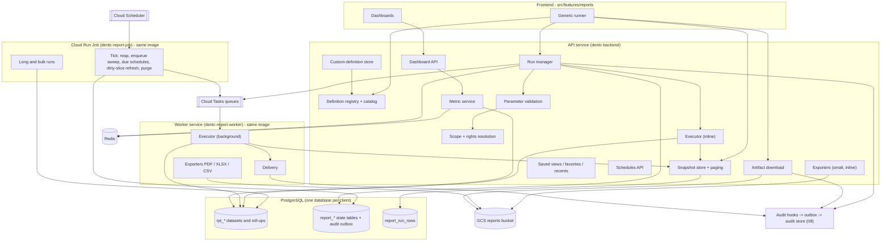
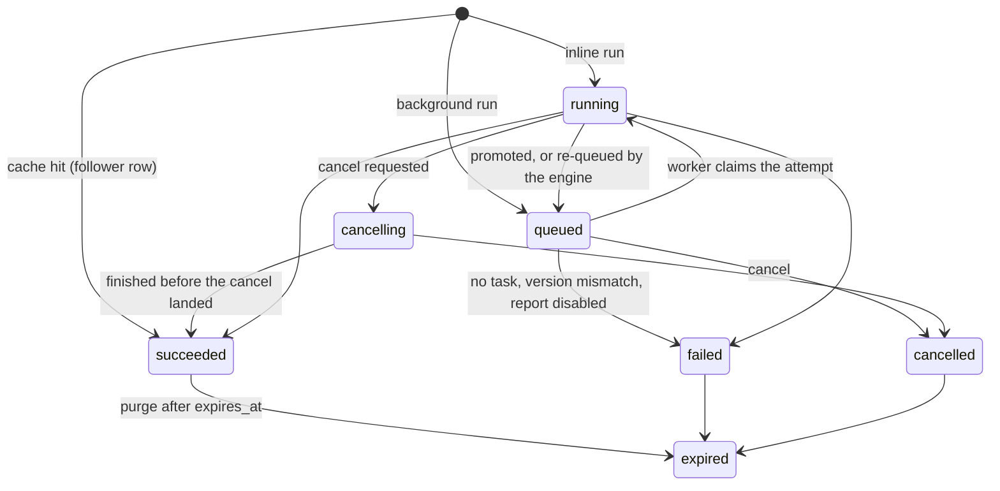

# 02 — Report engine architecture

Design document for the server-side report engine of the Reports & Analytics module. Written against
`00_design_brief.md` (decisions AD-1..AD-12, defaults PD-1..PD-15, phases P0..P5). Baseline path: research
architecture A then B (`research/reporting_architecture_options.md` §12.5).

| Owns | Does not define (owner) |
|---|---|
| Definition registry and schema, parameter validation pipeline, scope / rights call sites, executor, result model, run lifecycle, snapshots, exports, saved views / favorites / recents, schedules and delivery, engine side of metrics and dashboards, custom-definition store, worker topology, engine tables (`report_*`), API surface, testing strategy | `rpt_*` datasets, roll-ups, date and attribution rules (`03_data_foundation.md`) · parameter types, components, option sources, relative-date tokens (`04_filter_framework.md`) · metric formulas (`05_metric_catalog.md`) · dashboard, worklist and assistant content (`06_dashboards.md`) · UI (`07_ux_blueprint.md`) · right codes, data-class vocabulary, audit store and retention (`08_security_compliance.md`) · per-report columns and legacy mapping (`catalog/<category>.md`) |

**Evidence tags.** **[V]** read in the code while writing this document (path and line given; backend paths are relative
to `dentc-backend/`). **[A]** taken from an analysis document (cited). **[R]** taken from a research document (cited).
**[U]** platform behaviour not verified anywhere; settled by spike ENG-21. **[I]** design judgement of this document.
**NEW** = does not exist today. Names of other documents' objects (dataset columns, parameter type names, right codes,
data classes) used in examples are provisional and marked so.

---

## 1. Goals, non-goals and hard constraints

### 1.1 Goals

| # | Goal | Measured by |
|---|---|---|
| G1 | One execution path for every report: 118 legacy reports, worklists, drill lists, tenant custom reports (AD-1) | No report endpoint outside the engine after P3, except the documents listed in §14 |
| G2 | A report is data: a registered definition served as JSON; one generic frontend runner renders it (AD-2) | A new standard report needs zero frontend code and zero new routes |
| G3 | Tenant, office set, provider restriction, rights and column data classes are applied in one place, for run, view, drill, export, schedule and delivery (AD-7) | One function `report_authz.authorize()`; every block statement contains a scoped dataset handle, dimensions are join-only (§4.2) |
| G4 | Screen, PDF, XLSX and CSV show the same rows and totals (AD-5, AD-6) | Every output is rendered from the run snapshot, which holds display-final values read in one database snapshot (§4.8, §6.1); never from a second query |
| G5 | Report load never degrades chairside API traffic | Dedicated small pool with a 2 s pool timeout, per-run timeouts, admission limits for runs, renders and analytics from P0, background lanes |
| G6 | Every run, view, export, print and delivery is reconstructible (AD-7) | `report_runs` row + audit event written in the same transaction as the state change, with resolved parameters, scope, row count and patient manifest (§6.3) |
| G7 | Runs in a developer checkout with no cloud service | `REPORT_QUEUE_BACKEND=inprocess`, `REPORT_STORAGE_BACKEND=local`, `REPORT_NODE_SCOPE` keeps one developer's runs apart on a shared database (§12.3) |
| G8 | Nothing built in P0 is discarded later | Registry, executor, run pipeline and exports are a strict subset of the P4/P5 system |

### 1.2 Non-goals

| Non-goal | Where it lives instead |
|---|---|
| Defining datasets, money normalisation, indexes, roll-up refresh | `03_data_foundation.md` |
| Defining KPI formulas or dashboard content | `05_metric_catalog.md`, `06_dashboards.md` |
| External OLAP / BI product, free SQL for users, cross-organisation benchmarking | Out of the core plan (AD-3, PD-13, PD-14) |
| Letters, postcards, labels, blank forms, ADA claim form, single-patient documents | Owning features; the hub links to them and feeds them through bulk actions (PD-15, §3.10) |
| PHI in e-mail bodies or attachments | Never; link-only delivery (PD-12, §9) |
| Streaming a database cursor through the API service | Never; exports are files written by the run and downloaded (§7) |

### 1.3 Hard platform constraints

| # | Constraint | Evidence | Consequence for the design |
|---|---|---|---|
| C1 | Every pooled connection sets `statement_timeout = 30 s` and `idle_in_transaction_session_timeout = 60 s`; no isolation level is set, so every statement takes its own snapshot (READ COMMITTED) | [V] `app/db/session.py` L18-35; `DB_STATEMENT_TIMEOUT_MS` `app/core/config.py` L49 | Inline statement budget is 5 s / 15 s (§4.9). The report engine sets REPEATABLE READ itself (§4.8). Fetch, end the transaction, then render. The request session's own transaction is ended before execution starts (§4.1 step 7). The worker uses a longer per-run timeout |
| C2 | Sync SQLAlchemy 2 on psycopg2; `def` handlers run in the Starlette threadpool; no async engine | [V] `app/db/session.py` L18-27; [A] `analysis/be_platform.md` §2.1 | One inline run holds one thread, one `report_engine` connection and short state transactions on the main pool; admission limits are a P0 deliverable (§5.6) |
| C3 | gunicorn `--timeout 120` is hard-coded in the image; Cloud Run request timeout documented as 120 s; one API instance is 2 vCPU / 2 GiB shared by two worker processes | [V] `Dockerfile` L24-31; [A] `be_platform.md` §8 | Inline wall-clock budget 25 s (45 s until P2). Rendering never shares the run request and is limited to one render per process (§7.1). The worker service needs `GUNICORN_TIMEOUT` (ENG-02) and its own Cloud Run timeout |
| C4 | Pool 10 + 20 per worker process, 2 processes, up to 10 instances per client; one Cloud SQL instance shared by all clients; no read replica | [A] `be_platform.md` §2.1, §8 | Reports use a separate small pool (`report_engine`, §4.8). Queue lane caps are set per client and summed against the shared instance (§12.5) |
| C5 | Cloud Run, one service + one database + own buckets + own `REDIS_DB` per client organisation; Cloud SQL, Memorystore and VPC are shared; every client database starts at `tenant_id = 1`, `user_id = 1`; CI migrates and deploys only the main client | [V] `.github/workflows/deploy-cloud-run.yml`; [V] `docs/onboarding/NEW_CLIENT_DATABASE.md` L9-18, L354-360; [A] `be_platform.md` §8 | Every new infrastructure piece is per client: provisioning is scripted (ENG-46). Migrations are additive; every capability sits behind a settings flag that defaults to off, and unsafe combinations are refused at start-up (§12.4). `REDIS_DB` separates keys, not Pub/Sub channels [U]: the messaging bus needs a client namespace before the engine publishes on it (ENG-56) |
| C6 | No job queue, worker or scheduler exists; `BackgroundTasks` is used once; CPU is request-scoped on Cloud Run | [A] `be_platform.md` §3.1, §3.4 | Background work runs on a separate worker service or job; never on threads of a deployed API service (§12). The `inprocess` backend is for developer machines only and is refused outside `ENV = dev` |
| C7 | Memorystore is basic tier, no persistence; every Redis helper fails open | [V] `app/integrations/redis_store.py` L167-219; [A] `be_platform.md` §4 | Run state, schedules and deliveries live in PostgreSQL. Redis holds only disposable caches and version counters; a lost counter update is bounded by the cache lifetime (§5.4) |
| C8 | Fact tables carry no `tenant_id` | [A] `be_platform.md` §2.4 | Builders never touch OLTP tables. They read `rpt_*` datasets and dimension views, which must expose `tenant_id` (§4.2) |
| C9 | Test suite is in-memory SQLite built with `Base.metadata.create_all`; caller is a seeded `super_admin`; the deploy workflow has no test step; client databases are a schema dump plus stamp plus `alembic upgrade head`, and the revision chain cannot build an empty database | [V] `tests/conftest.py` L82-105, L119; `alembic/env.py` L26; `NEW_CLIENT_DATABASE.md` L72-98; workflow file | A PostgreSQL test tier built the same way (baseline dump, then `alembic upgrade head`) and a CI test job are P0 deliverables (ENG-17). Dataset `Table` objects live on their own `MetaData`, never on `Base.metadata` (§4.2) |
| C10 | Schema has no views, functions, extensions; `ruff` rule set `S` flags string-built SQL | [A] `be_platform.md` §2.2-2.3; [V] `pyproject.toml` | Builders are SQLAlchemy Core only. No `text()` with interpolation anywhere under `app/reports/` (§4.3) |
| C11 | Timestamps are naive UTC; each office has `offices.timezone`; helper `office_today()` | [V] `app/core/datetimes.py` L31-53 | Every date-basis column a report filters on is an office-local `DATE` supplied by the dataset (§4.7) |
| C12 | CORS exposes only `X-Request-ID`, `X-Process-Time` | [V] `app/main.py` L88-103 | Add `Content-Disposition` to `expose_headers` (ENG-02) |
| C13 | Non-streamed HTTP/1 responses are capped at 32 MiB on Cloud Run | [R] `reporting_architecture_options.md` §3.6 | Downloads are chunked `StreamingResponse` from object storage (§7.6) |
| C14 | `fastapi>=0.110` is unpinned; yield-dependency timing changed in 0.106, 0.118, 0.121 | [V] `requirements.txt`; [R] same §3.6 | Pin FastAPI (ENG-02). No response body ever depends on the request's database session |
| C15 | Frontend axios has no timeout, the access token lives 60 min and is never refreshed. `X-Office-ID` rides every request but never changes which rows a read returns, because generated query keys are `[url, params]` | [A] `analysis/fe_cross_cutting.md` §3.2, §8 R9; [V] `src/features/office-scope/officeHeader.ts` L4-12, `src/services/api.ts` L21-36 | No blocking request longer than the inline budget; long runs are polled. The working office reaches the engine as an explicit `working_office_id` body field; the header is not a functional input (AD-12, §4.7) |
| C16 | `AuditMiddleware` writes a generic `audit_logs` row for every authenticated 2xx POST / PUT / PATCH / DELETE, synchronously inside the async `dispatch`, with `resource_type` = first path segment; it buffers a POST's JSON body (up to 256 KB) to find an `id` unless the handler recorded `resource_id` | [V] `app/middleware/audit.py` L41-90, L142-176; `app/services/audit_service.py` L19-61 | Mutating engine handlers call `audit_context.record(resource_id=<run_id>, office_id=…)`. Read-type POSTs (parameter and spec validation, drill, live page, saved-view resolve, metric query and drill, dashboard data, assistant; §13) call `audit_context.record(skip_generic=True)`, a NEW flag the middleware honours by returning before body buffering and `write_audit` (ENG-14); their engine event is the only record |
| C17 | A Cloud Run container's writable file system is backed by instance memory [U] | Platform behaviour, not stated in the repository (ENG-21) | CSV and NDJSON stream straight to the bucket; XLSX temporary files are counted in the memory budget and limited by cells (§7.3, §12.5) |
| C18 | User, rights and office assignments are read from PostgreSQL on every request (1 + 2 + 2 + 1 statements, pre-ping on each pool checkout); Cloud Run is in `us-central1`, Cloud SQL in `us-east1` | [V] `app/api/deps.py` L49-58, `app/services/permission_service.py` L101-120, L154-180, workflow L14-20; [A] `be_platform.md` §1.2, §2.1 | One caller profile per request (`load_run_caller`), ownership-only check on status polls, single-write path for small instant runs, round-trip budgets measured from Cloud Run (§5.4, §6.1, §15.6) |
| C19 | Account and office logos are files written to `UPLOAD_DIR` on the instance that received the upload; `resolve_letterhead` returns a logo only when that file exists locally | [V] `app/services/account_service.py` L57-78, `office_setup_service.py` L421-437, `print_service.py` L185-196 | A worker, a job or a later revision never has the file: logos move to object storage before any server-rendered report PDF ships (ENG-60, §7.2) |

---

## 2. Component map



All engine code is **NEW**. Package `app/reports/` (engine) and `app/analytics/` (metric and dashboard side); thin routers
`app/api/v1/report_engine.py` (prefix `/reports`, tag `Reports`), `app/api/v1/analytics.py` (prefix `/analytics`, tag
`Analytics`), `app/api/internal/reports.py` (worker-only); ORM models `app/db/models/reporting.py`; schemas
`app/schemas/report_engine.py`, `app/schemas/analytics.py`. This follows the module layout in `be_platform.md` §10; a
package instead of one `*_service.py` file is a deliberate deviation because of size.

| Component | Module (NEW) | Responsibility | Reuses | Replaces |
|---|---|---|---|---|
| Definition registry | `app/reports/definitions/schema.py`, `registry.py`, `definitions/<category>/<report>.py` | Code-first `ReportDefinition` objects, import-time registration, JSON serialisation, derived definitions (`derive()` for the five My Reports) | Registry-as-data pattern of `app/api/v1/registry.py`; start-up uniqueness check precedent `_assert_unique_operation_ids` ([A] `be_platform.md` §1.1) | Frontend `ReportDefinition` with functions (`src/components/reports/types.ts`, [A] `fe_existing_reports.md` §2.1) |
| Parameter validation | `app/reports/params/pipeline.py`, `expr.py` | Unknown-key rejection, type handlers (registered by the filter framework), `enabled_when` / `forced_when`, relative-date and office-token resolution, reference checks, canonical form for hashing | Error codes `invalid_date_range`, `range_too_large` ([V] `app/services/time_clock_service.py` L1329-1334); `ValidationError` class ([V] `app/core/exceptions.py` L62) | Ad-hoc `Query(...)` params of `app/api/v1/reports.py` |
| Scope and rights resolution | `app/reports/scope.py`, `app/reports/authz.py`, `app/reports/caller.py` | Build the caller profile once per request (`load_run_caller`); resolve office set, provider restriction and data-class profile once per run; one `authorize(caller, definition, action, run)`; `can_view_run` | `OfficeScope.assigned_ids`, `can_view_all()`, `office_group_office_ids` ([V] `app/services/office_scope_service.py` L120-166); `effective_permissions`, `has_strict` ([V] `app/services/permission_service.py` L146-180). Not reused: `validate_target_office`, `require_all_offices`, `resolve_list_office_filter`, which pass every caller with zero office assignments ([V] L168-178, L246, L280, L350; §4.1) | Unvalidated `office_id` of `/reports/*` ([V] `app/api/v1/reports.py` L33-110) |
| Executor | `app/reports/exec/context.py`, `executor.py`, `banding.py`, `pivot.py` | Builder invocation, scoped dataset handles, timeouts, streaming fetch, sort, limits, groups / subtotals / totals, pivot | `app/services/ledger_sign.py` rule is applied inside `rpt_*` (03), not here | `report_service` metric functions, `transactions_service` in-memory feeds ([A] `be_existing_reporting.md` §5.2) |
| Result model | `app/reports/result.py`, `app/schemas/report_engine.py` | Blocks, resolved columns, positional rows with row kinds, totals, summary cards, chart series, warnings, criteria echo | `PaginatedResponse` conventions only for flat lists | Per-endpoint Pydantic models (`ReportSummary`, `Aging`, …) |
| Snapshot store | `app/reports/snapshot.py`, table `report_run_rows` | Write rows once per run; page, sort and search them; purge | `PatientStatement` frozen-snapshot precedent ([A] `be_existing_reporting.md` §5.2) | Client-side row caches capped at 600-1,600 rows |
| Exporters | `app/reports/render/pdf.py`, `pdf_layouts/*.py`, `xlsx.py`, `csv.py`, `fonts/` | PDF, XLSX, CSV from a snapshot | `app/services/pdf_report.py` kit after the refactor of §7.2 ([V] L37-67, L177-610), `print_service.resolve_letterhead` ([V] L200-266) | Frontend jsPDF / SpreadsheetML / CSV exports; `PatientReport` patient-shaped header for office-wide reports |
| Run manager | `app/reports/runs/manager.py`, `queue.py`, `worker.py`, `heartbeat.py`, `reaper.py`; table `report_runs` | Admission, lazy reaping, de-duplication, inline execution, promotion, enqueue, claim, heartbeat, fencing, retry, cancel | Row shape of `utility_runs` ([V] `app/db/models/platform.py` L40-57); polling contract of `GET /utilities/jobs/{job_id}` | Nothing (no executor exists; `utility_service.submit_run` records `completed` without running, [V] `app/services/utility_service.py`) |
| Scheduler and tick | `app/reports/schedules/service.py`, `app/reports/tick.py`, `scripts/run_report_tick.py`; tables `report_schedules`, `report_schedule_recipients` | Tick job: reap, enqueue sweep, due schedules, dirty-slice refresh, purge; idempotent run creation, next occurrence | Cron-script entry-point pattern (`scripts/run_sms_reminders.py` and three others, [V] `scripts/`) | Nothing |
| Delivery | `app/reports/delivery.py`; table `report_deliveries` | In-app notification, e-mail with a login-gated link, skip rules, per-recipient authorisation | `notifications` table and `/users/me/notifications` ([V] `app/db/models/access.py` L46-61, `app/api/v1/users_extended.py` L143); `send_email(to, subject, body)` and `active_transport()` ([V] `app/integrations/email.py` L172-200); `redis_store.publish` ([V] `app/integrations/redis_store.py` L241-257) | `statement_service.deliver` intent-only pattern stays for patient statements |
| Cache | `app/reports/cache.py` | Run cache keys, data-version markers fed by SQLAlchemy session events, metric result cache, single-flight | `cache_get` / `cache_set` / `cache_delete` ([V] `redis_store.py` L167-198); NEW helper `redis_store.bump_version` | `report_service._cache_key` without caller scope ([V] `app/services/report_service.py` L60-62) |
| Audit hooks | `app/reports/audit.py`; table `report_audit_outbox` | Write `report.*` events with parameters, scope, counts, manifest reference in the transaction of the state change; set `audit_context` | `audit_context.record` ([V] `app/core/audit_context.py` L48-69), `record_print` shape ([V] `print_service.py` L320-338) | Unaudited JSON roll-ups; client-side exports |
| Metric service | `app/analytics/metrics/service.py`, `compiler.py` | Execute metric queries (key, dimensions, grain, comparison) over live datasets or roll-ups | Metric registry objects from 05; scope resolution and cache from this engine | `/reports/summary`, `/reports/trends`, `/dashboard/summary` computations |
| Dashboard API | `app/analytics/dashboards/service.py` | Serve dashboard definitions; evaluate all tiles of a dashboard in one call | Metric service | `/dashboard/summary` per-office loop ([V] `app/api/v1/dashboard.py` L93-102) |
| Custom-definition store | `app/reports/custom/store.py`, `compile.py`; table `report_custom_definitions` | Store, validate and compile tenant-defined report specs into `ReportDefinition` objects | Metric registry field lists; same run pipeline | Legacy "Office Reports" slot |

Engine tables (complete list; all NEW, all in `app/db/models/reporting.py`): `report_runs`, `report_run_rows`,
`report_artifacts`, `report_patient_manifests`, `report_audit_outbox`, `report_saved_views`, `report_shares`,
`report_favorites`, `report_recents`, `report_schedules`, `report_schedule_recipients`, `report_deliveries`,
`report_custom_definitions`, `report_tenant_settings`. Conventions: `sqlalchemy.Uuid` primary keys with `default=uuid7`
for runs and artifacts (precedent [V] `app/db/models/messaging.py` L57, `app/core/ids.py` L33); integer keys elsewhere;
naive-UTC `TIMESTAMP` columns serialised through `UtcDatetime` ([V] `app/core/datetimes.py`); partial indexes declared
with `postgresql_where` / `sqlite_where` twins (precedent [V] `app/db/models/staff.py` L46-47). A unique key that
contains a nullable column is declared as partial unique indexes, one per non-null shape, because PostgreSQL and SQLite
both treat NULLs as distinct. Every engine table carries `tenant_id`, except the child tables `report_run_rows` and
`report_schedule_recipients`, which are reached only through their tenant-checked parent; every look-up by id also
filters `tenant_id`, because a second tenant can exist in a client database (open `POST /auth/signup`, [V]
`NEW_CLIENT_DATABASE.md` L338-340).

---
## 3. The report definition schema

One `ReportDefinition` per catalog entry. Written as Python objects (`app/reports/definitions/schema.py`, frozen
dataclasses), registered at import, validated by the definition lint (§15.4), serialised to snake_case JSON by
`GET /api/v1/reports/definitions/{report_key}`. "Served" = present in that JSON. Builders, dataset handles, escalation
rules and cache policy never leave the server. The frontend maps `icon_key`, `type`, `shape`, `layout` and `kind`
strings to local components; an unknown value must fail the frontend contract test (§15.5), not render blank.

### 3.1 Report

| Field | Type | Served | Meaning |
|---|---|---|---|
| `report_key` | str | yes | `<category>.<report>`; regex `^[a-z][a-z0-9_]*\.[a-z0-9][a-z0-9_]*$` (same as `tools/validate_parity.py`). Immutable; used in URLs, favorites, schedules, audit |
| `definition_version` | int ≥ 1 | yes | Bumped on any change to parameters, columns, formats or builder SQL. Part of cache keys, saved views, run rows and audit events |
| `definition_hash` | str | yes | SHA-256 of the complete served JSON, computed before any per-caller filtering and without `access`. The lock file also holds `sql_hash` per report format (compiled SQL of the lint's dry builds); the lint fails when either hash changes and the version does not (§15.4) |
| `param_migrations[]` | `[{from_version, rename_key \| map_value \| drop}]` | no | How stored parameters of an older version become valid again: `rename_key{from, to}`, `map_value{key, from, to}`, `drop{key}`. Required by the lint when a parameter key or an option value disappears (§8.2, §15.4) |
| `category`, `subcategory` | enum, str \| null | yes | Category keys of brief §4. `subcategory` ∈ `patient`, `provider`, `security`, `setup` for `lists` |
| `kind` | `standard` \| `worklist` \| `custom` | yes | `custom` = compiled from `report_custom_definitions` (§11) |
| `title`, `title_templates[]` | str, `[{when, title}]` | yes | Printed title derived from the criteria, first match wins (legacy behaviour, [R] `legacy_report_outputs_daily_my.md` §8 item 2) |
| `legacy_names[]` | str[] | yes | Exact legacy name plus older names; searchable aliases (AD-8) |
| `legacy` | `{folder, report_id}` \| null | yes | Pointer into `legacy/index/<folder>.controls.json` (ids from `tools/make_control_index.py`) |
| `legacy_unmapped[]` | `[{control_id, status, note}]` | yes | Legacy controls that map to no parameter, with a status of `tools/validate_parity.py` (`help_text`, `superseded`, `not_applicable`, `unknown_legacy`) |
| `legacy_actions[]` | `[{legacy_action, maps_to, note}]` | yes | Every footer action of the legacy screen (`actions` of the control index). `maps_to` ∈ `run`, `run_format:<value>`, `print`, `action:<key>`, `saved_view`, `frontend`. Generic defaults: `PRINT / PREVIEW` → `print`, `CLEAR CRITERIA` → `frontend`, `ADD TO MY FAVORITES` / `UPDATE MY FAVORITES` → `saved_view`; any other action must be listed (Statements: §14) |
| `description`, `keywords[]`, `icon_key` | str | yes | Catalog card, search, icon lookup |
| `right_code` | str | yes | Code (owned by 08) that grants run + view. Optional `action_right_codes{print, export_pdf, export_xlsx, export_csv, schedule, share, commit}` override the category defaults (PD-10) |
| `access` | object | yes, per caller | `{can_run, can_print, can_export, can_schedule, can_share, can_commit, hidden_data_classes[], hidden_parameters[]}` computed by `report_authz` |
| `cost_class` | `instant` \| `interactive` \| `background` | yes | §4.9. `escalate_when[]` (server only) raises it per run |
| `side_effects` | `none` \| `writes` | yes | `writes` = the run stores business rows through a `commit_builder` (statements). Such a definition is never cached or shared, needs `action_right_codes.commit`, and may be set per report format (§5.9) |
| `paging_mode` | `snapshot` \| `live` | yes | `live` = keyset paging straight from the dataset, for worklists (§4.6) |
| `datasets[]` | str[] | yes | `rpt_*` dataset keys (relations and table functions) the builders may read. Drives the data-version marker, `freshness` and lint |
| `freshness` | `live` \| `intraday` \| `nightly` | yes | Derived from the datasets' sources |
| `scope` | object | yes | `office_mode` (`required` \| `optional` \| `none`), `office_attribution`, `provider_attribution`, `provider_restriction` (`none` \| `self_unless_privileged` \| `self_always`). Attribution vocabularies are owned by 03, the restriction rule by 08 |
| `date_basis` | str \| null | yes | Fixed date basis when the report has no `date_basis` parameter (AD-9) |
| `parameters[]` | Param[] | yes | §3.2 |
| `report_formats[]` | ReportFormat[] | yes | §3.7. A report without a legacy REPORT FORMAT control has one format `standard` |
| `outputs` | Outputs | yes | §3.8 |
| `drill_targets[]`, `row_actions[]`, `bulk_actions[]` | | yes | §3.9, §3.10 |
| `limits` | object | yes | `max_rows_inline`, `max_rows`, `max_rows_export`, `max_date_span_days`, `max_pivot_columns` (defaults in §4.5) |
| `schedulable` | bool | yes | False for per-record documents, worklists and definitions with `side_effects = writes` |
| `empty_when` | `{block, test, column}` | no | When a run counts as empty for `skip_if_empty` (§9.2). `test` ∈ `no_detail_rows` (default, on the main block), `total_is_zero` (grand total of `column`). Needed for day sheets, summaries and key-value blocks, which always have rows |
| `availability[]` | `[{code, message, applies_to}]` | yes | What is impossible for migrated history (brief §8). Matching entries are returned as run warnings and printed in the criteria block |
| `cacheable`, `cache_ttl_seconds` | bool, int | no | §5.4. `cacheable` defaults to false; a definition opts in |
| `reconciles_with[]` | `[{block, column, metric_key}]` | no | Totals that must equal a metric for the same parameters (§15.3) |
| `phase`, `status` | `P0`..`P5`; `active` \| `beta` \| `hidden` \| `deprecated` | yes | `deprecated` definitions stay runnable for one release and flag saved views and schedules |

### 3.2 Parameter

| Field | Type | Meaning |
|---|---|---|
| `key` | str | snake_case, unique in the definition |
| `type` | str | Type name from `04_filter_framework.md`. Provisional names used here: `enum`, `enum_multi`, `boolean`, `date`, `date_range`, `office_scope`, `provider_multi`, `user_multi`, `entity_single`, `entity_multi`, `code_set`, `definition_multi`, `int_range`, `money_range`, `name_range`, `text` |
| `value_keys[]` | str[] | Keys this parameter contributes to the flat `params` object. Default `[key]`. `office_scope` → `office_ids`, `office_group_id`, `all_offices`; `date_range` → `date_from`, `date_to`, `date_preset`; ranges → `<key>_from`, `<key>_to` |
| `label`, `help_text` | str | Display |
| `section` | str | Legacy section title verbatim (`DATE RANGE`); the runner groups by it |
| `order` | int | Position in the form |
| `role` | `query` \| `layout` \| `output` | `query` values reach the builder and the cache key. `layout` (`page_break_by`) and `output` (`output_format`) only affect rendering: changing them reuses the snapshot |
| `default` | literal \| token object | Equals the legacy default (AD-8). Tokens: `{"token": "working_office"}`, `{"date_preset": "today"}`, `"all"`, `"none"` |
| `default_differs_reason` | str | Required when the default deliberately differs from legacy (same rule as `tools/validate_parity.py`) |
| `options[]` | Option[] | `{value, label, legacy_label, enabled_when, description}` for enum types |
| `options_source` | str | `static` or `lookup:<source_key>` (source keys owned by 04), with `depends_on[]` value keys |
| `required`, `required_when` | bool, expr | Missing → 422 `parameter_required` |
| `enabled_when`, `visible_when` | expr | False → the value is replaced by `disabled_value` (default: `default`) before hashing and execution, so greyed legacy controls cannot influence the result |
| `forced_when[]` | `[{when, value}]` | Legacy locked states (REPORT FORMAT locked to Summary) |
| `validation` | object | `min`, `max`, `max_items`, `max_span_days`, `pattern`, `max_length` |
| `accepts_all`, `accepts_none` | bool | Whether `"all"` (legacy `ALL`) and `"none"` (legacy `None`) are legal values of a multi-select |
| `data_class` | str | Class needed to use the parameter. Default: the most restrictive class among the dataset columns its value keys are applied to, recorded by `ctx.*_filter` during the lint's dry builds; a declaration may only raise it. A caller without the class does not receive the parameter (`access.hidden_parameters[]`) and the value is forced to `disabled_value`, so a hidden column cannot be probed through a filter (age range against a hidden date of birth, money range against a hidden amount) |
| `legacy_control_ids[]` | str[] | Ids `<folder>.rNN.sNN.cNN`. Every legacy control maps to exactly one parameter, or is listed in the definition's `legacy_unmapped[]` with a note |
| `legacy_option_map{}` | `{legacy_label: value \| value_key}` | For composite types whose legacy options select a member of the parameter instead of an enum value (OFFICE/GROUP radio `Office` / `Office Group` → `office_ids` / `office_group_id`). Satisfies the "Options and defaults" lint rule where no `Option` can carry the legacy label |
| `legacy_note` | str | For legacy controls that only appear in dynamic states and are absent from the screenshot inventory |

Expression grammar for `enabled_when`, `visible_when`, `required_when`, `forced_when.when`, `title_templates.when` and
column `visible_when`. JSON arrays; evaluated by `app/reports/params/expr.py` and a TypeScript twin with shared test
vectors (ENG-04). No arithmetic, no function calls. Which rule applies to which control is owned by 04 and `catalog/`.

| Form | Meaning |
|---|---|
| `["eq" \| "ne" \| "gt" \| "gte" \| "lt" \| "lte", <value_key>, <literal>]` | Compare a normalised parameter value with a literal |
| `["in" \| "not_in", <value_key>, [<literal>, …]]` | Membership |
| `["truthy" \| "falsy" \| "empty" \| "not_empty", <value_key>]` | Boolean and emptiness tests (`"all"` is not empty) |
| `["and" \| "or", <expr>, <expr>, …]`, `["not", <expr>]` | Combination |
| `["ctx", "multi_office" \| "provider_restricted"]` | Run-context facts set by scope resolution |

### 3.3 Column

| Field | Type | Meaning |
|---|---|---|
| `key`, `label` | str | `label` may contain `{value_key}` or resolved-name placeholders (`{compare_fee_schedule_name}`) |
| `type` | `text` \| `integer` \| `decimal` \| `money` \| `percent` \| `date` \| `datetime` \| `time` \| `duration` \| `boolean` \| `enum` \| `id` | Wire encoding, identical in the snapshot (§6.1): money and decimal are strings already quantised to `format.decimals` (`"1234.50"`), percent is a fraction string quantised to `decimals + 2` places, dates ISO, datetimes ISO-8601 with numeric offset in the zone named by `format.tz` (default `office`: the local time of the row's office). Values are display-final: no renderer rounds or converts a zone |
| `format` | object | Per type: money `{decimals, symbol, negative: minus \| parentheses}`, percent `{decimals}`, date `{pattern}`, datetime `{pattern, tz: office \| utc}`, duration `{unit}`, enum `{labels}`. Rounding mode is `ROUND_HALF_UP`, applied once by the banding step |
| `align`, `width` | str, number | `width` is a relative weight; drives PDF column widths (fixed widths render faster, [R] `reporting_architecture_options.md` §7.1) |
| `data_class` | str | Class from 08 (working vocabulary [R] `compliance_and_financial_semantics.md` §3.3). Mandatory on every column a builder returns, hidden ones included; there is no default. A denied class on a key column (row dimension, group key or its label column) refuses the run with 403 `data_class_denied`; on any other column the column is dropped from query, snapshot and every export. A computed column or derived total takes the most restrictive class of its inputs (derived by the serialiser, never declared). A sort option, summary card, chart or drill target that references a dropped column is removed from the served definition |
| `total` | TotalSpec | `{fn, args, label}`; `fn` ∈ `sum`, `count`, `count_distinct`, `min`, `max`, `avg`, `ratio`, `weighted_avg`, `share_of_parent`, `label`, `none` |
| `computed` | spec (server only) | `ratio(a, b)`, `difference(a, b)`, `share_of_parent(a)`: evaluated by the banding step for rows, subtotals and grand totals with one rule and a zero-denominator guard, from unrounded components, then quantised. `share_of_parent` only in summary blocks |
| `visible_when`, `default_visible` | expr, bool | Parameter-driven presence; column-chooser default |
| `hidden` | bool | Carried in the snapshot for drill, actions, sorting and group labels; never displayed or exported as a column. Group keys, sort-only keys and the `row_id_column` are declared this way: every label a builder returns is a declared column |
| `entity` | `{entity, id_column}` | Marks a cell as a link to a record and feeds the patient manifest (`entity = patient`) |
| `drill` | str | Key of a drill target (§3.9) |
| `sortable` | bool | Snapshot re-sort allowed on this column (flat blocks only, §6.2) |
| `null_display`, `description` | str | Empty-cell text (never `0` for no data); header tooltip |
| `export` | `{pdf, xlsx, csv}` | Per-output inclusion; default all true |

### 3.4 Grouping and subtotals (per block)

| Field | Meaning |
|---|---|
| `fixed_outer[]` | Group levels always applied, with an optional `when` (`["ctx", "multi_office"]`): the legacy `Office : <name>` band |
| `options[]` | Values of the `group_by` parameter: `{value, label, legacy_label, levels[]}` |
| level: `key_columns[]`, `label_columns{}`, `header_template`, `subtotal`, `subtotal_label_template`, `sort[]`, `page_break_allowed`, `trailer_blocks[]` | One group level. `key_columns` are declared (hidden) columns of the block. A key column belongs to the resolved block only while its level is active. `label_columns{placeholder: {dim, column}}` (server only) names the dimension attribute behind each template placeholder (`{office_name}` ← `rpt_office_dim.office_name`); the executor resolves them once per run inside the run transaction, so builders select keys only. `trailer_blocks` names blocks repeated after each group (per-provider adjustment list) |
| `max_levels` | Default 3 |
| `grand_total` | `{enabled, label}` |
| `subtotal_position` | `after` (default) or `before` |

### 3.5 Sort options (per block)

| Field | Meaning |
|---|---|
| `sort_options[]` | Values of the `sort_by` parameter: `{value, label, legacy_label, keys: [{column, dir, nulls}]}`. Every key is a declared column of the block (visible, or `hidden` for a sort-only key such as a last name). A sort value maps to column objects on the server; a client string never reaches `ORDER BY` |
| `default_sort` | Used when the report has no `sort_by` parameter: a sort option value or an inline key list |
| `row_id_column` | Mandatory tie-breaker for detail blocks, a declared hidden column; makes order deterministic and keyset paging possible |

### 3.6 Page-break options

| Field | Meaning |
|---|---|
| `page_break_options[]` | Values of the `page_break_by` parameter (role `layout`): `{value, label, legacy_label, level}`, `level` ∈ `none`, `group`, `office`, or a group level key |
| effect | PDF: `PageBreak` between groups of that level. XLSX: one sheet per group when `xlsx.sheet_per_page_break`. Screen and CSV: none. No new run |

### 3.7 Report format variants and blocks

| Field | Meaning |
|---|---|
| `report_formats[]` | Values of the `report_format` parameter: `{value, label, legacy_label, enabled_when, blocks[], cost_class, side_effects, summary_cards[], charts[]}`. `cost_class` and `side_effects` may override the report's (a detail format is usually heavier; only the document format of a statement run writes) |
| `blocks[]` | Ordered result blocks. One block for a plain list; legacy day sheets and journals have several (detail table + summary block; per-group adjustment list) |
| block: `key`, `title`, `shape` | `shape` ∈ `table`, `matrix`, `key_value` |
| block: `placement` | `main`, `report_start`, `report_end`, `after_group` |
| block: `columns[]`, `grouping`, `sort_options[]`, `default_sort` | §3.3-§3.5 |
| block: `pivot` | For `matrix`: `{row_keys[], column_key, column_label_key, value_columns[], column_order, max_columns, row_totals, column_totals}` (§4.4) |
| block: `builder`, `totals_builder` | Server only. `builder(ctx) -> Select` or, for the service-backed reports on the lint's whitelist, `python_builder(ctx) -> Iterable[row]` (contract in §4.2; §14, time clock) |
| `summary_cards[]` | `{key, label, block, column, format, drill}`: the value is a block total of the same run and nothing else, so a card can never disagree with the table below it. Equality with a metric is a test (`reconciles_with`), not a second query |
| `charts[]` | Hints `{key, kind, block, category_column, value_columns[], top_n}`; series are computed on the server from the snapshot |

### 3.8 Outputs

| Output | Fields | Meaning |
|---|---|---|
| `screen` | `default_page_size`, `density` | Always present |
| `pdf` | `enabled`, `layout`, `orientation` (`portrait` \| `landscape` \| `auto`), `page_size`, `font_size`, `letterhead`, `criteria_echo` (`footer` \| `header` \| `none`), `repeat_header`, `totals_on_last_page`, `max_rows`, `record_per_page`, `volume_size`, `sectioned_page_numbers` | `layout` is a renderer key (§7.2): `banded_table`, `day_sheet`, `journal`, `slip`, `statement`, or a report-specific key. `criteria_echo = footer` reproduces the legacy page furniture. `volume_size` (documents per file) applies to `record_per_page` layouts, which are split into volumes instead of being refused above `max_rows` |
| `xlsx` | `enabled`, `sheet_name`, `freeze_header`, `autofilter`, `outline_groups`, `sheet_per_page_break`, `criteria_sheet`, `max_cells` | Flat, typed cells; no merged title cells (the weakest point of the legacy export). Blocks other than `main` go to sheets of their own |
| `csv` | `enabled`, `include_header_block`, `delimiter` | UTF-8 with BOM; formula-injection guard always on (§7.4). One block per file: the main block unless the request names another (`options.block`) |
| all | `export_shapes[]` | `current_view` (the caller's sort, quick filter and column choice, all part of the artifact options), `full`, `summary_only` |

### 3.9 Drill-through targets

| Field | Meaning |
|---|---|
| `key`, `label` | Referenced by `column.drill` and `summary_cards[].drill` |
| `kind` | `report` (open another report), `rows` (same report, detail format, filtered to the clicked group: the list that reconciles to the number), `record` (open a patient, claim, appointment, ledger entry) |
| `report_key`, `param_map{}` | Target parameter ← `{"param": k}` (copy), `{"column": k}` (value of the clicked row), `{"group": k}` (group key), `{"literal": v}`. A parameter set through `param_map` counts as enabled and visible in the target run, so a drill can filter by a parameter that the target's form does not offer in that state |
| `record` | `{entity, id_column, route_key}`; `route_key` is resolved by the frontend router |
| `right_code` | Extra right needed for the target (drill to patient rows) |

Resolution is server-side: `POST /reports/runs/{run_id}/drill` reads the ids from the snapshot, authorises the target,
emits `report.drill` and returns `{kind, report_key, params}` or `{kind, entity, id, route_key}`.

### 3.10 Row and bulk actions

| Field | Meaning |
|---|---|
| `key`, `label`, `icon_key` | Display |
| `scope` | `row` or `bulk` |
| `kind` | `navigate` (route), `create_task`, `send_sms`, `send_email`, `letters`, `postcards`, `labels`, `export_selection`, `custom:<handler>` |
| `entity`, `id_column` | Which hidden column supplies the target ids |
| `right_code`, `requires[]` | Right for the action; data prerequisites (`sms_consent`) used for exclusion counts |
| `max_selection`, `confirm` | Limits and confirmation text |
| `legacy_action`, `legacy_control_ids[]` | The legacy footer action or on-screen button this action replaces (`UPDATE STATEMENT DATES`, `PAPER STATEMENT SENT`); checked by the lint like parameter controls |

`POST /reports/runs/{run_id}/actions/{action_key}` receives a selection (`all` or `row_nos[]`), passes the viewer check
(§5.4), resolves the entity ids from the snapshot (never from client-sent ids), calls the handler registered by the
owning feature and audits the hand-off. Handlers for letters, postcards, labels, SMS and tasks belong to those features
(PD-15). An action that writes (statement dates) is idempotent per `(run_id, action_key, entity id)`.

### 3.11 Worked example 1 — `daily.production_report`

Legacy source: Daily Reports › Production Report, 13 controls (`legacy/daily_reports.json`; dynamic states from [R]
`legacy_report_outputs_daily_my.md` A3). Dataset columns are those of `03_data_foundation.md` §2.3, §2.5, §2.9 and §2.11
as that document lists them today. `insurance_carriers` (`name`, [V] `app/db/models/insurance.py` L43-47) and
`fee_schedule_entries` (`fee_schedule_id`, `procedure_code`, `effective_date`, `patient_fee`; unique on the first three,
[V] `app/db/models/codes.py` L178-209) stand for passthrough catalog datasets (03 §2.0, DATA-45). Type names, the right
code and data classes are provisional. Final columns are owned by `catalog/daily.md`.

```python
# app/reports/definitions/daily/production_report.py                                   (NEW)
from sqlalchemy import func, select

from app.reports.definitions.schema import (
    Block, Column, DrillTarget, GroupLevel, GroupOption, Grouping, LegacyRef, Limits, Option, Outputs,
    PageBreakOption, Param, PdfOutput, ReportDefinition, ReportFormat, Scope, SortOption, SummaryCard,
    Total, XlsxOutput, ratio, share_of_parent,
)
from app.reports.exec.context import BuildContext
from app.reports.params.expr import all_of, any_of, ctx_is, eq, ne, truthy
from app.reports.registry import register

L = "daily_reports.r03"                       # legacy/index/daily_reports.controls.json
MONEY = {"decimals": 2, "symbol": False, "negative": "minus"}
AGG, FIN, PHI, COMP = "aggregate", "financial_practice", "phi_identified", "provider_comp"   # provisional (08)

PARAMS = [
    Param("report_format", "enum", "Report format", section="REPORT FORMAT", order=10, default="summary",
          options=[Option("detail", "Detail", enabled_when=eq("production_by", "provider")),
                   Option("summary", "Summary")],
          forced_when=[(ne("production_by", "provider"), "summary")], legacy_control_ids=[f"{L}.s01.c01"]),
    Param("output_format", "enum", "Print format", section="PRINT FORMAT", order=20, default="pdf",
          role="output", options=[Option("pdf", "PDF"), Option("xlsx", "Excel"),
                                  Option("csv", "CSV", legacy_label=None)], legacy_control_ids=[f"{L}.s02.c01"]),
    Param("office_scope", "office_scope", "Office / Office Group", section="OFFICE/GROUP", order=30,
          default={"token": "working_office"}, required=True,
          legacy_option_map={"Office": "office_ids", "Office Group": "office_group_id"},
          legacy_control_ids=[f"{L}.s03.c01", f"{L}.s03.c02"]),
    Param("date_range", "date_range", "Date range", section="DATE RANGE", order=40,
          default={"date_preset": "today"}, required=True, validation={"max_span_days": 366},
          legacy_control_ids=[f"{L}.s04.c01", f"{L}.s04.c02"]),
    Param("production_by", "enum", "Production by", section="PRODUCTION BY", order=50, default="code",
          options=[Option("code", "Code"), Option("provider", "Provider"),
                   Option("category", "Category"), Option("carrier", "Carrier")], legacy_control_ids=[f"{L}.s05.c01"]),
    Param("group_by", "enum", "Group by", section="GROUP BY", order=60, default="none",
          options=[Option("none", "None"), Option("provider", "Provider"), Option("carrier", "Carrier")],
          enabled_when=ne("production_by", "provider"), legacy_control_ids=[f"{L}.s06.c01"]),
    Param("page_break_by", "enum", "Page break", section="GROUP BY", order=61, default="none", role="layout",
          options=[Option("none", "No page break", legacy_label="unchecked"),
                   Option("group", "Page break by group", legacy_label="checked")],
          enabled_when=ne("group_by", "none"), legacy_control_ids=[f"{L}.s06.c02"]),
    Param("procedure_codes", "code_set", "Codes", section="CODES", order=70, default="all", accepts_all=True,
          visible_when=ne("production_by", "provider"), legacy_control_ids=[f"{L}.s07.c01"]),
    Param("provider_ids", "provider_multi", "Providers", section="CODES", order=71, default="all",
          accepts_all=True,
          visible_when=any_of(eq("production_by", "provider"), eq("group_by", "provider")),
          legacy_control_ids=[], legacy_note="PROVIDERS picker shown only in dynamic states"),
    Param("sort_by", "enum", "Sort by", section="SORT BY", order=80, default="transaction_date",
          options=[Option("transaction_date", "Transaction Date"),
                   Option("patient_last_name", "Patient Lastname")],
          visible_when=all_of(eq("production_by", "provider"), eq("report_format", "detail")),
          legacy_control_ids=[], legacy_note="SORT BY shown only when PRODUCTION BY = Provider"),
    Param("include_ucr", "boolean", "Include UCR", section="OTHER OPTIONS", order=90, default=False,
          enabled_when=ne("production_by", "provider"), legacy_control_ids=[f"{L}.s08.c01"]),
    Param("include_z_codes", "boolean", "Include Z-Codes", section="OTHER OPTIONS", order=91, default=False,
          enabled_when=truthy("include_ucr"), legacy_control_ids=[f"{L}.s08.c02"]),
    Param("compare_fee_schedule_id", "entity_single", "Fee Schedule To Compare",
          section="FEE SCHEDULE TO COMPARE", order=100, options_source="lookup:fee_schedules",
          default={"token": "office_default_ucr_fee_schedule"},
          default_differs_reason="legacy shows the first schedule of the list; the office UCR schedule is the documented meaning",
          enabled_when=truthy("include_ucr"), required_when=truthy("include_ucr"), legacy_control_ids=[f"{L}.s09.c01"]),
]

KEYS = [                                      # hidden group keys; resolved only while their level is active
    Column("office_id", "Office", "id", hidden=True, data_class=AGG),
    Column("provider_id", "Provider ID", "id", hidden=True, data_class=COMP),
    Column("primary_carrier_id", "Carrier ID", "id", hidden=True, data_class=AGG),
]
ROW_DIMENSIONS = [
    Column("procedure_code", "Code", "text", data_class=AGG, visible_when=eq("production_by", "code")),
    Column("description", "Description", "text", width=3, data_class=AGG, visible_when=eq("production_by", "code")),
    Column("provider_name", "Provider", "text", width=3, data_class=COMP,
           visible_when=eq("production_by", "provider")),
    Column("provider_short_id", "ShortID", "text", data_class=COMP, visible_when=eq("production_by", "provider")),
    Column("category", "Category", "text", width=3, data_class=AGG, visible_when=eq("production_by", "category")),
    Column("carrier_name", "Carrier", "text", width=3, data_class=AGG, visible_when=eq("production_by", "carrier")),
]
MEASURES = [                                  # computed columns declare no class: it is derived from their inputs
    Column("perf_count", "#Perf", "integer", data_class=AGG, total=Total("sum")),
    Column("charges", "Charges $", "money", format=MONEY, data_class=FIN, total=Total("sum"), drill="procedures"),
    Column("compare_fee", "{compare_fee_schedule_name}", "money", format=MONEY, data_class=FIN,
           total=Total("sum"), visible_when=truthy("include_ucr")),
    Column("avg_charge", "Avg $", "money", format=MONEY, computed=ratio("charges", "perf_count")),
    Column("total_duration", "Total Dur. (Units)", "integer", data_class=AGG, total=Total("sum")),
    Column("avg_duration", "Avg. Dur. (Units)", "decimal", format={"decimals": 1},
           computed=ratio("total_duration", "perf_count")),
    Column("eff_rate", "Eff. Rate $", "money", format=MONEY, computed=ratio("charges", "total_duration")),
    Column("pct_of_group", "Per %", "percent", format={"decimals": 1}, computed=share_of_parent("charges")),
]
DETAIL_COLUMNS = [
    Column("row_id", "Row", "id", hidden=True, data_class=AGG),
    Column("transaction_date", "Date", "date", data_class=PHI),
    Column("patient_name", "Patient", "text", width=3, data_class=PHI,
           entity=("patient", "patient_id"), drill="patient_ledger"),
    Column("patient_id", "Patient ID", "id", hidden=True, data_class=PHI),
    Column("patient_last_name", "Last name", "text", hidden=True, data_class=PHI),      # sort-only key
    Column("procedure_code", "Code", "text", data_class=PHI),
    Column("description", "Description", "text", width=3, data_class=PHI),
    Column("tooth", "Th", "text", data_class=PHI), Column("surface", "Surf", "text", data_class=PHI),
    Column("charges", "Charges $", "money", format=MONEY, data_class=FIN, total=Total("sum")),
]

OFFICE_LEVEL = GroupLevel(["office_id"], when=ctx_is("multi_office"),
                          label_columns={"office_name": ("rpt_office_dim", "office_name")},
                          header_template="Office : {office_name}",
                          subtotal_label_template="Total for, {office_name} [ {office_id} ] :",
                          page_break_allowed=True, trailer_blocks=["production_adjustments"])
PROVIDER_LEVEL = GroupLevel(["provider_id"], label_columns={"provider_name": ("rpt_provider_dim", "provider_name")},
                            header_template="Provider :- {provider_name}",
                            subtotal_label_template="Total for {provider_name} :", page_break_allowed=True,
                            trailer_blocks=["production_adjustments"])
GROUPING = Grouping(fixed_outer=[OFFICE_LEVEL], grand_total="Grand Total :", options=[
    GroupOption("none", "None"),
    GroupOption("provider", "Provider", levels=[PROVIDER_LEVEL]),
    GroupOption("carrier", "Carrier", levels=[GroupLevel(
        ["primary_carrier_id"], label_columns={"carrier_name": ("insurance_carriers", "name")},
        header_template="Carrier :- {carrier_name}", subtotal_label_template="Total for {carrier_name} :",
        page_break_allowed=True)]),
])


def build_summary(ctx: BuildContext):
    ch = ctx.dataset("rpt_charges")              # scoped handle: tenant + office set + provider restriction
    codes = ctx.dim("rpt_procedure_code_dim")    # dimension handles are join-only and declare their unique key
    prov, carr = ctx.dim("rpt_provider_dim"), ctx.dim("insurance_carriers")
    row_dim = {                                  # whitelist: enum value -> column objects, never user text
        "code": [ch.c.procedure_code, codes.c.description],
        "provider": [prov.c.provider_name, prov.c.short_id.label("provider_short_id")],
        "category": [codes.c.code_category.label("category")],
        "carrier": [carr.c.name.label("carrier_name")],
    }[ctx.params["production_by"]]
    keys = ctx.group_columns(ch) + row_dim       # hidden keys of the active levels + the row dimension
    stmt = (
        select(*keys, func.count().label("perf_count"), func.sum(ch.c.charged_fee).label("charges"),
               func.sum(ch.c.duration_minutes).label("total_duration"))
        .select_from(ch.join(codes, codes.c.procedure_code == ch.c.procedure_code)
                       .outerjoin(prov, prov.c.provider_id == ch.c.provider_id)
                       .outerjoin(carr, carr.c.id == ch.c.primary_carrier_id))
        .where(ch.c.is_production, ctx.date_filter(ch),
               ctx.in_filter(ch.c.procedure_code, "procedure_codes"),
               ctx.in_filter(ch.c.provider_id, "provider_ids"))
        .group_by(*keys)
    )
    if ctx.params["include_ucr"]:
        fee = ctx.dim("fee_schedule_entries")    # unique (fee_schedule_id, procedure_code, effective_date)
        # One price per charge: the entry in force on the service date. A plain join on (code, schedule) would
        # repeat a charge once per dated price of the code and inflate #Perf and Charges $.
        in_force = (
            select(fee.c.patient_fee)
            .where(fee.c.fee_schedule_id == ctx.params["compare_fee_schedule_id"],
                   fee.c.procedure_code == ch.c.procedure_code,
                   fee.c.effective_date <= ch.c.service_date)
            .order_by(fee.c.effective_date.desc()).limit(1).correlate(ch).scalar_subquery())
        stmt = stmt.add_columns(func.sum(in_force).label("compare_fee"))
        if not ctx.params["include_z_codes"]:    # office-defined Z codes carry no UCR fee
            stmt = stmt.where(codes.c.is_z_code.is_not(True))
    return stmt


def build_detail(ctx: BuildContext):
    ch, pat = ctx.dataset("rpt_charges"), ctx.dim("rpt_patient_dim")
    codes = ctx.dim("rpt_procedure_code_dim")
    return (
        select(*ctx.group_columns(ch), ch.c.entry_id.label("row_id"), ch.c.transaction_date,
               func.concat_ws(", ", pat.c.last_name, pat.c.first_name).label("patient_name"), ch.c.patient_id,
               pat.c.last_name.label("patient_last_name"), ch.c.procedure_code, codes.c.description,
               ch.c.tooth, ch.c.surface, ch.c.charged_fee.label("charges"))
        .select_from(ch.join(pat, pat.c.patient_id == ch.c.patient_id)
                       .join(codes, codes.c.procedure_code == ch.c.procedure_code))
        .where(ch.c.is_production, ctx.date_filter(ch), ctx.in_filter(ch.c.provider_id, "provider_ids"),
               ctx.in_filter(ch.c.procedure_code, "procedure_codes"))      # set by the "procedures" drill
    )


def build_production_adjustments(ctx: BuildContext):
    adj = ctx.dataset("rpt_adjustments")
    keys = ctx.group_columns(adj)
    return (select(*keys, adj.c.code.label("adjustment_code"), func.sum(adj.c.amount).label("amount"))
            .where(adj.c.txn_side == "production", adj.c.is_transfer.is_(False), ctx.date_filter(adj))
            .group_by(*keys, adj.c.code))


ADJUSTMENTS = Block(
    "production_adjustments", title="Total Production Adjustments :", shape="table", placement="after_group",
    columns=KEYS[:2] + [Column("adjustment_code", "Adjustment", "text", width=4, data_class=AGG),
                        Column("amount", "Amount", "money", format=MONEY, data_class=FIN, total=Total("sum"))],
    builder=build_production_adjustments)


@register
def production_report() -> ReportDefinition:
    return ReportDefinition(
        report_key="daily.production_report", definition_version=1, category="daily", kind="standard",
        title="Production Report",
        title_templates=[
            (all_of(eq("production_by", "code"), eq("group_by", "provider")), "Production by Codes - Provider"),
            (eq("production_by", "code"), "Production by Codes"),
            (eq("production_by", "provider"), "Production by Provider"),
            (eq("production_by", "category"), "Production by Category"),
            (eq("production_by", "carrier"), "Production by Carrier")],
        legacy_names=["Production Report", "Production by Provider Detail", "Production by Provider Summary",
                      "Production by Codes", "Production by Codes - Provider", "Production by Category"],
        legacy=LegacyRef("daily_reports", L),
        description="Completed procedures posted in the period, plus production adjustments.",
        keywords=["production", "charges", "codes", "provider"], icon_key="bar_chart",
        right_code="reports_daily_reports_screen_view_only",            # provisional, 08 owns the mapping
        cost_class="interactive", escalate_when=[("date_span_days_gt", 92), ("office_count_gt", 5)],
        datasets=["rpt_charges", "rpt_adjustments"],
        scope=Scope(office_mode="required", office_attribution="service_office",
                    provider_attribution="treating", provider_restriction="none"),
        date_basis="transaction_date", parameters=PARAMS,
        report_formats=[
            ReportFormat("summary", "Summary", blocks=[
                Block("main", shape="table", placement="main", columns=KEYS + ROW_DIMENSIONS + MEASURES,
                      grouping=GROUPING, default_sort=[("charges", "desc")], builder=build_summary),
                ADJUSTMENTS],
                summary_cards=[SummaryCard("total_charges", "Total production", "main", "charges"),
                               SummaryCard("perf_count", "Procedures", "main", "perf_count")]),
            ReportFormat("detail", "Detail", enabled_when=eq("production_by", "provider"),
                         cost_class="interactive", blocks=[
                Block("main", shape="table", placement="main", columns=KEYS[:2] + DETAIL_COLUMNS,
                      grouping=Grouping(fixed_outer=[OFFICE_LEVEL, PROVIDER_LEVEL], grand_total="Grand Total :"),
                      sort_options=[SortOption("transaction_date", "Transaction Date", [("transaction_date", "asc")]),
                                    SortOption("patient_last_name", "Patient Lastname", [("patient_last_name", "asc")])],
                      row_id_column="row_id", builder=build_detail),
                ADJUSTMENTS]),
        ],
        outputs=Outputs(
            pdf=PdfOutput(layout="banded_table", orientation="landscape", letterhead=True,
                          criteria_echo="footer", repeat_header=True, max_rows=10_000),
            xlsx=XlsxOutput(sheet_name="Production", freeze_header=True, autofilter=True, outline_groups=True),
            csv=True),
        page_break_options=[PageBreakOption("none", level="none"), PageBreakOption("group", level="group")],
        drill_targets=[
            DrillTarget("procedures", "Procedures behind this number", kind="rows",
                        param_map={"report_format": {"literal": "detail"}, "production_by": {"literal": "provider"},
                                   "provider_ids": {"group": "provider_id"}, "procedure_codes": {"column": "procedure_code"}}),
            DrillTarget("patient_ledger", "Open ledger", kind="record",
                        record=("patient", "patient_id", "patient_ledger"))],
        limits=Limits(max_rows_inline=5_000, max_rows=200_000, max_date_span_days=366),
        availability=[("payer_snapshot", "Carrier comes from the claim or coverage rule of the charge; migrated "
                       "charges without a claim link have no carrier.", eq("production_by", "carrier"))],
        reconciles_with=[("main", "charges", "charged_production")],
        phase="P1", status="active",
    )
```

Lint consequences visible in this example (§15.4): the dry build runs once per combination of `report_format`,
`production_by`, `group_by` and `include_ucr` (the parameters that select blocks, columns or joins), so the UCR branch
and the detail format are compiled and reconciled, not only the default; `rpt_procedure_code_dim`, `rpt_provider_dim`,
`rpt_patient_dim` and `insurance_carriers` are joined on their full unique key; `fee_schedule_entries` is not joined at
all, because the compare schedule alone does not cover its key.

Served JSON (`GET /api/v1/reports/definitions/daily.production_report`; `access` computed for the caller; server-only
fields such as `label_columns`, builders and `escalate_when` are absent; the classes of `avg_charge`, `avg_duration`,
`eff_rate` and `pct_of_group` are the derived ones):

```json
{
  "report_key": "daily.production_report", "definition_version": 1, "definition_hash": "sha256:5c1e…",
  "category": "daily", "subcategory": null, "kind": "standard", "status": "active", "phase": "P1",
  "title": "Production Report",
  "title_templates": [
    {"when": ["and", ["eq", "production_by", "code"], ["eq", "group_by", "provider"]], "title": "Production by Codes - Provider"},
    {"when": ["eq", "production_by", "code"], "title": "Production by Codes"},
    {"when": ["eq", "production_by", "provider"], "title": "Production by Provider"},
    {"when": ["eq", "production_by", "category"], "title": "Production by Category"},
    {"when": ["eq", "production_by", "carrier"], "title": "Production by Carrier"}],
  "legacy_names": ["Production Report", "Production by Provider Detail", "Production by Provider Summary", "Production by Codes", "Production by Codes - Provider", "Production by Category"],
  "legacy": {"folder": "daily_reports", "report_id": "daily_reports.r03"}, "legacy_unmapped": [],
  "legacy_actions": [{"legacy_action": "CLEAR CRITERIA", "maps_to": "frontend"}, {"legacy_action": "PRINT / PREVIEW", "maps_to": "print"}, {"legacy_action": "ADD TO MY FAVORITES", "maps_to": "saved_view"}],
  "description": "Completed procedures posted in the period, plus production adjustments.",
  "keywords": ["production", "charges", "codes", "provider"], "icon_key": "bar_chart",
  "right_code": "reports_daily_reports_screen_view_only",
  "access": {"can_run": true, "can_print": true, "can_export": true, "can_schedule": true, "can_share": false, "can_commit": false, "hidden_data_classes": [], "hidden_parameters": []},
  "cost_class": "interactive", "side_effects": "none", "paging_mode": "snapshot", "datasets": ["rpt_charges", "rpt_adjustments"], "freshness": "live",
  "scope": {"office_mode": "required", "office_attribution": "service_office", "provider_attribution": "treating", "provider_restriction": "none"},
  "date_basis": "transaction_date", "schedulable": true,
  "limits": {"max_rows_inline": 5000, "max_rows": 200000, "max_rows_export": 200000, "max_date_span_days": 366},
  "parameters": [
    {"key": "report_format", "type": "enum", "value_keys": ["report_format"], "label": "Report format", "section": "REPORT FORMAT", "order": 10, "role": "query", "required": true, "default": "summary",
     "options": [{"value": "detail", "label": "Detail", "legacy_label": "Detail", "enabled_when": ["eq", "production_by", "provider"]}, {"value": "summary", "label": "Summary", "legacy_label": "Summary"}],
     "forced_when": [{"when": ["ne", "production_by", "provider"], "value": "summary"}], "legacy_control_ids": ["daily_reports.r03.s01.c01"]},
    {"key": "output_format", "type": "enum", "value_keys": ["output_format"], "label": "Print format", "section": "PRINT FORMAT", "order": 20, "role": "output", "required": true, "default": "pdf",
     "options": [{"value": "pdf", "label": "PDF", "legacy_label": "PDF"}, {"value": "xlsx", "label": "Excel", "legacy_label": "Excel"}, {"value": "csv", "label": "CSV", "legacy_label": null}], "legacy_control_ids": ["daily_reports.r03.s02.c01"]},
    {"key": "office_scope", "type": "office_scope", "value_keys": ["office_ids", "office_group_id", "all_offices"], "label": "Office / Office Group", "section": "OFFICE/GROUP", "order": 30, "role": "query", "required": true, "default": {"token": "working_office"},
     "legacy_option_map": {"Office": "office_ids", "Office Group": "office_group_id"}, "legacy_control_ids": ["daily_reports.r03.s03.c01", "daily_reports.r03.s03.c02"]},
    {"key": "date_range", "type": "date_range", "value_keys": ["date_from", "date_to", "date_preset"], "label": "Date range", "section": "DATE RANGE", "order": 40, "role": "query", "required": true, "default": {"date_preset": "today"},
     "validation": {"max_span_days": 366}, "legacy_control_ids": ["daily_reports.r03.s04.c01", "daily_reports.r03.s04.c02"]},
    {"key": "production_by", "type": "enum", "value_keys": ["production_by"], "label": "Production by", "section": "PRODUCTION BY", "order": 50, "role": "query", "required": true, "default": "code",
     "options": [{"value": "code", "label": "Code", "legacy_label": "Code"}, {"value": "provider", "label": "Provider", "legacy_label": "Provider"}, {"value": "category", "label": "Category", "legacy_label": "Category"}, {"value": "carrier", "label": "Carrier", "legacy_label": "Carrier"}],
     "legacy_control_ids": ["daily_reports.r03.s05.c01"]},
    {"key": "group_by", "type": "enum", "value_keys": ["group_by"], "label": "Group by", "section": "GROUP BY", "order": 60, "role": "query", "required": true, "default": "none",
     "options": [{"value": "none", "label": "None", "legacy_label": "None"}, {"value": "provider", "label": "Provider", "legacy_label": "Provider"}, {"value": "carrier", "label": "Carrier", "legacy_label": "Carrier"}],
     "enabled_when": ["ne", "production_by", "provider"], "legacy_control_ids": ["daily_reports.r03.s06.c01"]},
    {"key": "page_break_by", "type": "enum", "value_keys": ["page_break_by"], "label": "Page break", "section": "GROUP BY", "order": 61, "role": "layout", "required": false, "default": "none",
     "options": [{"value": "none", "label": "No page break", "legacy_label": "unchecked"}, {"value": "group", "label": "Page break by group", "legacy_label": "checked"}],
     "enabled_when": ["ne", "group_by", "none"], "legacy_control_ids": ["daily_reports.r03.s06.c02"]},
    {"key": "procedure_codes", "type": "code_set", "value_keys": ["procedure_codes"], "label": "Codes", "section": "CODES", "order": 70, "role": "query", "required": false, "default": "all", "accepts_all": true,
     "options_source": "lookup:procedure_codes", "visible_when": ["ne", "production_by", "provider"], "legacy_control_ids": ["daily_reports.r03.s07.c01"]},
    {"key": "provider_ids", "type": "provider_multi", "value_keys": ["provider_ids"], "label": "Providers", "section": "CODES", "order": 71, "role": "query", "required": false, "default": "all", "accepts_all": true,
     "options_source": "lookup:providers", "visible_when": ["or", ["eq", "production_by", "provider"], ["eq", "group_by", "provider"]], "legacy_control_ids": [], "legacy_note": "PROVIDERS picker shown only in dynamic states"},
    {"key": "sort_by", "type": "enum", "value_keys": ["sort_by"], "label": "Sort by", "section": "SORT BY", "order": 80, "role": "query", "required": false, "default": "transaction_date",
     "options": [{"value": "transaction_date", "label": "Transaction Date", "legacy_label": "Transaction Date"}, {"value": "patient_last_name", "label": "Patient Lastname", "legacy_label": "Patient Lastname"}],
     "visible_when": ["and", ["eq", "production_by", "provider"], ["eq", "report_format", "detail"]], "legacy_control_ids": [], "legacy_note": "SORT BY shown only when PRODUCTION BY = Provider"},
    {"key": "include_ucr", "type": "boolean", "value_keys": ["include_ucr"], "label": "Include UCR", "section": "OTHER OPTIONS", "order": 90, "role": "query", "default": false,
     "enabled_when": ["ne", "production_by", "provider"], "legacy_control_ids": ["daily_reports.r03.s08.c01"]},
    {"key": "include_z_codes", "type": "boolean", "value_keys": ["include_z_codes"], "label": "Include Z-Codes", "section": "OTHER OPTIONS", "order": 91, "role": "query", "default": false,
     "enabled_when": ["truthy", "include_ucr"], "legacy_control_ids": ["daily_reports.r03.s08.c02"]},
    {"key": "compare_fee_schedule_id", "type": "entity_single", "value_keys": ["compare_fee_schedule_id"], "label": "Fee Schedule To Compare", "section": "FEE SCHEDULE TO COMPARE", "order": 100, "role": "query",
     "default": {"token": "office_default_ucr_fee_schedule"}, "default_differs_reason": "legacy shows the first schedule of the list; the office UCR schedule is the documented meaning",
     "options_source": "lookup:fee_schedules", "enabled_when": ["truthy", "include_ucr"], "required_when": ["truthy", "include_ucr"], "legacy_control_ids": ["daily_reports.r03.s09.c01"]}
  ],
  "report_formats": [
    {"value": "summary", "label": "Summary", "legacy_label": "Summary", "blocks": [
      {"key": "main", "shape": "table", "placement": "main", "default_sort": [{"column": "charges", "dir": "desc"}],
       "columns": [
         {"key": "office_id", "label": "Office", "type": "id", "hidden": true, "data_class": "aggregate"},
         {"key": "provider_id", "label": "Provider ID", "type": "id", "hidden": true, "data_class": "provider_comp"},
         {"key": "primary_carrier_id", "label": "Carrier ID", "type": "id", "hidden": true, "data_class": "aggregate"},
         {"key": "procedure_code", "label": "Code", "type": "text", "data_class": "aggregate", "visible_when": ["eq", "production_by", "code"]},
         {"key": "description", "label": "Description", "type": "text", "width": 3, "data_class": "aggregate", "visible_when": ["eq", "production_by", "code"]},
         {"key": "provider_name", "label": "Provider", "type": "text", "width": 3, "data_class": "provider_comp", "visible_when": ["eq", "production_by", "provider"]},
         {"key": "provider_short_id", "label": "ShortID", "type": "text", "data_class": "provider_comp", "visible_when": ["eq", "production_by", "provider"]},
         {"key": "category", "label": "Category", "type": "text", "width": 3, "data_class": "aggregate", "visible_when": ["eq", "production_by", "category"]},
         {"key": "carrier_name", "label": "Carrier", "type": "text", "width": 3, "data_class": "aggregate", "visible_when": ["eq", "production_by", "carrier"]},
         {"key": "perf_count", "label": "#Perf", "type": "integer", "data_class": "aggregate", "total": {"fn": "sum"}},
         {"key": "charges", "label": "Charges $", "type": "money", "format": {"decimals": 2, "symbol": false, "negative": "minus"}, "data_class": "financial_practice", "total": {"fn": "sum"}, "drill": "procedures"},
         {"key": "compare_fee", "label": "{compare_fee_schedule_name}", "type": "money", "format": {"decimals": 2, "symbol": false, "negative": "minus"}, "data_class": "financial_practice", "total": {"fn": "sum"}, "visible_when": ["truthy", "include_ucr"]},
         {"key": "avg_charge", "label": "Avg $", "type": "money", "format": {"decimals": 2, "symbol": false, "negative": "minus"}, "data_class": "financial_practice", "total": {"fn": "ratio", "args": ["charges", "perf_count"]}},
         {"key": "total_duration", "label": "Total Dur. (Units)", "type": "integer", "data_class": "aggregate", "total": {"fn": "sum"}},
         {"key": "avg_duration", "label": "Avg. Dur. (Units)", "type": "decimal", "format": {"decimals": 1}, "data_class": "aggregate", "total": {"fn": "ratio", "args": ["total_duration", "perf_count"]}},
         {"key": "eff_rate", "label": "Eff. Rate $", "type": "money", "format": {"decimals": 2, "symbol": false, "negative": "minus"}, "data_class": "financial_practice", "total": {"fn": "ratio", "args": ["charges", "total_duration"]}},
         {"key": "pct_of_group", "label": "Per %", "type": "percent", "format": {"decimals": 1}, "data_class": "financial_practice", "total": {"fn": "share_of_parent", "args": ["charges"]}}],
       "grouping": {"max_levels": 3, "grand_total": {"enabled": true, "label": "Grand Total :"},
         "fixed_outer": [{"key_columns": ["office_id"], "when": ["ctx", "multi_office"], "header_template": "Office : {office_name}", "subtotal": true, "subtotal_label_template": "Total for, {office_name} [ {office_id} ] :", "page_break_allowed": true, "trailer_blocks": ["production_adjustments"]}],
         "options": [
           {"value": "none", "label": "None", "legacy_label": "None", "levels": []},
           {"value": "provider", "label": "Provider", "legacy_label": "Provider", "levels": [{"key_columns": ["provider_id"], "header_template": "Provider :- {provider_name}", "subtotal": true, "subtotal_label_template": "Total for {provider_name} :", "page_break_allowed": true, "trailer_blocks": ["production_adjustments"]}]},
           {"value": "carrier", "label": "Carrier", "legacy_label": "Carrier", "levels": [{"key_columns": ["primary_carrier_id"], "header_template": "Carrier :- {carrier_name}", "subtotal": true, "subtotal_label_template": "Total for {carrier_name} :", "page_break_allowed": true, "trailer_blocks": []}]}]}},
      {"key": "production_adjustments", "title": "Total Production Adjustments :", "shape": "table", "placement": "after_group",
       "columns": [{"key": "office_id", "label": "Office", "type": "id", "hidden": true, "data_class": "aggregate"},
                   {"key": "provider_id", "label": "Provider ID", "type": "id", "hidden": true, "data_class": "provider_comp"},
                   {"key": "adjustment_code", "label": "Adjustment", "type": "text", "width": 4, "data_class": "aggregate"},
                   {"key": "amount", "label": "Amount", "type": "money", "format": {"decimals": 2, "symbol": false, "negative": "minus"}, "data_class": "financial_practice", "total": {"fn": "sum"}}]}],
     "summary_cards": [{"key": "total_charges", "label": "Total production", "block": "main", "column": "charges"}, {"key": "perf_count", "label": "Procedures", "block": "main", "column": "perf_count"}]},
    {"value": "detail", "label": "Detail", "legacy_label": "Detail", "enabled_when": ["eq", "production_by", "provider"], "cost_class": "interactive", "blocks": [
      {"key": "main", "shape": "table", "placement": "main", "row_id_column": "row_id",
       "sort_options": [{"value": "transaction_date", "label": "Transaction Date", "legacy_label": "Transaction Date", "keys": [{"column": "transaction_date", "dir": "asc"}]}, {"value": "patient_last_name", "label": "Patient Lastname", "legacy_label": "Patient Lastname", "keys": [{"column": "patient_last_name", "dir": "asc"}]}],
       "columns": [
         {"key": "office_id", "label": "Office", "type": "id", "hidden": true, "data_class": "aggregate"},
         {"key": "provider_id", "label": "Provider ID", "type": "id", "hidden": true, "data_class": "provider_comp"},
         {"key": "row_id", "label": "Row", "type": "id", "hidden": true, "data_class": "aggregate"},
         {"key": "transaction_date", "label": "Date", "type": "date", "format": {"pattern": "MM/DD/YYYY"}, "data_class": "phi_identified"},
         {"key": "patient_name", "label": "Patient", "type": "text", "width": 3, "data_class": "phi_identified", "entity": {"entity": "patient", "id_column": "patient_id"}, "drill": "patient_ledger"},
         {"key": "patient_id", "label": "Patient ID", "type": "id", "hidden": true, "data_class": "phi_identified"},
         {"key": "patient_last_name", "label": "Last name", "type": "text", "hidden": true, "data_class": "phi_identified"},
         {"key": "procedure_code", "label": "Code", "type": "text", "data_class": "phi_identified"},
         {"key": "description", "label": "Description", "type": "text", "width": 3, "data_class": "phi_identified"},
         {"key": "tooth", "label": "Th", "type": "text", "data_class": "phi_identified"}, {"key": "surface", "label": "Surf", "type": "text", "data_class": "phi_identified"},
         {"key": "charges", "label": "Charges $", "type": "money", "format": {"decimals": 2, "symbol": false, "negative": "minus"}, "data_class": "financial_practice", "total": {"fn": "sum"}}],
       "grouping": {"max_levels": 3, "grand_total": {"enabled": true, "label": "Grand Total :"}, "options": [],
         "fixed_outer": [{"key_columns": ["office_id"], "when": ["ctx", "multi_office"], "header_template": "Office : {office_name}", "subtotal": true, "subtotal_label_template": "Total for, {office_name} [ {office_id} ] :", "page_break_allowed": true, "trailer_blocks": ["production_adjustments"]},
                         {"key_columns": ["provider_id"], "header_template": "Provider :- {provider_name}", "subtotal": true, "subtotal_label_template": "Total for {provider_name} :", "page_break_allowed": true, "trailer_blocks": ["production_adjustments"]}]}},
      {"key": "production_adjustments", "title": "Total Production Adjustments :", "shape": "table", "placement": "after_group",
       "columns": [{"key": "office_id", "label": "Office", "type": "id", "hidden": true, "data_class": "aggregate"},
                   {"key": "provider_id", "label": "Provider ID", "type": "id", "hidden": true, "data_class": "provider_comp"},
                   {"key": "adjustment_code", "label": "Adjustment", "type": "text", "width": 4, "data_class": "aggregate"},
                   {"key": "amount", "label": "Amount", "type": "money", "format": {"decimals": 2, "symbol": false, "negative": "minus"}, "data_class": "financial_practice", "total": {"fn": "sum"}}]}]}
  ],
  "outputs": {
    "screen": {"default_page_size": 200},
    "pdf": {"enabled": true, "layout": "banded_table", "orientation": "landscape", "page_size": "letter", "letterhead": true, "criteria_echo": "footer", "repeat_header": true, "max_rows": 10000},
    "xlsx": {"enabled": true, "sheet_name": "Production", "freeze_header": true, "autofilter": true, "outline_groups": true},
    "csv": {"enabled": true, "include_header_block": false},
    "export_shapes": ["current_view", "full", "summary_only"]},
  "page_break_options": [{"value": "none", "label": "No page break", "legacy_label": "unchecked", "level": "none"}, {"value": "group", "label": "Page break by group", "legacy_label": "checked", "level": "group"}],
  "drill_targets": [
    {"key": "procedures", "label": "Procedures behind this number", "kind": "rows", "report_key": "daily.production_report",
     "param_map": {"report_format": {"literal": "detail"}, "production_by": {"literal": "provider"}, "provider_ids": {"group": "provider_id"}, "procedure_codes": {"column": "procedure_code"}}},
    {"key": "patient_ledger", "label": "Open ledger", "kind": "record", "record": {"entity": "patient", "id_column": "patient_id", "route_key": "patient_ledger"}}],
  "row_actions": [], "bulk_actions": [],
  "availability": [{"code": "payer_snapshot", "message": "Carrier comes from the claim or coverage rule of the charge; migrated charges without a claim link have no carrier.", "applies_to": ["eq", "production_by", "carrier"]}]
}
```

### 3.12 Worked example 2 — `lists.patient_list`

Legacy source: Lists › Patient › Patient List, 12 controls (`legacy/patients_list_reports.json`, report id
`patients_list_reports.r02`). The legacy output columns are not documented in the research set, so the column list is a
proposal for `catalog/lists.md`. The SEX dropdown list was collapsed in the screenshot: its option values are a
proposal, flagged in `legacy_note`, until read on the live screen. Dataset columns are those of
`03_data_foundation.md` §2.2, §2.3, §2.7 and §2.19: the patient attributes and the home office live in `rpt_patient_dim`,
which is registered as a dataset because it carries an office column; `rpt_patient_activity` has no office column and
only adds the visit dates. Right codes are provisional: `reports_lists_patient_list_screen_view_only` exists in the
rights catalog ([A] `be_data_identity_setup.md` §1.5), `patient_letters_generate` in the frontend `rightCodes.ts` ([A]
`fe_report_like_outputs.md` digest).

```python
# app/reports/definitions/lists/patient_list.py                                         (NEW)
from sqlalchemy import func, select

from app.reports.definitions.schema import (
    Action, Block, Column, DrillTarget, LegacyRef, Limits, Option, Outputs, Param, PdfOutput,
    ReportDefinition, ReportFormat, Scope, SortOption, SummaryCard, Total, XlsxOutput,
)
from app.reports.exec.context import BuildContext
from app.reports.registry import register

L = "patients_list_reports.r02"
PHI, SENSITIVE = "phi_identified", "phi_sensitive"                          # provisional class names (08)

PARAMS = [
    Param("output_format", "enum", "Print format", section="PRINT FORMAT", order=10, default="pdf", role="output",
          options=[Option("pdf", "PDF"), Option("xlsx", "Excel"), Option("csv", "CSV", legacy_label=None)],
          legacy_control_ids=[f"{L}.s01.c01"]),
    Param("patient_status", "enum", "Patient status", section="PATIENT STATUS", order=20, default="active",
          options=[Option("active", "Active"), Option("inactive", "Inactive"), Option("both", "Both")],
          legacy_control_ids=[f"{L}.s02.c01"]),
    Param("patient_type", "enum", "Patient type", section="PATIENT TYPE", order=30, default="both",
          options=[Option("both", "Both"), Option("general", "General"), Option("ortho", "Ortho")],
          legacy_control_ids=[f"{L}.s03.c01"]),
    Param("office_scope", "office_scope", "Office / Office Group", section="OFFICE/GROUP", order=40,
          default={"token": "working_office"}, required=True,
          legacy_option_map={"Office": "office_ids", "Office Group": "office_group_id"},
          legacy_control_ids=[f"{L}.s04.c01", f"{L}.s04.c02"]),
    Param("provider_ids", "provider_multi", "Provider", section="PROVIDER", order=50, default="all",
          accepts_all=True, legacy_control_ids=[f"{L}.s05.c01"]),
    Param("include_patient_types", "definition_multi", "Include patient type", section="INCLUDE PATIENT TYPE",
          order=60, default="all", accepts_all=True, options_source="lookup:definitions:patient_type",
          legacy_control_ids=[f"{L}.s06.c01"]),
    Param("exclude_patient_types", "definition_multi", "Exclude patient type", section="EXCLUDE PATIENT TYPE",
          order=70, default="none", accepts_none=True, options_source="lookup:definitions:patient_type",
          legacy_control_ids=[f"{L}.s07.c01"]),
    Param("sex", "enum", "Sex", section="SEX", order=80, default="any",
          options=[Option("any", "------"), Option("female", "Female", legacy_label=None),
                   Option("male", "Male", legacy_label=None)], legacy_control_ids=[f"{L}.s08.c01"],
          legacy_note="option list collapsed in the screenshot; values to confirm on the live legacy screen"),
    # data_class of "age" is derived: its filter is applied to dob, so the parameter needs phi_sensitive
    Param("age", "int_range", "Age range", section="AGE RANGE", order=90, default=None,
          validation={"min": 0, "max": 130}, legacy_control_ids=[f"{L}.s09.c01", f"{L}.s09.c02"]),
    Param("include_patients_with_no_email", "boolean", "Include Patients With No Email",
          section="OTHER OPTIONS", order=100, default=True, legacy_control_ids=[f"{L}.s10.c01"]),
]

COLUMNS = [                                   # every column of a patient row is at least phi_identified
    Column("patient_id", "Pat ID", "id", data_class=PHI),
    Column("chart_no", "Chart #", "text", data_class=PHI),
    Column("patient_name", "Patient", "text", width=3, data_class=PHI,
           entity=("patient", "patient_id"), drill="patient", total=Total("count", label="Patients :")),
    Column("dob", "DOB", "date", data_class=SENSITIVE),
    Column("age_years", "Age", "integer", data_class=SENSITIVE),
    Column("gender_code", "Sex", "enum", format={"labels": {"F": "F", "M": "M", "O": "Other"}}, data_class=PHI),
    Column("phone", "Phone", "text", width=2, data_class=PHI),
    Column("email", "Email", "text", width=3, data_class=PHI),
    Column("city", "City", "text", width=2, data_class=PHI, default_visible=False),
    Column("home_office_name", "Home office", "text", width=2, data_class=PHI),
    Column("preferred_provider_name", "Provider", "text", width=2, data_class=PHI),
    Column("patient_type_labels", "Pat Type", "text", data_class=PHI),
    Column("is_active", "Status", "enum", format={"labels": {"true": "Active", "false": "Inactive"}}, data_class=PHI),
    Column("last_visit_date", "Last visit", "date", data_class=PHI, default_visible=False),
]


def build_patient_list(ctx: BuildContext):
    pat = ctx.dataset("rpt_patient_dim")          # scoped handle: tenant + home office + provider restriction
    act = ctx.dataset("rpt_patient_activity")     # tenant-scoped, one row per patient, no office column
    off, prov = ctx.dim("rpt_office_dim"), ctx.dim("rpt_provider_dim")
    p = ctx.params
    age = func.date_part("year", func.age(ctx.today, pat.c.dob))
    stmt = (
        select(pat.c.patient_id, pat.c.chart_no,
               func.concat_ws(", ", pat.c.last_name, pat.c.first_name).label("patient_name"),
               pat.c.dob, age.label("age_years"), pat.c.gender_code, pat.c.phone, pat.c.email, pat.c.city,
               off.c.office_name.label("home_office_name"), prov.c.provider_name.label("preferred_provider_name"),
               func.array_to_string(pat.c.patient_type_codes, ", ").label("patient_type_labels"),
               pat.c.is_active, act.c.last_visit_date)
        .select_from(pat.join(act, act.c.patient_id == pat.c.patient_id)
                        .outerjoin(off, off.c.office_id == pat.c.home_office_id)
                        .outerjoin(prov, prov.c.provider_id == pat.c.preferred_provider_id))
        .where(ctx.in_filter(pat.c.preferred_provider_id, "provider_ids"),
               ctx.overlaps(pat.c.patient_type_codes, "include_patient_types"),
               ctx.not_overlaps(pat.c.patient_type_codes, "exclude_patient_types"),
               ctx.range_filter(age, "age_from", "age_to")))
    if p["patient_status"] != "both":
        stmt = stmt.where(pat.c.is_active.is_(p["patient_status"] == "active"))
    if p["patient_type"] != "both":
        stmt = stmt.where(pat.c.is_ortho_patient.is_(p["patient_type"] == "ortho"))
    if p["sex"] != "any":
        stmt = stmt.where(pat.c.gender_code == {"female": "F", "male": "M"}[p["sex"]])
    if not p["include_patients_with_no_email"]:
        stmt = stmt.where(func.coalesce(pat.c.email, "") != "")
    return stmt


@register
def patient_list() -> ReportDefinition:
    return ReportDefinition(
        report_key="lists.patient_list", definition_version=1, category="lists", subcategory="patient",
        kind="standard", title="Patient List", legacy_names=["Patient List"],
        legacy=LegacyRef("patients_list_reports", L),
        description="Patients by status, type, home office, provider, sex and age.",
        keywords=["patients", "roster", "demographics"], icon_key="users",
        right_code="reports_lists_patient_list_screen_view_only",       # provisional, 08 owns the mapping
        cost_class="interactive", escalate_when=[("office_count_gt", 3)],
        datasets=["rpt_patient_dim", "rpt_patient_activity"],
        scope=Scope(office_mode="required", office_attribution="home_office",
                    provider_attribution="preferred", provider_restriction="none"),
        date_basis=None, parameters=PARAMS,
        report_formats=[ReportFormat("standard", "Standard", blocks=[
            Block("main", shape="table", placement="main", columns=COLUMNS, row_id_column="patient_id",
                  sort_options=[SortOption("patient_name", "Patient name", [("patient_name", "asc")]),
                                SortOption("chart_no", "Chart #", [("chart_no", "asc")])],
                  default_sort="patient_name", builder=build_patient_list)],
            summary_cards=[SummaryCard("patients", "Patients", "main", "patient_name")])],
        outputs=Outputs(pdf=PdfOutput(layout="banded_table", orientation="landscape", letterhead=True,
                                      criteria_echo="footer", max_rows=10_000),
                        xlsx=XlsxOutput(sheet_name="Patients", freeze_header=True, autofilter=True), csv=True),
        drill_targets=[DrillTarget("patient", "Open patient", kind="record",
                                   record=("patient", "patient_id", "patient_overview"))],
        row_actions=[Action("open_patient", "Open patient", scope="row", kind="navigate",
                            entity="patient", id_column="patient_id")],
        bulk_actions=[Action("letters", "Letters", scope="bulk", kind="letters", entity="patient",
                             id_column="patient_id", right_code="patient_letters_generate", max_selection=500),
                      Action("labels", "Labels", scope="bulk", kind="labels", entity="patient",
                             id_column="patient_id", max_selection=5_000)],
        limits=Limits(max_rows_inline=5_000, max_rows=150_000, max_rows_export=150_000),
        availability=[("preferred_provider_migrated", "Preferred provider was not migrated; the provider filter "
                       "matches only patients edited in the app.", ["not_empty", "provider_ids"])],
        phase="P3", status="active",
    )
```

Served JSON for a caller who lacks the `phi_sensitive` data class and the export right:

```json
{
  "report_key": "lists.patient_list", "definition_version": 1, "definition_hash": "sha256:9a40…",
  "category": "lists", "subcategory": "patient", "kind": "standard", "status": "active", "phase": "P3",
  "title": "Patient List", "title_templates": [], "legacy_names": ["Patient List"],
  "legacy": {"folder": "patients_list_reports", "report_id": "patients_list_reports.r02"},
  "legacy_actions": [{"legacy_action": "CLEAR CRITERIA", "maps_to": "frontend"}, {"legacy_action": "PRINT / PREVIEW", "maps_to": "print"}, {"legacy_action": "ADD TO MY FAVORITES", "maps_to": "saved_view"}],
  "description": "Patients by status, type, home office, provider, sex and age.", "keywords": ["patients", "roster", "demographics"], "icon_key": "users",
  "right_code": "reports_lists_patient_list_screen_view_only",
  "access": {"can_run": true, "can_print": true, "can_export": false, "can_schedule": false, "can_share": false, "can_commit": false, "hidden_data_classes": ["phi_sensitive"], "hidden_parameters": ["age"]},
  "cost_class": "interactive", "side_effects": "none", "paging_mode": "snapshot", "datasets": ["rpt_patient_dim", "rpt_patient_activity"], "freshness": "live",
  "scope": {"office_mode": "required", "office_attribution": "home_office", "provider_attribution": "preferred", "provider_restriction": "none"},
  "date_basis": null, "schedulable": true,
  "limits": {"max_rows_inline": 5000, "max_rows": 150000, "max_rows_export": 150000},
  "parameters": [
    {"key": "output_format", "type": "enum", "value_keys": ["output_format"], "label": "Print format", "section": "PRINT FORMAT", "order": 10, "role": "output", "default": "pdf", "options": [{"value": "pdf", "label": "PDF", "legacy_label": "PDF"}, {"value": "xlsx", "label": "Excel", "legacy_label": "Excel"}, {"value": "csv", "label": "CSV", "legacy_label": null}], "legacy_control_ids": ["patients_list_reports.r02.s01.c01"]},
    {"key": "patient_status", "type": "enum", "value_keys": ["patient_status"], "label": "Patient status", "section": "PATIENT STATUS", "order": 20, "role": "query", "default": "active", "options": [{"value": "active", "label": "Active", "legacy_label": "Active"}, {"value": "inactive", "label": "Inactive", "legacy_label": "Inactive"}, {"value": "both", "label": "Both", "legacy_label": "Both"}], "legacy_control_ids": ["patients_list_reports.r02.s02.c01"]},
    {"key": "patient_type", "type": "enum", "value_keys": ["patient_type"], "label": "Patient type", "section": "PATIENT TYPE", "order": 30, "role": "query", "default": "both", "options": [{"value": "both", "label": "Both", "legacy_label": "Both"}, {"value": "general", "label": "General", "legacy_label": "General"}, {"value": "ortho", "label": "Ortho", "legacy_label": "Ortho"}], "legacy_control_ids": ["patients_list_reports.r02.s03.c01"]},
    {"key": "office_scope", "type": "office_scope", "value_keys": ["office_ids", "office_group_id", "all_offices"], "label": "Office / Office Group", "section": "OFFICE/GROUP", "order": 40, "role": "query", "required": true, "default": {"token": "working_office"}, "legacy_option_map": {"Office": "office_ids", "Office Group": "office_group_id"}, "legacy_control_ids": ["patients_list_reports.r02.s04.c01", "patients_list_reports.r02.s04.c02"]},
    {"key": "provider_ids", "type": "provider_multi", "value_keys": ["provider_ids"], "label": "Provider", "section": "PROVIDER", "order": 50, "role": "query", "default": "all", "accepts_all": true, "options_source": "lookup:providers", "legacy_control_ids": ["patients_list_reports.r02.s05.c01"]},
    {"key": "include_patient_types", "type": "definition_multi", "value_keys": ["include_patient_types"], "label": "Include patient type", "section": "INCLUDE PATIENT TYPE", "order": 60, "role": "query", "default": "all", "accepts_all": true, "options_source": "lookup:definitions:patient_type", "legacy_control_ids": ["patients_list_reports.r02.s06.c01"]},
    {"key": "exclude_patient_types", "type": "definition_multi", "value_keys": ["exclude_patient_types"], "label": "Exclude patient type", "section": "EXCLUDE PATIENT TYPE", "order": 70, "role": "query", "default": "none", "accepts_none": true, "options_source": "lookup:definitions:patient_type", "legacy_control_ids": ["patients_list_reports.r02.s07.c01"]},
    {"key": "sex", "type": "enum", "value_keys": ["sex"], "label": "Sex", "section": "SEX", "order": 80, "role": "query", "default": "any", "options": [{"value": "any", "label": "------", "legacy_label": "------"}, {"value": "female", "label": "Female", "legacy_label": null}, {"value": "male", "label": "Male", "legacy_label": null}], "legacy_control_ids": ["patients_list_reports.r02.s08.c01"], "legacy_note": "option list collapsed in the screenshot; values to confirm on the live legacy screen"},
    {"key": "include_patients_with_no_email", "type": "boolean", "value_keys": ["include_patients_with_no_email"], "label": "Include Patients With No Email", "section": "OTHER OPTIONS", "order": 100, "role": "query", "default": true, "legacy_control_ids": ["patients_list_reports.r02.s10.c01"]}
  ],
  "legacy_unmapped": [],
  "report_formats": [{"value": "standard", "label": "Standard", "legacy_label": null, "blocks": [
    {"key": "main", "shape": "table", "placement": "main", "row_id_column": "patient_id", "default_sort": "patient_name",
     "sort_options": [{"value": "patient_name", "label": "Patient name", "legacy_label": null, "keys": [{"column": "patient_name", "dir": "asc"}]}, {"value": "chart_no", "label": "Chart #", "legacy_label": null, "keys": [{"column": "chart_no", "dir": "asc"}]}],
     "columns": [
       {"key": "patient_id", "label": "Pat ID", "type": "id", "data_class": "phi_identified"},
       {"key": "chart_no", "label": "Chart #", "type": "text", "data_class": "phi_identified"},
       {"key": "patient_name", "label": "Patient", "type": "text", "width": 3, "data_class": "phi_identified", "entity": {"entity": "patient", "id_column": "patient_id"}, "drill": "patient", "total": {"fn": "count", "label": "Patients :"}},
       {"key": "gender_code", "label": "Sex", "type": "enum", "format": {"labels": {"F": "F", "M": "M", "O": "Other"}}, "data_class": "phi_identified"},
       {"key": "phone", "label": "Phone", "type": "text", "width": 2, "data_class": "phi_identified"},
       {"key": "email", "label": "Email", "type": "text", "width": 3, "data_class": "phi_identified"},
       {"key": "city", "label": "City", "type": "text", "width": 2, "data_class": "phi_identified", "default_visible": false},
       {"key": "home_office_name", "label": "Home office", "type": "text", "width": 2, "data_class": "phi_identified"},
       {"key": "preferred_provider_name", "label": "Provider", "type": "text", "width": 2, "data_class": "phi_identified"},
       {"key": "patient_type_labels", "label": "Pat Type", "type": "text", "data_class": "phi_identified"},
       {"key": "is_active", "label": "Status", "type": "enum", "format": {"labels": {"true": "Active", "false": "Inactive"}}, "data_class": "phi_identified"},
       {"key": "last_visit_date", "label": "Last visit", "type": "date", "format": {"pattern": "MM/DD/YYYY"}, "data_class": "phi_identified", "default_visible": false}],
     "grouping": null}],
    "summary_cards": [{"key": "patients", "label": "Patients", "block": "main", "column": "patient_name"}]}],
  "outputs": {"screen": {"default_page_size": 200}, "pdf": {"enabled": true, "layout": "banded_table", "orientation": "landscape", "page_size": "letter", "letterhead": true, "criteria_echo": "footer", "repeat_header": true, "max_rows": 10000},
              "xlsx": {"enabled": true, "sheet_name": "Patients", "freeze_header": true, "autofilter": true}, "csv": {"enabled": true, "include_header_block": false}, "export_shapes": ["current_view", "full"]},
  "drill_targets": [{"key": "patient", "label": "Open patient", "kind": "record", "record": {"entity": "patient", "id_column": "patient_id", "route_key": "patient_overview"}}],
  "row_actions": [{"key": "open_patient", "label": "Open patient", "scope": "row", "kind": "navigate", "entity": "patient", "id_column": "patient_id"}],
  "bulk_actions": [{"key": "letters", "label": "Letters", "scope": "bulk", "kind": "letters", "entity": "patient", "id_column": "patient_id", "right_code": "patient_letters_generate", "max_selection": 500},
                   {"key": "labels", "label": "Labels", "scope": "bulk", "kind": "labels", "entity": "patient", "id_column": "patient_id", "max_selection": 5000}],
  "availability": [{"code": "preferred_provider_migrated", "message": "Preferred provider was not migrated; the provider filter matches only patients edited in the app.", "applies_to": ["not_empty", "provider_ids"]}]
}
```

`dob` and `age_years` are absent from `columns`, the `age` parameter is absent from `parameters` and its value is forced
to "no range", `hidden_data_classes` and `hidden_parameters` name what was removed, and `can_export` is false. The
executor projects the builder's statement through an outer `SELECT` of the kept labels, so the two columns are not
fetched. The same profile governs the snapshot and every export of that caller's runs.

---
## 4. Execution

### 4.1 Pipeline

| # | Step | Module | Failure (HTTP, `error.code`) |
|---|---|---|---|
| 1 | Load the definition (registry, or compiled custom definition) | `registry` | 404 `report_not_found`; 409 `report_disabled` (tenant kill switch) |
| 2 | Build the caller profile (`load_run_caller`: rights, assigned offices, view-all right, provider link, data classes) and `authorize(caller, definition, "run")` | `caller`, `authz` | 403 `permission_denied` + audit `report.denied` |
| 3 | Validate and normalise parameters, with the `working_office_id` of the request body | `params.pipeline` | 422 `unknown_parameter`, `parameter_required`, `invalid_parameter`, `invalid_date_range`, `range_too_large`, `unknown_reference` |
| 4 | Resolve scope: office set, provider restriction, data-class profile | `scope` | 403 `office_not_assigned`, `data_class_denied`, `report_provider_not_linked` |
| 5 | Resolve report format, blocks, visible columns, title, cost class (after `escalate_when`) | `exec.context` | — |
| 6 | Admission: reap overdue inline runs, concurrency limits, in-flight de-duplication, cache lookup | `runs.manager` | 429 `report_concurrency_limit`; or return / follow an existing run |
| 7 | Insert `report_runs` (`running` for inline, `queued` for background) and commit; then `db.rollback()` on the request session, so the request holds no open transaction while the report runs | `runs.manager` | — |
| 8 | Per block: call the builder with a `BuildContext`; verify that the returned labels equal the block's declared columns; project the kept labels through an outer `SELECT` (a class-dropped column is never fetched); assert a scoped dataset handle in the statement | `exec.executor` | run fails `definition_error` |
| 9 | Open the run transaction on `report_engine` (REPEATABLE READ, READ ONLY). Its first statement sets the timeouts and `application_name` and returns the backend pid and `data_as_of`. Every statement of the run executes inside it, with `yield_per` | `exec.executor` | run fails `report_timeout` (SQLSTATE 57014) |
| 10 | Banding: group headers, subtotals, computed columns, totals, quantising to display-final values; pivot for matrix blocks | `exec.banding`, `exec.pivot` | — |
| 11 | Write snapshot rows in fenced batches, one short state transaction per batch; collect distinct patient ids | `snapshot` | run fails `row_limit_exceeded` above `max_rows` |
| 12 | End the run transaction; upload the patient manifest | `runs.manager`, `audit` | definition with a PHI class: run fails `audit_unavailable` |
| 13 | One state transaction: `succeeded` with blocks, totals, summary and counts; the manifest row; the `report.run` audit event; the rows of a `commit_builder` (§5.9); the state of follower runs (§5.4) | `runs.manager`, `audit` | the transaction fails as a whole: the run is not `succeeded` and no row is readable |
| 14 | Update recents, push progress, insert the notification | `delivery` | never fails the run |
| 15 | Respond with the run and the first page of the main block. An artifact asked for with `render_output` is returned `pending` and rendered by a second request or a queue task, never inside this one (§7.1) | router | — |

**Steps 2 and 7: caller profile and request session.** `load_run_caller(db, user)` reads the caller's rights,
assigned office ids, view-all right, provider link and data-class grants once and returns a plain `RunCaller` object.
`authorize`, scope resolution and `can_view_run` take that object and never read the request session again.
`get_current_user` opens a transaction on the request session ([V] `app/api/deps.py` L49-58); without step 7 that
connection would sit idle in transaction for the whole run, count as a second pinned connection, and be terminated by
PostgreSQL at 60 s ([V] `app/db/session.py` L35), after which a lazy load such as `OfficeScope.rights` ([V]
`office_scope_service.py` L148-166) raises. Steps 8-14 use only `report_engine` and short `with SessionLocal() as s:`
blocks. Worker and job handlers follow the same rule: build the profile, then hold no long-lived session.

**Rights.** `authorize()` uses the strict rule (`EffectivePermissions.has_strict`, [V]
`app/services/permission_service.py` L146-151): a user in no group does not pass unless 08 decides otherwise; kill
switch `REPORT_RIGHTS_ENFORCED`.

**Office scope.** The engine computes its own allowed set in `app/reports/scope.py`. It does not call the platform
resolver, because that resolver treats every caller with zero `user_offices` rows as tenant-wide (`is_ungated`, the
migration safety valve) and every caller as tenant-wide when `OFFICE_SCOPE_ENFORCED` is off ([V]
`office_scope_service.py` L168-178): `validate_target_office` (L246), `require_all_offices` (L280) and the default
branch of `resolve_list_office_filter` (L350) all pass such a caller. For bulk PHI and financial output that would mean
that removing a user's last office assignment widens their reports, and their scheduled reports, to the whole
organisation (AD-7).

| Caller | Allowed offices | Resolution of the request |
|---|---|---|
| Holds the view-all right: `OfficeScope.can_view_all()`, i.e. a leadership role or `office_scope_view_all_offices`; `REPORTS_ALL_OFFICES` is an alias of that code ([V] `permission_service.py` L74-98, `office_scope_service.py` L156-160) | Every office of the tenant | `all_offices = true` or omitted office keys → `NULL` (tenant-wide); explicit ids and groups as given, checked against the tenant |
| Has office assignments | `OfficeScope.assigned_ids` | Each requested id must be in the set, else 403 `office_not_assigned` with `details{office_id, assigned_office_ids}`; an office group is intersected with the set; `all_offices = true` is 403; omitted keys → the set |
| No assignment and no view-all right | None | Run: 403 `office_not_assigned`. Schedule: paused with `scope_lost` (§9.2) |

`REPORT_UNGATED_OFFICE_ACCESS` (default false) restores the platform rule for a client whose office assignments are not
set up yet; the engine does not read `OFFICE_SCOPE_ENFORCED`. An id list or office group that resolves to an empty set
is 403 `office_not_assigned`, never an empty report. The resolved `office_ids` (`NULL` = tenant-wide) is stored on the
run. The same code runs for a schedule with the profile of `run_as_user`. Reused from the platform:
`OfficeScope.assigned_ids`, `can_view_all()`, `office_group_office_ids` ([V] L120-166). Which rule applies to callers
without assignments is a decision of 08 (§18.2-13); this document uses the strict one.

**Working office.** `working_office_id` is a field of the request body (run, validate, saved-view resolve, live page,
metric query, dashboard data). It must lie in the caller's allowed set (403 `office_not_assigned`), is stored on the
run, resolves the `working_office` token and, for a multi-zone office set, the reference time zone (§4.7). The
`X-Office-ID` header is copied to the audit row and has no other effect (C15).

### 4.2 Dataset binding and scoped handles

A builder never sees a base table. `ctx.dataset(key)` returns a handle that already carries the scope predicates: a
subquery for a relation (PostgreSQL inlines it), a table-valued function call for a function dataset. The data
foundation registers each dataset with this contract (attributes are requirements on 03, not definitions of its
content):

| Attribute | Requirement |
|---|---|
| `key`, `kind`, `selectable` | `rpt_*` name; `kind` ∈ `relation` (view or table) \| `function` (table-valued SQL function, 03 §2.0). `selectable` is a declared SQLAlchemy `Table` (columns listed in code, not reflected at run time) on the dedicated `rpt_metadata = MetaData()` of `app/reports/datasets/_tables.py`. No dataset is declared on `Base.metadata`: `Base.metadata.create_all` ([V] `tests/conftest.py` L105) would create an empty table of that name, and `alembic revision --autogenerate` (target `Base.metadata`, no `include_object`, [V] `alembic/env.py` L26, L44-48) would emit `create_table` for every view. A test asserts that no dataset name is a key of `Base.metadata.tables` |
| `tenant_column` | Mandatory for relations. The handle always adds `tenant_column = :tenant_id` (C8) |
| `arguments[]` (functions) | `{name, source, required}` in call order. Sources: `tenant_id` (always the first argument, named `p_tenant_id`, bound by the engine and never by a builder); `office_ids_array` (always an explicit array: for a tenant-wide scope the engine passes every office id of the tenant, because `office_id = ANY (NULL)` matches nothing); `date_from`, `date_to`, `as_of` (from the validated date parameters); `param:<value_key>`; `builder` (a value the builder passes as `ctx.dataset(key, name=value)`, for example `account_ids`). The handle is `func.<key>(…).table_valued(*columns)`; tenant, office and provider predicates are still applied on the output columns named below |
| `office_columns{attribution: column}` | One column per supported office attribution (`service_office`, `payment_office`, `home_office`, …). The handle adds `IN (:office_ids)` on the column named by the definition's `scope.office_attribution`, or by the parameter that selects it |
| `provider_columns{attribution: column}` | Used when a provider restriction applies (`scope.provider_restriction`, PD-11) |
| `date_columns{date_basis: column}` | Office-local `DATE` columns, one per date basis; `ctx.date_filter(ds)` uses the active basis |
| `patient_column`, `row_id_columns`, `unique_key` | Patient manifest; natural key (`entry_id`) for drill and deterministic order; the key a join must cover |
| `nullable{column}` | Declared nullability of sortable columns (live keyset paging, §4.6) |
| `source`, `version_source`, `families[]` | `live_view` or `rollup_table`; where the data-version marker comes from (§5.4); write families that invalidate it |

**Function datasets** are defined by 03 where a predicate must be applied inside the query (`03_data_foundation.md`
§2.0, §2.13, §2.14, §2.17, §2.21, §2.24, §2.28, as written today):
`rpt_fifo_allocations(p_tenant_id, p_account_ids, p_as_of)`,
`rpt_ar_open_items(p_tenant_id, p_as_of, p_account_ids)`, `rpt_visit_audit(p_tenant_id, p_office_ids, p_date_from,
p_date_to)`, `rpt_benefit_usage(p_tenant_id, p_as_of)`, `rpt_recall_due(p_tenant_id, p_as_of)`,
`rpt_office_calendar_days(p_tenant_id, p_office_ids, p_date_from, p_date_to)`. They back Aging, Account Allocation,
Walkout, Statements, Daily Audit, Benefits Used / Unused and the recall reports. An outer office predicate is not pushed
into a body built on window functions and multiply-referenced CTEs [I], so a call without a narrowing argument
(`account_ids`, `office_ids_array`) computes the whole tenant: a definition that makes such a call is `cost_class =
background` until the performance tier shows otherwise. Lint: a function dataset whose first parameter is not
`p_tenant_id` fails; a definition must supply every `required` argument (ENG-59).

**Dimensions.** `ctx.dim(name)` returns the dimension views of 03 (`rpt_office_dim`, `rpt_provider_dim`,
`rpt_user_dim`, `rpt_patient_dim`, `rpt_account_dim`, `rpt_procedure_code_dim`, `rpt_transaction_code_dim`) and the
passthrough catalog datasets (03 §2.0, DATA-45), tenant-filtered when the object has `tenant_id`; never an OLTP table
(C8). A dimension handle is join-only:

| Rule | Enforcement |
|---|---|
| Every block statement contains at least one scoped dataset handle that carries the definition's office attribution, unless `scope.office_mode = 'none'` | The executor walks the FROM elements of the statement before execution (step 8) and the lint does the same on every dry build; a violation is `definition_error` |
| A dimension that has an office or provider column is also registered as a dataset (`rpt_patient_dim`: `office_columns{home_office: home_office_id}`, `provider_columns{preferred: preferred_provider_id}`), so a patient list is driven by a scoped handle (§3.12) | Dataset registry |
| A join to a dimension covers the dimension's declared `unique_key`; otherwise rows multiply | Lint on the compiled statement of every dry build |

**`python_builder` contract.** Allowed only for the definitions on the lint's whitelist (`management.time_clock_report`,
`my_reports.time_clock_report`). The function receives `ctx.scope` (resolved office ids, provider ids, data classes)
and `ctx.params`, passes the resolved office list to the service and returns `office_id` (and the provider id where the
block declares one) with every row. The executor checks each row against the resolved scope (a row outside it fails the
run with `definition_error`), applies class dropping and bands the rows like any other. Invariant R6 (§15.3) runs for
these definitions as for SQL builders.

The raw `Table` objects live in `app/reports/datasets/_tables.py`; importing that module from
`app/reports/definitions/**` is a lint error. Other `BuildContext` members: `params` (read access is recorded for the
unused-parameter lint), `group_columns(ds)`, `date_filter(ds)`, `in_filter(col, value_key)` (no predicate for `"all"`),
`range_filter`, `like_filter`, `overlaps`, `not_overlaps` (each records value key → column for the parameter data-class
derivation, §3.2), `today` (the run's reference date, §4.7), `reference_time_zone`, `scope` (read-only).

### 4.3 SQL safety rules

| Rule | Enforcement |
|---|---|
| User values are bound parameters only | Core expressions; reviewers reject string building; `ruff` `S` rules ([V] `pyproject.toml`) |
| Identifiers come from server-side maps | A parameter value selects a column through a dict keyed by a validated enum value (example: `row_dim` in §3.11). Sort and group keys are definition objects |
| No `text()`, `literal_column()` or f-string SQL under `app/reports/definitions/` and `app/reports/custom/` | AST check in the definition lint (§15.4) |
| `LIKE` input is escaped; `IN` lists above 1,000 ids are bound as one array (`= ANY(:ids)`) | `ctx.in_filter`, `ctx.like_filter` |
| Session settings use binds | `SELECT set_config('statement_timeout', :ms, true)`, `set_config('application_name', :name, true)`, `set_config('cursor_tuple_fraction', '1.0', true)` |
| Statements are read-only | `report_engine` connections set `default_transaction_read_only = on` at connect and every run transaction is opened READ ONLY; state writes and `commit_builder` writes (§5.9) use the normal `SessionLocal` |
| Row cap on every statement | `LIMIT :max_rows + 1`; the extra row signals overflow |
| Custom definitions never contain SQL | They are compiled from registry keys (§11) |

### 4.4 Grouping, subtotals, grand totals, pivot

| Topic | Design |
|---|---|
| Order | The executor appends `ORDER BY` group keys (level sort), block sort keys, `row_id_column`. `NULLS LAST` is explicit |
| Banding | Rows stream in order through `Bander`: one accumulator per group level and column. On a key change it emits `subtotal` rows (innermost first), the rows of the `after_group` blocks for that group, then the next `group_header`. Arithmetic is `Decimal` on unrounded values |
| Display-final values | The bander is the only place that rounds or converts: every decimal, money and percent cell, subtotal and total is quantised to the column's `format.decimals` with `ROUND_HALF_UP` and stored as a string; datetime cells are converted once to the zone named by `format.tz`. Screen, PDF, XLSX and CSV print the stored value, so `Avg $` cannot differ by a cent between screen and PDF (§6.1) |
| Additive totals | `sum`, `count`, `min`, `max` accumulate. Guarantee: grand total = Σ subtotals = Σ detail rows of the snapshot (property test, §15.3) |
| Derived totals | `ratio`, `weighted_avg`, `share_of_parent` are computed from accumulated unrounded components, never averaged from row values |
| Non-additive totals | `count_distinct` and medians come from `totals_builder(ctx)`: one statement with `GROUP BY GROUPING SETS` over the group levels (PostgreSQL only), merged by group key. It runs in the run transaction, so it counts the same rows as the detail statement |
| Summary formats | The builder aggregates in SQL to the row dimension; banding adds subtotals over those rows. `share_of_parent` buffers one group (summary blocks only) |
| Trailer blocks | Executed once per run as their own grouped statement inside the run transaction, indexed by group key. The bander writes their rows into the print stream directly after the group's subtotal, and `report_end` blocks at the end, under their own `block_no` (§6.1) |
| Group labels | `label_columns` are read once per run from the named dimension, inside the run transaction, and merged by key (§3.4) |
| Matrix, time columns | Column set is known from the parameters (trailing 12 months): one `SUM(x) FILTER (WHERE period = :p)` column per period, built with Core. Periods without data are present with `null` |
| Matrix, value columns | Distinct members are read first (same transaction), ordered, capped by `max_pivot_columns` (default 200) → 422 `too_many_pivot_columns`. Dynamic columns are returned in the run's `blocks[].columns` with `pivot{member, value_column}`; row and column totals per the block's `pivot` spec |
| No data | `null`, never `0` |

### 4.5 Row limits

There is no silent truncation: a result is complete or the run fails. Totals are never computed from a cut row set.

| Threshold | Default | Setting / field | Effect when exceeded |
|---|---|---|---|
| Inline rows | 5,000 | `REPORT_MAX_ROWS_INLINE`, `limits.max_rows_inline` | The inline attempt stops and the run is promoted to background (`REPORT_BACKGROUND_ENABLED`); when background is off the run ends `failed` with `report_too_large_for_inline` and a hint to narrow the criteria |
| Inline snapshot | 500 stored rows and 256 KB | `REPORT_INLINE_SNAPSHOT_MAX_ROWS` | Above it the rows go to `report_run_rows` instead of the run row (§6.1) |
| Snapshot table rows | 50,000 | `REPORT_SNAPSHOT_TABLE_MAX_ROWS` | Snapshot mode `file`: the complete result goes to `result.ndjson.gz`; the first 1,000 rows (`REPORT_PREVIEW_ROWS`) are stored for the screen; `preview_only = true`; totals and exports are complete |
| Run rows | 200,000 | `limits.max_rows`, hard cap `REPORT_MAX_ROWS_EXPORT` = 500,000 | Run fails `row_limit_exceeded` with a hint to narrow the criteria |
| PDF rows | 10,000 per file | `REPORT_PDF_MAX_ROWS`, `outputs.pdf.max_rows` | Tabular layouts: PDF refused with `pdf_too_large`; XLSX and CSV offered. `record_per_page` layouts (statements, slips): split into volumes of `volume_size` documents, never refused (§7.2) |
| XLSX cells | 5,000,000 | `REPORT_XLSX_MAX_CELLS`, `outputs.xlsx.max_cells` | Refused (`xlsx_too_large`); CSV offered |
| Inline render | PDF 1,500 rows, XLSX 10,000, CSV 50,000 | `REPORT_INLINE_PDF_MAX_ROWS`, `REPORT_INLINE_XLSX_MAX_ROWS`, `REPORT_INLINE_CSV_MAX_ROWS` | Rendered by a queue task; until the worker exists (P2): 422 `export_too_large_for_inline` (§7.1) |
| Date span | per definition | `limits.max_date_span_days` | 422 `range_too_large` |

### 4.6 Paging

| Kind | Where | Mechanism |
|---|---|---|
| Ingest | Worker and inline executor | Server-side cursor: `execution_options(yield_per=2000)`; rows flow to the bander and the snapshot writer in constant memory. `cursor_tuple_fraction = 1.0` is set for the transaction, because a cursor is otherwise planned for a fast first row (default 0.1) and can get a slower plan than the same `SELECT` [U] (ENG-21) |
| Snapshot paging | `GET /reports/runs/{run_id}/rows` | Keyset on `row_no` (`row_no > :after ORDER BY row_no LIMIT :size`); see §6.2 |
| Live keyset | `paging_mode = live` (worklists, P3) | No stored rows. The first page inserts a `report_runs` row (`snapshot_mode = none`) and returns its `run_id`; later pages carry it (audit: §6.3). Cursor = `crypto.encrypt()` ([V] `app/core/crypto.py` L27-39, Fernet) of `{run_id, params_hash, sort_by, values, row_id}`: opaque, tamper-evident and bound to the parameters it was issued for; anything else is 422 `invalid_cursor`. Predicate: when every sort key is declared NOT NULL in the dataset contract and all keys share one direction, the row-value comparison `(sort_cols…, row_id) > (:v…, :id)` (`<` when descending); otherwise the executor generates the expanded per-key form with explicit `IS NULL` branches that matches `NULLS LAST` (a row-value comparison yields NULL on a NULL key and would lose that row and every row after it; worklists sort by nullable dates). Only sort options declared by the definition, each with a matching index from 03; `has_more`, no total; totals come from a separate aggregate statement. Each page passes the admission of an `instant` run. Exporting a live list creates a normal snapshot run |

### 4.7 Time zones

| Topic | Rule |
|---|---|
| Reference time zone | (1) The zone shared by every office of the resolved office set: always the case for a single-office run, whatever the working office is. (2) For a set that spans zones: the zone of the working office, plus the run warning `mixed_time_zones`. (3) `DEFAULT_TIMEZONE` ([V] `app/core/datetimes.py`) when no office is in scope. For a schedule, the schedule's `time_zone` takes the place of the working office in (2). Stored on the run |
| "Today" and relative tokens | Resolved in the reference time zone (AD-9: today is the office's local date; a user working in an Eastern office who runs a Pacific office after midnight Eastern gets the Pacific date). The resolved date is stored as `reference_date`, is `ctx.today`, and is part of `params_hash`, so a cached result is never served across midnight |
| Date filters | Always `DATE` against the dataset's office-local `DATE` column. Builders contain no `AT TIME ZONE`; conversion from naive-UTC timestamps happens once, inside the `rpt_*` object (03) |
| Multi-office runs across zones | The resolved `date_from` / `date_to` apply to each row's own office-local date |
| Datetime cells | Converted by the banding step to the local time of the row's office (office id column in the block) and stored with the numeric offset; renderers print the stored wall time (§3.3). The criteria echo names the zone, or says "each office's local time" for a multi-zone run |
| Stamps | `data_as_of`, `generated_at` in UTC; printed "Printed" stamp in the reference zone |
| Age and "as of" | `ctx.today`, never `now()` |

### 4.8 Sessions, read-only transactions, timeouts

| Item | Design |
|---|---|
| Engine | `app/db/report_session.py` (NEW): `report_engine = create_engine(url, isolation_level="REPEATABLE READ", pool_size=REPORT_DB_POOL_SIZE (3), max_overflow=2, pool_timeout=REPORT_DB_POOL_TIMEOUT_SECONDS (2), pool_pre_ping=True)` from `REPORT_DATABASE_URL` (optional read-only role) or `DATABASE_URL`. Connect hook sets `default_transaction_read_only = on`, `idle_in_transaction_session_timeout = 60000`, `statement_timeout` = inline default. A checkout that times out (`sqlalchemy.exc.TimeoutError`) is mapped to 429 `report_concurrency_limit` with `Retry-After`; it is never a generic 500 |
| Run transaction | One transaction per run, per metric query and per dashboard call, `REPEATABLE READ READ ONLY`: all its statements see one database snapshot. Covered: every block, trailer block, `totals_builder`, label look-up and pivot member pre-read of a run; the roll-up, live-slice and comparison statements of a metric query; every tile of a dashboard call (each tile inside a `SAVEPOINT`, so a failed or timed-out tile does not abort the others). Under the PostgreSQL default, READ COMMITTED, which the main engine uses ([V] `app/db/session.py` L18-27), a payment committed between two statements would appear in one block and be missing from another on the same printout |
| First statement | `SELECT set_config('statement_timeout', :ms, true), set_config('application_name', :name, true), set_config('cursor_tuple_fraction', '1.0', true), pg_backend_pid(), transaction_timestamp()` with `:name = 'rpt:' \|\| run_id` (40 characters, one run). The pid is stored on the run for cancellation; the timestamp is `data_as_of` (this statement takes the snapshot) |
| Timeouts | `instant` 5 s, `interactive` inline 15 s, background 300 s per statement (`REPORT_*_STATEMENT_TIMEOUT_MS`); wall-clock deadline per run `REPORT_RUN_DEADLINE_SECONDS` = 1,500. Worker runs raise `idle_in_transaction_session_timeout` to `REPORT_WORKER_IDLE_TX_TIMEOUT_MS` (300,000) for the transaction: a stalled upload between two fetches must not kill the read |
| Transaction hygiene | The run transaction ends before rendering and before the manifest upload; state writes are short transactions on `SessionLocal` (C1); the request session holds no transaction during the run (§4.1 step 7) |
| Long snapshots | A REPEATABLE READ transaction holds back vacuum on the shared instance while it is open; the 25-minute run deadline bounds it. Job-mode runs that need longer work in key-range batches, one transaction per batch, and print "data as of" per batch (ENG-45) |
| Timeout mapping | psycopg2 `QueryCanceled` (57014) → the run thread re-reads `cancel_requested_at`: set → `cancelled`; not set → `failed`, `error_code = report_timeout` (today a cancelled statement surfaces as a generic 500, [A] `be_platform.md` §1.1) |
| Unverified | `statement_timeout` applies per `FETCH` with a server-side cursor; REPEATABLE READ with named cursors on Cloud SQL; SQLAlchemy `postgresql_readonly` execution option as an alternative to the connect hook [U] (ENG-21) |

### 4.9 Cost classes

| Class | Frontend behaviour | Execution | Budgets | Typical reports |
|---|---|---|---|---|
| `instant` | Auto-run on open and on change | Inline only | Statement 5 s; ≤ 5,000 rows | Setup lists, single-day registers, dashboard drill lists |
| `interactive` | Explicit Run | Inline first; promoted to background on timeout or row overflow | Inline statement 15 s, request 25 s | Most daily, ledger, appointment, list reports |
| `background` | Run → queued, progress, notification | Always the worker | Statement 300 s; run 25 min; longer → Cloud Run Job (`execution_mode = job`) | Aging, income allocation, statements, multi-year ranges, exports above the inline limit |

Assignment: (1) declared on the definition and optionally per report format; (2) raised per run by `escalate_when`
(`date_span_days_gt`, `office_count_gt`, `all_offices`, `format_is`); (3) raised to `background` when a function dataset
is called without a narrowing argument (§4.2); (4) verified by the performance tier, which fails when a definition's p95
on the large golden dataset exceeds its class budget (§15.6); (5) monitored: a report whose inline runs are promoted or
time out in more than 5 % of runs over 7 days is flagged for reclassification (§16). Definitions with `cost_class =
background` require phase ≥ P2 (lint). While `REPORT_BACKGROUND_ENABLED` is false a run that was escalated to
`background` is attempted inline with the budgets of the P0/P1 profile (§5.3) and fails with
`report_too_large_for_inline` only when it exceeds them, so an office group of six offices can still run the Production
Report before the worker exists.

---

## 5. Run lifecycle

### 5.1 State machine



Every request has its own row. A row is an **executor** (`snapshot_run_id = id`: it runs the report and owns the stored
rows) or a **follower** (`execution_mode = reuse`: another requester's row that reads an executor's snapshot, §5.4). The
table describes executors; a follower stays `running` until its executor is terminal and then takes that state.

| Transition | Trigger | Guard / write |
|---|---|---|
| → `running` (inline) | `POST /reports/runs`, class `instant` or `interactive` | Admission passed; `execution_mode = inline`, `attempt = 1`, `started_at`, `deadline_at = now() + inline budget + 30 s` |
| → `queued` | Class `background`, `mode = background`, schedule tick, promotion, engine retry | Whoever moves a run to `queued` increments `attempt` (1 at insert), clears `worker_id`, `started_at`, `heartbeat_at`, `deadline_at` and `db_backend_pid`, sets `queued_at`, commits, then enqueues (§5.8) |
| `queued` → `running` | Worker claim: `UPDATE report_runs SET status='running', worker_id=:w, started_at=now(), heartbeat_at=now(), deadline_at=now()+:budget, db_backend_pid=NULL WHERE id=:id AND status='queued' AND attempt=:attempt`, then in the same transaction `DELETE FROM report_run_rows WHERE run_id=:id` | One row updated, else the task is stale (§5.8). The worker's registry must hold the row's `definition_version` and `definition_hash`, else no claim (§5.8) |
| `running` → `succeeded` | Snapshot complete | Step 13 of §4.1, guarded by `attempt` |
| `running` → `failed` | Error | `error_code`, `error_message`, `db_backend_pid = NULL`; the attempt's rows are deleted; a partial snapshot is never readable |
| `running` → `queued` | Promotion of an inline run; transient failure with `retry_count < max_retries`; the reaper found a lost worker | `attempt + 1`; `retry_count + 1` except for a promotion; back-off 5 s × `retry_count` |
| `queued` → `failed` | No task could be created (`enqueue_failed`); worker and API disagree on the definition beyond the grace period (`definition_version_mismatch`); the report was disabled while queued (`report_disabled`) | — |
| → `cancelling` → `cancelled` | `POST /reports/runs/{run_id}/cancel` | §5.5 |
| `cancelling` → `succeeded` | The run finished before the cancel reached it | The result stands; `cancel_requested_at` stays on the row |
| → `expired` | Purge | Rows and artifacts deleted; the row stays as run history |

**Fencing.** `attempt` is the fencing token. Every write of a worker or inline thread after the claim (heartbeat,
progress, snapshot batch, terminal state) carries `AND attempt = :a`; zero rows updated means another attempt owns the
run, and the writer stops without writing. Each snapshot batch transaction begins with `SELECT 1 FROM report_runs WHERE
id = :id AND attempt = :a AND status = 'running' FOR SHARE`: the row lock orders the batch against a re-queue or a new
claim, whose `DELETE` then removes whatever the old attempt committed. Batches commit one by one (a single long state
transaction would sit idle in transaction while the report statement runs); readers require `status = 'succeeded'`.

**Heartbeat.** A background run has a heartbeat thread with its own short `SessionLocal` transactions. It is separate
from the thread that sits in a synchronous psycopg2 statement for up to 300 s, so a legitimate long aggregate never
looks lost. Every `REPORT_HEARTBEAT_SECONDS` (15): `UPDATE report_runs SET heartbeat_at = now(), rows_processed = :n,
phase = :p, progress_pct = :pct WHERE id = :id AND attempt = :a AND status IN ('running','cancelling') RETURNING
cancel_requested_at`. No row → the thread sets an abort flag that the executor checks between batches and statements. A
returned `cancel_requested_at` triggers the cancel of §5.5. Inline runs have no heartbeat; `deadline_at` bounds them.

### 5.2 Table `report_runs`

| Column | Type | Notes |
|---|---|---|
| `id` | UUID, PK | Client may supply it in the request (needed to cancel an in-flight inline run; makes a retried POST idempotent); else `uuid7()` |
| `tenant_id` | INTEGER NOT NULL, FK `tenants.id` | |
| `node_scope` | VARCHAR(40) NOT NULL DEFAULT '' | `REPORT_NODE_SCOPE` of the creating process: empty in deployed services, the host name on a developer machine (§12.3) |
| `report_key` | VARCHAR(120) NOT NULL | |
| `definition_version`, `definition_hash` | INTEGER NOT NULL; CHAR(64) NOT NULL | As registered in the creating process; compared by the worker at claim |
| `engine_build` | VARCHAR(40) NOT NULL | Git sha or `K_REVISION` of the creating process; part of `cache_key` |
| `definition_source` | VARCHAR(10) NOT NULL | `standard` \| `custom` |
| `custom_definition_id` | INTEGER NULL, FK `report_custom_definitions.id` ON DELETE SET NULL | |
| `title` | VARCHAR(255) NOT NULL | Title resolved from `title_templates` |
| `report_format` | VARCHAR(40) NOT NULL | |
| `source` | VARCHAR(12) NOT NULL | `ui` \| `schedule` \| `drill` \| `action` \| `api` \| `assistant` \| `preview` \| `live` |
| `parent_run_id` | UUID NULL | Drill origin or re-run origin |
| `snapshot_run_id` | UUID NULL | The run whose stored rows this row reads: its own `id` for an executor, the executor's id for a follower; `NULL` for `snapshot_mode = none` |
| `cache_hit` | BOOLEAN NOT NULL DEFAULT false | The row was answered from a finished executor |
| `saved_view_id` | INTEGER NULL, FK `report_saved_views.id` ON DELETE SET NULL | Deleting a view must not be blocked by 400 days of run history |
| `schedule_id`, `scheduled_for` | INTEGER NULL FK `report_schedules.id` ON DELETE SET NULL; TIMESTAMP NULL | Unique together: idempotent ticks |
| `requested_by`, `run_as_user_id` | INTEGER NOT NULL, FK `users.id` | Equal for interactive runs; schedule owner for schedules |
| `working_office_id` | INTEGER NULL, FK `offices.id` | From the request body, validated (§4.1) |
| `request_id`, `ip_address` | VARCHAR(64) NULL | From `request_id_ctx`, `client_ip_ctx` |
| `purpose_code`, `purpose_note` | VARCHAR(40) NULL; TEXT NULL | Purpose prompt of bulk or sensitive exports (rule owned by 08) |
| `params_input` | JSON NOT NULL | As sent: tokens, presets, `"all"` |
| `params` | JSON NOT NULL | Normalised and resolved: absolute dates, explicit ids, disabled values replaced |
| `params_hash` | CHAR(64) NOT NULL | SHA-256 of canonical JSON of the `query`-role values and `reference_date` |
| `criteria_echo` | JSON NOT NULL | `[{label, value}]` printed on screen, PDF, XLSX |
| `reference_time_zone`, `reference_date` | VARCHAR(50) NOT NULL; DATE NOT NULL | §4.7 |
| `requested_output` | VARCHAR(8) NULL | `pdf` \| `xlsx` \| `csv` when `render_output` was true |
| `scope_office_ids` | JSON NULL | Resolved list; `NULL` = tenant-wide |
| `scope_all_offices`, `scope_office_group_id` | BOOLEAN NOT NULL; INTEGER NULL | What was asked |
| `scope_provider_ids` | JSON NULL | Provider restriction applied; `NULL` = none |
| `scope_data_classes` | JSON NOT NULL | Sorted list of the data classes present in the result: the classes of the definition's columns and parameters that the requester holds |
| `scope_hash` | CHAR(64) NOT NULL | SHA-256 of tenant, office set, provider set, class list, attributions |
| `data_version` | VARCHAR(200) NULL | §5.4; `NULL` = unknown |
| `cache_key` | CHAR(64) NULL | `NULL` = not reusable as a cache entry |
| `dedup_key` | CHAR(64) NOT NULL | In-flight coalescing |
| `cost_class`, `execution_mode`, `lane` | VARCHAR(12) NOT NULL each | `execution_mode`: `inline` \| `background` \| `job` \| `reuse` (follower); `lane`: `interactive` \| `scheduled` \| `bulk` |
| `side_effects` | VARCHAR(8) NOT NULL DEFAULT 'none' | From the resolved report format (§5.9) |
| `status` | VARCHAR(12) NOT NULL | `queued`, `running`, `cancelling`, `succeeded`, `failed`, `cancelled`, `expired` |
| `phase`, `progress_pct`, `progress_message` | VARCHAR(12) NULL; SMALLINT NULL; VARCHAR(200) NULL | `phase`: `query`, `snapshot`, `render`, `deliver` |
| `rows_processed` | INTEGER NOT NULL DEFAULT 0 | Written by the heartbeat thread |
| `queued_at`, `enqueued_at` | TIMESTAMP NULL | Latest entry into `queued`; time the queue accepted a task for the current attempt (`NULL` = no task yet) |
| `started_at`, `finished_at`, `heartbeat_at`, `deadline_at` | TIMESTAMP NULL | `deadline_at` is set at claim (background) or at insert (inline), never while queued. Heartbeat every `REPORT_HEARTBEAT_SECONDS` (15) |
| `attempt` | SMALLINT NOT NULL DEFAULT 1 | Generation counter and fencing token; part of the task name |
| `retry_count`, `max_retries` | SMALLINT NOT NULL DEFAULT 0 / 1 | Re-executions after `transient_db` or `worker_lost`. A promotion is not a retry |
| `enqueue_count` | SMALLINT NOT NULL DEFAULT 0 | Tasks created for the current attempt |
| `promoted_at`, `promotion_reason` | TIMESTAMP NULL; VARCHAR(20) NULL | `timeout` \| `row_overflow` \| `budget` \| `inline_limit`. A promotion overwrites `execution_mode`, so the promotion rate is counted from here |
| `skew_detected_at` | TIMESTAMP NULL | Set by a worker that refused the claim because its registry holds another definition (§5.8) |
| `worker_id`, `db_backend_pid`, `task_name` | VARCHAR(100) NULL; INTEGER NULL; VARCHAR(255) NULL | Instance / revision id; PostgreSQL backend pid, set to `NULL` by every terminal write; current queue task name |
| `cancel_requested_at`, `cancel_requested_by` | TIMESTAMP NULL; INTEGER NULL | |
| `error_code`, `error_message`, `diagnostics` | VARCHAR(60) NULL; TEXT NULL; JSON NULL | `diagnostics`: SQLSTATE, `EXPLAIN` of slow runs (§16) |
| `row_count`, `snapshot_row_count`, `patient_count` | INTEGER NULL | Detail rows; stored rows including headers and subtotals; distinct patients |
| `snapshot_mode`, `preview_only` | VARCHAR(8) NULL; BOOLEAN NOT NULL DEFAULT false | `inline` \| `rows` \| `file` \| `none` |
| `inline_rows` | JSON NULL | The stored rows of a small result (`snapshot_mode = inline`, §6.1) |
| `blocks` | JSON NULL | Resolved blocks and columns after visibility, class filtering and pivot, with the active group levels |
| `render_spec` | JSON NULL | Resolved `outputs`, layout key and page-break options at run time. Exports of a stored run read `blocks` and `render_spec`, never the current definition, so a later definition change cannot print old cells under new headers |
| `totals`, `summary`, `warnings`, `freshness` | JSON NULL | Grand totals per block; summary cards and chart series; availability and data warnings; per-dataset freshness entries (§10.3) |
| `data_as_of` | TIMESTAMP NULL | `transaction_timestamp()` of the run transaction; for a roll-up source the older of that and its `last_refresh_at` |
| `duration_ms`, `queue_ms`, `query_ms`, `render_ms` | INTEGER NULL | |
| `retention_class` | VARCHAR(16) NOT NULL | `instant` \| `adhoc` \| `scheduled` \| `pinned` \| `legal_hold` |
| `expires_at`, `expired_at` | TIMESTAMP NOT NULL; TIMESTAMP NULL | |
| `created_at` | TIMESTAMP NOT NULL DEFAULT now() | |

Indexes: `(tenant_id, requested_by, created_at DESC)`; `(tenant_id, report_key, created_at DESC)`; partial
`(status, queued_at) WHERE status IN ('queued','running','cancelling')`; partial unique `(tenant_id, dedup_key) WHERE
status IN ('queued','running','cancelling') AND execution_mode <> 'reuse'`; partial `(tenant_id, cache_key, finished_at
DESC) WHERE status = 'succeeded' AND execution_mode <> 'reuse'`; partial `(snapshot_run_id) WHERE execution_mode =
'reuse'`; partial `(expires_at) WHERE expired_at IS NULL`; partial unique `(schedule_id, scheduled_for) WHERE
schedule_id IS NOT NULL`.

### 5.3 Inline fast path versus background run

| Condition | Path |
|---|---|
| Class `instant` or `interactive`, `mode = auto` | Inline in the request thread: statement timeout by class, `LIMIT max_rows_inline + 1`. Completed runs return rows in the same response. The thread checks `cancel_requested_at` between statements and every `REPORT_CANCEL_CHECK_SECONDS` (2) while it fetches |
| Inline timeout, row overflow, or wall clock over 25 s | Promotion: the inline attempt's rows are deleted; same run row → `queued`, `attempt + 1`, `execution_mode = background`, `promoted_at`; the response carries the run with `status = queued` |
| Class `background`, `mode = background`, schedule, export above the inline render limit | Insert `queued`, enqueue |
| `REPORT_BACKGROUND_ENABLED = false` (P0, P1) | Inline only. A promotion condition ends the run as `failed` with `report_too_large_for_inline` and a hint; `mode = background` is 422 `background_disabled`; a run escalated to `background` is attempted inline (§4.9); definitions declared `background` are hidden from the catalog. Deployment profile until P2: `REPORT_MAX_ROWS_INLINE = 50,000`, `REPORT_INLINE_STATEMENT_TIMEOUT_MS = 25,000`, `REPORT_INLINE_BUDGET_MS = 45,000`. A request then lasts at most about 50 s, inside the 120 s request timeout (C3); it holds no request-session transaction (§4.1 step 7) and never renders (§7.1). P2 returns to the defaults |

`POST /reports/runs` always answers 201 with `{run, result}`; `result` is `null` unless `run.status = succeeded`. One
frontend code path handles inline, promoted and background runs. Execution failures are a run with `status = failed`;
4xx is reserved for requests that create no run. `params` is flat, keyed by value keys; `working_office_id` is
explicit; `render_output = true` is the legacy PRINT / PREVIEW (the run comes back with a `pending` artifact of the
`output_format`, §7.1):

```json
{"run_id": "0193a1c2-7b1e-7c44-9d2a-3f5e8a6b1c90", "report_key": "daily.production_report", "working_office_id": 108,
 "mode": "auto", "refresh": false, "render_output": false, "page_size": 200,
 "params": {"report_format": "summary", "output_format": "pdf", "office_ids": [108], "date_preset": "today", "production_by": "code",
            "group_by": "provider", "page_break_by": "group", "procedure_codes": "all", "provider_ids": "all", "include_ucr": false}}
```

### 5.4 De-duplication and caching

| Element | Definition |
|---|---|
| Rows | Every accepted request has a `report_runs` row of its own requester: history, cancel, purpose note, artifacts, attribution and audit are per requester. A follower (`execution_mode = reuse`, `snapshot_run_id` = the executor) is inserted when another requester's execution or finished result can be reused. The one case without a new row: the same requester repeats a request that is still in flight (double click) and gets the existing row |
| `params_hash` | SHA-256 of canonical JSON (sorted keys, sorted id lists) of the resolved `query`-role values and `reference_date`. `layout` and `output` parameters are excluded, so PDF, XLSX and page-break changes reuse the snapshot |
| `scope_hash` | SHA-256 of `tenant_id`, resolved office ids (or `*`), provider restriction ids (or `*`), `scope_data_classes` (the classes present in the result), office and provider attribution. Two requests share an execution only when all of it is equal |
| `data_version` | Concatenation of one marker per dataset in `definition.datasets`. Roll-up dataset: `last_refresh_at` of the refresh log (03 §9.2). Live dataset: two Redis values per write family, `rptv:{tenant_id}:{family}:e` (random epoch, written once with `SET NX`, no expiry) and `rptv:{tenant_id}:{family}:n` (counter, `INCR`), read as `<epoch>:<counter>`; a Redis flush creates a new epoch, so an old marker can never come back. Redis unavailable, a key unreadable, or `report_tenant_settings.cache_poisoned_until` in the future → `NULL` |
| Marker maintenance | `reporting_touch(tenant_id, *families)` (NEW, `app/reports/cache.py`) calls `redis_store.bump_version(key)` (NEW: `SET NX` of the epoch plus `INCR`, no expiry; the existing `incr_counter` sets an expiry on first use and returns an integer, [V] `redis_store.py` L202-219). It is driven by SQLAlchemy session events on `SessionLocal`, not by the HTTP layer: `after_flush` collects the tables of `session.new`, `session.dirty` and `session.deleted`, `do_orm_execute` the target table of Core `insert` / `update` / `delete` statements, and `after_commit` touches the families of those tables through the table → family map owned by 03 (`app/reporting/families.py`; every table of `Base.metadata` is classified, `NONE` included, and an unclassified table fails the lint). This covers handlers with or without a token, webhooks, the worker, jobs and cron scripts; it runs on the committing thread, never on the event loop; it ignores read-style POSTs. `AuditMiddleware` cannot be the hook: it fires for every authenticated 2xx POST including the engine's own (`/reports/runs`, `/analytics/metrics/query`), derives the family from the first path segment (`patients` for every `/patients/{id}/...` route) and runs inside the async `dispatch` ([V] `app/middleware/audit.py` L41-90). Writers that bypass the session (`text()` DML, scripts on `engine.connect()`) call `reporting_touch(tenant_id, "*")`; the lint keeps the list |
| Lost touch | A touch can fail while later reads succeed (the helpers swallow `RedisError`, [V] `redis_store.py` L167-219), or the process can die between commit and touch. (a) `bump_version` returning `None` writes `report_tenant_settings.cache_poisoned_until = now() + REPORT_CACHE_MAX_TTL_SECONDS` in a short transaction; admission treats every marker as unknown until then. (b) In every other case `cache_ttl_seconds` is the staleness bound. Therefore `cacheable` defaults to false; day sheet, journal and deposit definitions stay `cacheable = false`; a `cacheable` money report uses `cache_ttl_seconds ≤ 60`; `REPORT_CACHE_ENABLED` is switched on for a client only after the write-route test of ENG-41 has passed |
| `cache_key` | SHA-256 of `report_key`, `definition_version`, `engine_build`, `report_format`, `params_hash`, `scope_hash`, `data_version`. `NULL` when `data_version` is `NULL`, when the definition is not `cacheable` or has `side_effects = writes`, or when `REPORT_CACHE_ENABLED` is false |
| `dedup_key` | `cache_key` when present, else SHA-256 of the same fields with `requested_by` instead of `data_version` (double-click protection for the same user only) |
| Lookup order (skipped with `refresh = true`) | 1. A row with the request's `run_id` exists → return it. 2. The same requester has a `queued` / `running` row (executor or follower) with the same `dedup_key` → return that row. 3. Another requester's `queued` / `running` executor has the same `cache_key` → insert a follower (`running`). 4. A `succeeded`, unexpired executor has the same `cache_key` and `finished_at` within `cache_ttl_seconds` (class default 300 s; at most 15 minutes when a roll-up was read) → insert a follower `succeeded` with `cache_hit = true`. 5. Insert an executor; on a unique-index conflict re-read and continue at 2 |
| Followers | Exist only with `REPORT_CACHE_ENABLED`, which requires `REPORT_BACKGROUND_ENABLED`. Result columns (`blocks`, `render_spec`, `totals`, `summary`, `warnings`, counts, `data_as_of`, the stored rows) and, while the executor is in flight, `phase` and progress are read through `snapshot_run_id`. The executor's terminal transaction, including a reap, sets its followers' state: `succeeded` → `succeeded`; `failed` → `failed` with the same `error_code`; `cancelled` → the oldest waiting follower becomes the executor of a new attempt (`queued`) and the others follow it, so one user's cancel delays another user's identical request and never removes it. Inserting a follower raises the executor's `expires_at` and retention class to at least its own. Progress envelopes and the completion notification go to every waiting requester under their own `run_id`. A schedule run is always a row of its own with its own `(schedule_id, scheduled_for)`: two schedules that fall due together share a snapshot, never a row |
| Authorisation | `can_view_run(viewer, run)` is evaluated for every follow and for every row read, drill, action, export, download and delivery |
| Audit | A cache hit or follow writes `report.run` with `cache_hit = true` for its own requester; it is an access |

```
can_view_run(v, r) :=
      r.tenant_id = v.tenant_id
  AND v holds the report right of r                                     (strict rule, §4.1)
  AND ( r.scope_office_ids IS NULL ?  v.can_view_all_offices
                                   :  v.can_view_all_offices OR r.scope_office_ids ⊆ v.allowed_office_ids )
  AND r.scope_data_classes ⊆ v.data_classes
  AND ( v.provider_ids IS NULL                                          (viewer is not provider-restricted)
        OR ( r.scope_provider_ids IS NOT NULL AND r.scope_provider_ids ⊆ v.provider_ids ) )
```

A viewer who holds more than the run needed passes: a practice owner opening a manager's run, a schedule recipient with
more data classes than the owner. Equality of scope is required only to share an execution (`scope_hash`), never to view
a result. A follower is checked with the scope columns of its executor, which are equal by construction. The requester
who polls a run of their own (`GET /reports/runs/{run_id}`, `requested_by = caller`) is checked for tenant and ownership
only; every other read applies the full predicate with a profile from `load_run_caller`, which read endpoints may take
from a Redis entry `rptc:{tenant_id}:{user_id}` of `REPORT_CALLER_CACHE_SECONDS` (30). Run creation, export, download
and delivery always load the profile fresh.

### 5.5 Cancellation

| Case | Mechanism |
|---|---|
| Whose run | Cancel acts on the caller's own row (any row for a holder of the manage right). Cancelling a follower touches nothing else. Cancelling an executor stops the execution; waiting followers are re-admitted (§5.4) |
| `queued` | `status = cancelled`; the queue task later finds a terminal row and acknowledges |
| `running`, inline | The frontend sent a client-generated `run_id` with the request and calls cancel with it. The API sets `cancel_requested_at` and issues the cancel statement below; the inline thread receives 57014, re-reads `cancel_requested_at` and marks the run `cancelled`. Between statements the thread sees the flag itself (§5.3) |
| `running`, background | Same; in addition the heartbeat thread sees `cancel_requested_at` within 15 s and issues the cancel statement from the worker; render loops check per batch |
| Cancel statement | `SELECT pg_cancel_backend(pid) FROM pg_stat_activity WHERE pid = :db_backend_pid AND application_name = :name`, `:name = 'rpt:' \|\| run_id`. `application_name` is transaction-local, so the statement matches only while that run's transaction is open: a late or repeated cancel, or the reaper acting on a stale row, cannot hit another run or a chairside statement that was given the same pooled backend afterwards. Issued on `cancel_engine`, a `NullPool` engine on the report URL: one short connection per cancel, same role as the runs, never waiting behind them in `report_engine` |
| Privilege | `pg_cancel_backend` is allowed for backends of the same role, and `pg_stat_activity` shows the `application_name` of that role's sessions. On Cloud SQL this is [U] (ENG-21); fall-back = cooperative cancel between batches and the wall-clock deadline |
| Deadline | The reaper cancels runs past `deadline_at` the same way and marks them `failed` (`deadline_exceeded`) |

### 5.6 Concurrency limits

The run limits (per user, per tenant, pool) and the lazy reaping ship with ENG-12 in P0; the render limits with the
first exporter (ENG-15), the analytics budget with ENG-32, the queue lanes in P2.

| Level | Limit (default) | Enforcement |
|---|---|---|
| Per user | 3 active runs (`REPORT_MAX_ACTIVE_RUNS_PER_USER`) | Count of the user's `queued` + `running` executors at admission, after the lazy reaping below → 429 `report_concurrency_limit` with `details{limit, active}` (`RateLimitError`, [V] `app/core/exceptions.py` L84) |
| Per tenant, inline | 6 (`REPORT_MAX_INLINE_PER_TENANT`) | Count of `running` inline rows with `deadline_at >= now()`; above it an `interactive` run is queued instead (when background is on), otherwise 429 |
| Per tenant, queued | 50 (`REPORT_MAX_QUEUED_PER_TENANT`) | 429 for interactive sources; a due schedule stays due until a later tick |
| Per process, report connections | 5 (`report_engine`: pool 3 + overflow 2), checkout wait 2 s | 429 `report_concurrency_limit` with `Retry-After` instead of a request thread waiting 30 s for a connection |
| Renders | One render at a time per API process; `REPORT_MAX_ACTIVE_RENDERS_PER_TENANT` (4) pending or rendering artifacts | §7.1 |
| Analytics | `ANALYTICS_MAX_CONCURRENT` (2) per process; `ANALYTICS_MAX_INFLIGHT_PER_TENANT` (8) | §10.3. Metric queries and dashboard calls create no run row, so they get a budget of their own |
| Per client, background | Queue `maxConcurrentDispatches` per lane: interactive 2, scheduled 1, bulk 1 | Cloud Tasks; worker service max instances = sum of lane caps (§12) |
| Shared database instance | Σ over clients of the connections of §16.4 ≤ connection budget | Capacity rule in §16.4; `report_engine` pool caps each process |
| Per-tenant overrides | `report_tenant_settings.max_concurrent_runs` | Read at admission |

**Lazy reaping.** Admission, the de-duplication lookup and both counts first run `UPDATE report_runs SET status =
'failed', error_code = 'worker_lost', finished_at = now(), db_backend_pid = NULL WHERE tenant_id = :t AND status IN
('running','cancelling') AND execution_mode = 'inline' AND deadline_at < now()`. An inline run orphaned by an instance
crash, an out-of-memory kill, a deploy or the 120 s platform timeout therefore cannot hold the `dedup_key` index or the
per-user limit beyond its deadline, and nobody is attached to a dead run; followers of a reaped run fail with it
(§5.4). The tick (§9.3) reaps background runs.

### 5.7 Progress reporting

| Channel | Contract |
|---|---|
| Polling | `GET /reports/runs/{run_id}` returns `status`, `phase`, `progress_pct`, `progress_message`, `rows_processed`, `queue_position`, `poll_after_ms` (1,000 → 5,000 back-off). Polling is the contract; it works without Redis. For the requester it costs two statements (§5.4). A poll that finds a `queued` row whose `enqueued_at` has been `NULL` for more than 10 s enqueues it again (same code as the enqueue sweep, §5.8) |
| WebSocket push | Existing socket `/api/v1/messaging/ws` ([V] `app/api/v1/messaging_ws.py` L80). Precondition ENG-56: Redis Pub/Sub channels are global to the instance and not scoped by `REDIS_DB` [U], and every client database starts at `tenant_id = 1`, `user_id = 1`, so today's channel `msg:{tenant_id}:{user_id}` ([V] `app/services/messaging_events.py` L44-58; plain `subscribe(channel)`, `app/integrations/redis_pubsub.py` L124-132) is the same channel in every organisation on the shared Memorystore. ENG-56 adds `REDIS_NAMESPACE` (client slug) to `channel_for`, `tenant_channel_for` and `_parse_channel` and reaches every client before the engine publishes. Envelope, same shape convention as `procedures.changed` ([V] `app/services/procedure_events.py`): `{"type": "report.run.updated" \| "report.run.completed" \| "report.run.failed" \| "report.artifact.ready", "run_id": "…", "report_key": "…", "status": "…", "phase": "…", "progress_pct": 40, "at": "<ISO-8601>"}`. The API publishes with `messaging_events.publish` ([V] L174-182). The worker and the job have no app lifespan, so `fanout.available` is never set there ([V] `app/main.py` L38): they call `redis_store.publish(channel, payload)` directly ([V] `redis_store.py` L241-257). Without Redis the frontend falls back to polling. Best effort, as for messaging |
| Notification | Background and scheduled runs insert a `notifications` row on completion (`category = 'report'`, `ref_type = 'report_run'`, `ref_id = <run_id>`; `ref_id` is VARCHAR(50), [V] `app/db/models/access.py` L59). Title and body carry no PHI |
| Progress value | `query` 10-60 % (rows processed against an `EXPLAIN` row estimate when available, else indeterminate), `snapshot` 60-80 %, `render` 80-95 %, `deliver` 95-100 % |

### 5.8 Failure handling, retries and task delivery

| `error_code` | Cause | Retry | User message |
|---|---|---|---|
| `report_timeout` | Statement timeout (57014) not caused by a cancel | No. Inline → promotion when possible | Narrow the criteria or run in the background |
| `report_too_large_for_inline` | Inline row overflow or budget while background is disabled | No | Narrow the criteria |
| `row_limit_exceeded` | Above `max_rows` | No | Narrow the criteria |
| `transient_db` | Connection loss, administrator shutdown, deadlock on a state write (40P01). A serialization failure (40001) cannot occur in a read-only transaction | Yes, up to `max_retries`, back-off | — |
| `worker_lost` | Background: heartbeat older than `REPORT_STALE_RUN_SECONDS` (90). Inline: past `deadline_at` | Background: by the reaper, up to `max_retries`. Inline: no | Run again |
| `enqueue_failed` | No queue task after `REPORT_ENQUEUE_MAX` (3) creations | No; alert | Try again later |
| `definition_version_mismatch` | Worker and creating process disagree on the definition for longer than `REPORT_VERSION_SKEW_GRACE_SECONDS` (600) | No | Run again |
| `deadline_exceeded` | Past `deadline_at` | No | Offer a narrower range, or job mode |
| `definition_error` | Builder labels do not match the block; no scoped handle in a statement; a `python_builder` row outside the scope; expression error | No; alert | Report unavailable |
| `audit_unavailable` | The patient manifest or the audit event of a definition with a PHI class could not be written | Only when the cause is `transient_db`; alert | Report unavailable |
| `storage_error` | Artifact write failed | The artifact is retried (§7.5); the run stays `succeeded` | Export failed, retry |
| `render_error` | Exporter exception | No; alert | Export failed |
| `schedule_missed` | An occurrence skipped by the catch-up rule (§9.2); the row is created `failed` as a record | No | — |
| `cancelled` | User or deadline | No | — |

Task delivery (backend `cloud_tasks`; `db_poll` claims rows directly and needs neither names nor a sweep):

| Topic | Rule |
|---|---|
| Who retries | The engine owns execution retries (`retry_count`, `max_retries`). The queue only retries deliveries: `maxAttempts = 5`, back-off 10 s to 300 s; the Cloud Tasks default of 100 attempts ([R] `reporting_architecture_options.md` §6.3 [CT-2]) is not used |
| Task name | `r-<h8>-<run_id>-a<attempt>-e<enqueue_count>`, `h8` = first 8 hex digits of `sha1(run_id)`. A name works once: Cloud Tasks refuses a task name for up to 24 h after the task ran or was deleted ([R] same §6.3 [CT-3]), so a retry, a re-queue by the reaper and a repeated enqueue each get a new name. The hashed prefix avoids the time-ordered prefix of a UUIDv7, which is the pattern Cloud Tasks documents as slow for named tasks [U] (ENG-21). The current name is stored in `task_name`; the payload is `{run_id, attempt}` |
| Enqueue | After the commit that set `queued`: create the task, then set `enqueued_at` and `enqueue_count + 1`. A failure leaves `enqueued_at = NULL` |
| Enqueue sweep | Run by the tick (§9.3) and by status polls (§5.7): a `queued` executor with `enqueued_at IS NULL`, or with `queued_at` older than `REPORT_ENQUEUE_SWEEP_SECONDS` (120) whose task no longer exists (`queue.task_exists(task_name)` is false), gets a new task under a new name. A run that simply waits behind others still has its task and is left alone. After `REPORT_ENQUEUE_MAX` (3) creations → `failed (enqueue_failed)`. This recovers a crash between commit and enqueue in the API, the tick or a promotion, and a task the queue gave up on |
| Handler outcome | `POST /internal/reports/runs/{run_id}/execute` with `{attempt}`. Row missing or terminal → 200. `queued` with the task's attempt and a matching definition → claim, execute, 200 once the outcome (terminal state or re-queue) is committed. `queued` but the worker's registry holds another `definition_version` / `definition_hash` → no claim, `skew_detected_at` is set if it is empty, 503: the queue retries, and the reaper fails the run once `skew_detected_at` is older than the grace period (a run that merely waits in its lane is not affected). Row attempt greater than the task's → 200 (stale task). `running` with the task's attempt and a fresh heartbeat → 200 (duplicate delivery). `running` with the task's attempt and a stale heartbeat → `reaper.reap_run(run)`, then 200 |
| Reaper | `reap_run`: guarded `UPDATE … WHERE id = :id AND attempt = :a AND status IN ('running','cancelling') AND heartbeat_at < now() - :stale`. With `retry_count < max_retries`: cancel the old backend (§5.5), set `queued`, `attempt + 1`, `retry_count + 1`, create a new task; otherwise `failed (worker_lost)`; a `cancelling` row becomes `cancelled`. The reaper is the only component that revives a lost run, so a redelivered task can never remove the last task of a run |
| Deliveries | Never repeated when a run is retried (unique key in `report_deliveries`, §9) |

### 5.9 Runs with side effects

| Topic | Rule |
|---|---|
| Scope | `side_effects = writes` on a definition or report format (ENG-61): the run stores business rows. In the catalog today: `statements.statement_run`, format `statements`, which writes the frozen `patient_statements` rows ([A] `be_existing_reporting.md` §1.1 G) |
| Hook | `commit_builder(ctx, snapshot) -> rows` runs in step 13 of §4.1, on `SessionLocal`, inside the state transaction that sets `succeeded`. Either the run is `succeeded` and its rows exist, or neither. The run transaction stays read-only |
| Idempotency | Nothing is written before the terminal transaction, so a retried attempt, a re-queue by the reaper or a redelivered task cannot write twice. Second guard: the rows carry the run id (`patient_statements.run_id`, NEW column of DATA-22 in 03; `batch_id` keeps the same value for existing readers) with unique `(run_id, account_id)` and `(run_id, patient_id)` |
| Never shared | `cacheable = false`, `cache_key` is `NULL`, the run is never a follower and never has followers; `dedup_key` is per requester, so the same requester's double click returns the first row |
| Rerun | `POST /reports/runs/{run_id}/rerun` needs `confirm_side_effects = true`, else 422 `side_effects_confirmation_required` |
| Rights and schedules | Needs `action_right_codes.commit` (lint: a `writes` definition without it fails); `schedulable = false` |
| Without writing | The list format of the same definition has `side_effects = none` (legacy PRINT STATEMENT REPORT) |
| Legacy actions | PRINT STATEMENTS = a run with format `statements`. UPDATE STATEMENT DATES and PAPER STATEMENT SENT = bulk actions over the snapshot of that run (§3.10, `legacy_action`), idempotent per `(run_id, action_key, account_id)`. FINANCE CHARGES is a parameter of the run (owned by 04) |

---

## 6. Result snapshots

### 6.1 Store

| Mode | When | Location | Readable as |
|---|---|---|---|
| `inline` | At most `REPORT_INLINE_SNAPSHOT_MAX_ROWS` (500) stored rows and 256 KB | `report_runs.inline_rows`, written in the terminal transaction: a small instant run costs one state write | Pages on screen; source of every export |
| `rows` | Up to `REPORT_SNAPSHOT_TABLE_MAX_ROWS` (50,000) | Table `report_run_rows` | Pages on screen; source of every export |
| `file` | Above that limit | `result.ndjson.gz` artifact (kind `snapshot`, one JSON line per row with the fields of the table), streamed to the bucket through `object_storage.open_writer` (§7.5), plus the first `REPORT_PREVIEW_ROWS` (1,000) rows in the table | Preview on screen (`preview_only = true`); exports render from the file |
| `none` | `paging_mode = live`, or zero rows | — | — |

Table `report_run_rows`: `run_id` UUID NOT NULL FK `report_runs.id` ON DELETE CASCADE; `row_no` INTEGER NOT NULL
(1-based position in the print stream); `block_no` SMALLINT NOT NULL (index of the block whose columns the cells
follow; 0 = `main`); `row_kind` SMALLINT NOT NULL (0 detail, 1 group_header, 2 subtotal, 3 grand_total, 4 note);
`group_level` SMALLINT NOT NULL; `cells` JSONB NOT NULL (positional array in the order of that block's resolved columns,
hidden columns included); `meta` JSON NULL (group key values, drill keys). Primary key `(run_id, row_no)`; index
`(run_id, block_no, row_no)`. JSONB through `JSON().with_variant(JSONB, "postgresql")`. `inline_rows` and the NDJSON
file hold the same row shape.

| Rule | Detail |
|---|---|
| One print stream | The rows of all blocks of a run are stored in print order: `report_start` blocks, the main block, each `after_group` block directly after the subtotal of its group (title as a `note` row, then its rows and total), `report_end` blocks. A change of `block_no` between two rows tells a renderer to switch column sets. This is how the per-provider "Total Production Adjustments" rows of the Production Report are stored, paged and exported |
| Display-final values | Cells hold what is printed: money, decimals and percent fractions as strings already quantised with `ROUND_HALF_UP`, datetimes already in the zone to show (§3.3, §4.4). Screen, PDF, XLSX and CSV neither round nor convert |
| Access | Only through `SnapshotReader(run)`, which requires an authorised run in status `succeeded` and follows `snapshot_run_id`; the table has no `tenant_id` of its own |
| Writes | Multi-row inserts of 1,000 rows, one short fenced transaction per batch (§5.1). Rows of an attempt that did not succeed are deleted by the next claim, by the failure transition, or by the purge |

One execution, one snapshot: PDF, XLSX, CSV, screen pages, drill resolution and bulk-action selections all read it.

### 6.2 Paging API

`GET /api/v1/reports/runs/{run_id}/rows?after=0&size=200[&block=<key>][&sort=<column>&dir=asc][&q=<text>]`

| Rule | Detail |
|---|---|
| Authorisation | `can_view_run(viewer, run)` on every call; emits `report.view` once per viewer and run per 15 minutes |
| Cursor | `after` = last `row_no` received; response `next_after`, `has_more`, `row_count` (detail rows of the main block, exact) and `snapshot_row_count` (stored rows including headers, subtotals and other blocks) |
| `size` | ≤ `REPORT_PAGE_SIZE_MAX` (500) |
| `block` | Omitted: the print stream. Given: only the rows of that block (per-block CSV, XLSX sheet) |
| Re-sort and quick filter | Only for a flat main block (no group levels, no other block in the stream) and columns marked `sortable`: `ORDER BY cells ->> :idx` cast by column type, tie-break `row_no`; `q` matches text columns. These use bounded offset paging (the table holds at most 50,000 rows). Grouped blocks keep their order: another sort is another run through `sort_by`. An export with shape `current_view` carries `sort`, `dir` and `q` in its options |
| Columns | Hidden columns are stripped from `cells` before serialisation |
| Cold or expired | Expired run → 410 `run_expired` with the original `params_input` for "run again" |

Response `ReportResultPage` (`b` = block index into `blocks[]`):

```json
{"run_id": "0193…", "preview_only": false,
 "blocks": [{"key": "main", "columns": [{"key": "procedure_code", "label": "Code", "type": "text"}, {"key": "description", "label": "Description", "type": "text"},
                                         {"key": "perf_count", "label": "#Perf", "type": "integer"}, {"key": "charges", "label": "Charges $", "type": "money"}]},
            {"key": "production_adjustments", "columns": [{"key": "adjustment_code", "label": "Adjustment", "type": "text"}, {"key": "amount", "label": "Amount", "type": "money"}]}],
 "rows": [
   {"n": 1, "b": 0, "k": "group_header", "l": 1, "g": {"provider_id": "PRV-12"}, "c": ["Provider :- Dr. A (12)"]},
   {"n": 2, "b": 0, "k": "detail", "l": 2, "c": ["D0120", "Periodic oral evaluation", 14, "910.00"]},
   {"n": 9, "b": 0, "k": "subtotal", "l": 1, "c": ["Total for Dr. A (12) :", null, 120, "12431.00"]},
   {"n": 10, "b": 1, "k": "note", "l": 1, "c": ["Total Production Adjustments :"]},
   {"n": 11, "b": 1, "k": "detail", "l": 1, "c": ["COURTESY", "-120.00"]},
   {"n": 12, "b": 1, "k": "subtotal", "l": 1, "c": [null, "-120.00"]},
   {"n": 57, "b": 0, "k": "grand_total", "l": 0, "c": ["Grand Total :", null, 512, "48210.50"]}],
 "page": {"after": 0, "next_after": 57, "size": 200, "has_more": false, "row_count": 44, "snapshot_row_count": 57}}
```

### 6.3 Retention, purge and audit records

| Retention class | Applies to | Default lifetime | Setting |
|---|---|---|---|
| `instant` | Runs of `instant` class | 24 h | `REPORT_RUN_TTL_HOURS_INSTANT` |
| `adhoc` | Other interactive runs | 7 days | `REPORT_RUN_TTL_DAYS_ADHOC` |
| `scheduled` | Schedule runs and delivered runs | 30 days (tenant setting 30-90) | `REPORT_RUN_TTL_DAYS_SCHEDULED`, `report_tenant_settings` |
| `pinned` | Runs kept as business records (day-close, month-end; PD-9) | Until unpinned; policy in 08 | Right required |
| `legal_hold` | Set by an administrator | Never purged while set | — |

Lifetimes are the defaults recommended in [R] `compliance_and_financial_semantics.md` §7; the product owner and counsel
confirm them (§18).

| Topic | Rule |
|---|---|
| Purge | A tick step from P0 (§9.3, ENG-58): select up to 200 runs with `expires_at < now()` and `expired_at IS NULL` `FOR UPDATE SKIP LOCKED`, skipping runs that have a `pending` or `rendering` artifact; delete their `report_run_rows` in batches and their artifact objects (`object_storage.delete_object`, [V] `app/integrations/object_storage.py` L188-193, or `filestore.delete_file`, [V] `app/core/filestore.py` L124); set `status = 'expired'`, `expired_at`; write `artifact.purge`. A bucket lifecycle rule on the `reports/` prefix is the safety net |
| Shared snapshots | A follower raises its executor's `expires_at` and retention class when it is inserted and when it is pinned (§5.4): an executor never expires before a row that reads it |
| `DELETE /reports/runs/{run_id}` | Purges the caller's run now. 409 `run_retained` for `pinned` or `legal_hold`. 409 `run_in_use` for an executor that unexpired followers of other users still read; it expires on its date |
| Run log | The `report_runs` row is deleted after `REPORT_RUN_LOG_RETENTION_DAYS` (400), except `pinned` and `legal_hold` rows (`rpt_day_close_snapshot.report_run_id` of 03 points at a pinned run). The audit event is the durable record |
| Audit event | Table `report_audit_outbox`: `id` BIGINT PK; `tenant_id`; `event_type` VARCHAR(40); `run_id` UUID NULL; `artifact_id` UUID NULL; `user_id`; `office_id` NULL; `payload` JSON (resolved parameters, scope, counts, manifest reference, watermark id, request id, address); `created_at`; `drained_at` NULL; partial index on undrained rows. The row is inserted in the same `SessionLocal` transaction as the state change it records (run `succeeded`, artifact `ready`, download counted, delivery recorded, schedule changed); a result is readable only after that transaction commits. A tick step and a best-effort call after commit move the rows to the audit store of 08 |
| Patient manifest | Table `report_patient_manifests`: `run_id` UUID PK without a foreign key (the manifest outlives the run row); `tenant_id`; `storage_backend`, `bucket`, `object_key`; `part_count`; `patient_count`; `sha256`; `created_at`; `retention_until` (audit retention of 08). Object: a gzip id list under `report-audit/…` (§7.5). For a definition with a PHI class the manifest is part of success: no manifest, no `succeeded` run (`audit_unavailable`). Followers reference the manifest of their executor in their own event |
| Live pages | `paging_mode = live` stores no rows but returns PHI lists: the first page creates the run row, every page writes a manifest part (`….p<n>.json.gz`) and a `report.view` event with its patient count |
| Preview and options | `POST /reports/custom-definitions/preview` is an ordinary run (`source = preview`, 10 rows, 5 s, class `instant`), so it has an event and a manifest. Parameter options (§13 row 4) pass `authorize()` and are limited to the caller's office scope where the source has an office column; patient and responsible-party look-ups delegate to the existing patient search with its visibility rule and are typeahead only |
| Watermark | The `watermark_id` printed on a file is stored on the artifact row and in its `report.export` event, so a leaked copy resolves to the event of the person who exported it, also after the artifact row is gone |

---

## 7. Exports

### 7.1 Pipeline

| Step | Detail |
|---|---|
| Request | `POST /reports/runs/{run_id}/artifacts` `{format, options{export_shape, block, orientation, page_break_by, columns[], include_criteria, sort, dir, q}}`. `render_output = true` on the run request (legacy PRINT / PREVIEW) only creates the `pending` artifact row; the runner then calls this endpoint |
| Authorisation | Viewer check (§5.4), then `authorize(caller, definition, "export_pdf" \| "export_xlsx" \| "export_csv" \| "print", run)`; purpose prompt per 08 |
| Whose artifact | Created on the caller's own run row, with the caller as `requested_by` and a watermark of its own, also when the rows belong to another requester's executor (§5.4): the file names the person who generated it and its watermark resolves to that person's event |
| Idempotency | Unique `(run_id, kind, options_hash, volume_no)` among artifacts in `pending`, `rendering` or `ready`: the same request returns the existing artifact; a `failed` or `expired` one is replaced by the next request |
| Never inside the run request | A render is a request or a task of its own. A run of up to 45 s followed by a render in the same request could pass the 120 s platform timeout (C3), and a pure-Python render holds the interpreter lock of a process that serves chairside traffic (G5) |
| Inline or queued | Rendered inside the artifact request when the snapshot has at most `REPORT_INLINE_PDF_MAX_ROWS` (1,500), `REPORT_INLINE_XLSX_MAX_ROWS` (10,000) or `REPORT_INLINE_CSV_MAX_ROWS` (50,000) rows. The caps follow from the time budget of an API request (target ≤ 15 s, measured in ENG-37), not from the snapshot limit. Above them: a queue task `render artifact` on the lane of the run's source (`interactive` for `ui`, `drill`, `api`; `scheduled` for `schedule`; `bulk` otherwise); until the worker exists (P2): 422 `export_too_large_for_inline`. A background run renders its requested output in the worker, right after the snapshot |
| Admission | One render at a time per API process (semaphore; a waiter gives up after 5 s with 429 `report_concurrency_limit`, `details.kind = render`, `Retry-After`); at most `REPORT_MAX_ACTIVE_RENDERS_PER_TENANT` (4) artifacts in `pending` or `rendering` |
| Source | The run snapshot (inline, table or file) through `snapshot_run_id`, read in batches; never a new dataset query. Layout comes from the run's `blocks` and `render_spec`, not from the current definition; a layout key that no longer exists is 409 `run_layout_unavailable` with "run again" |
| Completeness | The renderer counts the rows it read and sets `ready` only when the count equals the run's `snapshot_row_count`; otherwise `failed (snapshot_gone)`. The purge skips runs with a `pending` or `rendering` artifact (§6.3) |
| Column profile | The run's resolved columns minus the columns the user hid (`columns[]`), minus `export.<format> = false`. Class-filtered columns are not in the snapshot at all |
| Audit | `report.export` when rendered (with the watermark id), `report.download` per fetch, `report.print` when the PDF is fetched with `intent=print` |

### 7.2 PDF

Built on the existing kit: `ReportHeader`, `data_table(..., repeatRows=1)`, the two-pass numbered canvas ([V]
`app/services/pdf_report.py` L177-195, L401-491, L588-607) and `resolve_letterhead` ([V]
`app/services/print_service.py` L200-266). A new class `ReportDocument` (NEW, `app/reports/render/pdf.py`) uses the kit
after the refactor below; `PatientReport` keeps serving the four patient PDFs, and a regression test asserts that their
extracted text is unchanged.

The kit cannot be wrapped as it stands. Refactor list (ENG-23; logos ENG-60):

| Today ([V] `pdf_report.py`, `print_service.py`) | Change |
|---|---|
| `_NumberedCanvas` is a class defined inside `PatientReport.render()` (L588-607), so it cannot be imported | Module-level `NumberedCanvas` with a footer callback; `SectionedNumberedCanvas` (NEW) derives from it |
| The PDF title is built inside `render()` as `f"{title} - {patient_name}"` (L576); the later-page strip prints the patient (`_draw_later_header`, L319-328) | Hooks `PatientReport._document_title()` and `_later_header_text()`; `ReportDocument` overrides both (title + office, no patient) |
| `_rl()` exports neither `LongTable`, `PageBreak`, `CondPageBreak` nor font registration (L37-67) | Add `LongTable`, `PageBreak`, `CondPageBreak`, `pdfmetrics`, `TTFont` |
| `render()` returns `bytes` from a `BytesIO` (L550-610) | Add `render_to(fileobj)`; `render()` calls it |
| `data_table` wraps every cell in a `Paragraph` (L439-449) | New `band_table` primitive: plain strings for numeric cells, `Paragraph` only for wrapping text |
| Core fonts only ([A] `be_platform.md` §6); the image is `python:3.12-slim` without system packages ([V] `Dockerfile`) | One OFL-licensed TrueType family (regular, bold, italic) vendored under `app/reports/render/fonts/` and registered at import; Helvetica fallback |
| Logos are files on the instance that received the upload, and `logo_path` is returned only when the file exists locally (C19; `_local_path`, `print_service.py` L185-196) | Logos stored in object storage: `branding/{tenant_id}/account.<ext>`, `branding/{tenant_id}/office_{office_id}.<ext>` in `GCS_BUCKET_DOCUMENTS`. `/uploads/logos/…` and `/uploads/office_logos/…` stay as proxy routes, so stored `logo_url` values keep working. Existing files are back-filled where they still exist and re-uploaded otherwise. `resolve_letterhead` gains `logo_bytes()` (local file, else bucket; per-process LRU cache); `ReportDocument` draws from `ImageReader(BytesIO)` |

| Requirement | Mechanism |
|---|---|
| Letterhead | `resolve_letterhead(db, office, tenant_id)` for a single-office run; organisation name + "All offices" / office-group name for multi-office runs; logo through `logo_bytes()` |
| Title band and later-page strip | Title from `run.title`; later pages show title + office, no patient |
| Repeating column header | `repeatRows=1` on every table |
| Long tables | `LongTable` with fixed column widths from `column.width`, built with `band_table` |
| Group header, subtotal, grand total rows | Row kinds of the snapshot mapped to `TableStyle` ranges; `NOSPLIT` keeps a subtotal with its last row. A change of `block_no` in the stream closes the table and starts the table of the next block |
| Page break per group | `page_break_by` → `PageBreak` between groups of that level; header + first rows kept together |
| Landscape / portrait | `outputs.pdf.orientation`; `auto` = landscape when the sum of widths exceeds the portrait frame (existing `landscape` flag) |
| "Page x of y" | `NumberedCanvas`; statements use `SectionedNumberedCanvas` (numbers restart per document) |
| Criteria echo | `criteria_echo` block in the footer area of the last page (legacy: `From`, `Thru`, `Offices`, `Providers`, starred option notes, `Printed`, `Page n of m`, [R] `legacy_report_outputs_daily_my.md` §3.1) or under the title |
| Attribution line | Tenant, generated by (the requester of the artifact), generated at (reference zone), watermark id, "Contains protected health information" when a PHI class is present (control CR-12 of the compliance research) |
| Size | Tabular layouts: `REPORT_PDF_MAX_ROWS` (10,000) per file; the numbered canvas keeps every page state in memory. `record_per_page` layouts (statement, slip): volumes of `outputs.pdf.volume_size` documents (default `REPORT_PDF_VOLUME_DOCUMENTS` = 500), one artifact per volume with `volume_no` / `volume_count`; the cap applies per volume. A statement run for an office with 7,781 patients ([A] `be_platform.md` §9.1) is 16 files, not a refusal and not a spreadsheet |
| Transaction hygiene | Snapshot rows are read in batches with short transactions; rendering holds no transaction (C1) |

Layout renderers (`outputs.pdf.layout`, registry in `app/reports/render/pdf_layouts/`); report-specific layouts register
a key of their own:

| Layout | Legacy outputs | Structure |
|---|---|---|
| `banded_table` | Most reports and lists | Title band, one table per block with group bands, the rows of `after_group` blocks in place, criteria echo |
| `day_sheet` | Peg Board Day Sheet, Executive Day Sheet | Summary blocks `Charges` / `Payments` / `Adjustments` with columns `Est. Pat.`, `Est. Ins.`, `Total` and section totals ([R] `legacy_report_outputs_daily_my.md` §3.2) |
| `journal` | Daily Journal, Ortho Daily Journal, Daily Journal Summary by Allocation | Detail band per group followed by the summary block per group and at report end |
| `slip` | Deposit Slip, Routing Slip, Super Bill, Walkout Report | Per-record or per-group page blocks (`record_per_page`), compact key-value areas, totals by tender for the deposit slip |
| `statement` | Statements | One document per responsible party, one stream per volume: logo and return address, recipient address in window-envelope position, account box, tear line, line table (`Date`, `Description`, `Chart #`, `Patient Name`, `Code`, `Th`, `Surf`, `Credits`, `Charges`), totals, ageing grid, messages ([R] `legacy_report_outputs_monthly_mgmt_ledger_statements.md` §6); page numbers restart per document |

### 7.3 XLSX

| Topic | Design |
|---|---|
| Library | `XlsxWriter` (NEW dependency), `Workbook(target, {"constant_memory": True, "strings_to_formulas": False, "strings_to_urls": False, "strings_to_numbers": False})`; rows written in order |
| Memory | `constant_memory` keeps rows out of the Python heap by writing temporary XML files, and on Cloud Run the container file system is instance memory (C17 [U]): the temporary XML plus the finished archive count against the 2 GiB instance. The limit is therefore by cells, not rows: `REPORT_XLSX_MAX_CELLS` = 5,000,000, an estimated peak of about 350 MB [I] to be measured in ENG-37; one export per instance. Larger workbooks would need a bucket-backed volume for the temporary directory and are not planned |
| Cells | Typed cells built from the display-final strings: a money string becomes a number with a two-decimal format, so the sheet shows what the screen shows; text through `write_string` |
| Layout | Header block rows (title, criteria echo, generated by / at, data as of), one header row, frozen panes, autofilter range, group outline levels for subtotal rows, totals written as values equal to the screen. Blocks other than `main` go to sheets of their own with the group key columns in front |
| Restrictions of constant memory | No `add_table()`, no back-patching of earlier rows ([R] `reporting_architecture_options.md` §7.3): totals rows come from the snapshot, not from formulas |
| Limits | `REPORT_XLSX_MAX_CELLS`; 1,048,576 rows per sheet; one sheet per group when `sheet_per_page_break`; optional `Criteria` sheet |
| Reading uploads | `openpyxl` is imported by the fee-schedule import but undeclared ([A] `be_platform.md` §6): declare it (ENG-02) |

### 7.4 CSV

| Topic | Design |
|---|---|
| Encoding | UTF-8 with BOM, `\r\n`, every field quoted, embedded quotes doubled |
| Formula-injection guard | A text cell starting with `=`, `+`, `-`, `@`, tab, carriage return or line feed (and the full-width forms) is prefixed with an apostrophe. Typed numeric columns are written as plain decimals and are not prefixed |
| Content | One block per file: the main block, unless `options.block` names another (its rows then carry the group key columns in front). One header row with column labels, data rows, optional subtotal and total rows (`export_shape`). `include_header_block` prepends the criteria block for human readers; default off |
| Dates and money | ISO dates; decimals without symbol or thousands separator |
| Transport | Streamed to the bucket through `object_storage.open_writer`; no temporary file |

### 7.5 Artifact storage

Table `report_artifacts` (P0, ENG-57):

| Column | Type | Notes |
|---|---|---|
| `id` | UUID, PK | |
| `tenant_id`, `run_id` | INTEGER NOT NULL FK; UUID NOT NULL FK `report_runs.id` | The requester's own run row |
| `kind` | VARCHAR(20) NOT NULL | `pdf`, `xlsx`, `csv`, `snapshot` |
| `options`, `options_hash` | JSON NOT NULL; CHAR(64) NOT NULL | Partial unique `(run_id, kind, options_hash, volume_no) WHERE status IN ('pending','rendering','ready')` |
| `volume_no`, `volume_count` | SMALLINT NOT NULL DEFAULT 1; SMALLINT NULL | Volumes of a `record_per_page` PDF |
| `status` | VARCHAR(12) NOT NULL | `pending`, `rendering`, `ready`, `failed`, `expired` |
| `attempt`, `heartbeat_at`, `deadline_at` | SMALLINT NOT NULL DEFAULT 0; TIMESTAMP NULL; TIMESTAMP NULL | A render is claimed, fenced by `attempt` and reaped like a run (§9.3): `rendering` with a stale heartbeat or past its deadline is re-queued once, then `failed (worker_lost)`. An inline render has a deadline only. A worker killed while rendering a large PDF therefore never leaves an artifact that blocks every later request |
| `storage_backend`, `bucket`, `object_key` | VARCHAR(10) NOT NULL; VARCHAR(200) NULL; VARCHAR(500) NULL | `gcs` \| `local` |
| `file_name`, `content_type` | VARCHAR(255) NOT NULL; VARCHAR(100) NOT NULL | Download name `<report_key>_<date_from>_<date_to>.<ext>`; no patient data in names |
| `size_bytes`, `sha256` | BIGINT NULL; CHAR(64) NULL | |
| `row_count`, `page_count` | INTEGER NULL | `row_count` = rows read from the snapshot (§7.1 Completeness) |
| `watermark_id` | VARCHAR(40) NULL | Printed on the file; also stored in the `report.export` event |
| `requested_by` | INTEGER NOT NULL FK `users.id` | |
| `created_at`, `ready_at`, `expires_at`, `expired_at` | TIMESTAMP | `expires_at` = `expires_at` of the run |
| `download_count`, `last_downloaded_at` | INTEGER NOT NULL DEFAULT 0; TIMESTAMP NULL | |
| `error_code`, `error_message` | VARCHAR(60) NULL; TEXT NULL | |

Path scheme (object key): `reports/{tenant_id}/{yyyy}/{mm}/{run_id}/{artifact_id}.{ext}` in bucket `GCS_BUCKET_REPORTS`
(NEW setting; falls back to `GCS_BUCKET_DOCUMENTS`, [V] `app/core/config.py` L174, which every client already has, so
P0 needs no new infrastructure). Patient manifests: `report-audit/{tenant_id}/{yyyy}/{mm}/{run_id}.manifest.json.gz`
(parts `….p<n>.json.gz` for live pages), a different prefix so the report lifecycle rule never deletes them; they have
a table of their own (§6.3) and are not artifact rows.

Storage is object storage from P0. The container disk of Cloud Run is per instance and ephemeral ([A] `be_platform.md`
§5.2): a CSV rendered on one instance would answer 404 on the next, and every manifest would be lost with the next
revision. `REPORT_STORAGE_BACKEND = local` (`UPLOAD_DIR/reports/…` through `app/core/filestore.py`; `reports` is not in
`UPLOAD_PUBLIC_SUBDIRS`, [V] `config.py` L141, so nothing is served statically) exists for `ENV = dev` only; in
`staging` and `prod` it disables the engine (§12.4). A `local` artifact created under another `node_scope` answers 410
`artifact_not_on_this_node` (§12.3).

Additions to `app/integrations/object_storage.py`: `open_writer(bucket, object_key, content_type)` (NEW: a writable
stream on `blob.open("wb")`, a chunked resumable upload, used for CSV, NDJSON, manifests and finished PDF / XLSX files;
today only `upload_bytes` exists, [V] L141-173) and an `attachment` disposition option (`signed_url` forces `inline`,
[V] L109). Files are private; encryption at rest is the bucket default.

### 7.6 Download and expiry

| Topic | Design |
|---|---|
| Endpoint | `GET /api/v1/reports/artifacts/{artifact_id}/download[?intent=print]` |
| Checks | Artifact `ready` and unexpired; `can_view_run(viewer, run)` with a freshly loaded profile; export or print right; writes `report.download` or `report.print` and increments `download_count` in one transaction |
| Transport | Default `proxy`: `StreamingResponse` over `object_storage.stream()` ([V] L196-217) with `Content-Disposition: attachment` (`inline` for print), never buffered (C13). Optional `signed`: redirect to a V4 signed URL with a 60 s TTL (`REPORT_DOWNLOAD_URL_MODE`). A signed URL is never stored, logged or e-mailed |
| Frontend | Generated blob operation; file name read from `Content-Disposition` (needs C12); `openServerReport` pattern for print ([A] `fe_cross_cutting.md` §2.8) |
| Expiry | 410 `artifact_expired` with a "run again" hint; link lifetime in notifications equals artifact lifetime |

---
## 8. Saved views, favorites, recents

Replaces `localStorage` key `dentc:reports:views:<user_id>:<reportId>`, which is wiped on logout and on every 401 ([A]
`fe_cross_cutting.md` §6.4), and fixes two known defects: saved views that freeze relative dates ([A]
`fe_existing_reports.md` §2.11 D1) and legacy favorites pinned to the office they were saved in ([R]
`analytics_ux_patterns.md` §3.5).

### 8.1 Tables

| Table | Columns |
|---|---|
| `report_saved_views` | `id` INTEGER PK; `tenant_id` INTEGER NOT NULL; `owner_user_id` INTEGER NOT NULL FK `users.id`; `object_type` VARCHAR(12) (`report` \| `dashboard`); `object_key` VARCHAR(120); `name` VARCHAR(120) NOT NULL; `description` VARCHAR(500) NULL; `params` JSON NOT NULL; `office_policy` VARCHAR(24) NOT NULL; `office_scope` JSON NULL; `layout` JSON NULL; `definition_version` INTEGER NOT NULL; `visibility` VARCHAR(12) NOT NULL (`private` \| `shared` \| `organization`); `is_default` BOOLEAN; `is_org_default` BOOLEAN; `use_count` INTEGER; `last_used_at` TIMESTAMP NULL; `is_archived` BOOLEAN; `view_kind` VARCHAR(8) NOT NULL DEFAULT `view` (`view` \| `layout`: a per-user dashboard layout is a row of kind `layout`, not a view with a reserved name that could collide with a user's view); `created_at`, `updated_at` TIMESTAMP; `created_by`, `updated_by` INTEGER. Partial unique `(tenant_id, owner_user_id, object_type, object_key, name) WHERE view_kind = 'view'` and `(tenant_id, owner_user_id, object_type, object_key) WHERE view_kind = 'layout'`; index `(tenant_id, object_type, object_key)` |
| `report_shares` | `id`; `tenant_id`; `object_type` VARCHAR(20) (`saved_view` \| `custom_definition`); `object_id` INTEGER; `grantee_type` VARCHAR(8) (`user` \| `group` \| `tenant`); `grantee_id` INTEGER NULL; `permission` VARCHAR(4) (`view` \| `edit`); `created_by`; `created_at`. Partial unique `(object_type, object_id, grantee_type, grantee_id) WHERE grantee_id IS NOT NULL` and `(object_type, object_id) WHERE grantee_type = 'tenant'` (a plain unique key never fires for a tenant grant, whose `grantee_id` is NULL). Object-level sharing is needed because the rights catalog is global and cannot hold per-tenant objects ([A] `be_data_identity_setup.md` §7.2 P4) |
| `report_favorites` | `id`; `tenant_id`; `user_id`; `object_type` VARCHAR(16) (`report` \| `saved_view` \| `dashboard` \| `custom_report`); `object_key` VARCHAR(120); `sort_order` INTEGER; `created_at`. Unique `(user_id, object_type, object_key)` |
| `report_recents` | `id`; `tenant_id`; `user_id`; `object_type`; `object_key`; `last_opened_at` TIMESTAMP; `open_count` INTEGER; `last_run_id` UUID NULL. Unique `(user_id, object_type, object_key)`; trimmed to the 50 most recent per user on write. A table, not a query over `report_runs`, because runs expire |

### 8.2 Semantics

| Topic | Rule |
|---|---|
| `params` | Same shape as a run's `params_input`, without office keys: flat value keys, tokens allowed. A date range is stored as `date_preset` (relative) or as `date_from` / `date_to` with `date_preset = "custom"` (fixed); the view shows which |
| `office_policy` | `follow_working_office`: at run time `office_ids = [working_office_id of the resolve request]`. `fixed`: `office_scope` holds `{office_ids}`, `{office_group_id}` or `{all_offices: true}` and is sent as stored. `assigned_offices`: no office keys are sent; the server default applies |
| Resolution | `POST /reports/saved-views/{id}/resolve` with `{working_office_id}` returns concrete `params` for the caller now. The working office is a body field, not the header: the response depends on it, and a response that depended on `X-Office-ID` would be served from the query cache after an office switch (C15). Every id passes the normal validation; ids the caller may no longer use are dropped and listed in `notices[]` (`scope_reduced`, `reference_removed`); nothing left → 403. A view never widens access |
| Versioning | `definition_version` is stored. On a mismatch `resolve` applies the definition's `param_migrations` from the stored version to the current one (renamed keys, mapped option values, dropped keys), then re-validates: keys still unknown are dropped, new required parameters take their defaults, a value that is no longer valid and has no migration takes its default; every change is listed in `notices[]` and `migrated = true`. Interactively the user sees the notices before running. A schedule in the same situation does not run silently changed: it pauses (§9.2) |
| `layout` | Opaque to the engine except size (≤ 16 KB) and column keys (unknown keys dropped). Content is owned by 07 |
| Defaults | One `is_default` per owner and object; one `is_org_default` per object (administrators) |
| Sharing | `private` by default. `shared` uses `report_shares`; recipients read and duplicate, the owner edits. `organization` needs the share right (08) |
| Legacy actions | `ADD TO MY FAVORITES` = create a saved view and a favorite that points to it. `UPDATE MY FAVORITES` = `PATCH` the saved view |
| Favorites and recents | Favorites are ordered per user. Recents are written by the run endpoint and by the dashboard data endpoint |
| API | §13 rows 24-36 |

---

## 9. Schedules and delivery

### 9.1 Tables

| Table | Columns |
|---|---|
| `report_schedules` | `id` INTEGER PK; `tenant_id`; `node_scope` VARCHAR(40) NOT NULL DEFAULT '' (§12.3); `owner_user_id` FK `users.id`; `name` VARCHAR(120); `report_key` VARCHAR(120); `definition_version` INTEGER; `params` JSON NOT NULL and `layout` JSON NULL (the schedule's own copy); `saved_view_id` INTEGER NULL FK `report_saved_views.id` ON DELETE SET NULL (provenance); `saved_view_synced_at` TIMESTAMP NULL; `office_policy` VARCHAR(24) (`fixed` \| `assigned_offices`); `office_scope` JSON NULL; `output_formats` JSON (`["pdf"]`, `["pdf","xlsx"]`); `recurrence_kind` VARCHAR(10) (`daily` \| `weekly` \| `monthly` \| `cron`); `cron_expression` VARCHAR(100) (canonical 5-field form, always stored); `time_zone` VARCHAR(50); `spread_seconds` SMALLINT NOT NULL (stable offset: hash of the schedule id modulo `REPORT_SCHEDULE_SPREAD_SECONDS`, 900); `next_run_at` TIMESTAMP (UTC, offset included); `last_run_at` TIMESTAMP NULL; `last_run_id` UUID NULL; `last_status` VARCHAR(16) NULL; `is_active` BOOLEAN; `paused_reason` VARCHAR(40) NULL; `paused_at` TIMESTAMP NULL; `consecutive_failures` SMALLINT; `skip_if_empty` BOOLEAN; `scope_mode` VARCHAR(16) (`owner` \| `per_recipient`); `condition` JSON NULL (P4: alert-style conditions); `starts_on` DATE NULL; `ends_on` DATE NULL (default one year); `delivery_channels` JSON (`["in_app","email"]`); `purpose_note` VARCHAR(500) NULL; `created_at`, `updated_at`, `created_by`, `updated_by`. Index `(is_active, next_run_at)` |
| `report_schedule_recipients` | `id`; `schedule_id` FK ON DELETE CASCADE; `recipient_type` VARCHAR(8) (`user` \| `group`); `user_id` INTEGER NULL; `group_id` INTEGER NULL; `created_at`. Partial unique `(schedule_id, user_id) WHERE user_id IS NOT NULL` and `(schedule_id, group_id) WHERE group_id IS NOT NULL` (a four-column unique key with a NULL member never fires). Internal users and groups only; external recipients are out of scope until 08 defines an audited external-viewer account |
| `report_deliveries` | `id` BIGINT PK; `tenant_id`; `run_id` UUID FK; `schedule_id` INTEGER NULL; `recipient_user_id` INTEGER FK; `channel` VARCHAR(8) (`in_app` \| `email`); `status` VARCHAR(24) (`pending`, `sent`, `failed`, `skipped_empty`, `skipped_not_authorized`, `skipped_inactive`, `skipped_no_transport`); `address` VARCHAR(255) NULL; `notification_id` INTEGER NULL; `attempt` SMALLINT; `error` TEXT NULL; `created_at`; `sent_at` NULL; `first_opened_at` NULL. Unique `(run_id, recipient_user_id, channel)`: one delivery row per recipient, channel and run. Not bound to a patient, unlike `email_messages` ([A] `be_platform.md` §5.1) |

### 9.2 Rules

| Topic | Rule |
|---|---|
| What is scheduled | The schedule's own `params` and `layout` (tokens, not dates, so "last week" stays last week), copied from a saved view when the schedule is created. The view is provenance only: anyone who may edit the view, its owner or an `edit` grantee, could otherwise change what another user's schedule runs under that user's rights and sends to its recipients. `POST /reports/schedules/{id}/sync-from-view` copies the view again and may be called by the schedule owner only. `follow_working_office` cannot be scheduled: creation copies an explicit `office_policy` / `office_scope` onto the schedule |
| Run-as | The run executes as the owner with the owner's current rights and scope (`run_as_user_id`). Owner inactive, right revoked, or the owner's allowed office set empty (§4.1: last assignment removed and no view-all right) → the schedule pauses (`owner_inactive`, `right_revoked`, `scope_lost`) and administrators with the schedule-management right are notified; they may take it over |
| Partial scope loss | Some of the scheduled offices are no longer allowed to the owner: the run covers the remaining ones, `last_status = scope_reduced`, and the notification and e-mail say "offices reduced: N of M" (no office names in e-mail). A report must never arrive narrower under the same name without notice |
| Definition change | When resolving the schedule's parameters reports `migrated = true` or an invalid value (§8.2), the schedule pauses with `definition_changed` and the owner is notified. Resuming stores the reviewed parameters with the current `definition_version` |
| Recipients | Expanded at delivery time. Each recipient must satisfy `can_view_run(recipient, run)` (§5.4: more access than the owner passes, less does not); otherwise the delivery is `skipped_not_authorized` and the owner is told. `scope_mode = per_recipient` (P4) creates one run per distinct recipient scope instead |
| Skip if empty | The definition's `empty_when` test (§3.1; default: no detail rows in the main block) and `skip_if_empty` → deliveries `skipped_empty`, no notification, `last_status = empty` |
| E-mail | Plain text through `send_email(to, subject, body)` ([V] `app/integrations/email.py` L181-200; Graph, then SMTP, then log-only). `send_email` returns `True` in log-only mode ([V] L187-190), so the delivery first asks `email.active_transport()` ([V] L172-178): `log` outside `ENV = dev` → `skipped_no_transport`, a warning on the schedule and in the settings health; never `sent`. Content: organisation, schedule name, report title, period label, generated time, link `{APP_BASE_URL}/reports/runs/{run_id}`. No patient data, no row values, no attachment, no storage URL (PD-12). Opening the link requires login and passes `can_view_run` |
| In-app | `notifications` row + `report.run.completed` envelope for every recipient (§5.7) |
| Failure | Run `failed` → nothing goes to recipients; the owner gets an in-app notification; `consecutive_failures + 1`. At `REPORT_SCHEDULE_MAX_CONSECUTIVE_FAILURES` (3) the schedule pauses (`failures`). A `failed` e-mail hand-off is retried once by the next tick; a `sent` one never. A delivery left `pending` for more than `REPORT_DELIVERY_PENDING_RETRY_MINUTES` (15) by a crash between send and update is retried once; in that one case the link-only e-mail can arrive twice |
| Missed occurrences | An occurrence is skipped only when it is older than `REPORT_SCHEDULE_CATCHUP_HOURS` (6; same policy as `SMS_REMINDER_CATCHUP_HOURS`, [V] `config.py` L400) and has no run row; only the latest occurrence runs. Every skipped occurrence is recorded: a `report_runs` row created `failed` with `error_code = schedule_missed` and its `(schedule_id, scheduled_for)`, an owner notification and `report.schedule.missed`. A run that already exists waits in its lane, however long the queue is |
| Load spreading | `next_run_at` = the cron occurrence plus the schedule's stable `spread_seconds` (0-900), shown to the user as a 15-minute window, so the schedules of a Monday 07:00 do not fall due in the same minute. When `REPORT_MAX_QUEUED_PER_TENANT` is reached the remaining schedules stay due for a later tick |
| Limits | Minimum interval 60 minutes; at most 25 schedules per user and 200 per tenant (tenant settings); `ends_on` defaults to one year with a renewal notice |
| Time | `croniter` (NEW dependency) evaluates the next occurrence in the schedule's `time_zone`; `next_run_at` is stored in UTC |
| Test | `POST /reports/schedules/{id}/run-now` runs once and delivers to the caller only |
| Audit | `report.schedule.*` on create, change, pause, resume, delete, take-over, sync and missed occurrence; `report.deliver` per recipient and channel |

### 9.3 Tick

One Cloud Scheduler job per client starts the Cloud Run Job `dentc-report-job[-<c>]` with the command `python -m
scripts.run_report_tick` every 5 minutes, through the Cloud Run Admin API (`jobs.run`), as AD-5 states (not one job per
schedule). The tick is deliberately not a request to the worker service: that service has concurrency 1 and as many
instances as the lane caps add up to, so when every lane holds a 25-minute run, exactly when the reaper is needed, no
instance could accept it. `jobs.run` returns when the execution is created, so the Cloud Scheduler attempt deadline
(default 3 minutes, [R] `reporting_architecture_options.md` §6.3 [CS-2]) does not bound the tick; the job's task
timeout (300 s) does. `max-retries = 0`: the next tick is the retry. The purge and the reaping of inline runs are needed
from P0 (ENG-58); nothing else on this platform runs a script on a schedule today ([A] `be_platform.md` §3.1).

Steps, in this order. Each takes `pg_try_advisory_lock` on a key of its own (an overlapping execution skips the step),
acts only on rows of its own `node_scope`, and stops at its wall-clock slice:

| # | Step | Slice | From | Work |
|---|---|---|---|---|
| 1 | Reap | 30 s | P0 | Inline runs past `deadline_at` → `failed (worker_lost)` (the statement of §5.6). Background runs with a stale heartbeat → `reaper.reap_run` (§5.8); runs past `deadline_at` → cancel, `failed (deadline_exceeded)`; `queued` runs whose `skew_detected_at` is older than the grace period → `failed (definition_version_mismatch)`. Artifacts `rendering` with a stale heartbeat or past their deadline (§7.5). Deliveries `pending` for more than 15 minutes (§9.2) |
| 2 | Enqueue sweep | 30 s | P2 | §5.8 |
| 3 | Due schedules | 60 s | P2 | A loop of one schedule per transaction, until the slice or `REPORT_SCHEDULE_TICK_LIMIT` is reached: `SELECT … FROM report_schedules WHERE is_active AND next_run_at <= now() ORDER BY next_run_at LIMIT 1 FOR UPDATE SKIP LOCKED`; build the owner's profile, resolve the schedule's parameters, record skipped occurrences, insert the run with `(schedule_id, scheduled_for)` (unique: a repeated tick creates nothing), advance `next_run_at`, commit; then enqueue on the `scheduled` lane. An enqueue that fails is picked up by step 2 of the next tick |
| 4 | Refresh dirty slices | 60 s | P2 for `rpt_derived_allocations` and `rpt_ar_snapshot`, P4 for the roll-ups | Calls the slice refresh owned by 03 (its §9.2: claim `rpt_dirty_keys`, rebuild the touched slices, write `rpt_refresh_log`). 03 fixes the 5-minute cadence and leaves the scheduling to this document |
| 5 | Purge | 60 s | P0 | §6.3; retry `failed` e-mail hand-offs once |
| 6 | Drain the audit outbox | 30 s | P0 | §6.3 |

The tick writes one log line with its build, per-step counts and durations and updates
`report_tenant_settings.tick_seen_at` / `tick_build` (health, §12.4). Local mode: `python -m scripts.run_report_tick`,
or an in-process timer when `REPORT_DEV_TICK_SECONDS` is set; both act only on the developer's own `node_scope`
(§12.3).

---

## 10. Metric service and dashboard API (engine side)

Metric definitions, formulas, variants and organisation settings are owned by `05_metric_catalog.md`; dashboards, goals
and worklists by `06_dashboards.md`. This section fixes the execution contract.

### 10.1 Metric query

`POST /api/v1/analytics/metrics/query` — `MetricQueryRequest`:

| Field | Type | Meaning |
|---|---|---|
| `metrics[]` | str[1..12] | Metric keys of the registry |
| `dimensions[]` | str[0..2] | Dimension keys allowed for all requested metrics (`office_id`, `provider_id`, `provider_kind`, `procedure_category`, `carrier_id`, …; list owned by 05) |
| `time_grain` | `none` \| `day` \| `week` \| `month` \| `quarter` \| `year` | `none` = one value for the range |
| `date_from`, `date_to`, `date_preset` | date, date, token | Same resolution as report parameters (§4.7) |
| `as_of` | date | For point-in-time metrics (A/R, scheduled production) |
| `date_basis` | str | Optional override among the metric's allowed bases |
| `compare_to` | `{kind, date_from, date_to, align}` | `kind` ∈ `none`, `previous_period`, `previous_year`, `custom`, `goal`; `align` ∈ `calendar`, `weekday` |
| `filters{}` | object | Report-style value keys (`provider_ids`, `procedure_codes`, …) limited to each metric's allowed filters |
| `working_office_id` | int | Explicit, as for reports (§4.1); resolves office tokens and, for a multi-zone set, the reference time zone |
| `office_ids`, `office_group_id`, `all_offices` | | Scope, resolved exactly as for reports (§4.1) |
| `order_by[]`, `limit`, `include_other` | | Top-N members per dimension (≤ 500); the remainder as an explicit `other` member |
| `include[]` | str[] | `total`, `goal`, `benchmark`, `sparkline`, `definition` |

`MetricQueryResponse`:

```json
{"data_as_of": "2026-11-22T14:05:00+00:00",
 "freshness": [{"dataset": "rpt_ledger_entries", "source": "live", "last_refresh_at": null, "pending_keys": 0, "status": "ok"}],
 "time_grain": "month",
 "periods": [{"key": "2026-10", "date_from": "2026-10-01", "date_to": "2026-10-31", "is_partial": false, "is_locked": true},
             {"key": "2026-11", "date_from": "2026-11-01", "date_to": "2026-11-22", "is_partial": true, "is_locked": false}],
 "dimensions": [{"key": "office_id", "label": "Office", "members": [{"value": 108, "label": "Hamilton"}]}],
 "metrics": [{"metric_key": "net_production", "label": "Net Production", "format": {"type": "money"}, "direction": "up",
              "definition_version": 2, "settings_version": 7, "data_class": "financial_practice"}],
 "series": [{"metric_key": "net_production", "member": {"office_id": 108},
             "points": [{"period": "2026-10", "value": "118230.00", "compare": "109450.00", "delta": "8780.00", "delta_pct": 0.0802, "goal": null, "status": "ok"},
                        {"period": "2026-11", "value": "86410.50", "compare": "80200.00", "delta": "6210.50", "delta_pct": 0.0774, "goal": null, "status": "ok"}],
             "total": {"value": "204640.50", "compare": "189650.00"}}],
 "warnings": [], "cache": {"hit": false, "stale": false}}
```

| Rule | Detail |
|---|---|
| Point status | `ok`, `no_data` (value `null`, never `0`), `restricted` (data class or provider restriction), `suppressed` (small-cell rule from 08), `not_available` (metric availability from 05, for example before the migration date) |
| Authorisation | Each metric carries a right code and a data class (05 / 08). One `authorize()`; provider restriction applies to provider dimensions and filters; a restricted caller never receives a total from which another provider's value can be derived (rule owned by 08, enforced here) |
| Compilation | `app/analytics/metrics/compiler.py`: keys → SQLAlchemy Core over scoped dataset handles (§4.2). Ratios are computed from summed components. The statements for roll-up slices and live slices (§10.2) and the comparison statement on the aligned range run in one REPEATABLE READ transaction (§4.8), so a value and its comparison come from the same database snapshot. Same timeouts as `instant` reports (5 s per statement) |
| Admission | No `report_runs` row is created, so the run limits do not apply; §10.3 gives metric queries and dashboard calls a budget of their own |
| Audit | The handler calls `audit_context.record(skip_generic=True)`; the engine event `metric.query` is the record (C16) |
| Money | Decimal strings |
| Drill | `POST /analytics/metrics/drill` maps a point to the report that explains it: `{report_key, params}` built from the metric's `drill_report` and the point's member and period |

### 10.2 Roll-ups

| Topic | Design |
|---|---|
| Sources | Each metric lists sources in preference order (05): roll-up tables with their grain and dimensions, then the live `rpt_*` dataset |
| Selection | The compiler picks the first source whose dimensions cover the requested dimensions and filters. A roll-up is read only for slices (`office_id`, `business_date`) that are before the office's today and have no pending key in `rpt_dirty_keys` (checked inside the query transaction); every other slice of the request is read from the live dataset in the same transaction. This is the rule of 03 §9.2 ("today so far" from the views, earlier dates from the roll-ups) extended to dirty slices: a back-dated entry or a void in a prior day must not be served from the roll-up as current until the nightly rebuild |
| Freshness of the result | `freshness[]` lists every source read, with `last_refresh_at` and `pending_keys` from `rpt_freshness` (03 §9.2); `data_as_of` is the oldest stamp among them. The dashboard figure and its drill report read the same slices from the same kind of source, so `reconciles_with` (invariant R5) holds between refreshes |
| Refresh | The dirty-slice refresh runs as step 4 of the tick (§9.3), every 5 minutes; the nightly full rebuild is a second scheduler job on the same Cloud Run Job (§12.1). Both are implemented by 03 |
| Non-additive metrics | Distinct counts and medians are never summed across roll-up rows: they use patient-grain datasets or the live dataset |
| Phases | P1 dashboards run on live datasets with the cache below. `rpt_ar_snapshot` and `rpt_derived_allocations` arrive in P2, the other roll-up sources in P4, without a change to the request or response (ENG-50, ENG-62) |

### 10.3 Admission, caching and freshness

| Topic | Design |
|---|---|
| Budget | Metric queries and dashboard calls share the `report_engine` pool with runs but are admitted separately: a per-process semaphore `ANALYTICS_MAX_CONCURRENT` (2) and a per-tenant in-flight counter in Redis, `ANALYTICS_MAX_INFLIGHT_PER_TENANT` (8, fails open). A caller that cannot enter within 2 s gets 429 `analytics_busy` with `Retry-After`; inside a dashboard call the affected tiles return `status = busy` and the rest are served. A morning login wave therefore cannot take every report connection |
| Cache | Redis, key `rptm:{tenant_id}:{sha256(normalised request, scope_hash, metric definition versions, settings_version, reference_date[, data_version])}`; value = the response JSON (≤ 256 KB, larger responses are not cached) |
| TTL | Live sources `METRIC_CACHE_TTL_SECONDS_LIVE` (60 s); results that read a roll-up at most 15 minutes; locked periods (PD-9) 24 h. P1 is TTL-only: the data-version markers of §5.4 arrive with ENG-41 in P2 and are then added to the key; until then a tile can be up to 60 s behind a write, and its `data_as_of` says so |
| Single flight | The first caller of a missing key takes `SET rptm:lock:{key} NX EX 10`; the others wait for the value (up to 5 s) and compute it themselves if it does not appear. An expired key is thereby recomputed once, not N times |
| Stale while revalidate | A tile may be served from an entry up to twice its TTL old while one caller refreshes it; the response says `cache: {hit: true, stale: true}` and carries the `data_as_of` of the entry |
| Redis down | No cache, no single flight, no per-tenant counter; queries still run under the per-process semaphore (helpers fail open, [V] `redis_store.py` L167-198) |
| Freshness stamp | Every response carries `data_as_of` and `freshness[]` (`dataset`, `source` ∈ `live`, `rollup`, `snapshot`; `last_refresh_at`; `pending_keys`; `status` ∈ `ok`, `pending`, `stale`, `failed`). `pending` = dirty slices exist and were read live; a late or failed refresh yields `stale` / `failed`, never silent old numbers. `ReportRunRead` carries the same `freshness[]`; a cached run is shown as `stale` when the refresh log records a failure after its `data_as_of` |
| Audit | `metric.query` and `dashboard.view` events (aggregate, no patient manifest); one event per dashboard load, not per tile |

### 10.4 Dashboard API

| Endpoint | Contract |
|---|---|
| `GET /analytics/dashboards` | Catalog of dashboards the caller may open (key, title, right, tile count) |
| `GET /analytics/dashboards/{dashboard_key}` | Definition: parameters (same schema as §3.2), tiles `{tile_key, kind, title, query, drill}` where `query` is a `MetricQueryRequest` template or a report reference |
| `POST /analytics/dashboards/{dashboard_key}/data` | Body `{params, working_office_id, tiles[]?}`. The server resolves scope once and evaluates every tile on one connection in one REPEATABLE READ transaction (§4.8), each tile inside a `SAVEPOINT`; identical sub-queries are computed once. All tiles of a response therefore show the same database state. Returns `{data_as_of, tiles: {tile_key: {status, result \| error}}}`. A failing, timed-out or unadmitted tile returns `status = error \| timeout \| busy` and never fails the others. Budget: 5 s per tile, 20 s per call. If tiles are ever evaluated in parallel, the extra connections must import the first one's snapshot (`pg_export_snapshot`) |
| `GET` / `PUT /analytics/dashboards/{dashboard_key}/layout` | Per-user layout blob (order, visibility, sizes); stored as a `report_saved_views` row with `object_type = dashboard` and `view_kind = layout` (§8.1) |

---

## 11. Custom (tenant-defined) report definitions

| Topic | Design |
|---|---|
| Storage | Table `report_custom_definitions`: `id` INTEGER PK; `tenant_id`; `slug` VARCHAR(80) (unique per tenant; `report_key = custom.<slug>`); `title` VARCHAR(255); `description` TEXT NULL; `spec` JSON NOT NULL; `spec_schema_version` SMALLINT; `definition_version` INTEGER (incremented on publish); `status` VARCHAR(10) (`draft` \| `published` \| `archived`); `visibility` VARCHAR(12) (`private` \| `shared` \| `organization`); `owner_user_id`; `based_on_report_key` VARCHAR(120) NULL (template origin); `created_at`, `updated_at`, `published_at`, `created_by`, `updated_by`. Sharing through `report_shares` |
| `spec` | The builder's JSON query: `{dataset, mode: list \| summary, columns[{field, label}], measures[{metric_key \| measure_key, label}], filters[{field, op, value \| param}], parameters[], group_by[], sort[], pivot, chart}`. Every `field`, `measure_key`, `metric_key` and `dataset` is a registry key (05). No SQL, no expressions beyond the registry |
| Validation (save and publish) | JSON-schema check; every key exists and is allowed for the dataset; the author holds the data classes of every field; operators match field types; limits below. Errors: 422 `custom_definition_invalid` with a path per problem |
| Compilation | `app/reports/custom/compile.py` turns a published spec into an in-memory `ReportDefinition` (`kind = custom`, one format, one block, builder generated by the metric compiler), cached by `(tenant_id, id, definition_version)`. From there it is an ordinary report: same run pipeline, scope, snapshots, exports, saved views, schedules, audit |
| Rights | Building needs the build right (08). Running needs visibility (owner, `report_shares`, or organisation) and the data classes of the columns; a viewer without a class gets the column dropped and the filter parameters on it hidden, exactly as in §3.2 and §3.3 |
| Limits | 30 columns; 3 group levels; 200 pivot columns; mandatory date range on fact datasets, at most 24 months; 500 definitions per tenant; `spec` ≤ 64 KB; class `interactive` with promotion. Preview = an ordinary run of the unsaved spec (`source = preview`, first 10 rows, 5 s timeout): it passes `authorize()` and scope and has an audit event and a patient manifest like any run (§6.3) |
| Cost gate | Before a custom run: `EXPLAIN (FORMAT JSON)` on the compiled statement; above the row or cost threshold the run goes to background or is refused with a hint (ENG-54) |
| Templates | "Open in builder" on a standard report creates a draft from the standard definition where its shape fits the spec (`based_on_report_key`) |
| Lifecycle | Publishing bumps `definition_version`; the compiler derives `param_migrations` for removed or renamed spec parameters. Saved views on an older version are migrated at next use (§8.2); schedules pause with `definition_changed` until their owner has reviewed the result (§9.2). Archiving pauses its schedules |

---

## 12. Worker topology and deployment

### 12.1 Per client organisation

| Piece | Resource (per client `<c>`) | Notes |
|---|---|---|
| API service | Existing `dentc-backend[-<c>]` | `SERVICE_ROLE=api`. Runs inline reports and inline renders only; enqueues background runs. It is deployed `--allow-unauthenticated` ([V] `NEW_CLIENT_DATABASE.md` L289-292), so it must never mount an internal route |
| Worker service | Cloud Run service `dentc-report-worker[-<c>]`, same image | `SERVICE_ROLE=report_worker`: mounts only `/internal/reports/*` and `/health`. `--no-allow-unauthenticated`, concurrency 1, min instances 0, max instances = Σ lane caps, 2 vCPU / 2 GiB, request timeout 1,800 s, `GUNICORN_WORKERS=1`, `GUNICORN_TIMEOUT=1800`. Same secrets, VPC egress and Cloud SQL connection as the API service. A run holds three connections: read, state, heartbeat |
| Queues | Cloud Tasks queues `rpt-<c>-interactive`, `rpt-<c>-scheduled`, `rpt-<c>-bulk` | `maxConcurrentDispatches` 2 / 1 / 1; `maxAttempts` 5 with back-off 10-300 s; HTTP target = worker URL with an OIDC token of an invoker service account; dispatch deadline 30 min; task names per §5.8. A render task uses the lane of its run's source |
| Scheduler | Cloud Scheduler job `rpt-<c>-tick`, every 5 minutes, UTC; later `rpt-<c>-nightly` for the roll-up rebuild of 03 | Each starts the Cloud Run Job through the Admin API (`jobs.run`) with a scheduler service account. The tick job exists from P0 (ENG-58) |
| Job | Cloud Run Job `dentc-report-job[-<c>]`, same image | Commands: `python -m scripts.run_report_tick` (§9.3; task timeout 300 s, no retries); `python -m scripts.run_report_job run <run_id>` for runs with `execution_mode = job` (expected above 25 minutes: statement batches), started by the run manager through the Admin API with per-execution arguments ([R] `reporting_architecture_options.md` §6.3 [CR-3]); `… drain` for the `db_poll` backend (§12.3); `… refresh` for the nightly rebuild of 03 |
| Storage | `GCS_BUCKET_REPORTS`: the client's `GCS_BUCKET_DOCUMENTS` from P0, a dedicated `rd-<c>-reports` from P2 (ENG-46) | Private; lifecycle rule on prefix `reports/` only; separate prefixes for manifests (`report-audit/`) and logos (`branding/`) |
| Redis | Shared Memorystore, the client's `REDIS_DB` index and `REDIS_NAMESPACE` | Keys (version counters, metric cache, caller profile, locks) are separated by `REDIS_DB`; Pub/Sub channels only by the namespace in the channel name (ENG-56) |

Internal endpoints (registered only when `SERVICE_ROLE = report_worker`, or `all` under `ENV = dev`;
`include_in_schema = False`): `POST /internal/reports/runs/{run_id}/execute`,
`POST /internal/reports/artifacts/{artifact_id}/render`. Cloud Run IAM verifies the OIDC token before the request reaches
the container; the handler additionally checks the queue header and the audience. Handlers are idempotent (§5.8). The
tick is a job, not an endpoint.

**Deploy order per client: worker service, job, API service.** Definitions are code, and the service that validates a
run is not the one that executes it. A worker that is older than the API would execute a new definition's run with the
old builder and store the result under the new version; the claim therefore compares `definition_version` and
`definition_hash` with the worker's registry (§5.8). With the worker deployed first, the only runs that fail are those
of a changed definition created by the old API during the rollout window; they end as `definition_version_mismatch`
with a "run again" hint. `GET /reports/settings` shows `api_build`, `worker_build` / `worker_seen_at` (written at
claim) and `tick_build` / `tick_seen_at`; a difference older than 30 minutes raises an alert (§16.3).

### 12.2 Changes to deployment files and existing code

| File | Change |
|---|---|
| `Dockerfile` | `--timeout ${GUNICORN_TIMEOUT:-120}` instead of the literal 120 ([V] L24-31) |
| `requirements.txt` | Add `XlsxWriter`, `croniter`, `google-cloud-tasks`, `openpyxl`; pin `fastapi` (C14) |
| `app/reports/render/fonts/` | One vendored OFL font family (regular, bold, italic) with its licence file; no system packages |
| `.github/workflows/deploy-cloud-run.yml` | Add a test job before the migration step (§15.1). Deploy the worker service and the job before the API service, all with the same image. The workflow covers only the main client today ([V] file); per-client rollout stays in the runbook, in the same order, until the registry loop exists |
| `docs/onboarding/NEW_CLIENT_DATABASE.md` | New values in `deploy/clients/<client>.env.yaml` (`REDIS_NAMESPACE`, `REPORT_*`); scheduler service account and tick job (P0, ENG-58); invoker service account, queues, worker service, reports bucket (P2, ENG-46); all created by `scripts/provision_reporting.sh`. Correct its statement that `msg:{tenant}:{user}` is separated by `REDIS_DB` (L14-18) |
| `docker-compose.yml` | Add a `postgres:15` service for the PostgreSQL test tier (§15.1) and for local use of the tick and the `db_poll` worker; Redis stays optional |
| `app/main.py` | `Content-Disposition` in `expose_headers`; public engine routers always mounted, internal routes by `SERVICE_ROLE` (§12.4) |
| `app/middleware/audit.py` | Return before body buffering and `write_audit` when the handler recorded `skip_generic` (C16) |
| `app/services/messaging_events.py`, `app/integrations/redis_store.py` | `REDIS_NAMESPACE` in `channel_for`, `tenant_channel_for`, `_parse_channel` (ENG-56); `bump_version` helper (§5.4) |
| `app/db/session.py` | Session events on `SessionLocal` that feed the data-version markers (§5.4, ENG-41) |
| `app/services/account_service.py`, `office_setup_service.py`, `print_service.py`, `pdf_report.py` | Logos in object storage, `logo_bytes()`, kit refactor (§7.2; ENG-60, ENG-23) |
| `app/services/time_clock_service.py` | `build_report` accepts the engine's resolved office list, in addition to the single `office_id` of its own route, and returns `office_id` per entry row (§14, ENG-34) |

### 12.3 Local and development mode (no cloud service)

| Concern | Setting | Runs on | Behaviour |
|---|---|---|---|
| Queue, developer machine | `REPORT_QUEUE_BACKEND=inprocess` (default when `ENV = dev`) | A two-thread executor inside the API process | Same claim, heartbeat and fencing code. Refused outside `ENV = dev` (C6): on Cloud Run a thread has no guaranteed CPU after the response |
| Queue, tests | `sync` | The calling thread | Deterministic tests |
| Queue, pull | `db_poll` | (a) Drain job (ENG-63): a Cloud Scheduler job every minute starts `python -m scripts.run_report_job drain`, which claims `queued` runs and `pending` artifacts with `FOR UPDATE SKIP LOCKED`, executes them and exits after `REPORT_DRAIN_IDLE_SECONDS` (30) without work. (b) A Cloud Run worker pool: one always-on instance per client, instance-based billing ([R] `reporting_architecture_options.md` §6.3 [CR-5]). (c) `python -m scripts.run_report_worker` on a developer machine | A polling loop needs CPU outside a request, which a Cloud Run service does not provide; `db_poll` is never a thread of the API service. It is the alternative transport if Cloud Tasks delivery proves unusable (§18.1 R1), not a drop-in: (a) scales to zero but starts up to a minute plus container start late, (b) starts at once but costs an instance per client |
| Production | `cloud_tasks` | Worker service | §12.1 |
| Role | `SERVICE_ROLE=all` | One process | API and internal routes together; `ENV = dev` only |
| Storage | `REPORT_STORAGE_BACKEND=local` (default when `ENV = dev`) | `UPLOAD_DIR/reports/` | `ENV = dev` only |
| Scheduler | `python -m scripts.run_report_tick`, or `REPORT_DEV_TICK_SECONDS=60` | Developer machine | §9.3 |
| E-mail | No transport configured | — | `send_email` logs the message ([V] `app/integrations/email.py` L181-200); a delivery counts as `sent` only under `ENV = dev`, elsewhere `skipped_no_transport` (§9.2) |
| Redis | `REDIS_ENABLED=false` | — | No cache, no push; polling works |

**Shared development database.** Developers run the backend on the host against the shared Cloud SQL database ([V]
`docker-compose.yml` L3-5). All `report_*` state is then shared while queues and files are per machine: without a guard,
a `db_poll` worker or a tick on one laptop would claim another developer's, or the shared UAT service's, queued runs and
due schedules, execute them with its own code and write artifacts to its own disk, and its purge would act for
everyone. Guard: `report_runs.node_scope` and `report_schedules.node_scope` are filled from `REPORT_NODE_SCOPE` (empty
in deployed services; the host name by default when `ENV = dev`). The `inprocess` and `db_poll` executors, the tick, the
reaper and the purge act only on rows of their own scope; deployed services act only on the empty scope. A `local`
artifact requested from another scope answers 410 `artifact_not_on_this_node`.

### 12.4 Configuration flags

New `Settings` fields (`app/core/config.py`), kill-switch style as today (`*_ENFORCED`, `*_ENABLED`):

| Flag | Default | Purpose |
|---|---|---|
| `REPORTS_ENGINE_ENABLED` | `false` until P0 ships | Gate of the public engine routers. They are always mounted, so the OpenAPI document, and with it the generated Orval client, is the same in every environment (`scripts/export_openapi` imports `app.main:app`, [V] L16-22; `npm run api:sync` reads the running backend, [A] `fe_cross_cutting.md` §1.4); while the flag is off a router-level dependency answers 404 `reports_engine_disabled` |
| `REPORT_RIGHTS_ENFORCED` | `true` | Report rights and data classes; off only for a staged rollout |
| `REPORT_UNGATED_OFFICE_ACCESS` | `false` | Restores the platform rule "no office assignment = tenant-wide" for reports (§4.1); staged rollout only |
| `REPORT_BACKGROUND_ENABLED`, `REPORT_SCHEDULES_ENABLED`, `REPORT_EMAIL_ENABLED`, `REPORT_CACHE_ENABLED` | `false` each | Phase gates (P2). The cache is switched on per client after the write-route test of ENG-41 |
| `SERVICE_ROLE` | `api` | `api` \| `report_worker` \| `all`; `all` is accepted only when `ENV = dev` |
| `REPORT_QUEUE_BACKEND` | unset: `inprocess` when `ENV = dev`, otherwise required once background is enabled | `sync`, `inprocess`, `db_poll`, `cloud_tasks` |
| `REPORT_NODE_SCOPE` | `''`; the host name when `ENV = dev` | §12.3 |
| `REDIS_NAMESPACE` | — (client slug; set for every deployed client) | Pub/Sub channel names (ENG-56). Missing outside `ENV = dev`: start-up warning, the engine publishes nothing, existing messaging keeps its current channel names |
| `REPORT_TASKS_PROJECT`, `REPORT_TASKS_LOCATION`, `REPORT_TASKS_QUEUE_PREFIX`, `REPORT_WORKER_URL`, `REPORT_WORKER_INVOKER_SA` | — | Cloud Tasks target |
| `REPORT_DATABASE_URL`, `REPORT_DB_POOL_SIZE`, `REPORT_DB_MAX_OVERFLOW`, `REPORT_DB_POOL_TIMEOUT_SECONDS` | `None`, 3, 2, 2 | Report engine (§4.8) |
| `REPORT_INSTANT_STATEMENT_TIMEOUT_MS`, `REPORT_INLINE_STATEMENT_TIMEOUT_MS`, `REPORT_WORKER_STATEMENT_TIMEOUT_MS`, `REPORT_WORKER_IDLE_TX_TIMEOUT_MS` | 5,000 / 15,000 / 300,000 / 300,000 | §4.8 |
| `REPORT_INLINE_BUDGET_MS`, `REPORT_RUN_DEADLINE_SECONDS`, `REPORT_HEARTBEAT_SECONDS`, `REPORT_STALE_RUN_SECONDS`, `REPORT_CANCEL_CHECK_SECONDS` | 25,000 / 1,500 / 15 / 90 / 2 | §5 |
| `REPORT_ENQUEUE_SWEEP_SECONDS`, `REPORT_ENQUEUE_MAX`, `REPORT_VERSION_SKEW_GRACE_SECONDS`, `REPORT_DRAIN_IDLE_SECONDS` | 120 / 3 / 600 / 30 | §5.8, §12.3 |
| `REPORT_MAX_ROWS_INLINE`, `REPORT_INLINE_SNAPSHOT_MAX_ROWS`, `REPORT_SNAPSHOT_TABLE_MAX_ROWS`, `REPORT_PREVIEW_ROWS`, `REPORT_MAX_ROWS_EXPORT`, `REPORT_PAGE_SIZE_MAX` | 5,000 / 500 / 50,000 / 1,000 / 500,000 / 500 | §4.5, §6 |
| `REPORT_PDF_MAX_ROWS`, `REPORT_PDF_VOLUME_DOCUMENTS`, `REPORT_XLSX_MAX_CELLS`, `REPORT_INLINE_PDF_MAX_ROWS`, `REPORT_INLINE_XLSX_MAX_ROWS`, `REPORT_INLINE_CSV_MAX_ROWS`, `REPORT_MAX_ACTIVE_RENDERS_PER_TENANT` | 10,000 / 500 / 5,000,000 / 1,500 / 10,000 / 50,000 / 4 | §4.5, §7 |
| `REPORT_MAX_ACTIVE_RUNS_PER_USER`, `REPORT_MAX_INLINE_PER_TENANT`, `REPORT_MAX_QUEUED_PER_TENANT`, `ANALYTICS_MAX_CONCURRENT`, `ANALYTICS_MAX_INFLIGHT_PER_TENANT` | 3 / 6 / 50 / 2 / 8 | §5.6, §10.3 |
| `REPORT_RUN_TTL_HOURS_INSTANT`, `REPORT_RUN_TTL_DAYS_ADHOC`, `REPORT_RUN_TTL_DAYS_SCHEDULED`, `REPORT_RUN_LOG_RETENTION_DAYS` | 24 / 7 / 30 / 400 | §6.3 |
| `REPORT_STORAGE_BACKEND`, `GCS_BUCKET_REPORTS`, `REPORT_DOWNLOAD_URL_MODE` | unset: `local` when `ENV = dev`, otherwise `gcs`; `None` (falls back to `GCS_BUCKET_DOCUMENTS`); `proxy` | §7.5 |
| `REPORT_SCHEDULE_TICK_LIMIT`, `REPORT_SCHEDULE_CATCHUP_HOURS`, `REPORT_SCHEDULE_MAX_CONSECUTIVE_FAILURES`, `REPORT_SCHEDULE_SPREAD_SECONDS`, `REPORT_DELIVERY_PENDING_RETRY_MINUTES` | 200 / 6 / 3 / 900 / 15 | §9 |
| `METRIC_CACHE_TTL_SECONDS_LIVE`, `REPORT_CACHE_TTL_SECONDS_LIVE`, `REPORT_CACHE_MAX_TTL_SECONDS`, `REPORT_CALLER_CACHE_SECONDS` | 60 / 300 / 900 / 30 | §5.4, §10.3 |
| `APP_BASE_URL` | — | Link base in notifications (precedent `PASSWORD_RESET_URL_BASE`, [V] `config.py` L69) |

Fail-closed checks at start-up. The per-client configuration is a hand-written file (`deploy/clients/<client>.env.yaml`,
[V] `NEW_CLIENT_DATABASE.md` L255-270), so a development default must not be able to reach production by omission:

| Condition (`ENV` is `staging` or `prod`, [V] `config.py` L31) | Effect |
|---|---|
| `SERVICE_ROLE = all` | The process refuses to start (`Settings` validator): internal routes would sit on the public, unauthenticated API service |
| `REPORTS_ENGINE_ENABLED` and the resolved storage backend is `local`, or no bucket is set | Engine routes answer 503 `reports_engine_misconfigured` with `details.missing[]`; the rest of the API is unaffected |
| `REPORT_BACKGROUND_ENABLED` and the queue backend is not `cloud_tasks` or `db_poll`, or `cloud_tasks` lacks a `REPORT_TASKS_*` value | Same 503 |
| `REPORT_SCHEDULES_ENABLED` or `REPORT_EMAIL_ENABLED` without `APP_BASE_URL` | 503 on the schedule routes; the tick skips its schedule step |
| `REDIS_ENABLED` without `REDIS_NAMESPACE` | The engine publishes no envelope (polling still works); warning at start-up and in the settings health |
| `REPORT_CACHE_ENABLED` without `REPORT_BACKGROUND_ENABLED` (any `ENV`) | The cache stays off: a cancelled executor could not hand its followers over (§5.4) |

Health: `GET /reports/settings` returns the configuration errors, `api_build`, `worker_build` / `worker_seen_at`,
`tick_build` / `tick_seen_at`, the active e-mail transport and queue reachability.

Per-tenant values live in `report_tenant_settings` (one row per tenant): `run_ttl_days_scheduled`,
`max_concurrent_runs`, `max_schedules_per_user`, `disabled_report_keys` JSON, `email_delivery_enabled`,
`cache_poisoned_until` TIMESTAMP NULL (§5.4), `worker_build`, `worker_seen_at`, `tick_build`, `tick_seen_at`,
`updated_by`, `updated_at`.

### 12.5 Cost and capacity notes

| Item | Note |
|---|---|
| Idle cost | The worker service scales to zero; queues have no meaningful idle cost. The tick is 288 short job executions per client and day. A `db_poll` drain job would add 1,440 starts per client and day, a worker pool one always-on instance per client. Prices are not verified in this plan: confirm before budgeting |
| Cold start | A scaled-to-zero worker adds seconds to the first background run [U]; if it hurts, set min instances to 1 for busy clients only |
| Database | Connections per client: §16.4. Background concurrency per client = Σ lane caps (4) runs with 300 s statements on the shared instance; with N clients the worst case is 4 × N long statements, each holding a REPEATABLE READ snapshot for up to 25 minutes. Lane caps are a per-client setting and the sum is reviewed whenever a client is added |
| Memory | API instance: 2 GiB shared by two processes ([A] `be_platform.md` §8), hence one inline render at a time per process and the inline caps of §7.1. Worker: one run or render per instance (concurrency 1). Budgets: PDF 10,000 rows ≤ 600 MB (page states in memory); XLSX 5,000,000 cells about 350 MB of temporary XML and archive in the memory-backed file system [I] (C17); CSV and NDJSON constant, because they stream to the bucket. All measured in ENG-37 |
| Storage | Artifacts expire by class (§6.3); manifests are small (gzip id lists) |
| Multiplication | Every client needs 1 worker service, 3 queues, 2 scheduler jobs (3 with a drain job), 1 job, 1 bucket (from P2) and 2 service accounts: scripted, recorded in the client registry (runbook §13) |

---
## 13. API surface

Conventions ([A] `be_platform.md` §10): paths below are relative to `/api/v1`; snake_case everywhere; explicit unique
`operation_id` per route (`list_report_catalog`, `get_report_definition`, `create_report_run`, `get_report_run`,
`list_report_run_rows`, …); errors `{"error": {"code", "message", "details"}}`; collection endpoints return
`PaginatedResponse[T]` (`page`, `size` ≤ 200); array query parameters use repeated keys; request bodies carry arrays as
JSON. Tags: `Reports` and `Analytics` (one generated Orval file each).

| Convention | Rule |
|---|---|
| Viewer check | `can_view_run(viewer, run)` (§5.4). Named explicitly in every row that reads or acts on a stored run |
| Working office | Where the response depends on the working office it is the body field `working_office_id`, never the `X-Office-ID` header (C15) |
| Read-type POSTs | Rows 3, 13, 21, 29, 50, 56, 57, 60 and 64 call `audit_context.record(skip_generic=True)`: no generic `audit_logs` row, no response buffering; the engine event is the record (C16). Rows that create or change state record `resource_id` |
| Tenant | Every look-up of a `report_*` row by id also filters `tenant_id` |
| Right names | The last column names roles of rights; the codes are owned by 08 |
| Read models | Mirror the tables. `ReportRunRead` = `report_runs` (§5.2) without `params_hash`, `scope_hash`, `cache_key`, `dedup_key`, `node_scope`, `engine_build`, `worker_id`, `db_backend_pid`, `task_name`, `enqueue_count`, `inline_rows`, `diagnostics`, `ip_address`, plus `queue_position`, `poll_after_ms`, `artifacts[]`; the result fields of a follower are resolved through `snapshot_run_id`, the request fields (`requested_by`, `purpose_note`, `saved_view_id`, `working_office_id`) are always the caller's own row. `ReportArtifactRead` = `report_artifacts` (§7.5) without storage location, plus `download_path`. `ReportSavedViewRead`, `ReportShareRead`, `ReportFavoriteRead`, `ReportRecentRead` (§8.1), `ReportScheduleRead`, `ReportDeliveryRead` (§9.1) and `ReportCustomDefinitionRead` (§11) = their tables plus resolved display names |

| # | Method | Path | Purpose | Request | Response | Rights |
|---|---|---|---|---|---|---|
| 1 | GET | `/reports/catalog` | Catalog entries and categories | `category?`, `include_unavailable?` | `ReportCatalog{categories[], reports[]}`; entry = key, title, category, legacy names, description, keywords, cost class, outputs, `access`, `is_favorite`, `last_run_at` | Authenticated; entries filtered by report right |
| 2 | GET | `/reports/definitions/{report_key}` | Definition for the caller | — | `ReportDefinitionRead` (§3). `ETag` = hash of `definition_hash`, `access` and the hidden classes and parameters; `Cache-Control: private, no-cache`; `Vary: Authorization`. The body differs per caller, and operatory workstations are shared | Report right |
| 3 | POST | `/reports/definitions/{report_key}/validate` | Validate and normalise parameters without running | `{params, working_office_id}` | `{params, disabled[], errors[], warnings[], cost_class, title, criteria_echo[]}` | Report right |
| 4 | GET | `/reports/definitions/{report_key}/options/{param_key}` | Options of a lookup parameter that has no existing endpoint | `search?`, dependency value keys, `after?`, `size?` | `{options[{value, label, group}], next_after}` | Report right; options limited to the caller's office scope; patient and responsible-party sources delegate to the patient search (§6.3) |
| 5 | POST | `/reports/runs` | Create a run (inline or background) | `ReportRunRequest{run_id?, report_key, params, working_office_id, saved_view_id?, mode: auto \| background, refresh?, render_output?, page_size?, parent_run_id?, purpose_code?, purpose_note?}` | 201 `{run: ReportRunRead, result: ReportResultPage \| null}` | Run right; office scope; data classes |
| 6 | GET | `/reports/runs` | Run history and tray | `scope=mine \| all`, `status`, `report_key`, `source`, `created_from`, `created_to`, `page`, `size` | `PaginatedResponse[ReportRunRead]` | Own rows, followers included; `all` needs the view-others right |
| 7 | GET | `/reports/runs/{run_id}` | Status, progress, metadata | — | `ReportRunRead` (+ `poll_after_ms`, `queue_position`) | Requester: tenant and ownership only; anyone else: viewer check |
| 8 | GET | `/reports/runs/{run_id}/rows` | Snapshot page | `after`, `size`, `block?`, `sort?`, `dir?`, `q?` | `ReportResultPage` (§6.2) | Viewer check |
| 9 | POST | `/reports/runs/{run_id}/cancel` | Cancel the caller's run (§5.5) | — | `ReportRunRead` | Requester, or manage right |
| 10 | POST | `/reports/runs/{run_id}/rerun` | New run from the same input | `{mode: refresh_tokens \| same_values, working_office_id, confirm_side_effects?}` | As row 5; 422 `side_effects_confirmation_required` | Viewer check + run right |
| 11 | PATCH | `/reports/runs/{run_id}` | Pin, unpin, legal hold | `{retention_class}` | `ReportRunRead` | Pin right |
| 12 | DELETE | `/reports/runs/{run_id}` | Purge a run now | — | 204; 409 `run_retained`, `run_in_use` (§6.3) | Requester, or manage right |
| 13 | POST | `/reports/runs/{run_id}/drill` | Resolve a drill target from the snapshot | `{drill_key, row_no, column_key?}` | `{kind, report_key?, params?, entity?, id?, route_key?}` | Viewer check + target right |
| 14 | POST | `/reports/runs/{run_id}/actions/{action_key}` | Row or bulk action | `{selection{mode: all \| rows, row_nos[]}, payload{}}` | `{accepted, count, excluded[], result_ref}` | Viewer check + action right |
| 15 | POST | `/reports/runs/{run_id}/artifacts` | Request an export; renders it when it fits the inline caps (§7.1) | `{format: pdf \| xlsx \| csv, options{}}` | `ReportArtifactRead` (`ready` or `pending`); 422 `export_too_large_for_inline`; 429 | Viewer check + export or print right |
| 16 | GET | `/reports/runs/{run_id}/artifacts` | Artifacts of a run | `page`, `size` | `PaginatedResponse[ReportArtifactRead]` | Viewer check |
| 17 | GET | `/reports/artifacts/{artifact_id}` | Artifact status | — | `ReportArtifactRead` | Viewer check |
| 18 | GET | `/reports/artifacts/{artifact_id}/download` | File stream | `intent=print?` | Binary, `Content-Disposition` | Viewer check + export or print right |
| 19 | POST | `/reports/runs/{run_id}/deliveries` | Send a finished run to internal users | `{user_ids[], channels[], note?}` | `ReportDeliveryRead[]` (one per recipient and channel of this request) | Viewer check + share right; each recipient must pass the viewer check |
| 20 | GET | `/reports/runs/{run_id}/deliveries` | Deliveries of a run | `page`, `size` | `PaginatedResponse[ReportDeliveryRead]` | Run owner, or manage right |
| 21 | POST | `/reports/live/{report_key}/rows` | Keyset page of a `live` definition (P3) | `{params, working_office_id, cursor?, size, sort_by?}` | `{run_id, columns[], rows[], next_cursor, has_more, totals?}`; 422 `invalid_cursor` | Run right; office scope; data classes; admission of an `instant` run |
| 22 | GET | `/reports/stats` | Run metrics per report (§16.1) | `days?`, `report_key?` | `ReportRunStats[]` | Manage right |
| 23 | GET, PATCH | `/reports/settings` | Tenant engine settings and health (§12.4) | `ReportTenantSettingsUpdate` | `ReportTenantSettingsRead` | Administrator |
| 24 | GET | `/reports/saved-views` | List views | `object_type?`, `object_key?`, `scope=mine \| shared \| all`, `page`, `size` | `PaginatedResponse[ReportSavedViewRead]` | Authenticated; only views of reports and dashboards the caller may run |
| 25 | POST | `/reports/saved-views` | Create | `ReportSavedViewCreate{object_type, object_key, name, params, office_policy, office_scope?, layout?, is_default?}` | `ReportSavedViewRead` | Report right |
| 26 | GET | `/reports/saved-views/{id}` | Read | — | `ReportSavedViewRead` | Owner or grantee |
| 27 | PATCH | `/reports/saved-views/{id}` | Update | `ReportSavedViewUpdate` | `ReportSavedViewRead` | Owner or `edit` grantee |
| 28 | DELETE | `/reports/saved-views/{id}` | Delete. Schedules keep their own copy of the parameters (§9.2); run rows keep a NULL reference | — | 204 | Owner |
| 29 | POST | `/reports/saved-views/{id}/resolve` | Concrete parameters for the caller now | `{working_office_id}` | `{params, notices[], migrated}` | Owner or grantee |
| 30 | GET | `/reports/saved-views/{id}/shares` | Share list | `page`, `size` | `PaginatedResponse[ReportShareRead]` | Owner |
| 31 | PUT | `/reports/saved-views/{id}/shares` | Replace share list | `{shares[{grantee_type, grantee_id, permission}]}` | `ReportShareRead[]` (the list just written) | Owner + share right |
| 32 | GET | `/reports/favorites` | My favorites, ordered | `page`, `size` | `PaginatedResponse[ReportFavoriteRead]` | Authenticated |
| 33 | PUT | `/reports/favorites/{object_type}/{object_key}` | Add (idempotent) | — | `ReportFavoriteRead` | Authenticated |
| 34 | DELETE | `/reports/favorites/{object_type}/{object_key}` | Remove | — | 204 | Authenticated |
| 35 | PUT | `/reports/favorites/order` | Reorder | `{items[{object_type, object_key}]}` | `ReportFavoriteRead[]` (the order just written) | Authenticated |
| 36 | GET, DELETE | `/reports/recents` | My recents; clear | `page`, `size` | `PaginatedResponse[ReportRecentRead]` / 204 | Authenticated |
| 37 | GET | `/reports/schedules` | List schedules | `scope=mine \| all`, `report_key?`, `is_active?`, `page`, `size` | `PaginatedResponse[ReportScheduleRead]` | Own; `all` needs the manage-schedules right |
| 38 | POST | `/reports/schedules` | Create; the parameters are copied from the saved view or given directly (§9.2) | `ReportScheduleCreate{name, report_key, saved_view_id? \| params + layout?, output_formats[], recurrence_kind, cron_expression \| preset fields, time_zone, recipients[], delivery_channels[], skip_if_empty, office_policy, office_scope?, ends_on?}` | `ReportScheduleRead` | Schedule right |
| 39 | GET | `/reports/schedules/{id}` | Read | — | `ReportScheduleRead` (with recipients, next occurrences) | Owner or manage |
| 40 | PATCH | `/reports/schedules/{id}` | Update | `ReportScheduleUpdate` | `ReportScheduleRead` | Owner or manage |
| 41 | DELETE | `/reports/schedules/{id}` | Delete | — | 204 | Owner or manage |
| 42 | POST | `/reports/schedules/{id}/pause`, `/resume`, `/sync-from-view` | Pause; resume (after `definition_changed`: stores the reviewed parameters); copy the saved view again | — | `ReportScheduleRead` | Owner or manage; `sync-from-view`: owner only |
| 43 | POST | `/reports/schedules/{id}/run-now` | Run once, deliver to the caller only | — | `ReportRunRead` | Owner or manage |
| 44 | POST | `/reports/schedules/{id}/take-over` | Become owner | — | `ReportScheduleRead` | Manage-schedules right |
| 45 | GET | `/reports/schedules/{id}/runs` | Run and delivery history, missed occurrences included | `page`, `size` | `PaginatedResponse[ReportRunRead]` | Owner or manage |
| 46 | GET | `/reports/deliveries` | Reports delivered to me, or by my schedules | `scope=to_me \| from_my_schedules`, `status?`, `page`, `size` | `PaginatedResponse[ReportDeliveryRead]` | Authenticated |
| 47 | GET | `/reports/custom-definitions` | List (P5) | `scope=mine \| shared \| all`, `status?`, `page`, `size` | `PaginatedResponse[ReportCustomDefinitionRead]` | Build right or grantee |
| 48 | POST | `/reports/custom-definitions` | Create a draft | `{slug, title, description?, spec}` | `ReportCustomDefinitionRead` | Build right |
| 49 | GET, PATCH, DELETE | `/reports/custom-definitions/{id}` | Read, update, archive | `{title?, description?, spec?}` | `ReportCustomDefinitionRead` | Owner or `edit` grantee |
| 50 | POST | `/reports/custom-definitions/validate` | Validate a spec | `{spec}` | `{valid, errors[{path, code, message}], compiled_columns[]}` | Build right |
| 51 | POST | `/reports/custom-definitions/preview` | Run the unsaved spec for its first 10 rows (§11) | `{spec, params, working_office_id}` | `{run, result}` as row 5 | Build right; office scope; data classes |
| 52 | POST | `/reports/custom-definitions/{id}/publish` | Publish, bump version | — | `ReportCustomDefinitionRead` | Owner + build right |
| 53 | GET, PUT | `/reports/custom-definitions/{id}/shares` | Share list | `page`, `size` / `{shares[]}` | `PaginatedResponse[ReportShareRead]` / `ReportShareRead[]` | Owner + share right |
| 54 | GET | `/analytics/metadata` | Datasets, dimensions, measures, metrics, grains for pickers, tooltips, glossary, builder | `dataset?` | `AnalyticsMetadata` | Authenticated; filtered by rights and classes |
| 55 | GET | `/analytics/metrics/{metric_key}` | One metric definition | — | `MetricDefinitionRead` | Metric right |
| 56 | POST | `/analytics/metrics/query` | Metric query (§10.1) | `MetricQueryRequest` | `MetricQueryResponse`; 429 `analytics_busy` | Metric rights; scope; classes |
| 57 | POST | `/analytics/metrics/drill` | Report that explains a point | `{metric_key, member{}, period, request}` | `{report_key, params}` | Metric right + report right |
| 58 | GET | `/analytics/dashboards` | Dashboard catalog | `page`, `size` | `PaginatedResponse[DashboardCatalogEntry]` | Authenticated; filtered by right |
| 59 | GET | `/analytics/dashboards/{dashboard_key}` | Dashboard definition | — | `DashboardDefinitionRead` | Dashboard right |
| 60 | POST | `/analytics/dashboards/{dashboard_key}/data` | Evaluate tiles (§10.4) | `{params, working_office_id, tiles[]?}` | `{data_as_of, tiles{}}` | Dashboard right; scope; classes |
| 61 | GET, PUT | `/analytics/dashboards/{dashboard_key}/layout` | Per-user layout | `{layout}` | `{layout}` | Dashboard right |
| 62 | GET, PUT | `/analytics/goals` | Targets per office, provider, period (shape owned by 06) | filters, `page`, `size` / `{goals[]}` | `PaginatedResponse[GoalRead]` / `GoalRead[]` | Goal rights (08) |
| 63 | GET | `/analytics/freshness` | Refresh state per dataset | — | `{datasets[{dataset, source, last_refresh_at, pending_keys, status}]}` | Authenticated |
| 64 | POST | `/analytics/assistant/query` | Assistant (P5; contract owned by 06). Executes only `MetricQueryRequest` objects and catalog look-ups, never SQL (PD-14) | `{question, context{working_office_id, …}}` | `{answer, queries[], results[], citations[]}` | Assistant right |

Internal worker routes are listed in §12.1 and are not part of the generated client. `04_filter_framework.md` §13.3
specifies the option sources and a generic lookup route (`GET /reports/lookups/{lookup_key}`); row 4 and that route
become one route when the API surface is frozen (ENG-05).

---

## 14. What happens to what exists

| Existing | State today | Decision | When | Reason |
|---|---|---|---|---|
| `GET /reports/summary`, `/reports/trends` | Any token; unvalidated `office_id`; cache key without caller scope ([V] `app/api/v1/reports.py`, `report_service.py` L60-62); collections overstated ([A] `be_existing_reporting.md` §2.3) | **Secure, then wrap, then retire.** P0: the office rule of §4.1 + report right + scope in the cache key (ENG-16). P1: thin adapters over the metric service keeping `ReportSummary` / `ReportTrends`, marked `deprecated` (ENG-35). Retire when the frontend dashboards use `/analytics` | P0 → P1 → P2 | One definition per metric; no second formula |
| `GET /reports/accounts-receivable`, `/reports/aging` | Aging is gross-charge dating; `insurance_ar` collapses to total A/R ([A] same §2.3) | Same path. Values come from the canonical ledger metrics once DATA delivers them; the routes are retired with `monthly.aging_report` | P0 → P2 | Wrong numbers must not survive behind a second entry point |
| `GET /reports/insurance-verification-summary` | Counts subscribers by free-text status | Secure in P0; replaced by the eligibility worklist and its metric | P0 → P3 | Worklist is the product (brief §1) |
| `GET /dashboard/summary` | Uses `OfficeScopeDep`; untyped response; per-office Python loop ([V] `app/api/v1/dashboard.py` L66-109) | Add a right and the office rule of §4.1 in P0; P1 adapter over `POST /analytics/dashboards/{key}/data`, deprecated; retire after Main Dashboard v1 | P0 → P1 | No frontend caller today ([A] `fe_existing_reports.md` §3) |
| `GET /offices/{id}/financial-summary`, `/collections`, `/insurance-receivables`, `/adjustment-summary` | Tenant check only; Python-side aggregation ([A] `be_existing_reporting.md` §1.1 C) | P0: office check of §4.1 on the path office (`assert_office_path_access` passes callers without assignments, [V] `office_scope_service.py` L269-274) + right. P1: adapters over the metric service. Retire in P2 | P0 → P2 | Zero frontend callers; in-memory designs do not scale |
| `GET /offices/{id}/transactions`, `GET /transactions` | Loads the tenant ledger into Python ([A] same) | P0: scope + right. P1: service rewritten on `rpt_ledger_entries` with SQL filters and keyset paging, same response model | P0 → P1 | Keeps the search feature, removes the memory design |
| Time-clock report `GET /reports/time-clock` (+ `.csv`, `.pdf`) | Correct pattern: scope, caller rules, audit, one `build_report()` feeding three renderers ([V] `time_clock_service.py` L1324-1553) | **Keep and wrap.** Engine definitions `management.time_clock_report` and `my_reports.time_clock_report` use a `python_builder` that calls `build_report()` under the contract of §4.2; they gain snapshots, XLSX, schedules. `build_report` resolves its own scope today from an `OfficeScope` and one `office_id` ([V] L1324-1363): it gets a keyword for the engine's resolved office list and returns `office_id` with every entry row, while its caller rules (own rows, wages) stay. Existing routes stay for the Time Clock screen | P1 | Overtime logic is not SQL; do not re-implement it |
| Lab report and lab cost report (`/appointments/lab-cases/report.pdf`, `/cost-report`, `/cost-report.pdf`, `/export.csv`) | No office-scope validation, no right; grouping in Python ([A] `be_platform.md` §1.4) | P0: scope + right. P3: engine definitions `appointment.lab_report`, `appointment.lab_cost_report` with SQL builders (keep `date_basis`, `group_by`); old routes become adapters. `list_lab_cases` stays as the screen feed | P0 → P3 | Both are legacy Appointment Reports |
| Four patient PDFs (`/patients/{id}/reports/overview \| ledger \| transactions \| insurance`) | Platypus kit, letterhead, PRINT audit ([V] `print_service.py`) | **Keep** as patient documents outside the catalog. Move to the shared header, the stored-logo lookup (`logo_bytes()`, ENG-60) and the attribution line of `ReportDocument`; add `office_id` to their audit rows. Today these PDFs print without a logo on every instance that did not receive the upload (C19). The ledger PDF reads the canonical ledger once DATA ships (PD-2) | P1 | Single-patient documents, not reports |
| Statements (`POST /offices/{id}/statements/batch`, patient and account statement routes, raw-canvas PDF) | Synchronous per-patient loop; PDF without lines, logo or remit slip; e-mail records intent only ([A] `be_existing_reporting.md` §1.1 G, §3.2) | **Rework on the engine.** `statements.statement_run` (criteria parity) with two formats: `statement_report` (the list; legacy PRINT STATEMENT REPORT; no side effect) and `statements` (legacy PRINT STATEMENTS; `side_effects = writes`: the frozen `patient_statements` rows are written by the `commit_builder` in the terminal transaction, §5.9; PDF in volumes of 500 documents, §7.2). UPDATE STATEMENT DATES and PAPER STATEMENT SENT are bulk actions on the snapshot with `legacy_action` set. Executes as a background or job run. The synchronous batch route is deprecated. Sending statements to patients stays patient correspondence, not report delivery. Under the brief's phasing a P1 run must fit the inline budget (45 s, 50,000 rows) and a larger batch fails with `report_too_large_for_inline`; the way out is the challenge of §18.2-1 | P1 (see challenge §18.2-1) | A batch for a large office cannot finish in a request |
| Messaging Pub/Sub channels `msg:{tenant_id}:{user_id}`, `msg:{tenant_id}:tenant` | No client namespace on the shared Memorystore; `REDIS_DB` does not scope channels [U]; every client database starts at tenant 1, user 1 ([V] `messaging_events.py` L44-58, `NEW_CLIENT_DATABASE.md` L9-18). If ENG-21 confirms it, direct messages and `procedures.changed` already cross clients today [I] | Add `REDIS_NAMESPACE` to the channel names and release it to every client (ENG-56) before the engine publishes run envelopes | P0 | An envelope for user 7 of one client would reach user 7 of another |
| `utility_runs`, `letter_batch_runs` | Run records without an executor | Keep as they are; not reused as tables. Utilities may adopt the run manager later | — | Different domain |
| `print_service.record_print` | `PRINT` rows without office, counts, format | Keep for existing callers; engine events go through `app/reports/audit.py` (store owned by 08) | P0 | Richer event needed |
| `report_service._cache_key` | No caller scope, never invalidated | Fixed in P0 with the scope hash; removed with the adapters | P0 → P1 | Leak once scope is enforced |
| Six client-executed frontend reports (`src/components/reports/**`) | Page CRUD lists, cap at 600-1,600 rows ([A] `fe_existing_reports.md`) | Replaced in P0 by engine definitions as the proving ground (ENG-20): `production`, `collections`, `patient-list`, `appointments`, `treatment-plans`, `insurance-claims`; final keys and columns per `catalog/` | P0 | Brief P0 outcome |

---

## 15. Testing strategy

### 15.1 Tiers

| Tier | Runs on | Covers | Where |
|---|---|---|---|
| Unit | SQLite (existing fixtures) or no database | Registry, schema serialisation, expression evaluator, parameter pipeline, banding and totals on in-memory rows, exporters from in-memory snapshots, state machine with the `sync` queue | `tests/reports/unit/` |
| PostgreSQL | `postgres:15` container (`TEST_DATABASE_URL`). Schema: a committed baseline dump (`tests/pg/baseline_schema.sql`, structure only, with its Alembic revision id) is restored into a template database, stamped and brought to head with `alembic upgrade head`, which creates the `rpt_*` objects through the helper of 03; each test session clones the template with `CREATE DATABASE … TEMPLATE`. Every client database is built this way ([V] `NEW_CLIENT_DATABASE.md` L72-98). `Base.metadata.create_all` is never used for a real database and the revision chain cannot build an empty one, so a `create_all` schema would validate view SQL against ORM metadata instead of the migrated schema | Every builder, scoped handles, function datasets, timeouts, REPEATABLE READ read-only transactions, `GROUPING SETS`, snapshot paging, partial indexes, de-duplication races, cancellation, live keyset paging over NULLs and mixed directions | `tests/reports/pg/`, marker `postgres` |
| Fault injection | PostgreSQL tier plus a fake queue transport that drops, duplicates and delays tasks | A lost task, a duplicated task, a crash between commit and enqueue, a worker killed mid-run, a statement that sleeps 120 s while the tick runs twice (exactly one execution and one snapshot), a writer that commits between two block statements, a render killed mid-file, a purge during a render, a failed marker touch, a tick of another `node_scope` | `tests/reports/pg/faults/` |
| Migration smoke | PostgreSQL, nightly | Baseline dump refreshed from the main client's schema, stamp + `alembic upgrade head`; the `rpt_*` objects exist afterwards and match the declared dataset tables | CI nightly |
| Performance | PostgreSQL with the large golden dataset; the endpoint budgets also from a Cloud Run instance in `us-central1` against Cloud SQL in `us-east1` | Budgets of §15.6 and database round trips per endpoint | marker `perf`, nightly; ENG-37 |

CI: a test job is added to `.github/workflows/deploy-cloud-run.yml` before the migration step; today the workflow has
no test step ([V] file). It gates the deploy on `tests/reports/**` (unit, PostgreSQL and fault tiers) and on the
definition lint. The existing suite (96 files, about 1,299 tests, never run in CI, [A] `be_platform.md` §2.6) joins the
gate once it is green there; as a deploy gate from day one it would block releases for reasons unrelated to reports.

### 15.2 Golden datasets

| Dataset | Content | Use |
|---|---|---|
| `golden_small` | Deterministic seed: 2 tenants (isolation), 3 offices in 2 time zones, 1 office group, 6 providers (dentist, hygienist), 6 users with different office assignments, rights and data classes (among them one without any office assignment, one with the view-all right, one provider-restricted), about 200 patients, every ledger entry class with both sign conventions, voids, back-dated rows, cross-office payment, migrated-style rows (`is_migrated`), a procedure code with two dated prices on one fee schedule, appointments in every status vocabulary, claims with and without lines | Expected outputs per report as JSON files `tests/reports/golden/<report_key>/<case>.json` (parameters + expected totals and key rows), hand-computed; at least one case per report format and per value of a parameter that selects columns or joins |
| `golden_large` | Synthetic generator at documented production scale: about 1.4 M ledger entries, 180 k appointments, 96 k claims, 84 k patients, 15 offices ([A] `be_platform.md` §9.1) | Performance budgets; snapshot `file` mode; exports of 50 k and 500 k rows |
| Legacy layouts | Sample outputs described in `research/legacy_report_outputs_*.md` | PDF layout review checklists (structure, not numbers) |

### 15.3 Reconciliation tests (generic, run for every definition on `golden_small`)

| # | Invariant |
|---|---|
| R1 | For every additive column: grand total = Σ subtotals = Σ detail rows of the snapshot |
| R2 | Summary format totals = detail format totals for the same parameters |
| R3 | Σ of one run per office = one run over the same offices; same for providers |
| R4 | Rows of screen pages concatenated = CSV rows = XLSX rows; PDF row count equal; totals equal in all four |
| R5 | `reconciles_with`: the report total equals the metric service value for the same scope, period and basis |
| R6 | A restricted caller's result = an unrestricted caller's result filtered to the restricted scope; also for `python_builder` definitions |
| R7 | Ledger identities and balance parity with on-screen balances are owned by 03 and 05; the engine provides the harness (`assert_reconciles(report_key, metric_key, cases)`) |
| R8 | One snapshot per run: a writer that commits between two block statements changes no block of that run; the detail block, the summary block, the rows of `after_group` blocks and the distinct-count totals still reconcile (PostgreSQL tier, two connections). The same for the tiles of one dashboard call and for a metric and its comparison |
| R9 | Stored values are the printed values: for every decimal, money and percent cell the screen page, the PDF text, the XLSX cell and the CSV field of one run are equal |

### 15.4 Definition lint (`python -m app.reports.lint`, also a pytest)

The legacy control index (`legacy/index/*.controls.json`, 118 reports, 1,025 controls) and the catalog parity files
(`catalog/<category>.parity.json`) are vendored into the backend repository as `app/reports/legacy_index/` by a sync
script; the lint fails the build on any rule below.

| Rule | Failure |
|---|---|
| Legacy coverage | A legacy report without a definition (`legacy.report_id`), or planned in a later phase without an entry in the phase map |
| Control mapping | A legacy control id that is in neither exactly one parameter's `legacy_control_ids` nor `legacy_unmapped[]` (status + note); a footer action of the control index without a `legacy_actions[]` entry or generic default. Each mapped control is also compared with the vendored parity file (parameter key, option values, default), with the statuses and rules of `tools/validate_parity.py`, so the catalog's parity file and the code cannot drift apart |
| Options and defaults | A legacy option without an option carrying that `legacy_label` or a `legacy_option_map` entry; a default that differs from the legacy default without `default_differs_reason`; a legacy greyed control without `enabled_when` |
| Keys | Duplicate `report_key`, parameter, column, block, drill or action keys; `report_key` regex; `phase` outside P0..P5 |
| References | Expressions that name unknown value keys; drill targets and `param_map` entries that name unknown reports or parameters; sort keys, summary cards, charts, `label_columns` and `empty_when` that name unknown columns or dimensions; unknown `pdf.layout`; `datasets` not registered |
| Security | A column without `data_class` (there is no default); a parameter declared with a lower class than the one derived from its filter columns; a `right_code` missing from the rights catalog; `office_mode = none` without a justification note; a builder importing raw tables or using `text()`; a statement without a scoped dataset handle; a `python_builder` outside the whitelist; a `side_effects = writes` definition without `action_right_codes.commit`, or with `cacheable` or `schedulable` set |
| Builders | Dry builds on PostgreSQL, one per combination of the enum and boolean parameters that appear in `visible_when`, `enabled_when`, `forced_when`, format selection or a `ctx.params[…]` read of a builder (all combinations up to 64, pairwise coverage beyond): the returned labels equal the block's declared columns; every `query`-role parameter was read by a builder; every statement compiles and passes `EXPLAIN`; every join to a dimension covers its `unique_key`; every required function-dataset argument is supplied. Building with default parameters only would never compile the branches behind `production_by`, `include_ucr` or the detail format of §3.11 |
| Datasets | A declared dataset `Table` whose columns differ from `information_schema.columns` of the migrated test database; a function dataset whose first parameter is not `p_tenant_id` or whose result columns differ from the declaration; a dataset name that is a key of `Base.metadata.tables`; a table of `Base.metadata` without a write-family classification (§5.4) |
| Versioning | `definition_hash`, or the `sql_hash` of a report format, differs from the lock file `app/reports/definitions/_locks.json` while `definition_version` is unchanged; a parameter key or option value of the locked version is gone without a `param_migrations` entry |
| Classes | `cost_class = background` with phase < P2; `share_of_parent` in a detail block; `paging_mode = live` with a sort option that has no matching index |

### 15.5 Contract tests for the generated client

| Test | Mechanism |
|---|---|
| OpenAPI snapshot | The `/reports` and `/analytics` part of `scripts/export_openapi` output is compared with a committed snapshot; a diff needs review and an Orval sync (the frontend CI already has an API-drift step, [A] `fe_cross_cutting.md` §7.4). The test runs with default settings (`REPORTS_ENGINE_ENABLED = false`) and asserts that every engine path is present and no `/internal/` path is |
| Definition fixtures | The backend serialises every registered definition through the strict `ReportDefinitionRead` model (`extra = "forbid"`) into `tests/contract/definitions/*.json`. The frontend vitest suite loads the same files through the runner's `parseDefinition` and fails on an unknown `type`, `kind`, `shape`, `layout` or `icon_key` |
| Expression vectors | One JSON file of expression cases and expected results, executed by the Python and the TypeScript evaluator |
| Result page | Golden `ReportResultPage` payloads (group headers, subtotals, rows of a second block in the stream, matrix) rendered by the runner in a vitest snapshot |

### 15.6 Performance budgets (p95 on `golden_large`, worker-class hardware)

| Operation | Budget |
|---|---|
| `instant` run, end to end | ≤ 2 s (statement ≤ 1.5 s); ≤ 10 database round trips including authentication |
| `interactive` run, inline | ≤ 10 s; otherwise the definition is reclassified or the dataset gets an index |
| `background` run | ≤ 5 min per statement; ≤ 25 min per run |
| Snapshot page read | ≤ 150 ms; ≤ 4 round trips |
| Status poll by the requester | 2 round trips |
| Catalog and definition endpoints | ≤ 100 ms |
| CSV 50 k rows | ≤ 10 s |
| XLSX inline, 10 k rows × 12 columns | ≤ 15 s |
| XLSX 50 k rows × 12 columns (worker) | ≤ 60 s (published XlsxWriter figures imply about 25 s, [R] `reporting_architecture_options.md` §7.3) |
| PDF inline, 1,500 rows | ≤ 15 s |
| PDF 10 k rows (worker) | ≤ 90 s, ≤ 600 MB resident memory |
| Metric query, live source | ≤ 2 s; roll-up source ≤ 500 ms |
| Dashboard data call | ≤ 3 s live (P1), ≤ 1 s on roll-ups (P4) |

Budgets are targets to validate; the numbers have no measured basis yet (§18.1 R9). The millisecond figures assume a
database on the same network. On the deployed platform every statement crosses a region boundary and every pool
checkout adds a pre-ping (C18), so they hold only together with the round-trip counts: ENG-37 measures both from a
Cloud Run instance and records the round trips per endpoint as part of the budget.

### 15.7 Security tests

| Area | Cases |
|---|---|
| Office scope | Restricted user × office parameters → 403 `office_not_assigned`; group ∩ assignment; a user with no office assignment (403 without the view-all right, tenant-wide only under `REPORT_UNGATED_OFFICE_ACCESS`); the last assignment removed while a schedule exists (paused with `scope_lost`, nothing delivered); a `working_office_id` outside the allowed set |
| Provider and classes | Provider restriction; data-class dropping on screen and in each export; a parameter hidden and forced for a missing class; derived class of computed columns |
| `can_view_run` | Truth table: viewer with more, equal and fewer offices, classes and provider scope than the run; a tenant-wide run; a viewer of a second tenant in the same database. Applied on rows, drill, actions, export, download and delivery |
| Sharing of executions | User B never receives user A's execution with a different `scope_hash`; a follower's history, attribution line and watermark are its own requester's; cancel of one requester does not remove another's result |
| Isolation and input | Two-tenant isolation on the PostgreSQL tier; injection fuzzing of every parameter (sort, group, text); tampered and foreign live cursors; CSV formula vectors |
| Platform | Artifact download without the export right; zero generic `audit_logs` rows for a metric query and a validate call; an API-role instance answers 404 on `/internal/reports/…`; a deployed configuration with local storage or the `inprocess` queue is refused (§12.4) |

---

## 16. Observability and operations

### 16.1 Run metrics

No metrics or tracing library exists ([A] `be_platform.md` §8). Sources: structured log lines and SQL over `report_runs`.

| Signal | Source |
|---|---|
| One log line per run transition: `report.run` with `run_id`, `report_key`, `cost_class`, `execution_mode`, `status`, `attempt`, `promotion_reason`, `duration_ms`, `queue_ms`, `query_ms`, `render_ms`, `row_count`, `cache_hit`, `engine_build`, `tenant_id`, `user_id`, `request_id` | `app/core/logging.py` context |
| Duration p50 / p95, failure rate by `error_code`, promotion rate (rows with `promoted_at`; a promotion overwrites `execution_mode`), cache hit rate (rows with `cache_hit`; every hit is a row), rows and bytes exported, per report and per day | `GET /reports/stats` (SQL over `report_runs` and `report_artifacts`) |
| Queue wait, queue depth per lane, runs without a task, stuck runs | `report_runs` (`queued_at`, `enqueued_at`, `started_at`, `heartbeat_at`) |
| Tick lag, deliveries sent / failed / skipped | Tick log line and `report_tenant_settings.tick_seen_at`; `report_deliveries` |
| Build skew between API, worker and tick | `api_build`, `worker_build`, `tick_build` on `GET /reports/settings` (§12.4) |
| Undrained audit events | `report_audit_outbox` rows with `drained_at IS NULL` |
| Dataset freshness and reconciliation deltas | Refresh log and reconciliation results of 03, surfaced by `GET /analytics/freshness` |
| Database view | `application_name = rpt:<run_id>` in `pg_stat_activity` and the PostgreSQL log (the first 8 hex digits of a UUIDv7 are timestamp bits shared by every run of about a minute, [V] `app/core/ids.py` L55-58, so a shortened id would not identify a run) |

### 16.2 Slow-run log

A run whose `query_ms` exceeds its class budget is flagged; for the first 20 flagged runs per report and day the
executor stores `EXPLAIN (FORMAT JSON)` (not `ANALYZE`) of the statement and the bound parameter shapes (no values of
PHI classes) in `report_runs.diagnostics`. The plan is taken for the statement as executed, under the same
`cursor_tuple_fraction`, so it is the plan that ran and not that of a plain `SELECT`. `GET /reports/stats` lists the
slowest definitions. A definition with more than 5 % promotions or timeouts over 7 days is reported for
reclassification or indexing (§4.9).

### 16.3 Alerting

| Alert | Condition |
|---|---|
| Failure rate | `failed` runs (excluding `cancelled`, `row_limit_exceeded`) > 5 % over 15 minutes, per client |
| Definition error | Any `definition_error` or `render_error` |
| Queue | Queue wait p95 > 60 s on the interactive lane; a run on the interactive lane `queued` for more than 10 minutes; any `enqueue_failed` |
| Stuck runs | A reaper action (`worker_lost`, `deadline_exceeded`) on a run or an artifact |
| Tick | No successful tick for 15 minutes |
| Build skew | API, worker and tick builds differ for more than 30 minutes; any `definition_version_mismatch` |
| Audit | A `report_audit_outbox` row undrained for more than 15 minutes; any `audit_unavailable` |
| Cache | `cache_poisoned_until` set: a marker touch failed (§5.4) |
| Configuration | `reports_engine_misconfigured` on any client; a delivery `skipped_no_transport` |
| Delivery | Any schedule auto-paused; any `schedule_missed`; delivery failures > 3 in an hour; a scheduled-lane backlog older than 30 minutes |
| Storage | Artifact write or delete failures; purge backlog > 1,000 runs |
| Data | Roll-up refresh late or failed; reconciliation delta not zero (03) |

Delivery of alerts: log-based alerting on the JSON log lines (`LOG_JSON`) in the cloud project; the mechanism is an
operations choice outside this document.

### 16.4 Capacity

| Resource | Rule |
|---|---|
| Database connections, per client | Read connections (`report_engine`): inline runs ≤ `REPORT_MAX_INLINE_PER_TENANT` (6); analytics ≤ `ANALYTICS_MAX_INFLIGHT_PER_TENANT` (8), and 2 per API process when Redis is down; worker runs ≤ Σ lane caps (4). State connections (main pool): one short transaction at a time per inline run (≤ 6); per worker run one state and one heartbeat connection (≤ 8). Tick job: 2. Cancel: one short-lived connection each. With every limit reached: 6 + 8 + 4 + 6 + 8 + 2 = 34. The sum over clients must stay inside the share of the Cloud SQL `max_connections` reserved for reporting; the instance value is unknown today (§18.2-8) |
| `report_engine` pool | 3 + 2 per process bounds a single API process regardless of admission errors; a further request gets 429 after 2 s instead of holding a thread for 30 s |
| Request sessions | An inline run pins no main-pool connection while it executes (§4.1 step 7) |
| `report_run_rows` | Bounded by retention: runs/day × average rows × lifetime. At 2,000 runs/day × 500 rows × 7 days ≈ 7 M rows. Monitor table and index size; partition by day only if purge deletes become costly (§18.1 R6) |
| Worker | One run or render per instance; max instances = Σ lane caps. The tick is a job and never competes for a worker instance |
| Bucket | Monitor bytes per client; lifecycle rule as backstop |

---

## 17. Work items

Sizes: S ≤ 2 days, M ≤ 1 week, L ≤ 2 weeks, XL more (brief §4). Dependencies on other areas name the area. Ids are
stable identifiers, not an order: the table is sorted by phase, and the "Depends on" column gives the build order.

| ID | Title | Phase | Size | Depends on | Acceptance check |
|---|---|---|---|---|---|
| ENG-01 | Engine package skeleton; always-mounted routers behind the `reports_engine_disabled` gate; tags; settings flags; `SERVICE_ROLE` default `api`; fail-closed start-up checks | P0 | M | — | With default settings the OpenAPI document contains every engine path and no `/internal/` path, and engine routes answer 404 `reports_engine_disabled`; `ENV=prod` with `SERVICE_ROLE=all` does not start; `ENV=prod` with local storage answers 503 `reports_engine_misconfigured`; start-up `operation_id` check passes |
| ENG-02 | Platform hygiene: declare `XlsxWriter`, `croniter`, `google-cloud-tasks`, `openpyxl`; pin `fastapi`; expose `Content-Disposition`; `GUNICORN_TIMEOUT` | P0 | S | — | Image builds; browser code reads a download file name; worker timeout configurable |
| ENG-03 | Definition schema (dataclasses) and `ReportDefinitionRead` serialisation, derived classes of computed columns, hidden parameters | P0 | M | FLT | Both worked examples of §3 serialise to the documented JSON; strict model rejects unknown fields |
| ENG-04 | Expression evaluator (Python) with shared test vectors | P0 | S | — | All vectors pass in Python and in the frontend twin |
| ENG-05 | Registry, catalog, definition, validate and option endpoints | P0 | M | ENG-03, ENG-07 | Catalog lists only permitted reports; definition JSON and `ETag` differ by caller data classes, so two users of one workstation never get a 304 for each other's definition; options are limited to the caller's office scope |
| ENG-06 | Parameter validation pipeline (type handlers, tokens, disabled and forced values, reference checks, explicit `working_office_id`, reference date) | P0 | M | ENG-03, ENG-04, FLT | Every legacy default of the P0 definitions validates; a disabled parameter never changes `params_hash`; the same body with another `X-Office-ID` header gives the same result |
| ENG-07 | Caller profile (`load_run_caller`), engine office rule, rights resolution, single `authorize()`, `can_view_run` | P0 | M | SEC | Security tests of §15.7 for office, provider and class dimensions pass, including the user without assignments and the `can_view_run` truth table |
| ENG-08 | Report database session: REPEATABLE READ read-only run transaction, per-run timeout, `application_name`, backend pid, pool timeout mapped to 429, `cancel_engine` | P0 | S | — | A write through `report_engine` fails; a 6 s statement in an `instant` run ends as `report_timeout`; invariant R8 holds; a request beyond the pool gets 429 within 3 s |
| ENG-09 | Dataset binding contract on `rpt_metadata`, scoped handles, join-only dimension handles | P0 | M | DATA | A statement without a scoped handle fails as `definition_error`; lint rejects raw-table imports; no dataset name is a key of `Base.metadata.tables` |
| ENG-10 | Executor: builders, kept-label projection, order, row caps, streaming fetch, release of the request session | P0 | L | ENG-06..09 | Golden outputs of the P0 definitions match; memory flat for a 200 k-row stream; no connection is idle in transaction during a 40 s inline run |
| ENG-11 | Banding: group levels, label columns, subtotals, grand totals, computed columns, display-final quantising, all blocks in one print stream | P0 | M | ENG-10 | Invariants R1, R2 and R9 hold for every P0 definition |
| ENG-12 | `report_runs`, state machine with `attempt` fencing, inline run endpoint, admission limits (user, tenant, pool), lazy reaping, inline cancel, per-user in-flight de-duplication | P0 | L | ENG-10 | A double click yields one run; failed execution returns a `failed` run, not a 500; an inline run whose process was killed is `failed (worker_lost)` at the next admission and no longer captures the same request; a fourth concurrent run of one user gets 429 |
| ENG-13 | Snapshot store (inline and table modes), paging endpoint, flat re-sort | P0 | M | ENG-12 | Page concatenation equals the full result; an expired run returns 410; a 300-row instant run makes one state write |
| ENG-14 | Audit: events in the state transaction (`report_audit_outbox`), patient manifest table and upload, `skip_generic` in `AuditMiddleware` | P0 | M | SEC, ENG-57 | Each run, view, export and download of the test suite has one event with parameters, scope and counts; manifest ids equal the snapshot's patients; a PHI run whose manifest upload fails is not `succeeded`; a metric query and a validate call write zero generic `audit_logs` rows |
| ENG-15 | CSV exporter with injection guard; artifact request with render admission; proxy download | P0 | S | ENG-13, ENG-57 | CSV formula vectors neutralised; download audited; a CSV written by one instance downloads from another; a second simultaneous render in one process waits or gets 429 |
| ENG-16 | Secure existing roll-up, dashboard, office, transaction, lab and statement-batch endpoints (office rule of §4.1, right, scope-aware cache key) | P0 | M | SEC, ENG-07 | A restricted user gets 403 for an unassigned office on every listed route; cached values never cross scopes |
| ENG-17 | PostgreSQL test tier from a baseline dump plus `alembic upgrade head`, fault-injection harness, CI test job gating on `tests/reports/**` and the lint, `golden_small` | P0 | L | DATA | CI fails on a failing PostgreSQL test; two-tenant isolation test passes; the tier's schema equals a database built by the client runbook |
| ENG-18 | Definition lint: vendored legacy control index and parity files, lock file with `definition_hash` and `sql_hash`, branch-covering dry builds, dataset and class rules | P0 | L | ENG-03, ENG-09 | Removing one `legacy_control_ids` entry fails the build; changing a builder's SQL without a version bump fails the build; the UCR branch of §3.11 is compiled |
| ENG-19 | Contract tests: OpenAPI snapshot with default settings, definition fixtures for the frontend, result-page fixtures | P0 | S | ENG-03, UX | An unknown column `type` fails the frontend suite; the snapshot contains the engine paths while the engine is disabled |
| ENG-20 | Proving ground: the six existing reports as engine definitions | P0 | L | ENG-10..15, RPT, UX | The six frontend reports run on the engine with totals over the full population |
| ENG-21 | Platform spike: Cloud Tasks → private Cloud Run with OIDC and named-task behaviour; cold start and job start latency; `pg_cancel_backend` and `pg_stat_activity` visibility on Cloud SQL; REPEATABLE READ with named cursors, per-`FETCH` timeout and `cursor_tuple_fraction`; Pub/Sub scoping across `REDIS_DB`; memory accounting of the container file system | P0 | S | — | Written findings; open [U] items of this document closed or re-planned |
| ENG-56 | Redis channel namespace: `REDIS_NAMESPACE` in `channel_for`, `tenant_channel_for`, `_parse_channel`; rollout to every client | P0 | S | — | Two services with different namespaces on one Redis instance do not receive each other's envelopes; every client in the registry runs with a namespace |
| ENG-57 | Artifact store foundation: `report_artifacts`, `report_patient_manifests`, `object_storage.open_writer`, path scheme, `GCS_BUCKET_REPORTS` falling back to the documents bucket | P0 | M | ENG-12 | An artifact and a manifest written on one instance are readable from another; with `ENV=prod` no report file is ever written to local disk |
| ENG-58 | Tick job: `scripts/run_report_tick`, per-step advisory locks and time slices; reap, purge and audit-outbox steps; Cloud Scheduler job and Cloud Run Job per client | P0 | M | ENG-13, ENG-14 | Expired runs lose rows and files within two ticks on a deployed client; two overlapping ticks do not process the same run; a tick of another `node_scope` changes nothing |
| ENG-22 | Artifact lifecycle: idempotency key, render attempts with heartbeat and reaper, completeness check, attachment disposition, large-file proxy download | P1 | M | ENG-57 | One artifact per `(run, kind, options, volume)`; a render killed mid-file is retried once and never blocks a later request; proxy download streams a 100 MB file |
| ENG-23 | PDF: kit refactor and `ReportDocument` banded renderer (letterhead, repeating header, group bands, blocks in the stream, page break per group, criteria echo, page x of y, vendored Unicode font) | P1 | L | ENG-22, ENG-60 | PDF of both worked examples matches the layout checklist; office-wide later pages carry no patient stub; the extracted text of the four patient PDFs is unchanged |
| ENG-24 | PDF layouts: `day_sheet` and `journal` | P1 | L | ENG-23, RPT | Layout checklist for Peg Board Day Sheet and Daily Journal |
| ENG-25 | PDF layout `slip` (deposit slip, routing slip, super bill, walkout) | P1 | L | ENG-23, RPT | One record per page where specified; totals by tender |
| ENG-26 | PDF layout `statement` with sectioned page numbers and volumes | P1 | L | ENG-23, RPT | Page numbers restart per statement; address block in window position; a 1,200-statement run yields three volumes |
| ENG-27 | XLSX exporter (typed cells from display-final values, cell limit, one sheet per block) | P1 | M | ENG-22 | Typed cells, frozen header, outline levels; invariants R4 and R9 |
| ENG-28 | Saved views and shares; `param_migrations` on resolve | P1 | M | ENG-06 | A "this month" view saved in one month runs the next month's dates; a view never widens scope; a renamed option value is migrated with a notice |
| ENG-29 | Favorites and recents | P1 | S | ENG-05 | Survive logout; ordered |
| ENG-30 | Drill-through resolution | P1 | M | ENG-13 | The drill list total equals the clicked number |
| ENG-31 | Pivot / matrix results | P1 | M | ENG-11 | Trailing-12-month grid with nulls for no data; `too_many_pivot_columns` enforced |
| ENG-32 | Metric service v1: query contract, compiler on live datasets, comparison in one transaction, analytics admission, TTL cache with single flight, freshness | P1 | L | MET, DATA, ENG-07..09 | Invariant R5 for the P1 metrics; response carries `data_as_of`; 20 simultaneous identical queries on a cold key execute at most twice; a saturated budget answers 429 `analytics_busy` |
| ENG-33 | Dashboard API v1: one transaction, one savepoint per tile | P1 | M | ENG-32, DASH | One call evaluates a dashboard; a failing tile does not fail the call; invariant R8 for tiles |
| ENG-34 | `python_builder` contract and time-clock reports on the engine | P1 | M | ENG-10 | Engine output equals `GET /reports/time-clock` for the same parameters; an office group resolves to the right entries; a row outside the scope fails the run |
| ENG-35 | Adapters for the legacy roll-up endpoints, deprecation marks | P1 | M | ENG-32 | Old responses equal the metric service values; routes flagged deprecated in OpenAPI |
| ENG-36 | Retention classes, `report_tenant_settings`, pin and legal hold, guarded delete | P1 | S | ENG-58 | Pinned runs survive the purge and the 400-day delete; deleting a pinned run answers 409 `run_retained` |
| ENG-37 | Performance tier and `golden_large`; measurement from a Cloud Run instance | P1 | M | ENG-17 | Budgets of §15.6 and round trips per endpoint measured and recorded per definition; inline render caps and the XLSX memory estimate confirmed or changed |
| ENG-59 | Function datasets: argument binding, scope arguments, lint | P1 | M | ENG-09, DATA | `rpt_visit_audit` and `rpt_ar_open_items` bind through `ctx.dataset`; a tenant-wide scope passes every office id of the tenant; a call without a narrowing argument is classed `background` |
| ENG-60 | Logos in object storage: `branding/` objects, proxy routes for stored URLs, back-fill, `logo_bytes()` | P1 | M | ENG-57 | A logo uploaded through one instance prints on a PDF rendered by another service; stored `logo_url` values still load in the browser |
| ENG-61 | Runs with side effects: `side_effects`, `commit_builder` in the terminal transaction, rerun confirmation, `legacy_actions` and action mapping for Statements | P1 | M | ENG-12, DATA | A statement run retried after a killed attempt writes each `patient_statements` row once; an identical request by a second user creates a batch of its own; the list format writes nothing |
| ENG-38 | Background path: queue abstraction (`sync`, `inprocess`, `db_poll`, `cloud_tasks`) with `task_exists`, claim, heartbeat thread, fencing, promotion, definition check at claim, `node_scope` | P2 | L | ENG-12, ENG-21 | A 500 k-row export completes without an API instance; promotion keeps the same `run_id`; a 120 s statement is not reaped; a worker with another definition version leaves the run queued |
| ENG-39 | Worker service role, internal routes, OIDC check, deploy order worker → job → API, build identity in the settings health | P2 | M | ENG-38 | The worker rejects unauthenticated calls; an API-role instance of every client in the registry answers 404 on `/internal/reports/runs/x/execute`; the health shows a build mismatch |
| ENG-40 | Background reaper, engine retries, enqueue sweep, cancellation of background runs, lanes | P2 | M | ENG-38, ENG-58 | Cancel stops the SQL statement within 5 s and cannot cancel another run; a killed worker's run is retried once under a new task name; a run whose task was never created is enqueued by the sweep; the fault-injection suite passes on the `cloud_tasks` backend |
| ENG-41 | Run cache: data-version markers from session events, `bump_version`, poison stamp, follower rows and cross-user coalescing | P2 | L | ENG-12, DATA | Identical runs by two users with equal scope share one execution and each has a row of its own; a payment posted through any write route (HTTP, webhook, script) invalidates the cached report; a failed touch disables reuse; running a report bumps no marker |
| ENG-42 | Progress push and notification producer | P2 | S | ENG-38, ENG-56 | Envelope received on the messaging socket from the API and from the worker; polling still works without Redis |
| ENG-43 | Schedules: tables, API, own parameter copy, `croniter`, due-schedule tick step, spreading, catch-up with recorded misses, auto-pause | P2 | L | ENG-28, ENG-38, ENG-58 | A repeated tick creates no duplicate run; DST change keeps the local time; editing the source view does not change the schedule; a skipped occurrence has a row and a notification |
| ENG-44 | Delivery: in-app and e-mail link, `empty_when`, recipient checks, transport check, delivery log | P2 | M | ENG-43 | No PHI in any e-mail; an unauthorised recipient is skipped and logged; a recipient with more access than the owner receives the report; without a transport the delivery is `skipped_no_transport` |
| ENG-45 | Cloud Run Job execution mode for long and bulk runs, batch transactions | P2 | M | ENG-38 | A statement batch above 25 minutes completes as a job |
| ENG-46 | Per-client provisioning script and runbook update: queues, worker service, invoker account, reports bucket, configuration values | P2 | M | ENG-39, ENG-58 | A new client gets queues, worker, scheduler jobs, job, bucket and service accounts from one script |
| ENG-47 | Observability: stats endpoint, slow-run log, alerts | P2 | M | ENG-12 | §16.3 alerts fire in a drill |
| ENG-62 | Dirty-slice refresh step of the tick; `freshness[]` with pending keys; source selection by clean slice for the P2 tables | P2 | S | ENG-58, DATA | A back-dated payment changes the A/R snapshot figure within two ticks, and the response reports `pending` in between |
| ENG-63 | `db_poll` drain job (Cloud Scheduler every minute → Cloud Run Job) | P2 | S | ENG-38 | A queued run starts within 90 s without Cloud Tasks and without a worker service. Movable to P1 together with the claim and heartbeat part of ENG-38 if challenge §18.2-1 is accepted |
| ENG-48 | Live keyset paging mode: run row per session, encrypted cursor, NULL-safe predicate, manifest parts | P3 | M | ENG-10, ENG-14 | Deep pages stay within the `instant` budget; paging a list with NULLs and mixed directions returns exactly the unpaged rows; a tampered cursor is 422; export creates a snapshot run |
| ENG-49 | Row and bulk action dispatch with snapshot-resolved selections | P3 | M | ENG-13 | Entity ids come from the snapshot; hand-off audited |
| ENG-50 | Metric service on roll-ups: source selection by clean slice, live read of today and dirty slices, capped cache | P4 | L | DATA, ENG-32, ENG-62 | Same response for roll-up and live source on `golden_small`, also after a back-dated edit; `freshness[]` names every source |
| ENG-51 | Ranking, goal and benchmark overlays in metric queries | P4 | M | ENG-50, DASH | Office comparison with `other` member and goal values |
| ENG-52 | Condition-based schedules and per-recipient scope runs | P4 | M | ENG-43, ENG-50 | An alert schedule delivers only when its condition holds |
| ENG-53 | Custom-definition store, validation, compilation | P5 | L | MET, ENG-32 | A published spec runs through the standard pipeline with snapshots and exports |
| ENG-54 | Builder limits, `EXPLAIN` cost gate, preview as a run | P5 | M | ENG-53 | A query over the threshold is routed to background or refused; a preview has an audit event and a manifest |
| ENG-55 | Assistant tool endpoints over the metric registry | P5 | M | ENG-32, DASH | The assistant can execute only `MetricQueryRequest` objects within the caller's scope |

---

## 18. Risks and open decisions

### 18.1 Risks

| # | Risk | Effect | Mitigation |
|---|---|---|---|
| R1 | Cloud Tasks → private Cloud Run delivery, OIDC and cold start are unverified [U] | Background path design may need a pull worker | ENG-21 spike in P0; `db_poll` as a drain job or worker pool is the alternative transport behind the same queue abstraction (§12.3), at the price of a slower start or a standing instance |
| R2 | `pg_cancel_backend` privileges, `pg_stat_activity` visibility, REPEATABLE READ with named cursors and per-`FETCH` timeout on Cloud SQL are unverified [U] | Cancellation or long exports behave differently | ENG-21; fall-back = cooperative cancel between batches and a wall-clock deadline |
| R3 | Data-version markers depend on Redis and on every writer passing the session events or calling the touch | Stale cache hit after a lost touch or a writer outside the session | `cacheable` is off by default and stays off for balancing reports; the TTL is the staleness bound; poison stamp on a failed touch; `refresh = true`; the cache is enabled per client only after the write-route test of ENG-41 |
| R4 | The scoped-handle rule can be bypassed by code review failure | Cross-office or cross-tenant leak | Executor and lint assert a scoped handle in every statement; dimensions are join-only; `python_builder` whitelist with row checks; two-tenant PostgreSQL tests; invariant R6 for every definition |
| R5 | Per-client multiplication of infrastructure; CI automates one client; services of one client can run different builds | Drift between clients; a client without a worker has no background runs; a worker on an older image executes with an older builder | Provisioning script; flags default off and fail closed (§12.4); definition check at claim and deploy order (§12.1); build identity and configuration errors in `GET /reports/settings` |
| R6 | `report_run_rows` growth and delete-based purge | Bloat on the shared instance | Retention by class; inline snapshots for small results; batch deletes; day partitioning as a later step |
| R7 | PDF renderer memory for long documents (two-pass page numbering) | Worker out of memory; an artifact left in `rendering` | Row cap per file, volumes for record-per-page layouts, one run per instance, artifact reaper, XLSX for large outputs |
| R8 | Strict rights and the strict office rule on day one lock out users who belong to no group or have no office assignment ([A] `be_data_identity_setup.md` §7.2 P5) | Support load at rollout | `REPORT_RIGHTS_ENFORCED` and `REPORT_UNGATED_OFFICE_ACCESS` staged per client; both decisions are owned by 08 |
| R9 | All numeric limits and budgets are starting values without measurement; the millisecond budgets assume a database on the same network | Wrong classification, timeouts | ENG-37 measures on `golden_large` and from Cloud Run before P1 exit; limits are settings |
| R10 | Definitions written before `03`, `04`, `05`, `08` are final use provisional names | Rework of examples and early definitions | Names isolated in handlers and registries; lint against the final catalogs and against the migrated schema |
| R11 | Generic audit middleware and engine audit both record engine requests | Duplicate or inconsistent trail; a synchronous insert on the event loop for every read-type POST | `skip_generic` for read-type POSTs, `record(resource_id=run_id)` for mutations (C16); the engine event is the authority; 08 defines the store |
| R12 | Access token expiry (60 min, no refresh) during long polling ([A] `fe_cross_cutting.md` R9) | A user loses the session while a background run finishes | Runs are server-side and survive; result reachable from the run tray and the notification after re-login |
| R13 | Redis Pub/Sub channels are shared by all clients on one Memorystore [U] | Envelopes of one organisation reach sockets of another; an existing property of the messaging bus | ENG-56 before the engine publishes; engine envelopes carry ids and status only, never PHI |
| R14 | REPEATABLE READ run transactions of up to 25 minutes on the shared instance | Vacuum held back on hot tables | Run deadline; lane caps per client; job-mode batches; watch the oldest `rpt:` transaction in `pg_stat_activity` |
| R15 | Follower rows and executor hand-over add states to the run model | Errors in cancel, retention and purge of shared snapshots | Fault-injection tier (§15.1); followers exist only once `REPORT_CACHE_ENABLED` is on (P2) |
| R16 | From P0 the engine depends on object storage and on a scheduler job per client | A client without the tick job accumulates snapshot rows and audit events are not drained | Tick and outbox alerts (§16.3); ENG-58 is accepted on a deployed client; provisioning recorded in the client registry |

### 18.2 Open decisions

| # | Decision | Default used in this document | Needed by |
|---|---|---|---|
| 1 | **Challenge to the phase skeleton.** The brief puts Statements parity in P1 and background runs in P2. A statement batch for a large office (up to 7,781 patients per office, [A] `be_platform.md` §9.1) cannot finish inside the 45 s inline budget or a 120 s request (C3), and background work on threads of the API service is excluded on Cloud Run (C6). Either statement batch generation moves to P2, or the minimal pull path moves to P1: ENG-63 (`db_poll` drain job) with the claim, heartbeat and fencing part of ENG-38, without Cloud Tasks, worker service or schedules. The same step would lift the inline render caps of P1 (§7.1) | Written against the brief: ENG-38 and ENG-63 stay P2; a P1 statement run that exceeds the inline budget fails with `report_too_large_for_inline` | P1 planning (`12_roadmap.md`) |
| 2 | Queue transport: Cloud Tasks push to a worker service (AD-5) or `db_poll` (drain job or worker pool) | Cloud Tasks; `db_poll` as the alternative | After ENG-21 |
| 3 | Dedicated read-only database role per client (`REPORT_DATABASE_URL`) or read-only transactions on the application role | Optional role; read-only transactions always | P0 |
| 4 | Run-cache invalidation: Redis markers fed by session events; TTL-only reuse; or database-side markers written by the triggers that 03 plans for `rpt_dirty_keys` | Session-event markers; `cacheable` off by default; metrics TTL-only until P2 | P2 |
| 5 | Retention defaults: 24 h / 7 d / 30 d snapshots and files, 400 d run log, manifest retention | As §6.3; manifest retention from 08 | P1, counsel |
| 6 | Schedule recipients: owner-scope run with a per-recipient check, or one run per recipient scope | Owner scope + check; per-recipient in P4 | P2 |
| 7 | Money on the wire: decimal strings (this document) while the existing `/reports/*` return floats | Strings for all engine and analytics responses | P0 (frontend contract) |
| 8 | Connection budget: `max_connections` of the shared Cloud SQL instance and the share reserved for reporting; read replica later | Lane caps 2 / 1 / 1, inline 6, analytics 8 per client (34 connections worst case, §16.4) | P2 |
| 9 | PDF above 10,000 rows | Tabular layouts: refuse, XLSX / CSV offered. Record-per-page layouts (statements, slips): volumes of 500 documents | P1 |
| 10 | E-mail transport for report notifications and one `APP_BASE_URL` per client | Existing `send_email` (Graph, SMTP); no delivery is recorded as sent without a transport | P2 |
| 11 | Whether `output_format` keeps the legacy default `pdf` (literal parity, AD-8) while the screen result is always produced | Yes; `render_output` distinguishes Run from Print / Preview | P0 (`04`, `07`) |
| 12 | PostgreSQL-only SQL in builders and engine tests (`GROUPING SETS`, `FILTER`, `age()`, JSONB) | Allowed; PostgreSQL tier is mandatory from P0 | P0 |
| 13 | Office rule for callers without any office assignment. The platform treats them as tenant-wide (`is_ungated`), and `04_filter_framework.md` §6.2 and §6.6 transcribe that rule; for bulk PHI and financial output this document refuses them unless they hold the view-all right | Strict; `REPORT_UNGATED_OFFICE_ACCESS` restores the platform rule per client | P0 (`08`, `04`) |
| 14 | Tick as a Cloud Run Job every 5 minutes (AD-5) or as an endpoint of a worker service with one reserved instance | Job; 288 executions per client and day | P0 (ENG-58) |
| 15 | Reference time zone when the working office and the reported office are in different zones | The reported office's zone (§4.7, AD-9); `04_filter_framework.md` §7.5 names the working office | P0 (`04`) |

### 18.3 Assumptions about other documents

| Document | Assumed |
|---|---|
| `03_data_foundation.md` | Each `rpt_*` relation satisfies §4.2: `tenant_id`, office columns per attribution, provider columns, office-local `DATE` columns per date basis, `patient_id`, natural key, declared nullability of sortable columns. Function datasets take `p_tenant_id` first and are registered with their arguments and result columns. Dimension views that carry an office or provider column are registered as datasets. A refresh log with `last_refresh_at` and `pending_keys` (`rpt_freshness`), the dirty-key table and a slice-refresh entry point that the tick can call. The table → write-family map over every ORM table. `patient_statements.run_id` with unique `(run_id, account_id)` and `(run_id, patient_id)` (DATA-22). The `rpt_*` DDL is applied by Alembic revisions on top of a restored schema, and the test tier takes the same path |
| `04_filter_framework.md` | Final parameter type names, value shapes, relative-date tokens, option-source keys and the dependency rule list; the engine examples use provisional names. Where 04 as written differs from this document, the decision named here applies to both: the working office is a body field, not the validated header (04 §6.2; C15); decisions 13 and 15 of §18.2. The generic lookup route of 04 §13.3 and row 4 of §13 are one route |
| `05_metric_catalog.md` | Metric registry objects with key, formula on datasets, allowed dimensions, grains, date bases, format, direction, availability, drill report, roll-up sources with their grain (so that the compiler can select by clean slice), and a `settings_version` for organisation-level variants |
| `06_dashboards.md` | Dashboard definitions as tiles holding metric queries; goal storage and semantics; worklist definitions using `paging_mode = live`; assistant behaviour |
| `07_ux_blueprint.md` | Runner behaviour per cost class, polling cadence, routes for runs and reports, the content of the `layout` blob, icon map; rendering of a print stream that holds several blocks; Print / Preview as a run followed by an artifact request; `working_office_id` in request bodies |
| `08_security_compliance.md` | Right codes per category, report and action, including `commit`; data-class vocabulary, its order of restrictiveness and grants; strict versus ungated rule for rights and for offices; provider-restriction rule and which user-provider link applies; audit event store fed from `report_audit_outbox`, manifest retention, purpose prompts, small-cell rule |
| `catalog/<category>.md` | Columns, formats, layouts and cost class per report; `parity.json` mapping that the lint compares with the code; the `actions[]` of each report, mapped by `legacy_actions[]` |
