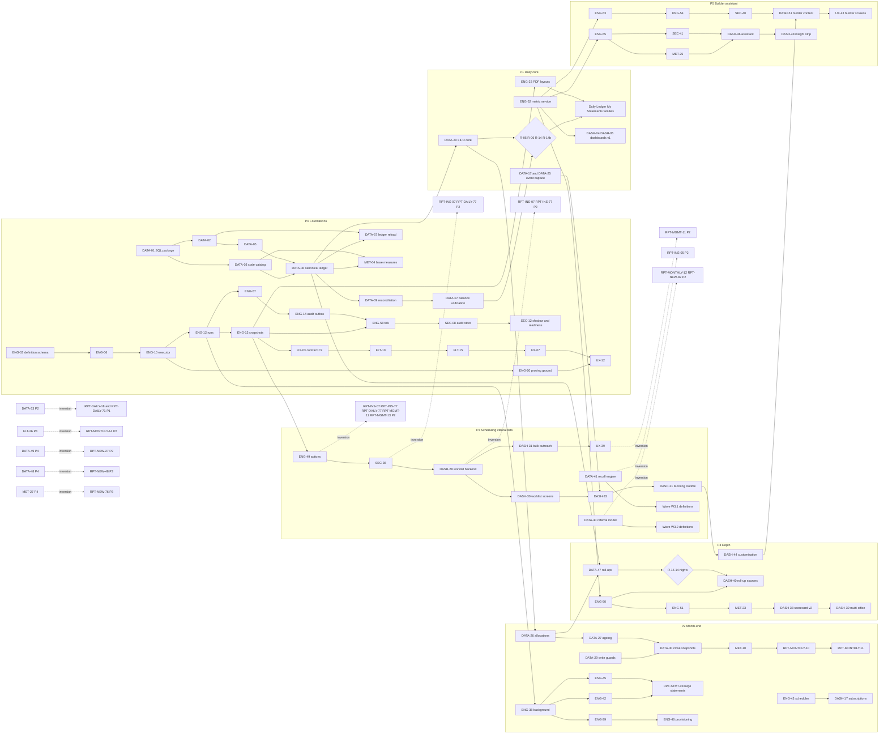

# 12 - Roadmap: Reports & Analytics, phase by phase

The design documents (`00_design_brief.md`, `02`..`09`, `catalog/*`) decide **what** is built; `10_backend_plan.md` and
`11_frontend_plan.md` break it into epics per phase. This roadmap decides the **order of releases, milestones, gates,
acceptance, rollout, risks and the decisions the product owner must take**. Every work-item id is taken from the register
(`work_items.json`); an item keeps its register phase. An id quoted inside a phase section with a different phase carries
its own phase in brackets, for example `DATA-33 (P2)`. Counts come from `plan_inputs/facts.md`, the parity matrix
(`09_parity_matrix.md`) and the two plans. Effort is the register's order of magnitude (S = 2, M = 5, L = 10, XL = 20
engineer-days), not an estimate.

**Staffing scenarios used for every duration in this document** (no calendar date is implied):

| Scenario | Backend | Frontend | QA | Rollout and parity lane | Productivity rule (both plans) |
|---|---|---|---|---|---|
| S6 | 6 backend engineers, re-assigned to tracks only at phase boundaries (`10_backend_plan.md` §1.2) | 3 / 2 / 1 / 2 / 3 / 3 engineers in P0..P5 (staffing curve of `11_frontend_plan.md` §1.4) | 0.5 in P0, P4, P5; 1 in P1-P3 (one output comparison per legacy report, 118, plus reruns per further client) | Client-success role 0.5 FTE from P0 (pilot, parallel run, parity records, training, sections 4-5); per-client operations steps from track T7 | 3.5 register-days per engineer-week (5 days x 0.7 focus); phase length = max(track load / engineers on the track, in-phase critical path) |
| S10 | 10 backend engineers (same rule) | 3 engineers in every phase | as S6 | as S6, plus the spare backend capacity of P4 / P5 | same |

QA and the rollout lane are an assumption of this roadmap: their work has no register size (RG-05), so they are not in
the phase-length formula. Under S6 the frontend curve leaves one frontend engineer for P2 (a single point of failure, risk
R-19); the knowledge-sharing rule is that every P2 frontend epic is reviewed by an engineer of the P1 or P3 frontend team.

Phases are sequential on the main client for **switch-on**: phase n+1's features are enabled there only after phase n
has passed its gate. The build of phase n+1 starts when phase n's build is complete; the gate's sign-offs (closed month,
accountant countersignature, 14-day rights readiness window) run in the first weeks of phase n+1. Preparation for the
next phase (decisions, live-tool capture, provisioning approval) runs inside the previous phase and is listed per phase.

---

## 1. The roadmap on one page

| Phase | Outcome for the practice | Legacy families at parity (reports) | Dashboards, worklists and features delivered | Backend effort (register) | Frontend effort (register) | Duration S6 / S10 (weeks) | Gate to the next phase |
|---|---|---|---|---|---|---|---|
| **P0** Foundations and correctness | Balances that include in-app insurance money (PD-2); the new hub and Reports menu; three of today's six reports run on the server with totals over the full population (no 600-1,600-row cap; the other three at the start of P1); open signup and tenant leaks closed | none (0) | Hub, catalog-driven menu, classic and enhanced runner, CSV and interim PDF, engine office rule, rights catalog revision 2 in shadow, audit store | 67 items, 355 d | 22 frontend-only items, 122 d (138 d with shared items and plan tasks) | 20 / 19 | G0: EX0-1..EX0-10, X0-1, X0-3..X0-10, and X0-2 / X0-11 restricted to the three EX0-5 reports, on the main client; R-01..R-04, R-10a, R-12, R-13 green; balance bridge signed |
| **P1** Daily financial core | Front desk and billing run every daily, ledger, personal and statement report with the legacy criteria and layouts; first KPI dashboards | Daily 12, Ledger 4, My Reports 5, Statements 1 = **22** | `dashboards.main`, `dashboards.provider`, `dashboards.my`; `worklists.not_reappointed` (read-only list); PDF / XLSX / CSV from one stored run; saved views, favorites, recents on the server; drill-through; metric service v1; 2 new control reports | 168 items, 736 d | 26 items, 110 d (166 d) | 39 / 24 | G1: EX1-1..EX1-12, X1-1..X1-11; output comparison signed for six reports (section 5); R-05, R-06, R-14, R-14b green per enabled client |
| **P2** Month-end, A/R and insurance | Month-end close with day close and period lock; tenant-wide ageing and allocations reproducible for closed months; insurance follow-up; reports delivered on a schedule | Monthly 9, Management 4, Insurance 13 = **26** | `dashboards.production`, `dashboards.collections_ar`, `dashboards.insurance_rcm`, `dashboards.executive_summary`, Main / Provider v2, Scorecard v1; `worklists.day_close_checklist`; background runs, run tray, schedules, link-only e-mail, sharing, administration; 21 new analytics and control reports | 167 items, 859 d | 7 items, 39 d (117 d) | 46 / 27 | G2: EX2-1..EX2-10, X2-1..X2-12; known gaps of EX2-1b recorded with their closing items; background enabled on the main client |
| **P3** Scheduling, clinical, patients and lists | Every legacy report exists; teams work queues (recall, unscheduled treatment, claims, A/R) with outcomes and bulk outreach; Morning Huddle | Appointment 9, Treatment Plan 4, Referral 8, Recall 4, Ortho 5, Lists 40 = **70** | 17 worklists, row and bulk actions, `dashboards.morning_huddle` and 7 topic dashboards, production goals with pacing, correspondence workspace, 18 new analytics reports | 303 items, 1,184 d | 8 items, 41 d (198 d) | 60 / 36 | G3: EX3-1 (all 118 registered, no phase-map exception), EX3-2..EX3-9, X3-1..X3-12; EX2-1b gaps closed (EX3-8) |
| **P4** Analytics depth | Fast dashboards from roll-ups; targets and bands; ranked scorecards; office comparison with same-store growth; alerts | (enhancements of 8 items only) | `dashboards.multi_office`, Scorecard v2, matrix compare modes, alerts and digests, customisation v2, comparison period, 8 new analytics reports | 37 items, 232 d | 4 items, 25 d (87 d) | 13 / 13 | G4: EX4-1..EX4-7 (R-16 for 14 nightly rebuilds), X4-1..X4-9 |
| **P5** Builder and assistant | Practices build their own reports (the legacy Office Reports) and KPIs; an assistant answers questions from the metric registry with verified numbers | (Office Reports per organisation, RPT-MENU-15) | Custom report builder, `custom.*` definitions, custom KPIs, assistant with kill switch, explain-this-number, insight strip | 13 items, 77 d | 3 items, 27 d (47 d) | 13 / 13 (up to 19 if UX-43 (XL) takes 40 d) | Module definition of done (section 10) |
| **Total** | | **118** legacy reports (P1 22, P2 26, P3 70) | 16 dashboards, 19 worklists, 49 new reports | **755 items, 3,443 d** | **70 items, 364 d** (753 d incl. shared items and plan tasks) | **191 / 132 build weeks** | |

How to read the totals: they are build weeks, a floor and not a plan. Added to them: (1) a gate and stabilisation
allowance of 2-4 weeks per gate (assumption of this roadmap); because the next phase builds while the previous gate's
sign-offs complete, only the last gate (G5) and any failed gate lengthen the programme, so the planned figure is
**193-195 / 134-136 weeks**; (2) the XL range: each XL item on a chain may take 20-40 d, which moves only P5 (UX-43,
+6 weeks); (3) no contingency is included; (4) unplanned work named in RG-05, RG-14 and RG-17. Under S10 the pipelining
option of section 3 takes about 11 weeks off the total.

Register totals: 825 items, 3,807 engineer-days (`work_items.md` effort table) = 3,443 backend + 364 frontend-only.
Shared items (a backend and a frontend half) are counted in full in both plans; the frontend column in brackets is
`11_frontend_plan.md` §1.4. Backend weeks are `10_backend_plan.md` §1.2 (the frontend plan quotes an older set, gap
RG-01). Phase length is backend-bound in P1-P4 under both scenarios, frontend-bound in P0 under S10 (19.1 weeks; about
17 if UX-03 is split, `11_frontend_plan.md` G-26) and bound by the cross-team builder chain in P5 (12.9 weeks).

Where the effort sits: report definitions (backend track T4) carry 2,010 of 3,443 backend engineer-days (58 %); P3 alone
carries 1,184. Adding report-definition engineers is the only lever that shortens P1-P3; adding engineers does not
shorten P4 and P5, which are bound by their dependency chains (45 and 45 engineer-days).

### 1.1 Requirements trace

The product owner's request, sentence by sentence, against the phase that answers it and the evidence that shows it.

| Demand | Phase(s) | Milestones and gates | Evidence document |
|---|---|---|---|
| Use each legacy screenshot as the reference for every module: its filters and options | P0 (parity files, lint), P1-P3 (families) | M0.1 (lint against parity files), M1.5-M1.7, M2.5-M2.7, M3.2, M3.4, M3.5; G1-2, G2-2, G3-2 | `09_parity_matrix.md` §2-§8, `catalog/*.md`, `04_filter_framework.md` |
| Replicate the same functionality; leave out no option of the screenshots and filters | P1-P3; P5 for Office Reports | Section 5.1 (every control, including superseded and help-text controls, and the 09 §4 defaults signed); 09 §5 buttons mapped in 5.1; M3.7 (all 118 registered); DoD-1, DoD-2 | `09_parity_matrix.md`, section 5 |
| Enhance it ("in a more advanced way") | every phase | Section 1.2 below | `07_ux_blueprint.md`, `02_architecture.md` |
| Analytics for an organisation or an office; reach their KPIs; improve the business | P1 (metric service, Main / Provider / My), P2 (production, collections, RCM, executive, Scorecard v1), P3 (huddle, goals, worklists), P4 (targets, scorecard v2, multi-office, alerts) | M1.8, M2.9, M3.3, M3.8, M3.10, M4.2-M4.5 | `05_metric_catalog.md`, `06_dashboards.md` |
| Use external websites, latest dashboards, KPIs and analysis | P1-P5 | Research trace below | `research/*.md` |
| Break a big task into steps; a plan phase by phase for frontend and backend | P0-P5 | This document; `10_backend_plan.md`; `11_frontend_plan.md` | `work_items.md` |
| See the end-to-end reporting system implemented | P5 exit | Section 10 (DoD-1..DoD-12) | this document |

| Research document | Features adopted | Items (phase) |
|---|---|---|
| `research/competitor_analytics_teardown.md` §6 | Morning Huddle (idea 1); not-reappointed list (2); goals and pacing (3, 8); provider scorecard and ranked scorecards (7, 9, 22); outreach results (11); revenue opportunity (12); bulk actions and smart tasks (16, 17); drill-through (19); bands (20); comparison presets (21); benchmark overlay (23); glossary (25); organisation metric settings (26); custom KPIs and builder (27, 28); scheduled digests (32); favorites (33); assistant and explain (34, 35); financial worklists (37); treatment funnel (40); communication funnel (42); present mode (43); data-as-of (44); permission modes (45); saved option sets with the office as a variable (46) | DASH-21 (P3); DASH-53 (P1); DASH-18..DASH-20 (P3); DASH-52 (P2), DASH-38 (P4); RPT-NEW-75 (P4); RPT-NEW-53 (P4); DASH-28, DASH-31, DASH-36 (P3); UX-22 (P1); MET-21, DASH-37 (P4); FLT-26 (P4); MET-21 (P4); UX-27 (P1); MET-04 (P0); MET-24, ENG-53, UX-43 (P5); DASH-17 (P2), DASH-42 (P4); UX-20 (P1); DASH-46..DASH-49 (P5); DASH-35 (P3); RPT-NEW-46 (P3); RPT-NEW-74 (P3); DASH-21 (P3); ENG-62 (P2); SEC-06 (P0); UX-19 (P1) |
| `research/dental_kpi_dictionary.md` §11 | Versioned metric registry with "how calculated"; parameters instead of forks; legacy-parity presets; benchmarks as reference data; three-zone thresholds; drill from rate to list; snapshots for point-in-time KPIs | MET-01..MET-04 (P0), MET-05..MET-09 (P1), MET-21 (P4), DASH-37 (P4), DATA-30 (P2), DATA-48 (P4) |
| `research/analytics_ux_patterns.md` §11 | Hub and catalog, parameter form, results, dashboards, schedule / share / export, builder, AI surfaces, accessibility and freshness | UX-01..UX-15 (P0), UX-16..UX-32 (P1), UX-33..UX-37 (P2), UX-38..UX-40 (P3), UX-41 (P4), UX-43, UX-44 (P5) |
| `research/denticon_analytics_and_dso.md` | Interactive Reports as worklists; Office Reports; My Favorites and Search Report; DPA dashboards; office groups | DASH-28..DASH-36 (P3); RPT-MENU-01 (P0), RPT-MENU-15 (P5); UX-20 (P1), UX-05 (P0); DASH-04, DASH-05 (P1); DASH-39 (P4) |
| `research/legacy_report_outputs_*.md` (five files) | Printed layouts and columns of the legacy outputs | The family items of P1-P3; section 5.3 and 5.4 |

Reference dashboard rows (`06_dashboards.md` §2.1, §2.2): Main rows 1-20 → DASH-04 (P1); Provider rows 1-11 → DASH-05
(P1); rows whose metrics ship later join with DASH-16 (P2), DASH-54 (P3) and DASH-40 (P4); the reference product's
assistant ("Ask") → DASH-46, DASH-49 (P5).

### 1.2 Better than legacy, per phase

| Phase | What a user of a legacy report gets beyond the legacy tool |
|---|---|
| P0 | Totals over the full population (no row cap); legacy-alias search in the hub; every run audited; CSV from the same run as the screen |
| P1 | Screen, PDF, XLSX and CSV from one stored run; saved views and favorites on the server that roll their dates; drill-through to the record; pivot and chart views; glossary; first KPI dashboards |
| P2 | Background runs, schedules with link-only e-mail, sharing; closed months that reproduce (snapshots); tenant-wide ageing; insurance follow-up dashboards; 21 new analytics and control reports |
| P3 | Worklists with outcomes, assignments and bulk outreach; Morning Huddle; production goals with pacing; every legacy report under its legacy name |
| P4 | Dashboards from roll-ups in about a second; targets and bands; comparison period on every report; ranked scorecards; office comparison with same-store growth; alerts |
| P5 | Own reports and KPIs; an assistant that answers from the metric registry with verified numbers |

---

## P0 - Foundations and correctness

### Objectives

1. One canonical ledger that the screens and the reports share, reconciled on every client database before any money
   report is enabled (AD-10, PD-2).
2. An engine skeleton that proves the whole path once: definition JSON, validate, inline run, snapshot, page, CSV, PDF,
   audit, office rule (walking skeleton, `10_backend_plan.md` §3, `11_frontend_plan.md` §3).
3. Close the security defects that are entry conditions of every report (open signup, tenant predicate, unscoped report
   roll-ups) and put report rights in shadow.
4. Give users the new hub and menu without taking anything away from them.

### In scope / out of scope

| In scope | Out of scope (phase that delivers it) |
|---|---|
| Canonical ledger legs and `rpt_ledger_entries`, reconciliation suite, balance unification, reporting indexes, server-side transaction-code catalog, repairs batch 1, migrated-ledger reload | Allocations and ageing (`rpt_fifo_core()`, DATA-20 (P1)); tenant-wide allocations (DATA-26 (P2)) |
| Engine: registry, definition schema, parameter pipeline, executor, banding, runs, snapshots, artifacts, CSV, tick job, audit outbox and store, lint with the parity files, OpenAPI contract | PDF layouts and XLSX (ENG-23 (P1), ENG-27 (P1)); background runs (ENG-38 (P2)); schedules (ENG-43 (P2)) |
| Hub, Reports menu, classic and enhanced frames, result table v1, CSV export, access gating, session continuity | Saved views and favorites on the server (UX-19 (P1), ENG-28 (P1)); dashboards (P1) |
| Three of today's six reports on the engine (`10_backend_plan.md` G-03) | Legacy parity of any category (P1-P3) |
| Rights catalog revision 2, default grants, shadow window, readiness report | Rights enforcement on a client (after the 14-day readiness window, section 4.3) |

### Legacy reports delivered

None at parity. Interim engine definitions (legacy `report_key`, parity in a later phase):

| Category | report_key | Parity phase |
|---|---|---|
| daily | `daily.production_report`, `daily.collection_report` | P1 |
| lists | `lists.patient_list` | P3 |
| Not in P0: appointment, treatment_plan, insurance are delivered at the start of P1 (M1.2, `10_backend_plan.md` G-03) | `appointment.appointment_list`, `treatment_plan.treatment_plan_status`, `insurance.claims_list` | P3, P3, P2 |

### New reports, dashboards, worklists and platform features

| Kind | Delivered |
|---|---|
| Administration report | `management.report_access_readiness` (SEC-12; no catalog specification, gap RG-10) |
| Platform | Engine flag `REPORTS_ENGINE_ENABLED`, tick job per client (ENG-58), audit outbox drained into `report_audit_events` (ENG-14, SEC-08), patient manifests (SEC-09), Redis namespace (ENG-56, SEC-45), PostgreSQL test tier and deploy preflight for operations steps (ENG-17), definition lint against the parity files with the phase map (ENG-18, FLT-27) |
| Frontend | One lazy `/reports/*` route, hub home with alias search, catalog-driven Reports menu with engine-off fallback, classic frame (`/reports/c/:category`) and enhanced runner (`/reports/r/:report_key`), result table v1, CSV, request-access state, silent token refresh |

### Backend and frontend epics

| Track | Epics (`10_backend_plan.md` P0, `11_frontend_plan.md` P0) |
|---|---|
| Data (T1) | E0.03 (DATA-01, DATA-02), E0.04 (DATA-03..DATA-05), E0.05 (DATA-08), E0.06 (DATA-10, DATA-11, DATA-57), E0.07 (DATA-06, DATA-07, DATA-09) |
| Engine (T2, T3) | E0.09 (ENG-03..ENG-06, FLT-01..FLT-05), E0.10 (ENG-07..ENG-11), E0.11 (FLT-06, FLT-07), E0.12 (ENG-12, ENG-13, ENG-15, ENG-57, ENG-58), E0.15 (ENG-18, FLT-27) |
| Security (T6) | E0.08 (SEC-01..SEC-07, SEC-13), E0.13 (ENG-14, SEC-08, SEC-09), E0.14 (ENG-16, SEC-10..SEC-12, SEC-14, SEC-42, SEC-45) |
| Platform (T7) | E0.01 (ENG-01, ENG-02, ENG-21, ENG-56), E0.02 (ENG-17, ENG-19) |
| Metrics (T5) | E0.17 (MET-01..MET-04) |
| Reports and parity tooling (T4) | E0.16 (FLT-22, FLT-23, RPT-MENU-01), E0.18 (ENG-20) |
| Frontend | F0.1 (UX-01, UX-11, UX-15), F0.2 (UX-03, UX-04, UX-13, UX-14), F0.3 (UX-02), F0.4 (FLT-04, FLT-05, FLT-10..FLT-15), F0.5 (UX-06, UX-07, UX-45), F0.6 (UX-08, UX-09), F0.7 (UX-10), F0.8 (UX-05), F0.9 (UX-12) |

### Dependencies and critical path

| Chain | Engineer-days | Note |
|---|---|---|
| Backend: ENG-03 → ENG-06 → ENG-10 → ENG-12 → ENG-57 → ENG-14 → ENG-58 → SEC-08 → SEC-12 | 55 | Phase critical path (`10_backend_plan.md` §1.2) |
| Frontend after contract point C2: UX-03 → FLT-10 → FLT-15 → UX-07 → UX-12 | 32 | Waits for ENG-12 and ENG-13 in the schema; 19.1 weeks in total, the P0 bound under S10 |
| Data: DATA-01 → DATA-02 → DATA-05 → DATA-06 → DATA-09 → DATA-07 (DATA-03, DATA-04 parallel to DATA-02 / DATA-05; DATA-57 after DATA-02 and DATA-06, parallel to DATA-09 / DATA-07) | 50 | From the register's `depends_on_text` (short forms "03, 04, 05"; the parsed `depends_on` is empty, gap RG-19); DATA-03 needs `btree_gist` (risk R-12); DATA-57 needs the Denticon export (decision O-8) |
| Security entry conditions: SEC-11, SEC-42 | none on the engine | Week 1, before any report ships |

External dependencies: Denticon export and office printouts of control totals (DATA-57, R-21); an accountant for the
class seed of the payment and adjustment codes (DATA-03, MET-04); cloud project access for the tick job (ENG-58).

### Milestones

| Id | Milestone | Demonstrable result | Items |
|---|---|---|---|
| M0.1 | Walking skeleton | On UAT, `/reports/r/daily.production_report` shows criteria from the served definition, runs, pages the banded result from the snapshot and downloads CSV and PDF with the same totals; the run writes one audit outbox row; a restricted user gets 403 `office_not_assigned` | ENG-01..ENG-15 (thin parts), DATA-01, DATA-02, DATA-04..DATA-06 (thin), SEC-01, SEC-03..SEC-05, ENG-18, ENG-19, UX-01..UX-04, UX-07..UX-10, FLT-04, FLT-05, FLT-10..FLT-15 |
| M0.2 | Security entry conditions | Anonymous `POST /auth/signup` answers 404 on the main client; every route of D-01..D-06 refuses an unassigned office; cache keys carry scope and namespace | SEC-11, SEC-42, ENG-16, SEC-10, ENG-56, SEC-45 |
| M0.3 | Ledger reconciled on the main client | R-01..R-04, R-10a, R-12, R-13 pass as nightly control queries; R-21 recorded or waived in writing; the P0 check list of `10_backend_plan.md` §5.4 recorded in `rpt_data_quality` | DATA-02, DATA-03, DATA-06, DATA-08..DATA-11, DATA-57 |
| M0.4 | Balance unification signed | `GET /patients/{id}/balance` equals the ledger sum for every fixture patient and a 1,000-patient sample; bridge per account reviewed and signed by the product owner; tenant flag on for the main client | DATA-07 |
| M0.5 | Hub and menu | Reports menu in legacy order filtered by the catalog; search by legacy alias; with a 404 catalog the menu and pages equal today's | UX-05, UX-11, UX-45, SEC-13 |
| M0.6 | Proving ground | `production`, `collections`, `patient-list` run on the engine with totals over the full population and match their golden cases; old ids redirect (the P0 part of ENG-20 and UX-12, gap RG-02) | ENG-20, UX-06, UX-12 |
| M0.7 | Shadow rights | 397 active codes; grant script run per tenant; readiness report lists checks (a)-(k); `shadow_denied` events written | SEC-01, SEC-02, SEC-12 |
| M0.8 | Parity record store and P1 captures | The parity-record store of section 5.5 exists (one file per `report_key`, signer roles, comparison artifact id) with its count script; the capture parts of RPT-DAILY-09 (P1), RPT-LEDGER-07 (P1), RPT-MY-04 (P1) and RPT-STMT-09 (P1) are done under FLT-23 | FLT-23, RPT-MENU-01 (store and capture effort: gap RG-05, RG-20) |

### Exit criteria (gate G0)

| # | Statement |
|---|---|
| G0-1 | EX0-1..EX0-10 (`10_backend_plan.md`), X0-1, X0-3..X0-10 (`11_frontend_plan.md`), and X0-2 / X0-11 restricted to the three EX0-5 reports pass on the main client; the other three reports of ENG-20 / UX-12 are checked at G1 (EX1-11, gap RG-02) |
| G0-2 | The engine is switched on for a client only after its own P0 check list, DATA-08 indexes, DATA-10 / DATA-57 (migrated tenants) and the DATA-09 reconciliation are recorded (X0-10) |
| G0-3 | The P0 reconciliation scope is stated in the release note: ledger legs and balances (R-01..R-04, R-10a, R-12, R-13); allocation and ageing invariants R-05, R-06, R-14, R-14b are P1 (`10_backend_plan.md` G-05) |
| G0-4 | Decisions of the P1 list below are recorded |
| G0-5 | Capture parts of RPT-DAILY-09 (P1), RPT-LEDGER-07 (P1), RPT-MY-04 (P1) and RPT-STMT-09 (P1) done (section 7); parity-record store in place (M0.8) |
| G0-6 | EN1-1..EN1-4 (`10_backend_plan.md`) met |

### Effort and duration

| Track | T1 Data | T2 Engine | T3 Runs | T4 Reports | T5 Metrics | T6 Security | T7 Platform | Backend total | Frontend (frontend-only / plan total) |
|---|---|---|---|---|---|---|---|---|---|
| Engineer-days | 82 | 93 | 27 | 25 | 25 | 80 | 23 | 355 | 122 / 138 |

| Scenario | Backend weeks | Frontend weeks | Phase length | Bound by |
|---|---|---|---|---|
| S6 | 20 | 13.1 at 3 engineers; chain 19.1 | 20 | T6 + T7 load (1.5 engineers) |
| S10 | 16 (chain 15.7) | 19.1 | 19 (17 with the UX-03 split) | Frontend chain after C2 |

### Decisions before P0 starts

| Decision | Default | Source |
|---|---|---|
| PD-2, PD-10 (section 6) | Brief defaults | Brief §5 |
| PD-11 provider-restricted reporting | Brief default; final before P0 mid-point (SEC-06) | Brief §5 |
| PD-1, PD-3, BD-05 class, Sub Type and collection flags of the payment and adjustment codes (03 O-2, 05 D-8) | Provisional seed of 03 §3.3 by P0 week 1 (DATA-03 seeds it); final, signed by the accountant, before MET-04 starts; a later change re-baselines MET-04, the P1 golden cases of the Daily family and the class columns it prints | Brief §5, 03, 05 |
| BD-01 office rule for callers without assignments | Strict; `REPORT_UNGATED_OFFICE_ACCESS` per client during the shadow window | 02, 04, 08 OD-5 |
| BD-03 reference time zone | Reported office's zone, one range per run with `mixed_time_zones` | 02, 04 OD-4 |
| BD-04 read-only database role | Read-only transactions always; dedicated role optional | 02 |
| BD-07 / O-8 Denticon export and control totals | Reload the skipped charges (DATA-57) | 03 O-8, O-14 |
| Pilot organisation (section 4.2) | The main client | this roadmap |
| Event capture start (RG-11): binary product-owner decision, due before P0 starts | (a) recommended: the additive capture parts of DATA-17 (P1) and DATA-25 (P1) start in P0 week 1 (a register phase change, RG-11); (b) accepted loss: capture starts in P1 week 1, `history_starts_on` is published, and the event-based columns (appointment created / confirmed stamps, claim-status history, treatment-item history; Time Stamps, Missed Not Marked, claim cycle and case-acceptance reports) stay empty for the length of P0 (about 20 weeks under S6, 19 under S10) | `10_backend_plan.md` G-20, BR-9 |
| OD-2, OD-3, G-26 (frontend) | TanStack Table v9 if spike S-1 passes; silent refresh in P0; UX-03 not split | 07, `11_frontend_plan.md` §8.2 |

---

## P1 - Daily financial core

### Objectives

1. Legacy parity of the four daily-operations families: every control, option, default and printed layout (AD-8).
2. One stored run feeds screen, PDF, XLSX and CSV (AD-5, AD-6).
3. Allocation core (`rpt_fifo_core()`) so that ledger, statements and ageing-based totals agree (R-05, R-06, R-14, R-14b).
4. The metric service and the first dashboards, every number computed on the server (AD-4).

### In scope / out of scope

| In scope | Out of scope (phase) |
|---|---|
| Daily, Ledger, My Reports, Statements families; patient Print launcher; Scheduler Routing Slip and Walkout entries; ADA claim print capture | Statement batches above the inline budget (RPT-STMT-08 (P2)) unless BD-02 moves ENG-63 (P2) and part of ENG-38 (P2) |
| PDF kit and layouts, XLSX, logos, criteria echo; saved views, favorites, recents, drill, pivot | Background runs, schedules, sharing administration (P2) |
| Metric service v1, dashboard API v1, Main / Provider / My Dashboard v1 | Collections by provider on tenant-wide allocations (DATA-26 (P2)): P1 shows the credited provider, restated in P2 (G-10 of 10) |
| Posting stamps, `tenant_id` batch 1, scheduling / visit / activity / calendar / treatment-item facts, early event capture | Carrier stamps on charges and payments (DATA-33 (P2)): RPT-DAILY-18 and RPT-DAILY-71 ship their interim carrier rule |

### Legacy reports delivered (22)

| Category | report_keys |
|---|---|
| Daily Reports (12) | `daily.peg_board_day_sheet`, `daily.daily_journal`, `daily.production_report`, `daily.collection_report`, `daily.deposit_slip`, `daily.scheduled_production`, `daily.routing_slip`, `daily.progress_notes`, `daily.production_analysis_report`, `daily.daily_audit`, `daily.claims_printed`, `daily.special_transaction_report` |
| Ledger Reports (4) | `ledger.ledger_report`, `ledger.walkout_report`, `ledger.super_bill`, `ledger.account_allocation` |
| My Reports (5) | `my_reports.daily_journal`, `my_reports.time_clock_report`, `my_reports.missing_progress_notes`, `my_reports.appointment_detail_by_user`, `my_reports.production_report` |
| Statements (1) | `statements.statement_run` (+ companion `statements.finance_charges`, RPT-STMT-17) |

Interim definitions completed at the start of P1: `appointment.appointment_list`, `treatment_plan.treatment_plan_status`,
`insurance.claims_list` on the engine with full-population totals (EX1-11).

### New reports, dashboards, worklists and platform features

| Kind | Delivered |
|---|---|
| New control reports (2) | `management.report_access_log` (RPT-NEW-78), `management.setup_integrity` (RPT-NEW-83) |
| Dashboards (3) | `dashboards.main` (all 20 reference rows, DASH-04), `dashboards.provider` and `dashboards.my` (DASH-05), hidden twin report definitions (DASH-09), role-based landing (DASH-10) |
| Worklist (1) | `worklists.not_reappointed` as a read-only list in the runner (DASH-53) |
| Platform | PDF / XLSX / CSV with inline caps 1,500 / 10,000 / 50,000 rows; watermark id and attribution line (SEC-16); saved views and favorites that survive logout; one-time import of `localStorage` views (UX-19); drill-through and record routes; matrix blocks and chart views; glossary; return-to-after-login; metric service with availability gating; legacy roll-up endpoints become adapters over the metric service |

### Backend and frontend epics

| Track | Epics |
|---|---|
| Data (T1) | E1.01 (DATA-12..DATA-15, DATA-50), E1.02 (DATA-16..DATA-19, DATA-55, DATA-56), E1.03 (DATA-20, DATA-21, DATA-25), E1.04 (DATA-22..DATA-24, DATA-51..DATA-53) |
| Engine (T2, T3) | E1.05 (ENG-22..ENG-27, ENG-60, FLT-18), E1.06 (ENG-28..ENG-31, ENG-34, ENG-59, FLT-16, FLT-17), E1.07 (ENG-36, ENG-61) |
| Metrics and dashboards (T5) | E1.08 (ENG-32, ENG-33, ENG-35), E1.09 (MET-05..MET-09), E1.10 (DASH-01, DASH-04, DASH-05, DASH-09, DASH-10, DASH-53) |
| Security (T6) | E1.11 (SEC-15..SEC-24, SEC-26, SEC-43, SEC-44) |
| Platform (T7) | E1.12 (ENG-37) |
| Reports (T4) | E1.13 Daily, E1.14 Ledger, E1.15 My Reports, E1.16 Statements, E1.17 (FLT-20, RPT-MENU-02, RPT-MENU-03, RPT-NEW-78, RPT-NEW-83) |
| Frontend | F1.1 results depth (UX-16, UX-17, UX-23, UX-24, UX-26), F1.2 export dialog (UX-18), F1.3 saved views (FLT-19, UX-19, UX-20, UX-21, UX-32), F1.4 drill (UX-22, RPT-NEW-83, RPT-MY-15), F1.5 shell additions (UX-31, UX-48, UX-49), F1.6 dashboard frame and KPI components (UX-25, UX-27, DASH-02, DASH-03, DASH-06, DASH-07), F1.7 first dashboards (DASH-04, DASH-05, DASH-10, DASH-53), F1.8 Statements screen (UX-28, RPT-STMT-01, FLT-28), F1.9 patient context and My Reports (FLT-16, UX-29, RPT-LEDGER-03, RPT-MY-03), F1.10 migration and entry points (UX-30, DASH-08, RPT-DAILY-76, RPT-DAILY-51, RPT-MENU-02), F1.11 filter accessibility (FLT-21) |

### Dependencies and critical path

| Chain | Engineer-days | Note |
|---|---|---|
| ENG-22 → ENG-23 → ENG-25 → RPT-DAILY-02 → RPT-DAILY-79 → RPT-DAILY-81 | 42 | In-phase critical path |
| DATA-20 → R-05, R-06, R-14, R-14b pass per client | 10 + checks | Financial gate: no Daily, Ledger or Statements report is enabled for a client before these pass (AD-10) |
| DATA-16 → DATA-17; DATA-25 | 25 | Event history cannot be back-filled: these start in the first week of P1 |
| T4 load: 406 engineer-days of report definitions | 406 | Sets the phase length (3 engineers on T4 under S6: 38.7 weeks; 5 under S10: 23.2) |
| Cross-phase inversions | — | RPT-DAILY-18 and RPT-DAILY-71 need DATA-33 (P2): interim carrier rule in P1, final in P2 (EX1-12) |

### Delivery waves inside P1

Each wave is enabled per client on its own (`report_tenant_settings.disabled_report_keys`). End weeks assume T4 works the
families in this order (S6: 3 engineers = 10.5 register-days a week; S10: 5 = 17.5); register T4 days per family:
RPT-DAILY 191, RPT-LEDGER 58, RPT-MY 53, RPT-STMT 80, RPT-MENU and RPT-NEW 17.

| Wave | Content | Milestones | Starts after | End week S6 / S10 |
|---|---|---|---|---|
| W1.1 Daily | E1.13, FLT-20; event capture, proving-ground remainder, formats, allocation core | M1.1, M1.2, M1.3, M1.4, M1.5 | P1 start; definitions enabled after M1.4 | about 19 / 11 |
| W1.2 Ledger and My Reports | E1.14, E1.15; dashboards v1 | M1.6, M1.8 | W1.1 page furniture (RPT-DAILY-02) | about 29 / 17 |
| W1.3 Statements and control reports | E1.16, E1.17; output comparisons | M1.7, M1.9 | ENG-26, ENG-61 | about 39 / 24 |

### Milestones

| Id | Milestone | Demonstrable result | Items |
|---|---|---|---|
| M1.1 | Event capture live | New appointment, claim-status and treatment-item events are written on the main client; capture start date recorded per client | DATA-16, DATA-17, DATA-25 |
| M1.2 | Remaining proving-ground reports | `appointment.appointment_list`, `treatment_plan.treatment_plan_status`, `insurance.claims_list` run on the engine (EX1-11); the old runner is only the engine-off fallback | ENG-20 (P0), UX-12 (P0), DATA-16, DATA-21, DATA-56 |
| M1.3 | Output formats and saved views | One run of `daily.production_report` prints PDF in the legacy layout and XLSX with the same totals as the screen; a "Month to date" view saved in one month runs the next month's dates on another device | ENG-22..ENG-27, ENG-28, ENG-29, UX-18, UX-19, UX-20 |
| M1.4 | Allocation core and financial gate | R-05, R-06, R-14, R-14b green on the main client; `ledger.account_allocation` matches its golden case | DATA-20, DATA-21, DATA-09 (P0) |
| M1.5 | Daily family at parity | The 12 Daily definitions pass their parity default tests; day sheet A/R proof and `reconciles_with` checks green | E1.13 (all 46 RPT-DAILY items of P1; the capture part of RPT-DAILY-09 is done before P1, G0-5), FLT-20 |
| M1.6 | Ledger and My Reports at parity | Walkout and Superbill print from the patient shell and the Scheduler; a provider-restricted user sees only own figures in My Reports | E1.14, E1.15, UX-29, RPT-MY-03, RPT-DAILY-51 |
| M1.7 | Statements | A statement run inside the inline budget writes `statement_runs` and one `patient_statements` row per account; rerun asks for confirmation; larger batches get the name-range split hint (EX1-5); PRINT STATEMENT REPORT, PRINT STATEMENTS and UPDATE STATEMENT DATES (09 §5) work as specified | E1.16, UX-28, FLT-28 |
| M1.8 | Dashboards v1 | `dashboards.main` returns a value or a named state for all 20 Main reference rows and `dashboards.provider` for the 11 Provider reference rows; the home and My Page tiles re-pointed by DASH-08 (production, collections, patients, appointments) contain no browser-aggregated number (the rest: M3.10) | DASH-02, DASH-03, DASH-06, DASH-07, DASH-04, DASH-05, DASH-08, ENG-32, ENG-33, MET-05 |
| M1.9 | Legacy output comparison signed | Daily Journal, Production, Collection, Deposit Slip, Ledger and Statement compared with Denticon prints for one closed pre-cutover month and one day on the main client; differences classified (section 5) | RPT-DAILY-09, RPT-LEDGER-07, RPT-MY-04, RPT-STMT-09 |

### Exit criteria (gate G1)

| # | Statement |
|---|---|
| G1-1 | EX1-1..EX1-12 and X1-1..X1-11 pass on the main client |
| G1-2 | Each of the 22 reports has a signed parity record (section 5.5); known gaps are listed with their closing item (RPT-DAILY-18, RPT-DAILY-71 → DATA-33 (P2); large statement batches → RPT-STMT-08 (P2)) |
| G1-3 | Release note states the restatement of collections by provider in P2 and the history start of event-based columns |
| G1-4 | Decisions of the P2 list recorded; per-client provisioning for the worker approved |
| G1-5 | Capture parts of RPT-MONTHLY-23 (P2), RPT-MONTHLY-52 (P2), RPT-MGMT-01..RPT-MGMT-04 (P2, family questions of section 7) and RPT-INS-09 (P2) done |
| G1-6 | Precondition: the parity-record store, its count script and the comparison harness of RG-05 exist, and the client-success lane is staffed; G1-2 is checked by the count script |
| G1-7 | EN2-1..EN2-4 met |

### Effort and duration

| Track | T1 | T2 | T3 | T4 | T5 | T6 | T7 | Backend total | Frontend |
|---|---|---|---|---|---|---|---|---|---|
| Engineer-days | 115 | 34 | 64 | 406 | 68 | 44 | 5 | 736 | 110 / 166 |

| Scenario | Backend weeks | Frontend weeks | Phase length | Bound by |
|---|---|---|---|---|
| S6 | 39 | 23.7 at 2 engineers | 39 | T4 (3 engineers) and T5 (0.5) |
| S10 | 24 | 15.8 at 3 engineers | 24 | T4 (5 engineers) |

### Decisions before P1 starts

| Decision | Default | Source |
|---|---|---|
| PD-4..PD-8 (section 6); PD-1 and PD-3 are settled before P0 | Brief defaults | Brief §5 |
| PD-15 letters, postcards, labels, forms (RPT-MENU-02, RPT-MENU-03 are P1) | Stay with their owning features; the hub links to them | Brief §5 |
| BD-02 statements in P1 versus background in P2 | Brief kept; oversized batches fail with `report_too_large_for_inline` and the name-range split | 02 §18.2-1, `10_backend_plan.md` G-09 |
| BD-08 P1 collections by provider | Credited provider, restated in P2 | 03 O-12 |
| BD-09 retention defaults and PDF above 10,000 rows | 24 h / 7 d / 30 d / 400 d; audit 72 months; refuse PDF, offer XLSX / CSV; statements in 500-document volumes | 02, 08 OD-8 |
| OD-1 default frame | Classic until a category's parity sign-off | 07 |
| OD-5, OD-6, OD-8, OD-11 | Grid pattern; default views may replace legacy defaults visibly; preferences blob; registry guard | 07 |
| SEC-43 (P1) switch-on rule per client | Only after the client's engine is on, or its users hold an accepted right | `11_frontend_plan.md` G-33 |

---

## P2 - Month-end, A/R and insurance

### Objectives

1. Month-end at parity: Monthly, Management and Insurance families.
2. Tenant-wide persistent allocations and ageing in two units (account, account and office) that reproduce for a locked
   month (close snapshots).
3. Day close, period lock and deposits as operational features (PD-9).
4. Background runs, scheduled delivery with link-only e-mail (PD-12), sharing and administration.

### In scope / out of scope

| In scope | Out of scope (phase) |
|---|---|
| DATA-26..DATA-38: allocations, ageing, deposits, day close, period lock, snapshots, claim model, benefit usage, payer stamps, eligibility history, capitation and ERA tables, audit events dataset, contract instalments | Roll-up tables and incremental refresh (DATA-47 (P4)) |
| Background path, worker service, per-client provisioning, schedules, delivery, run cache | Condition-based alerts (ENG-52 (P4)) |
| Collections and A/R, insurance, executive dashboards; Scorecard v1 without rank | Ranked Scorecard v2 and peers (DASH-38 (P4)) |
| Held parts of five P2 reports recorded as known gaps | Their bulk actions (ENG-49 (P3), SEC-36 (P3), DASH-28 (P3)) unless the roadmap recommendation RG-04 is accepted |

### Legacy reports delivered (26)

| Category | report_keys |
|---|---|
| Monthly Reports (9) | `monthly.executive_summary`, `monthly.executive_day_sheet`, `monthly.aging_report_by_home_office`, `monthly.aging_report`, `monthly.income_allocation`, `monthly.allocation_detail`, `monthly.unallocated_payment_adjustments`, `monthly.daily_journal_summary_by_allocation`, `monthly.waterfall_report` |
| Management Reports (4) | `management.payment_plan_charges`, `management.uncollected_copay`, `management.audit_trail`, `management.time_clock_report` |
| Insurance Reports (13) | `insurance.claims_list`, `insurance.capitation_utilization`, `insurance.claims_created_not_sent`, `insurance.procedures_on_hold`, `insurance.dps_eligibility_report`, `insurance.capitation_payment`, `insurance.benefits_used_unused`, `insurance.outstanding_claims`, `insurance.claims_not_created`, `insurance.unbilled_report_due_to_no_insurance`, `insurance.eob_835_claims_reconcile_report`, `insurance.835_denial_report`, `insurance.rte_sweep_details` |

Known P2 parity gaps (EX2-1b), each closed by a later item: CREATE TASK of Outstanding Claims (RPT-INS-07) and the bulk
part of RPT-INS-77 → DASH-28 (P3), ENG-49 (P3), SEC-36 (P3) for RPT-INS-07; bulk part of RPT-DAILY-77 → ENG-49 (P3),
SEC-36 (P3); bulk hand-off of RPT-MGMT-11 → ENG-49 (P3), UX-39 (P3); bulk part of RPT-MGMT-13 → ENG-49 (P3); estimate
caveat of RPT-NEW-27 → DATA-49 (P4); recall mode of `insurance.benefits_used_unused` (RPT-INS-05) → DATA-41 (P3); referral block of the
Executive Summary (RPT-MONTHLY-12) and RPT-NEW-82 → DATA-40 (P3); comparison period of RPT-MONTHLY-14 → FLT-26 (P4).
`insurance.eob_835_claims_reconcile_report`, `insurance.835_denial_report` and `insurance.rte_sweep_details` return
rows only where a clearinghouse ERA or real-time eligibility integration feeds the new tables (DATA-38, DATA-34).

### New reports, dashboards, worklists and platform features

| Kind | Delivered |
|---|---|
| New analytics and control reports (21) | `analytics.production_trend_mix`, `analytics.collections_trend_mix`, `analytics.payment_lag`, `analytics.adjustment_writeoff_analysis`, `monthly.ar_trend`, `management.time_of_service_collection`, `management.payment_plan_portfolio`, `analytics.fee_realization`, `insurance.payer_mix_profitability`, `insurance.claim_cycle_performance`, `daily.day_close_reconciliation`, `management.provider_pay_basis`, `insurance.claims_backlog_trend`, `insurance.estimate_accuracy_analysis` (estimate caveat until DATA-49 (P4)), `statements.statement_collection_effectiveness`, `management.time_clock_exceptions`, `management.patient_report_access`, `management.transaction_exceptions`, `management.user_activity_review`, `management.data_quality_exceptions`, `management.report_usage` (RPT-NEW-10, RPT-NEW-12..RPT-NEW-20, RPT-NEW-23, RPT-NEW-25..RPT-NEW-28, RPT-NEW-77, RPT-NEW-79..RPT-NEW-82, RPT-NEW-84) |
| Dashboards (4 + v2) | `dashboards.production` (DASH-12), `dashboards.collections_ar` (DASH-13), `dashboards.insurance_rcm` (DASH-14), `dashboards.executive_summary` with frozen month-end values (DASH-15), Main and Provider v2 (DASH-16), Scorecard v1 (DASH-52), chart tiles (DASH-11), subscriptions (DASH-17) |
| Worklist (1) | `worklists.day_close_checklist` (DASH-55), served as a list in the runner until the worklist page ships in P3 |
| Platform | Background runs with run tray and history; schedules and deliveries; link-only e-mail; sharing; administration (all runs, all schedules, usage); step-up for bulk exports; write-once manifests, disclosure log, patient access index; day close and period lock with write guards; deposits; capitation payment entry screen; correspondence merge engine and blank insurance forms (RPT-MENU-04, RPT-MENU-05, RPT-MENU-12) |

### Backend and frontend epics

| Track | Epics |
|---|---|
| Data (T1) | E2.01 (DATA-26, DATA-27, DATA-35), E2.02 (DATA-28..DATA-30), E2.03 (DATA-31..DATA-34, DATA-38), E2.04 (DATA-36, DATA-37) |
| Runs, schedules, platform (T3, T7) | E2.05 (ENG-38, ENG-40, ENG-42, ENG-45, ENG-63), E2.06 (ENG-39, ENG-46, ENG-47), E2.07 (ENG-43, ENG-44, SEC-25), E2.08 (ENG-41, ENG-62) |
| Metrics and dashboards (T5) | E2.09 (MET-10..MET-12, MET-26), E2.10 (DASH-12..DASH-17, DASH-52, DASH-55) |
| Security (T6) | E2.11 (SEC-27..SEC-35) |
| Engine (T2) | E2.12 (FLT-08, FLT-24) |
| Reports (T4) | E2.13 Monthly, E2.14 Management, E2.15 Insurance, E2.16 P2 follow-ups of P1 families (RPT-DAILY-22b, RPT-DAILY-42, RPT-DAILY-43, RPT-DAILY-77, RPT-LEDGER-14, RPT-LEDGER-15, RPT-LEDGER-19, RPT-STMT-08, RPT-STMT-21, RPT-STMT-22), E2.17 new reports, E2.18 correspondence parity |
| Frontend | F2.1 background runs and tray (UX-33, FLT-24), F2.2 schedules and subscriptions (UX-34, DASH-17), F2.3 sharing, administration, step-up (UX-35, UX-36, UX-46), F2.4 chart tiles and Scorecard v1 (DASH-11, DASH-52), F2.5 P2 dashboards (DASH-12..DASH-16), F2.6 insurance dashboard rebinding (UX-37), F2.7 family touches and day-close list (RPT-MGMT-02, RPT-MGMT-15, RPT-MGMT-18, RPT-LEDGER-14, DASH-55, RPT-MGMT-11), F2.8 owning-feature screens (RPT-INS-44, RPT-MENU-05, RPT-MENU-12) |

### Dependencies and critical path

| Chain | Engineer-days | Note |
|---|---|---|
| DATA-26 → DATA-27 → DATA-30 → MET-10 → RPT-MONTHLY-10 → RPT-MONTHLY-11 | 65 (85 if DATA-26 (XL) takes 40 d) | In-phase critical path; the DATA edges come from `depends_on_text` ("26", "27, 29"), not the parsed `depends_on` (gap RG-19); DATA-26 (XL) changes the payment posting path (allocation at posting, decision O-6); below the T4 bound in both scenarios even at 85 |
| ENG-38 → ENG-45 → RPT-STMT-08 (ENG-42 in parallel) | 20 | Large statement batches |
| ENG-38 → ENG-39 → ENG-46 | 20 | Background switch-on per client (provisioning); tenant-wide ageing on the worker waits for it |
| DATA-28, DATA-29 (XL) | 30 | Write guards on every money writer; behaviour change on existing screens behind a tenant flag |
| DASH-11 (frontend, M) early in the phase | 5 | Chart-bearing dashboard items of P2 and P3 wait on it |
| T4 load: 556 engineer-days | 556 | Sets the phase length (3.5 engineers on T4 under S6: 45.4 weeks; 6 under S10: 26.5) |

### Delivery waves inside P2

Each wave is enabled per client on its own (`disabled_report_keys`). End weeks assume T4 works the waves in this order
(S6: 3.5 engineers = 12.25 register-days a week; S10: 6 = 21); register T4 days: RPT-INS 181, P1 follow-ups 32,
RPT-MONTHLY 145, RPT-MGMT 57, RPT-NEW 121, RPT-MENU 20. Insurance goes first because Monthly waits on the DATA-26 chain
(65 d, about week 19 for RPT-MONTHLY-10 / RPT-MONTHLY-11).

| Wave | Content | Milestones | Starts after | End week S6 / S10 |
|---|---|---|---|---|
| W2.1 Insurance and background | E2.15, E2.16; E2.05, E2.06; day close | M2.1, M2.3, M2.6 | P2 start; DATA-31..DATA-34 | about 17 / 10 |
| W2.2 Monthly and A/R | E2.13; allocations, ageing, close snapshots; output comparisons | M2.2, M2.4, M2.5, M2.10 | DATA-27; MET-10 | about 29 / 19 |
| W2.3 Management, new reports, schedules | E2.14, E2.17, E2.18; E2.07; P2 dashboards | M2.7, M2.8, M2.9 | ENG-43; MET-10 | about 46 / 27 |

### Milestones

| Id | Milestone | Demonstrable result | Items |
|---|---|---|---|
| M2.1 | Background path on the main client | A tenant-wide ageing runs on the worker, the requester is notified, the API instance is not used (EX2-3); a 7,800-account statement office yields 16 PDF volumes | ENG-38..ENG-40, ENG-42, ENG-45, ENG-46, RPT-STMT-08, UX-33 |
| M2.2 | Tenant-wide allocations and ageing | R-05, R-14, R-14b tenant-wide; Executive Summary Show AR equals the Aging Report total | DATA-26, DATA-27, RPT-MONTHLY-08 |
| M2.3 | Day close and period lock | A write into a closed day is rejected and an override is audited (EX2-5); `worklists.day_close_checklist` clears a row when the day is closed | DATA-28, DATA-29, DASH-55 |
| M2.4 | Month-end reproducible | Aging reports for a locked month reproduce their snapshot after a back-dated edit; the difference appears in `rpt_snapshot_variances` (EX2-2) | DATA-30, MET-12 |
| M2.5 | Monthly family at parity | 9 definitions pass parity default tests; Income Allocation roll-forward check green | E2.13, RPT-MONTHLY-42 |
| M2.6 | Insurance family at parity | 13 definitions pass parity default tests; outstanding claims equals the all-tier metric | E2.15, MET-11 |
| M2.7 | Management family at parity | 4 definitions; Audit Trail opens from the patient shell | E2.14, RPT-MGMT-15 |
| M2.8 | Schedules and delivery | A scheduled report delivers an in-app notification and a link-only e-mail; a recipient without the right receives nothing (EX2-4) | ENG-43, ENG-44, SEC-25, UX-34, DASH-17 |
| M2.9 | P2 dashboards and new reports | Each P2 dashboard fills all tiles with one data call and every tile equals its drill report; the 21 new reports pass their golden cases | E2.10, E2.17, F2.4, F2.5 |
| M2.10 | Legacy output comparison signed | Executive Summary, Aging Report, Aging by Home Office and Outstanding Claims compared for one closed pre-cutover month (section 5) | RPT-MONTHLY-23, RPT-MONTHLY-52, RPT-INS-09 |

### Exit criteria (gate G2)

| # | Statement |
|---|---|
| G2-1 | EX2-1..EX2-10 and X2-1..X2-12 pass on the main client (X2-13, deletion of the old report code, is checked and either done or carried with the clients still off named) |
| G2-2 | Each of the 26 reports has a signed parity record; the EX2-1b gaps are listed in the release note with their closing items |
| G2-3 | `/reports/aging` and `/reports/accounts-receivable` carry the deprecated mark; removal follows the retirement rule of `10_backend_plan.md` §7.3 |
| G2-4 | The restatement of P1 collections by provider is published (allocation-based from DATA-26) |
| G2-5 | Capture parts of the P3 verification items done (all P3): RPT-APPT-09 (P3), RPT-RECALL-06 (P3), RPT-TX-04 (P3), RPT-ORTHO-06 (P3), RPT-REF-08 (P3), RPT-PLIST-09 (P3), RPT-PRLIST-09 (P3), RPT-SLIST-09 (P3), RPT-STLIST-09 (P3) (EN3-3) |
| G2-6 | EN3-1..EN3-3 met; per-client quota inventory of section 8 (R-17) recorded for every client to be enabled in P3 |

### Effort and duration

| Track | T1 | T2 | T3 | T4 | T5 | T6 | T7 | Backend total | Frontend |
|---|---|---|---|---|---|---|---|---|---|
| Engineer-days | 122 | 4 | 56 | 556 | 67 | 39 | 15 | 859 | 39 / 117 |

| Scenario | Backend weeks | Frontend weeks | Phase length | Bound by |
|---|---|---|---|---|
| S6 | 46 | 33 at 1 engineer | 46 | T4 (3.5 engineers) |
| S10 | 27 | 11.1 at 3 engineers | 27 | T4 (6 engineers) |

### Decisions before P2 starts

| Decision | Default | Source |
|---|---|---|
| PD-9, PD-12 (section 6) | Brief defaults | Brief §5 |
| BD-10 queue transport after the ENG-21 (P0) spike; run-cache invalidation; tick | Cloud Tasks (`db_poll` ENG-63 as fallback); Redis markers, cache off by default; job every 5 minutes | 02 |
| O-6 allocation for app payments | Persist at posting with the legacy rule and an explicit unallocated remainder | 03 |
| O-7 period-lock basis; connection budget per client | As 03 / 02 defaults; budget reviewed per enabled client | 03, 02 |
| 08 OD-2 two keys for XLSX / CSV export and schedules; OD-9 external recipients | Two keys; declared-recipient log only | 08 |
| 06 C-1 Huddle v1 in P2; C-5 minimal billing-worklist slice in P2; RG-04 move ENG-49 (P3) and SEC-36 (P3) to P2 | Not moved (register kept); roadmap recommends RG-04 | 06 §12.3, `10_backend_plan.md` G-01 |
| OD-7 run tray as the only notification reader | Tray | 07 |

---

## P3 - Scheduling, clinical, patients and lists

### Objectives

1. Parity of the remaining 70 legacy reports; every legacy report registered and reachable under its legacy name.
2. Worklists that lead to action: live lists, outcomes, assignments, follow-ups, bulk outreach with consent exclusions.
3. Morning Huddle, production goals with pacing and the topic dashboards.
4. Close the P2 known gaps that wait on P3 items.

### In scope / out of scope

| In scope | Out of scope (phase) |
|---|---|
| DATA-39..DATA-46, DATA-54; live keyset paging, row and bulk actions; MET-13..MET-20; worklist backend and 17 worklists; goals service; correspondence workspace, labels and forms; Reports (Old) decisions (RPT-MENU-14) | Roll-up sources for dashboards (DASH-40 (P4)); targets and bands (MET-21 (P4)); goal overlays on any metric (ENG-51 (P4)) |
| Scheduler flow statuses for Time Stamps (RPT-APPT-52) | Next-available-appointment search beyond decision 06 D-7 |
| Bulk sign of progress notes off by default (06 D-11) | Bulk attestation as a default |

### Delivery waves inside P3

P3 is the heaviest phase (311 register items, 1,184 backend engineer-days). It is released in five waves; each wave
can be enabled per client on its own (`report_tenant_settings.disabled_report_keys`, `10_backend_plan.md` §7.1).

| Wave | Content | Backend items | Starts after |
|---|---|---|---|
| W3.0 Actions and worklist core | ENG-48, ENG-49 → SEC-36 (7 d, weeks 1-2: unblocks the bulk-action parts); FLT-09, UX-38; DASH-28 → DASH-30 (complete about week 8 after SEC-36), DASH-29 after DASH-28 and ENG-43 (P2); DASH-31 → UX-39; held P2 actions closed (RPT-INS-07 (P2), RPT-INS-77 (P2), RPT-DAILY-77 (P2), RPT-MGMT-11 (P2), RPT-MGMT-13 (P2)) | E3.03, part of E3.05 | P3 start; about 8 weeks (ENG-49 → SEC-36 → DASH-28 → DASH-30 = 27 engineer-days) |
| W3.1 Appointment and Recall (13 reports) + schedule worklists + Huddle | E3.08 report definitions from P3 start; DASH-33, DASH-21, DASH-22 after DASH-30; MET-13, MET-14, MET-17, DASH-18 | E3.08, E3.04, E3.06 | Definitions: DATA-41, DATA-43, DATA-54; worklist and Huddle parts: DASH-30 |
| W3.2 Treatment Plan, Ortho, Referral (17 reports) | E3.09 report definitions; DASH-34 after DASH-30 | E3.09 | DATA-39, DATA-40, DATA-42 |
| W3.3 Lists (40 reports) | E3.10 | E3.10 | DATA-44, DATA-45; SEC-37 for the security lists |
| W3.4 Tails | E3.11 row and bulk actions on P1 / P2 families; DASH-32, DASH-35, DASH-36; E3.12 new reports; E3.13 correspondence; topic dashboards DASH-23..DASH-27; DASH-54 | E3.11..E3.13 | DASH-31 (W3.0), DASH-33, DASH-34 |

The frontend plan groups P3 in two waves (3a: worklist frame, bulk actions, schedule and finance worklists, goals,
huddle, appointment, recall and treatment-plan families; 3b: the rest). The roadmap keeps the backend's family grouping
as the release unit; the treatment-plan family's frontend verification moves with W3.2 (gap RG-03).

### Legacy reports delivered (70)

| Category | report_keys |
|---|---|
| Appointment Reports (9) | `appointment.appointment_list`, `appointment.missed_appointments_not_marked_as_missed`, `appointment.new_patients_via_appointments`, `appointment.lab_report`, `appointment.smartassist_report_card`, `appointment.appointments_confirmed_via_vendors`, `appointment.appointment_time_stamps`, `appointment.appointment_detail`, `appointment.lab_cost_report` |
| Recall Reports (4) | `recall.procedural_recall_report`, `recall.scheduled_recall_report`, `recall.recall_due_report`, `recall.post_op_report` |
| Treatment Plan Reports (4) | `treatment_plan.treatment_plan_proposal`, `treatment_plan.treatment_plan_status`, `treatment_plan.treatment_plan_analysis`, `treatment_plan.treatment_plan_detail` |
| Ortho Reports (5) | `ortho.ortho_compliance_report`, `ortho.ortho_daily_journal`, `ortho.patients_by_ortho_status_with_time_in_treatment`, `ortho.ortho_report`, `ortho.missing_ortho_visits` |
| Referral Reports (8) | `referral.referral_production_list`, `referral.referred_out_list`, `referral.referral_source_list`, `referral.external_outgoing_referral_management`, `referral.referral_summary_report`, `referral.referral_count_summary`, `referral.internal_referral_management`, `referral.external_incoming_referral_management` |
| Lists - Patient (12) | `lists.update_patient_insurance_conversion_list_by_appointment`, `lists.patient_list`, `lists.patient_list_new_patient`, `lists.patients_seen`, `lists.patients_notes`, `lists.patient_list_grouped_by`, `lists.patients_on_payment_plan`, `lists.online_registered_patients`, `lists.responsible_party_list`, `lists.responsible_party_sent_to_collection`, `lists.responsible_party_statements_sent`, `lists.responsible_party_email_statement_error_report` |
| Lists - Provider (4) | `lists.provider_list`, `lists.provider_holidays`, `lists.provider_operatory`, `lists.provider_registration` |
| Lists - Security (4) | `lists.user_list`, `lists.group_list`, `lists.group_rights_list`, `lists.user_group_membership` |
| Lists - Setup (20) | `lists.employer_list`, `lists.insurance_plan_list`, `lists.carrier_list`, `lists.inactive_plans_list`, `lists.drug_list`, `lists.procedure_codes_list`, `lists.explosion_codes_list`, `lists.procedure_codes_by_fee_schedule`, `lists.credit_codes_report`, `lists.fee_schedule_list`, `lists.capitation_fee_schedule`, `lists.office_list`, `lists.office_holidays`, `lists.operatory_list`, `lists.ada_categories_list`, `lists.default_ins_plan_coverage_category_list`, `lists.document_types_list`, `lists.notes_macro_category_list`, `lists.notes_macros_list`, `lists.patient_types_list` |

Migrated-history limits stated by the reports (`history_starts_on`): treatment-plan history, recalls, ortho contracts and
contract billing, appointment created and confirmation stamps cannot be reconstructed without a Denticon re-export
(DATA-50 (P1)); `ortho.*` reports depend on DATA-42 for the contract status of migrated patients.

### New reports, dashboards, worklists and platform features

| Kind | Delivered |
|---|---|
| New analytics reports (18) | `insurance.denial_analysis`, `insurance.eligibility_verification_compliance`, `appointment.schedule_utilization`, `appointment.broken_appointment_analysis`, `appointment.patient_flow_times`, `recall.recare_effectiveness`, `analytics.clinical_mix`, `treatment_plan.clinical_follow_through_gaps`, `treatment_plan.case_acceptance_funnel`, `analytics.new_patient_acquisition`, `analytics.patient_retention_cohorts` (waits for DATA-48 (P4)), `appointment.lab_case_performance`, `ortho.ortho_contract_health`, `analytics.goal_attainment`, `referral.referral_source_return`, `analytics.online_booking_funnel`, `analytics.communication_effectiveness`, `management.staff_productivity` (waits for MET-27 (P4)) (RPT-NEW-21, RPT-NEW-22, RPT-NEW-40..RPT-NEW-48, RPT-NEW-51, RPT-NEW-52, RPT-NEW-71..RPT-NEW-74, RPT-NEW-76) |
| Worklists (17) | `worklists.eligibility_verification`, `worklists.unsigned_progress_notes` (DASH-32); `worklists.unconfirmed_appointments`, `worklists.broken_appointments`, `worklists.unresolved_appointments`, `worklists.todays_patients`, `worklists.lab_cases_due` (DASH-33); `worklists.unscheduled_treatment`, `worklists.recall_due`, `worklists.reactivation` (DASH-34); `worklists.outstanding_claims`, `worklists.denied_claims`, `worklists.patient_ar`, `worklists.unallocated_credits`, `worklists.unbilled_procedures`, `worklists.payment_plan_overdue` (DASH-35); `worklists.my_followups` (DASH-36) |
| Dashboards (8) | `dashboards.morning_huddle` (DASH-21), `dashboards.schedule_capacity` (DASH-22), `dashboards.hygiene_recall`, `dashboards.treatment`, `dashboards.patients`, `dashboards.referrals_marketing`, `dashboards.ortho`, `dashboards.front_office` (DASH-23..DASH-27); goals page (DASH-18..DASH-20) |
| Platform | Interactive Reports entries open worklists; bulk text, e-mail and letters from a selection; correspondence workspace with 23 legacy items; Scheduler flow statuses; accessibility pass on every module route (UX-40); `tenant_id` batch 2 (DATA-46) |

### Backend and frontend epics

| Track | Epics |
|---|---|
| Data (T1) | E3.01 (DATA-39, DATA-41..DATA-43, DATA-54), E3.02 (DATA-40, DATA-44..DATA-46) |
| Engine (T2) | E3.03 (ENG-48, ENG-49, FLT-09, FLT-25, SEC-36) |
| Metrics, worklists, dashboards (T5) | E3.04 (MET-13..MET-20), E3.05 (DASH-28, DASH-29, DASH-31..DASH-36), E3.06 (DASH-18, DASH-21..DASH-27) |
| Security (T6) | E3.07 (SEC-37) |
| Reports (T4) | E3.08 wave 3A, E3.09 wave 3B, E3.10 wave 3C, E3.11 actions on P1 / P2 families, E3.12 new reports, E3.13 correspondence |
| Frontend | F3.1 worklist page (UX-38, DASH-30), F3.2 worklist content (DASH-32..DASH-36), F3.3 bulk actions and hand-offs (UX-39, DASH-31, RPT-INS-16, RPT-TX-12), F3.4 goals (UX-42, DASH-19, DASH-20), F3.5 huddle (DASH-21, DASH-22), F3.6 P3 dashboards (DASH-23..DASH-27, DASH-54), F3.7 code picker (FLT-25), F3.8 correspondence (RPT-MENU-09, RPT-MENU-10, RPT-MENU-13), F3.9 Scheduler status and record routes (RPT-APPT-52, RPT-RECALL-15, RPT-APPT-16, RPT-APPT-18, RPT-PRLIST-07, RPT-SLIST-07, RPT-STLIST-08), F3.10 accessibility pass (UX-40) |

### Dependencies and critical path

| Chain | Engineer-days | Note |
|---|---|---|
| ENG-49 → SEC-36 → DASH-28 → DASH-30 (frontend) → DASH-33 → DASH-21 | 47 | Cross-team critical path; the frontend hand-off DASH-30 is the pivot |
| T4 load: 930 engineer-days (wave 3A 187, 3B 189, 3C 340, actions 44, new reports 120, correspondence 50) | 930 | Sets the phase length (4.5 engineers on T4 under S6: 59 weeks; 7.5 under S10: 35.4) |
| DATA-41 (recall engine), DATA-40 (referral model), DATA-42 (ortho) | three parallel L items, 10 days each (30 in total) | Each gates one wave; start in week 1 |
| Owning-feature handlers (SMS, letters, Scheduler, claims) | — | A worklist action appears only when its handler is registered (06 risk 4) |
| Inversions | — | RPT-NEW-48 needs DATA-48 (P4); RPT-NEW-76 needs MET-27 (P4): they ship in P4 (recommendation RG-04) or with a caveat |

### Milestones

| Id | Milestone | Demonstrable result | Items |
|---|---|---|---|
| M3.1 | Actions and worklist core (W3.0) | A row action and a bulk action run on a snapshot selection with a confirmation showing counts and exclusions; CREATE TASK of `insurance.outstanding_claims` works; live keyset paging rejects a tampered cursor | ENG-48, ENG-49, SEC-36, DASH-28, UX-38, DASH-30, DASH-31, UX-39, RPT-INS-07 (P2) |
| M3.2 | Appointment and Recall at parity (W3.1) | 13 definitions pass parity default tests; Scheduler statuses stamp the Time Stamps report | E3.08, RPT-APPT-52 |
| M3.3 | Morning Huddle | `dashboards.morning_huddle` returns a value or a named state for every tile at 07:00 office time on UAT; renders on a phone viewport and in present mode | DASH-21, DASH-33, MET-17, DASH-18 |
| M3.4 | Treatment Plan, Ortho, Referral at parity (W3.2) | 17 definitions pass parity default tests; `worklists.unscheduled_treatment` total equals `unscheduled_treatment_amount` | E3.09, DASH-34 |
| M3.5 | Lists at parity (W3.3) | 40 definitions pass parity default tests; security lists pass the SEC-37 review | E3.10, SEC-37 |
| M3.6 | Bulk outreach | A bulk text to 500 selected patients skips opted-out and no-number patients and writes one event per patient (EX3-3) | DASH-31 |
| M3.7 | All 118 registered | The lint's legacy-coverage rule passes with no phase-map exception (EX3-1); every legacy menu entry opens a real page | ENG-18 (P0), UX-11 (P0), DASH-36 |
| M3.8 | Topic dashboards and new reports | DASH-22..DASH-27 fill all tiles with one call; the 18 new reports pass golden cases (RPT-NEW-48 and RPT-NEW-76 as recorded) | E3.06, E3.12 |
| M3.9 | Legacy output comparison signed | Appointment List, Recall Due, Treatment Plan Status, Patient List, Referral Summary, one Ortho report and one report per Provider, Security and Setup list family compared for one closed pre-cutover month (section 5.3) | RPT-APPT-09, RPT-RECALL-06, RPT-TX-04, RPT-PLIST-09, RPT-REF-08, RPT-ORTHO-06, RPT-PRLIST-09, RPT-SLIST-09, RPT-STLIST-09 |
| M3.10 | No client aggregation left | The recall-due and insurance-receivable tiles and `useRecallDue` read the metric service; no `fetchAllPages` call remains under the dashboard components; AD-1 holds on home and My Page | DASH-54 |

### Exit criteria (gate G3)

| # | Statement |
|---|---|
| G3-1 | EX3-1..EX3-9 and X3-1..X3-12 pass on the main client |
| G3-2 | Each of the 70 reports has a signed parity record; the comparisons of M3.9 are signed; reports with an inferred legacy layout follow section 5.4 |
| G3-3 | The EX2-1b gaps closed by P3 items are closed (EX3-8) |
| G3-4 | `tenant_id` NOT NULL on the nine tables of DATA-46 on every client database (EX3-5) |
| G3-5 | EN4-1..EN4-3 met |

### Effort and duration

| Track | T1 | T2 | T3 | T4 | T5 | T6 | T7 | Backend total | Frontend |
|---|---|---|---|---|---|---|---|---|---|
| Engineer-days | 65 | 22 | 0 | 930 | 162 | 5 | 0 | 1,184 | 41 / 198 |

| Scenario | Backend weeks | Frontend weeks | Phase length | Bound by |
|---|---|---|---|---|
| S6 | 60 | 28.3 at 2 engineers | 60 | T4 (4.5 engineers) |
| S10 | 36 | 18.9 at 3 engineers | 36 | T4 (7.5 engineers) |

### Decisions before P3 starts

| Decision | Default | Source |
|---|---|---|
| 03 O-5 visit definition; O-3 ortho patient rule; O-4 contract-billing codes | 03 defaults | 03 |
| 06 D-7 next available appointment; D-11 bulk signing of progress notes; D-6 who sees money on the huddle; D-10 worklist versus print report in menus | Scheduler slot search call as specified; bulk sign off; by family and class; both exist | 06 |
| 05 D-2, D-3, D-5, D-6 (case acceptance unit and window, hygiene reappointment test, new-patient basis, working-day basis) | 05 defaults | 05 |
| RPT-MENU-14 Reports (Old) entries | Decision per entry | `catalog/other_menu_entries.md` |
| OD-9 keep the legacy-named menu permanently; OD-10 mobile scope | Keep; worklists and dashboards, huddle first | 07 |
| Live-tool answers for the P3 families (section 7) | Captured in P2 (G2-5); each family's legacy-behaviour decisions settled before its definitions start | FLT-23 (P0) |

---

## P4 - Analytics depth

### Objectives

1. Dashboards answer from roll-up tables in about a second (metric query ≤ 500 ms, dashboard data call ≤ 1 s).
2. Targets, bands, goal and benchmark overlays on any metric.
3. Ranked Scorecard v2 with peer suppression, multi-office comparison with same-store growth, alerts and digests.

### In scope / out of scope

| In scope | Out of scope |
|---|---|
| DATA-47..DATA-49 roll-ups, refresh engine, dirty-key triggers, point-in-time snapshots | External OLAP or BI products (AD-3) |
| ENG-50, ENG-51, FLT-26, MET-21..MET-23, MET-27; DASH-37..DASH-45; ENG-52, SEC-38, SEC-39 | Cross-organisation percentiles (PD-13) |
| 8 new reports and 8 enhancement items | Published external benchmarks on by default (05 D-9: off by default) |

### Legacy reports delivered

No new legacy report. Enhancements that keep the parity default tests green: RPT-DAILY-24, RPT-DAILY-46, RPT-REF-09,
RPT-REF-13, RPT-REF-49, RPT-REF-50, RPT-TX-16, RPT-MENU-11; the comparison period closes the RPT-MONTHLY-14 (P2) gap.

### New reports, dashboards, worklists and platform features

| Kind | Delivered |
|---|---|
| New analytics reports (8) | `analytics.production_vs_schedule` (RPT-NEW-11), `analytics.cash_conversion_waterfall` (RPT-NEW-24), `analytics.patient_value` (RPT-NEW-49), `analytics.provider_scorecard` (RPT-NEW-50), `analytics.revenue_opportunity` (RPT-NEW-53), `analytics.office_comparison` (RPT-NEW-70), `analytics.outreach_results` (RPT-NEW-75), `analytics.cross_office_patient_flow` (RPT-NEW-85) |
| Dashboards | `dashboards.multi_office` (DASH-39); Scorecard v2 (DASH-38); matrix compare, prior-year, percent-of-goal, heat modes and the switch of every dashboard to roll-up sources (DASH-40); targets on KPIs (DASH-37); customisation v2 and phone layouts (DASH-44, UX-41) |
| Alerts | Condition schedules, alert states, digests (ENG-52, DASH-41, DASH-42, SEC-39, UX-47) |

### Backend and frontend epics

| Track | Epics |
|---|---|
| Data (T1) | E4.01 (DATA-47..DATA-49) |
| Metrics and dashboards (T5) | E4.02 (ENG-50, ENG-51, FLT-26, MET-22), E4.03 (MET-21, MET-23, MET-27), E4.05 (DASH-38..DASH-40, DASH-43, DASH-45, SEC-38) |
| Runs (T3) | E4.04 (DASH-41, DASH-42, ENG-52, SEC-39) |
| Reports (T4) | E4.06 |
| Frontend | F4.1 customisation, F4.2 targets, scorecard v2, comparison, F4.3 alerts, F4.4 outreach results, F4.5 advanced letter templates |

### Dependencies and critical path

| Chain | Engineer-days | Note |
|---|---|---|
| ENG-50 → ENG-51 → MET-23 → DASH-38 → DASH-39 | 45 | Phase critical path; bounds P4 at 12.9 weeks whatever the team size |
| DATA-47 (XL) → R-16 for 14 nightly rebuilds → DASH-40 | 20-40 + 14 nights (XL range) | Dashboards switch to roll-ups only after R-16 has held 14 nights on the client |
| Trigger overhead measured on the charge-entry path before triggers are enabled per client | — | Entry criterion EN4-2 |
| DASH-44 (frontend) → DASH-51 (P5) | 10 | P5 builder content waits on P4 customisation |

### Milestones

| Id | Milestone | Demonstrable result | Items |
|---|---|---|---|
| M4.1 | Roll-ups stable | R-16 held for 14 consecutive nightly rebuilds on the main client (EX4-1) | DATA-47 |
| M4.2 | Overlays and targets | A KPI with a target shows its band as colour, icon and word; "Set target" updates without reload | ENG-50, ENG-51, MET-21, DASH-37 |
| M4.3 | Scorecard v2 and office comparison | A provider-restricted caller never receives another provider's row, rank or share; a newly opened office is excluded from same-store growth and named | DASH-38, DASH-39, SEC-38, MET-23 |
| M4.4 | Alerts | An alert fires once on entering the bad band and not again inside it; acknowledge, snooze and mute work | ENG-52, DASH-41, DASH-42, SEC-39 |
| M4.5 | Dashboards on roll-ups | `dashboards.main` returns the same values from roll-ups and from live datasets for a closed month (EX4-2) | DASH-40, MET-22 |
| M4.6 | Customisation and P4 reports | A customised layout is restored on another device; the 8 new reports pass golden cases | DASH-44, UX-41, E4.06 |

### Exit criteria (gate G4)

EX4-1..EX4-7 and X4-1..X4-9 on the main client; performance budgets of 02 §15.6 met on `golden_large` from a Cloud Run
instance; `compare_to = none` leaves every legacy output unchanged (X4-4); EN5-1..EN5-3 met.

### Effort and duration

| Track | T1 | T2 | T3 | T4 | T5 | T6 | T7 | Backend total | Frontend |
|---|---|---|---|---|---|---|---|---|---|
| Engineer-days | 35 | 0 | 22 | 93 | 82 | 0 | 0 | 232 | 25 / 87 |

| Scenario | Backend weeks | Frontend weeks | Phase length | Bound by |
|---|---|---|---|---|
| S6 | 13 | 8.3 at 3 engineers | 13 | Critical path (12.9) |
| S10 | 13 | 8.3 | 13 | Critical path; spare engineers take per-client rollout |

### Decisions before P4 starts

| Decision | Default | Source |
|---|---|---|
| PD-13 benchmarking scope | Inside one organisation | Brief §5 |
| 06 D-4 alert payload | Notifications and e-mails carry no office aggregate value (link only) | 06 |
| 05 D-9 published benchmarks in product | Off by default, behind a permission | 05 |
| 08 OD-15 peer thresholds | Mean from 5 other providers, quantiles from 10 | 08 |

---

## P5 - Builder and assistant

### Objectives

1. Custom reports from governed datasets with the same scope, classes and exports as standard reports; the legacy
   Office Reports of each organisation as custom reports.
2. Organisation KPIs over base measures, versioned per organisation.
3. An assistant that answers only through the metric registry (PD-14), verifies every number and can be switched off per
   client.

### In scope / out of scope

| In scope | Out of scope |
|---|---|
| ENG-53, ENG-54, SEC-40, MET-24, DASH-51, RPT-MENU-15; UX-43 | Free SQL, external datasets |
| ENG-55, MET-25, SEC-41, DASH-46..DASH-48, DASH-50; DASH-49, UX-44 | Assistant answers with row-level PHI by default (aggregates only) |
| — | "Optional pilots" named in the brief (no work item, gap RG-08) |

### Legacy reports delivered

The 6 Office Reports in 3 customer folders found by `catalog/other_menu_entries.md`, and every Office Report captured
per organisation (RPT-MENU-01 (P0)), mapped to a standard report, an alias or a `custom.*` definition, or signed "not
needed" (RPT-MENU-15, EX5-5).

### New reports, dashboards, worklists and platform features

Builder screens and template gallery, `custom.*` definitions, publish and share; custom KPIs in
`GET /analytics/metadata`; assistant ask bar, answer card, explain panel (DASH-47) and insight strip (DASH-48);
`/reports/office/*` redirects land on `/reports/c/custom` (X5-6).

### Backend and frontend epics

| Track | Epics |
|---|---|
| Engine (T2) | E5.01 (DASH-51, ENG-53, ENG-54, MET-24, RPT-MENU-15, SEC-40) |
| Metrics (T5) | E5.02 (DASH-46..DASH-48, DASH-50, ENG-55, MET-25, SEC-41) |
| Frontend | F5.1 report builder (UX-43, DASH-51), F5.2 assistant surfaces (DASH-49, UX-44, DASH-47, DASH-48), F5.3 Office Reports (RPT-MENU-15) |

### Dependencies and critical path

| Chain | Engineer-days | Note |
|---|---|---|
| ENG-53 → ENG-54 → SEC-40 → DASH-51 → UX-43 (MET-24 parallel to ENG-54 / SEC-40; RPT-MENU-15 after DASH-51) | 45 (65 if UX-43 (XL) takes 40 d) | Phase critical path, crossing to the frontend: 12.9 weeks (up to 18.6); DASH-51 also waits for DASH-44 (P4) |
| ENG-55 → SEC-41 → DASH-46 → DASH-48 (MET-25 parallel to SEC-41; DASH-47 before DASH-48) | 30 | Assistant chain (8.6 weeks) |
| Assistant vendor route, covered endpoint and BAA (08 OD-11) | — | Entry criterion EN5-2; without it the assistant stays off |

### Milestones

| Id | Milestone | Demonstrable result | Items |
|---|---|---|---|
| M5.1 | Builder | A custom report is created, validated, previewed, published and run by a colleague under the colleague's own scope (EX5-1) | ENG-53, ENG-54, SEC-40, UX-43, DASH-51 |
| M5.2 | Office Reports | Every captured Office Report runs under its legacy name or carries a signed "not needed" | RPT-MENU-15 |
| M5.3 | Custom KPIs | A custom KPI validates, is versioned, obeys the data classes of its components and appears in the metadata | MET-24 |
| M5.4 | Assistant behind its kill switch | Only schema-valid metric queries execute; a question outside the registry is declined; the evaluation set passes | ENG-55, MET-25, SEC-41, DASH-46, DASH-50 |
| M5.5 | Explain and insights | Every number of an answer exists in its facts payload; Explain shows the inputs that sum to the value | DASH-47, DASH-48, DASH-49, UX-44 |

### Exit criteria (gate G5)

EX5-1..EX5-5 and X5-1..X5-6 on the main client, then the module definition of done (section 10).

### Effort and duration

| Track | T1 | T2 | T3 | T4 | T5 | T6 | T7 | Backend total | Frontend |
|---|---|---|---|---|---|---|---|---|---|
| Engineer-days | 0 | 35 | 0 | 0 | 42 | 0 | 0 | 77 | 27 / 47 |

| Scenario | Backend weeks | Frontend weeks | Phase length | Bound by |
|---|---|---|---|---|
| S6 | 9 (load) | 4.5 at 3 engineers (frontend chain DASH-51 → UX-43 7.1) | 13 (up to 19) | Cross-team builder chain (12.9) |
| S10 | 9 (load) | same | 13 (up to 19) | Cross-team builder chain; spare engineers on release support and rollout |

### Decisions before P5 starts

| Decision | Default | Source |
|---|---|---|
| PD-14 assistant | Registry only, aggregates by default | Brief §5 |
| 08 OD-11 assistant vendor route and BAA; kill switch per client | Must be decided; no default ships the assistant on | 08, `10_backend_plan.md` EN5-2 |
| Builder dataset exposure per data class | 08 rule: a report family of its dataset and the class of every field | 08 |

---

## 3. Dependency view

The DATA edges follow the register's `depends_on_text` (gap RG-19); DATA-26 depends on DATA-15 and DATA-20, not on the P1
report families. Dotted edges are the 19 register phase inversions of `plan_inputs/facts.md` (closing items in RG-04).

**Critical path in words.** Inside P0 the engine chain ENG-03 → ENG-06 → ENG-10 → ENG-12 → ENG-57 → ENG-14 → ENG-58 →
SEC-08 → SEC-12 (55 engineer-days) and, after contract point C2, the frontend chain UX-03 → FLT-10 → FLT-15 → UX-07 →
UX-12 bound the phase; the data chain DATA-01 → DATA-02 → DATA-05 → DATA-06 → DATA-09 → DATA-07 (50 days, DATA-57 in
parallel after DATA-06) must finish inside it because no money report is enabled before it. P1 cannot enable a single financial report before DATA-20 has made R-05, R-06, R-14 and R-14b pass,
and its length is set by 406 engineer-days of report definitions. P2 is bound by the data chain DATA-26 → DATA-27 →
DATA-30 → MET-10 → RPT-MONTHLY-10 → RPT-MONTHLY-11 (65 days) and again by report-definition load (556 days). P3 is bound
by report-definition load (930 days) with the worklist chain ENG-49 → SEC-36 → DASH-28 → DASH-30 → DASH-33 → DASH-21 (47
days, crossing to the frontend) as the earliest finish for the Huddle. P4 is bound by ENG-50 → ENG-51 → MET-23 → DASH-38
→ DASH-39 (45 days) and P5 by the cross-team builder chain ENG-53 → ENG-54 → SEC-40 → DASH-51 → UX-43 (45 days), not by
staff. With strictly sequential phases the levers that move the end are the number of report-definition engineers in
P1-P3 (track T4), the early decisions that keep DATA-20, DATA-26 and DATA-47 from waiting, and pipelining.

**Pipelining option (S10).** The backend heads of the P4 and P5 chains depend only on earlier phases: DATA-47 (empty
parsed `depends_on`; text DATA-06, DATA-16, DATA-26), ENG-50 (ENG-32 (P1), ENG-62 (P2)), ENG-53 and ENG-55 (ENG-32 (P1)).
Under S10, P3 is T4-bound and other tracks have spare capacity, so DATA-47 with its R-16 observation window, ENG-50 →
ENG-51 → MET-23, and ENG-53 → ENG-54 → SEC-40 and ENG-55 → SEC-41 can be built inside P3, with their switch-on held to the
P4 and P5 gates. P4 then shrinks to its frontend load (about 8.3 weeks; DASH-38 → DASH-39 = 20 d) and P5 to DASH-51 → UX-43
(25 d, 7.1 weeks), about 11 weeks off the S10 total (132 → about 121 build weeks). Under S6 the option is not available
without slowing T4.

---

## 4. Release and rollout

### 4.1 Feature flags and switches

| Switch | Level | Off means | Switched on when | Owner item |
|---|---|---|---|---|
| `REPORTS_ENGINE_ENABLED` | Client (`deploy/clients/<client>.env.yaml`) | Router-level 404; the frontend probe shows today's menu and pages | Client's P0 check list, indexes, repairs and reconciliation recorded; tick job deployed and one drain observed (G0-2) | ENG-01, ENG-58 |
| `REPORT_RIGHTS_ENFORCED`, `REPORT_RIGHTS_SHADOW`, `REPORT_RIGHTS_SHADOW_UNTIL` | Client | Shadow: grace list relaxed, denials logged | After the readiness window (4.3) | SEC-12 |
| `REPORT_UNGATED_OFFICE_ACCESS` | Client | Strict office rule | Only during the shadow window, for a client without office assignments | SEC-05 |
| Balance-unification tenant flag | Tenant | Old balance paths | Bridge reviewed and signed for the client | DATA-07 |
| `REPORT_BACKGROUND_ENABLED` | Client | Inline only; oversized runs refused | Provisioning script run; settings show no error | ENG-38, ENG-46 |
| `REPORT_SCHEDULES_ENABLED`, `REPORT_EMAIL_ENABLED` | Client | No schedules, no e-mail | Background on; `APP_BASE_URL` set; transport check green | ENG-43, ENG-44 |
| `REPORT_CACHE_ENABLED` | Client | No run cache | Background on; write-route test green | ENG-41 |
| Day-close write guards, statement lock | Tenant | No guard | Office trained on day close (4.6) | DATA-29, RPT-STMT-04 |
| `report_tenant_settings.disabled_report_keys` | Tenant | — | Holds back a family whose data checks fail (for example financial reports while R-21 is open) or a P3 wave not yet signed | ENG-36 |
| Assistant kill switch | Client | Assistant slots render nothing | Vendor route and BAA decided; evaluation set green | SEC-41, DASH-50 |

### 4.2 Pilot organisation

| Item | Rule |
|---|---|
| Choice | The main client (CI-automated deploy, `10_backend_plan.md` §1.3) is the pilot for every phase; UAT runs each release first, then a rehearsal of the phase's repair set and operations steps on a clone of the main client's database (the timing clone of EN0-2), then the main client |
| Fallback | Every behaviour change has a tenant or client switch (4.1): balance unification (DATA-07), day-close guards (DATA-29), statement lock (RPT-STMT-04), `disabled_report_keys` per family; a misfire is rolled back by switching off, never by a data restore |
| Selection criteria to confirm with the product owner | Migrated from Denticon with the export still available (O-8); at least two offices (office scope, office groups, mixed time zones if available); an office manager, a billing lead and an accountant willing to sign the comparisons; Denticon still readable for parallel runs |
| Pilot cohort inside the client | One office first for each family (front desk, billing, one provider), then the other offices of the client after the family's sign-off |
| Further clients | In the order of the client registry, each in its own window, each with its own data checks and readiness window; a client may stay one phase behind the main client. Per-client work per phase: the check list of 4.3 (checks such as #1, #5, #6, #24 and #35 need a policy decision per client), index builds, R-21 control totals, provisioning, rights readiness (14 + 7 days), parity reruns. It is carried by the rollout lane of the staffing table (operations from T7, client-success, QA reruns); its days per client are not sized by the design (RG-05) |
| Exit of the pilot for a family | Signed parity records (5.5) for every report of the family and no open defect of class (a) |

### 4.3 Per-client runbooks

| Runbook | Steps | Evidence |
|---|---|---|
| Data repair (per phase check list of `10_backend_plan.md` §5.4: P0 #1-#13, #21, #22, #24, #28-#32, #35, #38, #39; P1 #14, #18, #25, #36, #37; P2 #15, #16, #17, #23, #26, #33, #34; P3 #19, #20) | Check → decide → back up → apply (dry run, then apply) → re-check | `rpt_data_quality` row per check; change-ledger row per step; backup id |
| Operations steps (index builds, back-fills, NOT NULL tightening) | Listed in `scripts/ops/required.json`; deploy preflight fails when one is missing; off-hours, one table per step | `pg_index.indisvalid`, `attnotnull`, durations recorded |
| Rights enablement | SEC-11 / SEC-42 deployed → SEC-01 revision and SEC-02 grants → shadow with end date → readiness report for 14 days → administrator clears the list → enforce → zero shadow denials for 7 days | Signed checklist in the client registry |
| Infrastructure | P0: tick job and scheduler by hand per the ENG-58 runbook entry; P2: `scripts/provision_reporting.sh` (worker, queues, bucket, service accounts); deploy order worker, job, API | Settings endpoint shows no configuration error |
| Engine switch-on | G0-2 recorded; flag on; smoke run of `daily.production_report` | Runbook row |

### 4.4 Running side by side with the legacy tool

| Rule | Detail |
|---|---|
| Duration | The legacy tool stays the reference for a family until the family's parity records are signed on the pilot; at least one closed month and one day per family are compared (section 5.3) |
| Which months | Denticon holds data only up to the migration cut-over (R-21 covers `transaction_date <= :cutover`). Comparison months and days are pre-cutover migrated periods, chosen after DATA-57 and R-21 are recorded; the known migration limits (skipped charges until reloaded, `history_starts_on`) are classified (c) on the record |
| Post-cutover periods | No legacy reference exists. Acceptance uses the internal identities of 5.2 plus a manual spot-check of 20 accounts per office against source documents (posted charges, payment slips, EOBs) for one closed month |
| Same inputs | Same office, period, criteria (legacy defaults) and, for migrated periods, the R-21 control totals |
| Where the legacy tool cannot be run | Comparison against the stored Denticon printouts captured in section 7; if none exists, section 5.4 |
| Users | During the parallel window users print from DentC; the pre-cutover Denticon printouts remain the reference for the compared months only |
| Old frontend reports | Remain the engine-off fallback per client; deleted only when every client is on the engine and the saved-view import has run for one release (`11_frontend_plan.md` §6.1, X2-13) |
| Old endpoints | Retired only by the retirement rule of `10_backend_plan.md` §7.3 (no caller, replacement compared, one release deprecated, every client enabled) |

### 4.5 Sign-off per report

| Report class | Signs | Evidence |
|---|---|---|
| Financial (daily, ledger, statements, monthly, management money reports, insurance money reports) | Billing lead of the pilot office and the accountant; product owner countersigns | Parity record (5.5) with the comparison and the invariants |
| Operational (appointment, recall, treatment plan, ortho, referral, worklists) | Office manager of the pilot office; product owner | Parity record |
| Lists and security lists | Product owner; security owner for `lists.user_list`, `lists.group_list`, `lists.group_rights_list`, `lists.user_group_membership` | Parity record; SEC-37 review |
| New analytics reports and dashboards (no legacy counterpart) | Product owner | Golden cases green; tile total equals its drill report |

### 4.6 Communication and training

| When | Audience | Content |
|---|---|---|
| Before P0 switch-on | All users of the client | New Reports menu (legacy order and names kept), hub search by legacy name; balances now include in-app insurance payments (PD-2) with the bridge explanation |
| P1 release | Front desk, billing, providers | Daily families, patient Print launcher, saved views and favorites; P1 collections by provider use the credited provider and will be restated in P2; event-based columns start on the capture date |
| P2 release | Billing, office managers, administrators | Day close and period lock (what is blocked, who can override), background runs and the tray, schedules with link-only e-mail, sharing; restatement of collections by provider |
| P3 release (per wave) | Front desk, hygiene, treatment coordinators, billing | Worklists, outcomes and follow-ups, bulk outreach and consent exclusions, Morning Huddle |
| P4 release | Owners, managers | Targets, scorecards and peer rules, office comparison, alerts |
| P5 release | Administrators, owners | Builder, custom KPIs, assistant and its limits |
| Every release | All | Release note listing known parity gaps with their closing item, deprecated endpoints, and per-role quick guides; Help Center articles extended (not forked) |

None of 4.2-4.6 has a register item (gap RG-05); the roadmap assigns them to the rollout lane of the staffing table
(client-success 0.5 FTE from P0, QA, operations from T7) and makes the parity-record store a P0 deliverable (M0.8) and a
G1 precondition (G1-6).

---

## 5. Parity acceptance

A legacy report is accepted when four checks pass and a parity record is signed.

### 5.1 Criteria parity (mechanical, every report)

| Check | Gate |
|---|---|
| The definition lint's coverage and control-mapping rules pass against the vendored parity file of the category (`catalog/parity/<folder_key>.parity.json`) with no interim flag (ENG-18, FLT-27) | Deploy gate |
| The parity default test passes: the untouched form equals the legacy defaults and validates (FLT-20 and the family items) | Deploy gate |
| The parity matrix (`09_parity_matrix.md`) shows the report's controls as replicated, replicated with additions, help text or superseded; any `unknown_legacy` control of the report (20 in total) is resolved by the family's live verification item or recorded as an accepted unknown | Family sign-off |
| Show / hide / enable rules of 09 §7.3 are exercised by component tests in both frames | Family sign-off |
| Every control of the report with status superseded (26 in total) or help text (8) is listed on the parity record with its replacement, and the product owner accepts each one | Family sign-off |
| Every default of 09 §4 that deliberately differs from the legacy default (13 rows) is listed on the parity record; the rows marked "confirm on the live tool" are confirmed in the capture of section 7 or accepted by the product owner | Family sign-off |
| Every legacy action button of 09 §5 works in its milestone: ADD TO MY FAVORITES → M1.3 (UX-20, P1); CLEAR CRITERIA and PRINT / PREVIEW → M0.1 (runner frames), with PDF / XLSX in M1.3; PRINT STATEMENT REPORT, PRINT STATEMENTS, UPDATE STATEMENT DATES → M1.7; CREATE TASK → M3.1 | Family sign-off |

### 5.2 Reconciliation identities (every financial report)

| Identity | Source |
|---|---|
| Engine invariants R1-R9 for every definition (screen = PDF = XLSX = CSV of one run; summary cards from block totals) | 02 §15.3 |
| Data invariants: P0 R-01..R-04, R-10a, R-12, R-13; P1 adds R-05, R-06, R-14, R-14b, R-07, R-15, R-19, R-20, R-22; P2 R-08, R-09, R-11, R-17; P4 R-16; R-21 recorded or waived | 03 §10 |
| `reconciles_with`: report totals equal the metric service for the same scope and period; metric identities I-1..I-12 and later packs | 05, MET-04, MET-09 |
| Family reconciliation: day sheet A/R proof, Ledger closing balance = account balance, Executive Summary Show AR = Aging Report total, Income Allocation roll-forward | RPT-DAILY-07, RPT-LEDGER-06, RPT-MONTHLY-08, RPT-MONTHLY-42 |

### 5.3 Output parity against the legacy printout

| Step | Rule |
|---|---|
| Sample | Pilot client, one office, one closed pre-cutover month and one day (daily reports) chosen after DATA-57 and R-21 (4.4), legacy default criteria; plus one variant per column-selecting option (report format, group by) where the legacy tool offers it |
| Compare | Totals per band, row counts, the key rows (first, last, largest) and the printed title, column set and order |
| Tolerance | Money totals equal to the cent; counts equal; any difference is classified |
| Classification | (a) DentC defect → fix before sign-off; (b) documented semantic change (PD-*, AD-*, for example PD-2 balances, PD-4 allocation order) → listed on the record; (c) data gap (R-21 waived, era caveat, `history_starts_on`) → listed and printed as a notice on the report |
| Storage | Both outputs and the classification stored with the family's live-verification item (RPT-DAILY-09, RPT-LEDGER-07, RPT-MY-04, RPT-STMT-09, RPT-MONTHLY-23, RPT-MONTHLY-52, RPT-INS-09, RPT-APPT-09, RPT-RECALL-06, RPT-ORTHO-06, RPT-REF-08, RPT-TX-04, RPT-PLIST-09, RPT-PRLIST-09, RPT-SLIST-09, RPT-STLIST-09) |
| Required comparisons (from the plans) | P1: Daily Journal, Production, Collection, Deposit Slip, Ledger, Statement. P2: Executive Summary, Aging Report, Aging by Home Office, Outstanding Claims. P3 (M3.9): Appointment List, Recall Due, Treatment Plan Status, Patient List, Referral Summary, one Ortho report, one report per Provider, Security and Setup list family. All other reports: one comparison each where a legacy print can be produced |

### 5.4 Reports whose legacy output is only inferred

The catalog overview tables mark the evidence for each report's output. Where the whole output is INFERRED, the printed
layout was designed from in-family evidence and cannot be compared until a legacy print is obtained. The table below is
counted by hand from those overview tables (26 reports wholly INFERRED: P1 4, P2 5, P3 17); `plan_inputs/facts.md` has no
output-evidence count (gap RG-15).

| Phase | Output wholly INFERRED | Layout INFERRED, content documented |
|---|---|---|
| P1 | `daily.peg_board_day_sheet`, `daily.claims_printed`, `ledger.account_allocation`, `my_reports.missing_progress_notes` | `ledger.ledger_report`, `ledger.super_bill` (printed layout), the PRINT STATEMENT REPORT list of `statements.statement_run` |
| P2 | `monthly.daily_journal_summary_by_allocation`, `management.payment_plan_charges`, `insurance.claims_created_not_sent`, `insurance.dps_eligibility_report`, `insurance.rte_sweep_details` | `monthly.allocation_detail`, `monthly.unallocated_payment_adjustments`, `monthly.waterfall_report`, `insurance.procedures_on_hold`, `insurance.capitation_payment`, `insurance.claims_not_created`, `insurance.unbilled_report_due_to_no_insurance`, `insurance.eob_835_claims_reconcile_report` |
| P3 | `appointment.missed_appointments_not_marked_as_missed`, `appointment.appointments_confirmed_via_vendors`, `referral.external_outgoing_referral_management`, `referral.internal_referral_management`, `referral.external_incoming_referral_management`, `lists.provider_list`, `lists.provider_holidays`, `lists.provider_operatory`, `lists.provider_registration`, `lists.group_list`, `lists.user_group_membership`, `lists.drug_list`, `lists.fee_schedule_list`, `lists.office_list`, `lists.office_holidays`, `lists.operatory_list`, `lists.notes_macros_list` | `appointment.new_patients_via_appointments`, `treatment_plan.treatment_plan_detail`, `ortho.ortho_compliance_report` (columns); the four other `ortho.*` reports are documented by field list without an image |

Procedure for these reports:

| Step | Rule |
|---|---|
| 1 | Obtain one legacy print in the capture pass of the phase before (section 7); if obtained, the report follows 5.3 |
| 2 | If no print can be obtained (legacy access ended, report not used by the pilot), the content is checked instead: criteria parity (5.1), reconciliation identities (5.2) and a review of the designed layout by a user of the report at the pilot |
| 3 | The parity record states "output: designed, no legacy sample" and the product owner signs the layout as a deliberate design; the catalog's open questions on layout are closed as decided |
| 4 | If a legacy print appears later, the layout is compared and adjusted in the next release; the record is re-signed |

### 5.5 The parity record

One record per legacy report: `report_key`, legacy name, criteria-parity result (lint and parity default test commit),
`unknown_legacy` controls and their resolution, output comparison id (or "designed, no legacy sample"), invariants run,
known gaps with their closing item, superseded / help-text controls and 09 §4 defaults with their acceptance (5.1),
signers (5 roles of 4.5), client and office. Store (a deliverable of this roadmap, M0.8): one generated file
`docs/reports/parity_records/<report_key>.json` per legacy report, holding the fields above, the signer roles and the
comparison artifact id, plus a count script that reports signed records per family and per client; G1-2, G2-2 and G3-2
are checked with it. Owner: the client-success role of the rollout lane. A family is at parity when every record is
signed. The store, the count script and the comparison harness have no register item (gap RG-05).

---

## 6. Decisions needed

### 6.1 Product decisions of the brief

| PD | Recommended default | What changes if decided otherwise | Settle by |
|---|---|---|---|
| PD-1 Production basis | Keep both: `gross_production` = office (UCR) fee, `charged_production` = posted fee, `net_production` = charged plus signed production adjustments; parity reports show the posted fee | One basis only: either the legacy reports stop matching their prints (UCR only) or the UCR-based KPIs and comparisons disappear (posted only); MET-04 base measures and P1 golden cases re-baselined | Provisional before P0 starts (03 §3.3 seed); final before MET-04 starts |
| PD-2 In-app insurance payments in balances | Fix in P0 through the canonical ledger | Screens and reports disagree on balances; R-02 fails, so AD-10 blocks every financial report of P1; DATA-07 leaves the critical path but a reconciliation waiver is needed per client | Before P0 starts |
| PD-3 Collections | Patient + insurance payments, excluding adjustments and transfers, net of refunds; net collections add signed collection adjustments | Collection Report, dashboards and metric identities change; the refund netting of 03 O-10 changes; class seed (O-2) revisited | Provisional before P0 starts; final before MET-04 starts |
| PD-4 A/R aging | Oldest-first at guarantor-account level; legacy bucket edges for parity, configurable for dashboards; transaction-office and home-office views (03 uses two allocation units) | Account level only: the legacy Aging Report cannot tie to the per-office ledger (R-14b, 03 O-11); per-line ageing would need a different `rpt_fifo_core()` | Before P1 starts (DATA-20 builds both units) |
| PD-5 Active patient window | Organisation setting, 18 months (12 and 24 available) | Only the default value changes; a fixed window removes the setting | Before P1 starts (MET-05); changeable later |
| PD-6 Office attribution | Production: office of service; collections: office where applied; A/R: transaction office with a home-office variant | Golden cases of every financial family and the office-comparison metrics re-baselined | Before P1 starts |
| PD-7 Provider attribution | Treating provider, hygienist when recorded; collections by provider allocation-based with an Unallocated bucket | Hygiene credit to the treating provider changes provider dashboards and pay-basis reports (05 D-4); payment-line attribution would remove the P2 restatement but break the allocation component | Before P1 starts (credit policy); before P2 (allocation component) |
| PD-8 Date basis | Dashboards: service date; day sheet, journals, deposit: transaction date; created date only where supported | Dashboards no longer tie to the Production Report default; date-basis options of 36 fixed-basis reports change | Before P1 starts |
| PD-9 Day close and period lock | New operational features, reversible by an administrator with audit; snapshots for point-in-time KPIs | Without them closed months are not reproducible (EX2-2 dropped), `worklists.day_close_checklist` and `daily.day_close_reconciliation` drop, DATA-29 (XL) leaves P2 | Before P2 starts |
| PD-10 Report rights | Per category with per-report override and action rights; View Only = run and view; Full Control = print, export, schedule | Literal legacy View Only (lists but cannot generate, 08 OD-1) removes running from View Only groups; grant rules of SEC-02 change | Before P0 starts |
| PD-11 Provider-restricted reporting | `users.report_access_provider_id` restricts My Reports and provider dashboards; privileged roles unrestricted | Literal parity: `my_reports.production_report` shows other providers' figures (08 OD-13); restriction tests and pickers change | Before P0 mid-point (SEC-06); the brief default is used from P0 start |
| PD-12 Scheduled delivery | Login-gated link, no PHI attachments | Attachments need encryption, per-recipient disclosure logging and counsel review; ENG-44 / SEC-25 redesigned | Before P2 starts |
| PD-13 Benchmarking | Across offices and groups inside one organisation | Cross-organisation percentiles need a shared service across client databases (one database per client): new architecture outside this plan | Before P4 starts |
| PD-14 Assistant | Registry only, never free SQL; aggregates by default | Free SQL contradicts AD-4 and the assistant controls (SEC-41); not plannable on this design | Before P5 starts |
| PD-15 Letters, postcards, labels, forms | Stay with their owning features; the hub links to them | Hub-owned correspondence turns RPT-MENU-04..RPT-MENU-13 into a module with its own UX blueprint (`11_frontend_plan.md` G-15) | Before P1 starts (RPT-MENU-02, RPT-MENU-03) |

### 6.2 Remaining open decisions of the design documents (de-duplicated)

| Group | Decision (sources) | Default used | Owner | Settle by |
|---|---|---|---|---|
| Sequencing | BD-02 statements in P1 versus background in P2 (02 §18.2-1, 10 G-09) | Brief kept; name-range split as P1 workaround | Product owner, architecture | P1 start |
| Sequencing | Move ENG-49 (P3) and SEC-36 (P3) to P2 so five P2 reports ship complete; move RPT-NEW-27 (P2), RPT-NEW-48 (P3), RPT-NEW-76 (P3) to P4; split RPT-DAILY-18 (P1) / RPT-DAILY-71 (P1) like RPT-DAILY-22a / RPT-DAILY-22b (10 G-01, G-02; 11 G-11) | Register kept, parts held | Product owner | P2 planning |
| Sequencing | Huddle v1 in P2 (06 C-1); minimal billing-worklist slice in P2 (06 C-5); goals in P3 not P4 (05 D-7, 06 C-2) | Register kept (goals P3) | Product owner | P2 planning |
| Sequencing | Additive event capture of DATA-17 / DATA-25 in P0 (10 G-20); DATA-50 (P1) to P0 (10 G-21); minimal DATA-16 / DATA-21 / DATA-56 views in P0 for all six proving-ground reports (10 G-03); step-B tables in P2 (03 O-9); nightly derived allocations in P1 (03 O-12) | Register kept; event capture is the binary decision of the P0 table (recommended: P0 week 1) | Product owner, data lead | Before P0 starts |
| Financial semantics | Class, Sub Type, `is_income`, collection flag of each code; insurance write-off Sub Type; `COLPY`, `AD900`; bad debt inside or beside net production (03 O-2, 05 D-8, BD-05) | Seed of 03 §3.3 | Accountant | Provisional before P0 starts; final before MET-04 starts |
| Financial semantics | Positive migrated payments (03 O-13); archive partitions (03 O-1) | `credit`; `exclude` | Accountant, data lead | P0 (DATA-11) |
| Financial semantics | Reload the skipped migrated charges or accept the gap; Denticon export available (03 O-14, O-8, BD-07) | Reload | Product owner, operations | P0 start |
| Financial semantics | Allocation for app payments at posting (03 O-6); legacy allocation order patient-then-provider (ledger A-6); refunds netted once (03 O-10) | Persist at posting; oldest-first; `entry_type = 'refund'` | Product owner, accountant | P1 (DATA-20 design), P2 (DATA-26) |
| Metric definitions | Collection % denominator and adjustment dating (05 D-1); case acceptance unit and window (D-2); hygiene reappointment (D-3); hygiene credit (D-4); new-patient basis (D-5); working days and clinical hours (D-6); treatment reappointment (D-10) | 05 defaults | Product owner | P1 (D-1, D-4); P3 (others) |
| Security | Office rule for callers without assignments (BD-01, 02, 04 OD-13, 08 OD-5); who is report-unrestricted (04 OD-13) | Strict; 08 rule S-3 | Security owner | P0 start |
| Security | Two keys for data-file export and schedules (08 OD-2); `reports_group_reports_*` codes (08 OD-3, 04 OD-3); role `owner` and `manager` (08 OD-4) | Two keys; deactivate; manager follows its offices | Security owner, product owner | P0 (rights), P2 (export keys) |
| Security | `patient_access_level` meaning; date of birth class; SSN never in full (08 OD-6, OD-7); segregation default for `user_activity` and audit (08 OD-14) | 08 defaults | Security owner, counsel | P1 |
| Compliance | Retention (24 h / 7 d / 30 d / 400 d; audit 72 months; pinned 84) and audit-table protection (08 OD-8, OD-10, BD-09) | 02 / 08 defaults | Product owner, counsel | P1 |
| Compliance | External recipients, disclosure-log right, export approval and step-up (08 OD-9, OD-16, OD-12); assistant vendor route (08 OD-11) | Declared-recipient log only; step-up per setting | Counsel, security owner | P2; P5 (assistant) |
| Platform | Reference time zone (BD-03, 02, 04 OD-4); read-only database role (BD-04); queue transport, cache invalidation, tick form (BD-10); connection budget; PDF above 10,000 rows | Reported office zone; read-only transactions; Cloud Tasks, Redis markers off, job every 5 minutes; reviewed per client; refuse with XLSX / CSV | Architecture, operations | P0 (zone, role, tick); P1 (PDF); P2 (transport, cache, budget) |
| UX | OD-1 default frame; OD-2 table library; OD-3 silent refresh; OD-4 Ctrl+K scope; OD-5 matrix keyboard; OD-6 default views; OD-7 tray; OD-8 preferences store; OD-9 legacy menu; OD-10 mobile; OD-11 unsaved-changes guard; split UX-03 (11 G-26) and UX-12 (11 G-29) | 07 / 11 defaults | Frontend lead, product owner | P0-P3 as listed in `11_frontend_plan.md` §8.2 |
| Dashboards and worklists | Alert payload (06 D-4); money on the huddle (D-6); next available appointment (D-7); worklist versus print in menus (D-10); bulk sign of notes (D-11); published benchmarks (05 D-9); peer thresholds (08 OD-15) | 06 / 05 / 08 defaults | Product owner | P3 (D-6, D-7, D-10, D-11); P4 (D-4, D-9, OD-15) |
| Legacy behaviour (after the live check, section 7) | EXCLUDE PATIENT TYPE meaning; Office Group multi-select; name-range rule; missing birth date in age ranges; `output_format` re-runs; patient box default; patient context from the hub; PAPER STATEMENT SENT; PD-11 exempt callers (04 OD-1, OD-2, OD-5, OD-6, OD-11, OD-12, OD-14, OD-15, OD-16) and the family open questions of every catalog | 04 / catalog defaults | Product owner after FLT-23 (P0) | Before the family's definitions start (captures one phase earlier, G0-5, G1-5, G2-5) |
| Product scope | Reports (Old) entries (RPT-MENU-14); owning-feature screens built by this programme (11 G-15); per-office security groups (security lists OQ6); many-to-many provider-operatory; Denticon patient id on lists (referral, 03); `rpt_legacy_logins` mapping for migrated users (my reports); grand totals on referral reports | Decide per item; defaults of the catalogs | Product owner | The phase of the item |

---

## 7. Information to capture from the live legacy tool

Ordered by the phase that needs it; each capture belongs to a register item (owner) and must be done in the phase
**before** the family is built, because the decisions of section 6.2 depend on it. The owner items sit in the family's own
phase in the register, so the capture half of each is done in the first weeks of phase n-1 under FLT-23 (P0) and is a
gate row there (G0-5 for P1, G1-5 for P2, G2-5 for P3); the build half (catalog updates, tests) stays in the register
phase (gap RG-20). FLT-23's acceptance ("every row of section 11 answered") is met in P0 for the cross-family rules
(the three unknown rules, the inferred date bases, the signature map) and for the P1 families; the rows of P2 and P3
families are answered by G1-5 and G2-5. Question counts are the rows of 09 §8.3 per category at the time of writing.

| Needed by | Capture | Content | Owner item |
|---|---|---|---|
| P0 | Live verification setup and the 13 menu entries without screenshots | Interactive Reports queues, Office Reports of each organisation (6 in 3 customer folders seen in vendor material; per-client capture), My Favorites, Search Report, letters, postcards, labels, forms, Reports (Old) tree | FLT-23, RPT-MENU-01 |
| P0 | Denticon control totals for migrated periods | Per office and month: production, collections, adjustments, A/R totals printed from Denticon (R-21) | DATA-57 |
| P0 | Signature map signatures still `unknown_legacy` | The 20 controls counted in `plan_inputs/facts.md` | FLT-22, FLT-23 |
| P1 | Daily Reports (31 open criteria questions) | Production Report PROVIDERS default and list, Page Break auto-tick, SORT BY driver, Include UCR greying; Collection Report Payment Types and Page Break; Special Transaction Amount dropdown values; Deposit Slip Payer display and GROUP BATCH CHECKS enabling; Progress Notes Unsigned / Missing behaviour; provider meaning per report | RPT-DAILY-09 |
| P1 | Daily sample outputs | Peg Board Day Sheet and Claims Printed prints (INFERRED); Production Report by Carrier adjustment list | RPT-DAILY-09 |
| P1 | My Reports (14) | REPORT BY values of the Daily Journal; Missing Progress Notes provider picker restriction (P1 blocker), printed columns; Time Clock date-span cap and Group By Office; Appointment Detail by User band and phones | RPT-MY-04 |
| P1 | Ledger Reports (8) | Ledger Report title, columns, Previous Balance line; Walkout message defaults (W-4) and next appointment rule; Super Bill Previous Balance basis; Account Allocation whole layout | RPT-LEDGER-07 |
| P1 | Defaults that differ from the legacy default (09 §4) | Ledger Report patient-note prompt (L-4); Walkout message defaults and walkout-note option (W-4, W-5); Super Bill Include Previous Balance (S-3); Statement Date `yesterday` | RPT-LEDGER-07, RPT-STMT-09 |
| P1 | Statements (8) | Statement Date default rule and tooltip; values of the days. dropdown; PAPER STATEMENT SENT; PRINT STATEMENT REPORT list layout; FINANCE CHARGES dialog; Exclude Responsible Party Type dialog contents | RPT-STMT-09 |
| P2 | Monthly Reports (11) and the clipped rows of 09 §8.2 | SORT BY rows of Aging Report and Aging by Home Office (clipped); chair-hour unit; Over 120+ and bucket edge; sample prints of Allocation Detail, Unallocated Payment/Adjustments, Daily Journal Summary by Allocation, WaterFall | RPT-MONTHLY-23, RPT-MONTHLY-52 |
| P2 | Management Reports (8) | Audit Type and Module Type dropdown values and order; Payment Plan Charges print (INFERRED) for Regular and Ortho; Uncollected Copay Detail columns; Time Clock office split | RPT-MGMT-01..RPT-MGMT-04 |
| P2 | Insurance Reports (24) | Claims List default statuses; Capitation Utilization Fee Schedule To Compare list and Office Default; Benefits Used/Unused Recall screen state; Outstanding Claims age basis and past Report Date; DPS Eligibility and RTE Sweep layouts (INFERRED); 835 Denial and EOB 835 option meanings; Claims Created Not Sent print | RPT-INS-09 |
| P3 | Criteria screens cut off (09 §8.1) | Treatment Plan Proposal (single screenshot); External Outgoing Referral Management (third STATUSES row); Internal Referral Management (GROUP BY options) | RPT-TX-04, RPT-REF-08 |
| P3 | Entries not read with certainty (09 §8.2) | Appointment List list-type selector title; Appointment Detail third OTHER OPTIONS row | RPT-APPT-09 |
| P3 | Appointment Reports (22) | Criteria enabled per Appointment List format; Length dropdown values; Time Stamps and Confirmed Via Vendors layouts; Missed Not Marked output; Lab Report REPORT TYPE rules | RPT-APPT-09 |
| P3 | Treatment Plan (14), Ortho (10), Recall (8), Referral (16) | Hidden third option row of Proposal; Summary layouts; ortho status value list and the five printed layouts; SELECT dialog contents; recall interval units; REFERRED TO / BY options; case-report layouts; Expired rule | RPT-TX-04, RPT-ORTHO-06, RPT-RECALL-06, RPT-REF-08 |
| P3 | Lists: Patient (18), Provider (4), Security (4), Setup (10) | The 11 uncaptured REPORT BY panels of Patient List - Grouped By; Responsible Party List aged-balance panel; specialty and patient-type lists; credit-code TYPE and CLASS options; Procedure Codes by Fee Schedule preselection; sample prints of the INFERRED lists of 5.4 | RPT-PLIST-09, RPT-PRLIST-09, RPT-SLIST-09, RPT-STLIST-09 |
| P3 | Defaults that differ from the legacy default (09 §4, "confirm on the live tool") | Appointment Detail Include Patient Home Office; Patient List - Grouped By LAST VISIT DATE RANGE default; Responsible Party List SEND STATEMENT STATUS default | RPT-APPT-09, RPT-PLIST-09 |
| P5 | Office Reports per organisation | Each customer-folder report: criteria, output sample, users | RPT-MENU-15 (from RPT-MENU-01 (P0)) |

Rule: when legacy access for a client is about to end (risk R-03), the capture of every later phase is pulled forward and
done in one pass, sample prints first.

---

## 8. Risk register

| # | Risk | Likelihood | Impact | Early signal | Mitigation | Owner role |
|---|---|---|---|---|---|---|
| R-01 | Migrated ledger incomplete although internal invariants pass (87,585 skipped charges; R-21 not obtainable) | High | High: wrong A/R and income for history | DATA-57 reload count differs from Denticon; offices cannot print control totals | DATA-57 reload; R-21 per client; waiver printed on financial reports for migrated periods; `disabled_report_keys` holds families | Data lead |
| R-02 | Balance unification changes numbers users see (PD-2) | High | Medium: support load, mistrust | Bridge shows many accounts with deltas; duplicate postings (#7) | Bridge per account, tenant flag, product sign-off, release note (4.6), support briefing | Product owner |
| R-03 | Access to the live legacy tool or the Denticon export ends before verification | Medium | High: parity unverifiable for inferred outputs and `unknown_legacy` controls | Client contract end date; export request unanswered | Capture plan of section 7 pulled forward; sample prints first; 5.4 procedure | Programme lead |
| R-04 | Report-definition capacity (T4 holds 58 % of backend effort) is the bottleneck of P1-P3 | High | High: phase lengths 39 / 46 / 60 weeks under S6 | T4 burn-down below plan in the first family | Staff T4 first (S10); reuse family pieces; lists (mostly S) parallelised; definitions generic (AD-2) | Backend lead |
| R-05 | P3 overrun (311 items) and dependency on other features' handlers | High | High | DASH-30 hand-off late; handlers of SMS, letters, claims not registered | Five waves, each releasable; actions appear only when handlers exist; decisions C-1 / C-5 before P2 ends | Programme lead |
| R-06 | Event history lost: capture of appointment, claim and treatment events starts in P1 after a P0 of about 20 weeks | High | Medium: event-based reports empty for months | Capture start date later than P0 exit | Binary decision before P0 starts (P0 decision table): additive part of DATA-17 / DATA-25 in P0 week 1 (RG-11), or accepted loss with `history_starts_on` published | Product owner |
| R-07 | Accountant decisions late (code classes, sign policy, allocation rule) | Medium | High: P0 exit and P1 financial families blocked | No named accountant at P0 start (EN0-4) | Name the accountant before P0; defaults of 03 §3.3 as provisional seed with re-baseline cost known | Product owner |
| R-08 | Engine P0 chain serial; frontend waits for contract point C2 | Medium | Medium: P0 at 20 weeks regardless of team size | ENG-12 / ENG-13 not in the schema by mid-P0 | Walking skeleton first; engine lane as a DAG; split UX-03 (11 G-26); route-mock frontend work | Backend lead |
| R-09 | Cloud Tasks to a private worker does not behave as assumed | Low | High: background path redesign | ENG-21 findings by week 2 negative | `db_poll` drain (ENG-63) as transport; `report_runs` claim columns fit both | Architecture owner |
| R-10 | Rights enforcement locks users out | Medium | Medium | Shadow denials do not fall during the readiness window | Shadow window with end date, readiness report, administrator checklist, break-glass roles | Security owner |
| R-11 | Report load competes with chairside traffic on the shared Cloud SQL instance (34 connections per client worst case) | Medium | High | Pool timeouts (429), slow-run log above 5 % | ENG-37 measurements; lane caps per client; background for heavy classes; read replica later | Operations lead |
| R-12 | Per-client manual operations drift (repairs, indexes, provisioning, `btree_gist`) | High | Medium | Change ledger rows missing; deploy preflight failures | Change ledger per client; idempotent scripts; preflight `assert_applied.py`; instance-administrator step for `btree_gist` | Operations lead |
| R-13 | Inferred legacy layouts rejected by users at sign-off (26 reports wholly inferred, counted from the catalog overview tables, 5.4) | Medium | Medium: rework in later releases | Pilot users reject designed layouts | Capture samples one phase early; 5.4 procedure; layout review before the family is built | Product owner |
| R-14 | PHI disclosure through exports, schedules, shares or the assistant | Low | High: compliance breach | Audit events without manifest; schedules to recipients without right | Link-only e-mail (PD-12), manifests as part of success, disclosure log, step-up, kill switch, security reviews per phase (SEC-24, SEC-37) | Security owner |
| R-15 | Two code paths during migration: engine-off clients use the old frontend reports, and SEC-43 or endpoint retirement breaks them | Medium | Medium | A client stays engine-off beyond P1; 403 on cross-patient lists | SEC-43 per-client rule; retirement rule of `10_backend_plan.md` §7.3; `engine_states.spec.ts`; deletion only after every client is on | Frontend lead |
| R-16 | Query performance on large tables: tenant-wide FIFO allocation and ageing (DATA-26 (XL), DATA-27) over about 1.37 M charges and 1.33 M payments against the 30 s statement timeout and 120 s request timeout (brief §2) | Medium | High: month-end reports time out; background queue backs up | Slow-run log on `golden_large`; EXPLAIN of tenant-wide ageing on the timing clone above budget | DATA-08 indexes; background class for heavy definitions; ENG-37 budgets measured before each family is enabled; roll-ups (DATA-47) for dashboards | Backend lead |
| R-17 | Platform usage limits multiplied per client: Cloud Run timeouts, Cloud Tasks / Cloud Scheduler / Cloud Run Job counts, e-mail sending limits, GCS storage and egress (R-11 covers connections only) | Medium | Medium: schedules or background runs fail for later clients | Quota warnings in the cloud project; delivery failures in the run history | Per-client quota inventory before P3 switch-on (G2-6) and before each further client's P2; link-only e-mail (PD-12) keeps mail small; retention defaults (BD-09) | Operations lead |
| R-18 | Scope creep: 541 replicated-with-additions controls, 49 new reports and 340 metric keys compete with literal parity for T4 capacity | High | High: parity families late | T4 burn-down shows enhancement items before the family's parity default tests pass | Parity first: a family's enhancements start only after its parity default tests pass, and are released after its sign-off; enhancement items are the first to move to a later wave | Product owner |
| R-19 | One frontend engineer in P2 under S6 (single point of failure for background runs, schedules, sharing, administration, 4 dashboards, Scorecard v1) | Medium | Medium | P2 frontend epics late or blocked by absence | Review rule of the staffing note; or keep at least 2 frontend engineers in every phase (the spare capacity takes the per-family verification tasks of RG-14) | Frontend lead |
| R-20 | Behaviour change on OLTP write paths breaks existing screens: allocation at posting (DATA-26, O-6), day-close write guards (DATA-29), statement lock (RPT-STMT-04) | Medium | High: posting screens reject or mis-post entries | Regression failures on posting screens; support tickets after switch-on | Tenant flags (4.1) with rollback by switch-off; regression suite on the posting screens before each switch-on; clone rehearsal (4.2) | Data lead |

---

## 9. Not in this plan, or deliberately later

| Item | Status | Reason or source |
|---|---|---|
| External OLAP or BI product, data warehouse | Not planned | AD-3: two-step data layer in the same PostgreSQL |
| Cross-organisation benchmarks and percentiles | Not planned | PD-13; one database per client |
| Free-SQL assistant, row-level PHI answers by default | Not planned | PD-14, 08 §9 |
| PHI attachments in e-mail | Not planned | PD-12 |
| Reports (Old) replication | Not planned; per-entry decision only | Brief §1, RPT-MENU-14 |
| Letters, postcards, labels and forms as hub features | Stay with owning features; the programme builds the anchors and screens named in RPT-MENU-02..RPT-MENU-13 | PD-15 |
| Reconstruction of history that the migration did not carry (treatment-plan history, recalls, ortho contracts and contract billing, appointment created and confirmation stamps, patient creation date, per-line legacy insurance amounts) | Not possible without a Denticon re-export; reports declare `history_starts_on` | `10_backend_plan.md` §5.4, DATA-50 |
| ERA (835) and real-time eligibility integrations | Not in this plan; the reports and tables exist and fill when an integration exists | Insurance catalog, DATA-34, DATA-38 |
| Read replica for reporting | Later option | 02, risk R-11 |
| External-viewer accounts for recipients outside the organisation | Later | 08 OD-9 default |
| Published industry benchmarks on by default | Off by default | 05 D-9 |
| Bulk attestation of progress notes | Off by default | 06 D-11 |
| Data-router migration of the frontend | Deferred | 07 OD-11 |
| Mobile beyond worklists, dashboards and the huddle | Later | 07 OD-10 |
| Per-office security groups, many-to-many provider-operatory assignment | Product decision, not planned | Security lists OQ6, provider lists |
| "Optional pilots" of P5 | Undefined; no work item | Brief §6 (gap RG-08) |
| Calendar dates and commitments | Not given | Durations depend on the staffing scenario |

---

## 10. Definition of done for the module

| # | Statement |
|---|---|
| DoD-1 | All 118 legacy reports are registered, active on every client of the client registry (or held by a recorded data waiver) and reachable from the menu and the hub under their legacy names and aliases; the lint's legacy-coverage rule passes with no phase-map exception |
| DoD-2 | Every legacy report has a signed parity record (5.5); every one of the 1,054 legacy criteria controls is mapped in the parity matrix with no `unknown_legacy` status left unresolved or unaccepted |
| DoD-3 | Every financial report passes its reconciliation identities on every enabled client; R-21 is passed or waived in writing per client; balances on screens equal the canonical ledger |
| DoD-4 | The browser aggregates nothing: no report, dashboard or widget computes totals client-side; the six old client-executed reports and `src/components/reports/**` are deleted; the deprecated roll-up endpoints are retired by the retirement rule |
| DoD-5 | The 16 dashboards and 19 worklists return a value or a named state for every tile and row on UAT; every tile equals its drill report; worklist totals equal their metrics |
| DoD-6 | The 49 new analytics reports pass their golden cases and are active, with the inversion items (RPT-NEW-27, RPT-NEW-48, RPT-NEW-76) shipped without caveat |
| DoD-7 | Every run, export, print, share and delivery is audited with parameters, row count and patient manifest; rights are enforced (shadow ended) on every client; security reviews of each phase closed |
| DoD-8 | Screen, PDF, XLSX and CSV of one run carry the same rows and totals for every definition; performance budgets of 02 §15.6 hold on `golden_large` from Cloud Run |
| DoD-9 | Saved views, favorites, schedules, layouts and goals are stored on the server and survive logout and device changes; schedules deliver link-only e-mail |
| DoD-10 | Custom reports and custom KPIs can be built and shared under the caller's scope; each organisation's Office Reports are mapped or signed "not needed"; the assistant passes its evaluation set and can be switched off per client |
| DoD-11 | `npx tsc -b`, `npx eslint`, `npm test`, the API drift step, the Playwright route-mock and live specs, accessibility (`wcag22aa`) on every module route, and the backend PostgreSQL tier, lint and contract tests are green in CI |
| DoD-12 | Each client's change ledger shows every operations step, repair and check; release notes have listed every known parity gap and its closure; per-role training delivered on every client |

---

## 11. Gaps found in the design

| # | Gap or contradiction | Where | Effect on the roadmap | Recommendation |
|---|---|---|---|---|
| RG-01 | `11_frontend_plan.md` §1.4 quotes backend weeks 17 / 35 / 41 / 56 / 11 / 4 at 6 engineers; `10_backend_plan.md` §1.2 now gives 20 / 39 / 46 / 60 / 13 / 9 | 10, 11 | Roadmap uses the backend plan; the frontend staffing curve still fits (frontend weeks are below the backend bound in P1-P4). The roadmap's S10 total (132) also differs from 10 §1.2 (125) because it takes the cross-team P0 bound (19.1 weeks, 16 in 10) and the cross-team P5 bound (12.9 weeks, 9 in 10) | Refresh 11 §1.4 from 10 §1.2; 10 §1.2 takes the cross-team P0 and P5 bounds from 11 and the register |
| RG-02 | ENG-20 split: the backend plan runs three of the six proving-ground reports in P0 and three at the start of P1 (10 G-03, EX0-5, EX1-11); the frontend plan's X0-2 and X0-11 expect all six on the engine in P0 | 10, 11 | G0-1 restricts X0-2 / X0-11 to the three EX0-5 reports (M0.6); M1.2 delivers the rest. The register phase of ENG-20 (P0) and UX-12 (P0) is wrong: their acceptance ("the six frontend reports run on the engine") completes in P1 | Split ENG-20 and UX-12 into a P0 part (three reports) and a P1 part (three reports); align X0-2 / X0-11 with EX0-5; alternative: move minimal DATA-16 (P1), DATA-21 (P1), DATA-56 (P1) views into P0 |
| RG-03 | P3 wave grouping differs: backend waves 3A (appointment, recall), 3B (treatment plan, ortho, referral), 3C (lists); frontend 3a includes the treatment-plan family, 3b referral, ortho and lists | 10 P3, 11 P3 | Roadmap waves W3.0..W3.4 follow the backend families; the treatment-plan frontend verification moves to W3.2 | 11 adopts the roadmap waves |
| RG-04 | 19 register phase inversions (`plan_inputs/facts.md`) stay unresolved; five P2 reports and three new reports cannot exit their phase as specified. Inversion → closing item (phase): RPT-NEW-27 → DATA-49 (P4); RPT-NEW-48 → DATA-48 (P4); RPT-NEW-76 → MET-27 (P4); RPT-NEW-82 → DATA-40 (P3); RPT-DAILY-18 → DATA-33 (P2); RPT-DAILY-71 → DATA-33 (P2); RPT-DAILY-77 → ENG-49 (P3); RPT-DAILY-77 → SEC-36 (P3); RPT-INS-05 → DATA-41 (P3); RPT-INS-07 → DASH-28 (P3); RPT-INS-07 → ENG-49 (P3); RPT-INS-07 → SEC-36 (P3); RPT-INS-77 → DASH-28 (P3); RPT-INS-77 → ENG-49 (P3); RPT-MGMT-11 → ENG-49 (P3); RPT-MGMT-11 → UX-39 (P3); RPT-MGMT-13 → ENG-49 (P3); RPT-MONTHLY-12 → DATA-40 (P3); RPT-MONTHLY-14 → FLT-26 (P4) | Register | Held parts recorded as known gaps (EX2-1b, P3 inversions row); every inversion drawn in section 3 | Move ENG-49 and SEC-36 to P2; move RPT-NEW-27, RPT-NEW-48, RPT-NEW-76 to P4; split RPT-DAILY-18 / RPT-DAILY-71 and the action parts of RPT-INS-07 / RPT-INS-77 (10 G-01, G-02) |
| RG-05 | No register item covers rollout: pilot selection, parallel run, parity record store and sign-off, per-client change ledger, legacy output comparison harness, communication and training | Register, 10 G-13 | Sections 4 and 5 are not sized by the register; the roadmap assigns them to the rollout lane (client-success 0.5 FTE, QA, operations) and makes the parity-record store a P0 deliverable (M0.8) and a G1 precondition (G1-6). The per-client rollout effort (days per client per phase) cannot be derived from the design | Add register items: parity-record store and count script (P0), legacy output comparison harness (P0), per-client change ledger (P0), per-client rollout runbook per phase with a size (P0-P2), communication and training (P1) |
| RG-06 | The brief places goals in P4; the register and 05 D-7 / 06 C-2 place production goals and pacing in P3 | Brief §6, 05, 06 | Roadmap follows the register (P3) | Update brief §6 |
| RG-07 | The brief's P0 outcome ("canonical ledger reconciled", "existing reports moved onto the engine") is met only in part: P0 reconciles ledger legs and balances, not allocations and ageing (R-05, R-06, R-14, R-14b need DATA-20 (P1)), and moves three of six reports | Brief §6, 10 G-05 | Stated in G0-3 | Update brief §6 wording |
| RG-08 | The brief's P5 lists "optional pilots" with no definition and no work item | Brief §6 | Not planned (section 9) | Define or drop |
| RG-09 | `unknown_legacy` count differs: `plan_inputs/facts.md` and 09 count 20 controls; 04 OD-9 states 18 signatures / 22 controls | 04, 09, facts | Roadmap quotes 20 | Regenerate 04's statement from the parity files |
| RG-10 | `management.report_access_readiness` (SEC-12, P0) has no catalog specification or RPT item | 08, catalog, 10 G-14 | Delivered inside SEC-12 | Add to `catalog/management_reports.md` |
| RG-11 | Event capture that cannot be back-filled (DATA-17, DATA-25) is P1 after a P0 of about 20 weeks | Register, 10 G-20 | Risk R-06; binary product-owner decision before P0 starts | Move the additive capture parts of DATA-17 and DATA-25 to P0 (register phase change), or record accepted loss |
| RG-12 | DATA-57 (P0) needs the Denticon export while its feasibility decision DATA-50 is P1 | Register, 10 G-21 | O-8 answer made a P0 entry decision | Move DATA-50 to P0 |
| RG-13 | Statements parity is P1 but batches above the inline budget need the background path of P2 | Brief §6, 02 §18.2-1 | Known P1 gap with the name-range workaround unless BD-02 decides otherwise | Decide BD-02 before P1 |
| RG-14 | Frontend plan tasks FT-1..FT-4 and the 16 per-family verification tasks (43 engineer-days) and a seeded backend test image have no register items | 11 G-31 | Counted in the frontend plan totals, not in the register | Adopt them as UX items |
| RG-15 | No design rule for signing off reports whose legacy output is only inferred (26 reports wholly INFERRED, counted by hand from the catalog overview tables; more with an inferred layout); `plan_inputs/facts.md` has no output-evidence count | Catalogs, 09, `tools/make_facts.py` | Roadmap defines 5.4 and quotes the hand count | Record the rule in 09 or the catalogs; have `tools/make_facts.py` emit the output-evidence class per report |
| RG-16 | Live-tool and Denticon-export availability (03 O-8) is an assumption of DATA-57, R-21, FLT-23 and every output comparison, with no item that secures access | 03, 10 A-4 | Risk R-03 | Make access a P0 entry criterion with an end date per client |
| RG-17 | The requests of 05 to 02 / 03 / 04 / 08 (REQ-01..REQ-16) and the `GET` / `PUT /analytics/settings` route are not register items or 02 routes | 05, 02 §13, 10 G-06, G-08 | Unplanned effort in P0-P4 | Register them or fold them into existing acceptance |
| RG-18 | Per-client flag files (`deploy/clients/<client>.env.yaml`) and P0 tick infrastructure have no own item (provisioning script ENG-46 is P2) | 08 RC-5, 10 G-17, G-18 | Handled by runbook entries under ENG-01, SEC-12, ENG-58 | Add to ENG-01 / ENG-58 acceptance |
| RG-19 | The register's parsed `depends_on` is empty for most DATA items (DATA-03..DATA-07, DATA-09, DATA-26, DATA-27, DATA-30, DATA-47, DATA-57): their dependencies exist only as short forms in `depends_on_text` ("03, 04, 05", "26", "27, 29") | `work_items.json`, `tools/collect_work_items.py` | Chains of P0, P2, P4 and the section 3 view use `depends_on_text` | Resolve short-form DATA references to full ids when the register is generated |
| RG-20 | The live-verification items that answer a family's open questions (RPT-DAILY-09, RPT-LEDGER-07, RPT-MY-04, RPT-STMT-09 (P1); RPT-MONTHLY-23, RPT-MONTHLY-52, RPT-MGMT-01..RPT-MGMT-04, RPT-INS-09 (P2); RPT-APPT-09, RPT-RECALL-06, RPT-TX-04, RPT-ORTHO-06, RPT-REF-08, RPT-PLIST-09, RPT-PRLIST-09, RPT-SLIST-09, RPT-STLIST-09 (P3)) are in the family's own phase, but their capture half is needed one phase earlier; FLT-23 (P0) acceptance asks for every row answered in P0 | Register, 04 §11 | Capture halves gated at G0-5, G1-5, G2-5 (section 7) | Split each item into a capture part in phase n-1 and a build part in phase n; restate FLT-23's acceptance per phase |
| RG-21 | PD-15 keeps letters, postcards, labels and forms with their owning features, yet the register builds a merge engine (RPT-MENU-04), template authoring (RPT-MENU-05), blank forms (RPT-MENU-12), registration forms (RPT-MENU-13) and advanced letter templates (RPT-MENU-11), the last placed in P4 "Analytics depth" | Brief PD-15, register, 11 G-15 | Built as registered; PD-15 settled before P1 (RPT-MENU-02, RPT-MENU-03) | Product owner confirms that the owning-feature screens are built by this programme, and whether RPT-MENU-11 belongs in P4 |
| RG-22 | Four XL items sit on or next to critical paths and are not split: DATA-26, DATA-29 (P2), DATA-47 (P4), UX-43 (P5); XL means "more than 2 weeks", so 20 d is a lower bound | Register | Chains show a 20-40 d range; P5 shows 13 (up to 19) weeks | Split each XL item into L or smaller pieces at phase planning |
| RG-23 | The P5 critical path in 10 §1.2 and 11 §1.4 is the assistant chain (30 d, written with MET-25 although SEC-41 does not depend on it); the register's longest P5 path is the cross-team builder chain ENG-53 → ENG-54 → SEC-40 → DASH-51 → UX-43 (45 d) | 10 §1.2, 11 §1.4 | Roadmap uses 45 d: P5 13 weeks, totals 191 / 132 | Correct both plans; split UX-43 (RG-22) |
